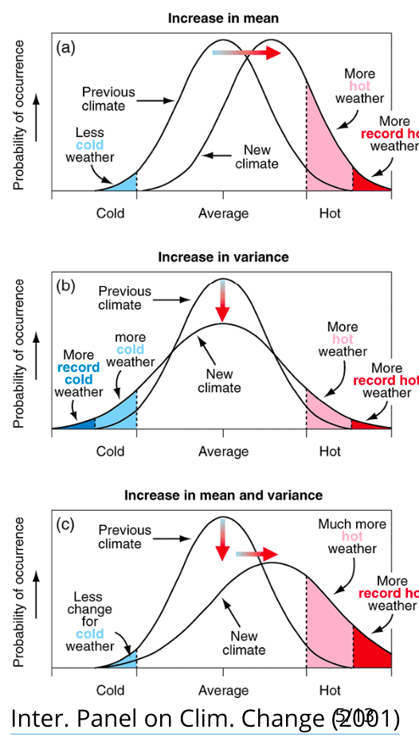
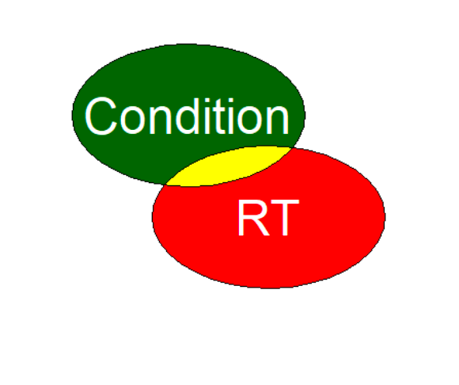

<!-- source: 1_intro_indicateurs.md -->

# 1 traitement de données

- [[i_intro_indicateurs]]
- [[ii_intro_indicateurs]]

BTW c le boss et c'est lui qui décide de tout dans la recherche

Partiel en QCM pas en par cœur mais interprétation de textes, avec partie liée
au CM et une autre liée au TD. Efficacité imoprtante, dont report aux normes
APA. 20% en contrôles continu.

## Introduction

Le but des cours en master est de tout faire par ordinateur, pour devenir
autonome dessus d'ici le 2e semestre.

Il et pas d'accord du tout que les maths sont une science plus pure que la
psychologie, ce n'est pas un niveau analytique meilleur. Dès qu'on fait nos
hypothèse, on doit être capable de se projeter sur les aspects méthodologiques
de notre étude. On doit pas le découvrir au fur et à mesure. Et quand on s'en
tire on fait le design le plus simple possible.

On est très susceptibles aux biais et les statistiques en psychologiques ont
étées faites pour les corriger.

On sera pas interrogés en t-tests et anova, mais lputot sur les modèles
linéaires.

--- start-multi-column: asdfasfd

```column-settings
number of columns: 2
border: off
shadow: off
Column Size: [50%, 50%]
```


--- end-column ---

On a 2 grosses classes de tess :

- Paramétriques : rentrent dans les modèles linéaires, utiles la plupart du
  temps, basé sur variance et moyenne
- Non paramétriques : basés sur ordinaux ?

--- end-multi-column

Mais dans cet arbre, il manque beaucoup d'informations : sur toutes les branches
où il y a ANOVA il y que normalité, indépendance et homoscédasticité. On ne
trouvera jamais de normale dans nos données, c'est une abstraction mathématique
qui fonctionne bien : ce qu'on fait sur une normale marche juste bien pour nos
tests. QI est souvent exemple mais c'est un cas très très spécial.

--- start-multi-column: meow

```column-settings
number of columns: 2
border: off
shadow: off
Column Size: [75%, 25%]
```

On est sensé retenir en L1 est qu'on fait des descriptives pour décrie un
échantillon, et L2 L3 généralisation avec inférentielles. Mais ce n'est pas les
p-values qui nous intéressent, mais **effet** et **taille d'effet**. Les reports
aux normes APA sont très lourds car on doit donner tous les indicateurs.

Ce graphique montre l'importance d'avoir tous les indicateurs. $a$ montre
déplacement de moyenne, et ses conséquences. Pareil pour la variance. Mais on a
jamais juste un changement de moyenne ou variance, il faut donc bien tout
connaître. Bien connaître ça. **Il faut donc toujours rapport toutes les
informations**, d'où les lourdes normes APA.

--- end-column ---



--- end-multi-column

Par exemple on cherche juste si une moyenne $m_1$ a changé après une
manipulation dans la moyenne $m_2$.

$$
b = m_2 - m_1
\tag*{Effet (brut)}
$$

Mais ça ne veut pas dire que ça marche pareil chez tout le monde dans un
échantillon. La moyenne n'existe pas dans les données, elle est calculée dans le
$b$. Cette taille d'effet par participant n'est pas la même, qui dit
variabilité, qui dit variance qui dit écart-type, **soit la variabilité** $s$.

La taille d'effet peut être donnée par plusieurs indicateurs, $d$ de Cohen, $r$,
$r^2$. L'idée du $d$ de Cohen est de combiner des infos pour savoir jsp quoi.

$$
d = \frac{b}{s}
$$

Mais plus on a de patients plus on peut être sûrs de nous, donc $n$ ou
**effectif** ou **taille d'échantillon** est ici très important. La variance
dépend aussi de la composition de notre échantillon, c'est ici que les
statistiques sont importantes. On peut donc combiner $s$ et $n$ pour donner le
$se$ qui nous dit "est-ce que l'effet des variables peut vraiment être beaucoup
plus fort ou faible" ??? > TODO: voir docs en ligne

$$se = \frac{s}{\sqrt{n}}$$

C'est le $sd$ de la moyenne. Il est préférable de minimiser $s$ car le
dénominateur est une racine carrée et est bien plus dur a contrôler.

Et on combine tout dans le t-test qui > TODO: dire pourquoi

$$t = \frac{b}{se} = d\sqrt{n}$$

Donc plus le $t$ est grand plus on peut être sur de nous, mais il est dur à
interpréter donc on le traduit dans un indicateur de 0 à 1, la $p$ valeur, ou $t
= 0$ est $p = 1$. C'est la **statistique de test**. On doit donc reporter tous
les indicateurs qui mènent à le construire.

Donc on veut (dans le cas où on veut que nos patients aillent mieux) un grand
$b$, un petit $s$, donc un grand $d$. Ça marche si on est "juste" des
cliniciens, mais si on veut convaincre les scientifiques il faut un grand $t$ et
un petit $p$.

Il y a un effet (non) significatif de la thérapie entre vant/après (b = + 1
heure, SE = 0.5 heure, t = 2.00, p ~ .05, d = 0.2). Donc oui il y a un effet,
c'est assez variable, t est pas énorme, on est donc pas surs du p, et la taille
d'effet est assez grande.

On peut donc améliorer nos résultats en diminuant la variabilité $SD$ qui va
énormément diminuer le $p$ ; ou on augmente _beaucoup_ $n$.

### Exemples de tests statistique simple

--- start-multi-column:

```column-settings
number of columns: 2
border: off
shadow: off
Column Size: [75%, 25%]
```

La partie jaune est ce qui est expliqué dans les TR par les conditions. Quand on
a VI Prepost VI groupe et interaction on veut savoir qu'est-ce qui est dû à
quoi. On va beaucoup utiliser les diagrammes de Wenn très difficiles pour se
représenter nos modèles. Légende :

- **Patate rouge** : VD, qu'on veut bien expliquer par nos VI, donc on veut les
  patates de VI et VD les plus entremêlées possible
- **Partie jaune** : partie de la VD expliquée par une VI
- **Patate verte** : VI

--- end-column ---



--- end-multi-column

Les statistiques sont une discipline récente.

- Les stats quanti/quanti sont les plus vieilles, faites pour tester l'eugénisme
- Corrélations de Pearson littéralement Hitler, aussi fait $\chi^2$
- Gosset était brasseur en chef de Guiness et à fait le t-test
- Fisher agronome a fait l'ANOVA

C'est donc un gros bazard fait par des gens très différents qui ont pas de très
grosses standardisation. Toutes ces statistqiues de tests ont une variable
explicative et expliquée et on veut savoir la dépendance de ces variables. cohen
a fait la fiabilité $\kappa$ et la taille d'effet $d$ ainsi que puissance et
méta analyse.

> TODO: dans le diapo histoire de maths truc politique

---

<!-- source: 2_stats.md -->

# CM2 Stats

> TODO: peser à faire le contrôle continu

La taille de la patate représente la variance de la variable qui lui est propre.
Dans le cas où la VI n'a aucun effet sur la VD, alors la distribution de Y ne va
pas dépendre de l'axe X. Prendre en compte une VI peut aider a réduire la
variance de la VD, ce qui se traduit en une

--- start-multi-column: meow

```column-settings
number of columns: 2
border: off
shadow: off
Column Size: [50%, 50%]
```

![[2_stats 2026-09-28 13.37.58.excalidraw]]

--- end-column ---

![[2_stats 2026-09-28 14.09.28.excalidraw]]

--- end-multi-column

En psycho on utilise une vision hybride des p-valeurs, entre Fisher et
Neyman-Pearson, et c'est un truc batard.

---

<!-- source: 3_stats.md -->

1. 1
2. 2
3. 3
4. 4
5. 5
6. 6
7. 7
8. 8
9. 9
10. 10

---

<!-- source: 4_stats.md -->

# CM4 Stats

Il faut réussir à être flexible sur les représentations des stats (digrammes de
Wenn, etc., voir la diapo `Schema_symthese.pdf`).

Si on veut savoir qu'il y a une variable qui a un effet sur une autre, on va
utiliser des statistiques descriptives :

- Effet brut (non standardisé) : pente de la droite $b_1$ ou écart-type des
  résidus ($RMSE$)
- Taille d'effet (standardisé) : $d$ de cohen, ou $r$ de Pearson

Inféretielles : pour savoir si l'effet se généralise à la population

- $t$ de student, $F$ de Fisher, et $p$-valeur associée

Méthode : on compare ce qu'on observe a une hypothèse nulle ($H_0$), celle ou
$b_1 = 0$. Sur quoi se baser notre raisonemnet, et comment s'y prendre ?

- Focus sur la pente : $b_1 \neq 0$ ? -> $d$ de Cohen et $t$-test
- Focus sur les résidu : $SCE_{H1} < SCE_{H0}$ ? -> $R^2$ et $F$-test

FIX: faire diapo $R^2$

RMSE trop compliqué pour nous pour l'instant je crois ? Mais $R^2$ est que
descriptif donc le $F$ de fisher est la version inférentielle : "Quelle est
la varaibilité autour de notre variablet quelle est la variabilité autour des
moyennes".

