<!-- source: 1_oeil_frequences.md -->

# EC08 Cognition Visuelle Mermillod

## Présentation

Cours partagé avec Eve où on va parler de plein de choses, un peu complexe et
technique, qui permet de comprendre le système visuel humain et créer des
modèles qui permettent de comprendre son fonctionnement et créer des modèles à
la base de l'intelligence artificielle. 6h de TD où on va devoir présenter des
modèles sur les choses qui nous intéressent sur le thème de la cognition
visuelle (de près ou de loin, pas de note).

Mermillod à fait sa thèse à Liège sur réseaux de neurones. Travaillé sur liens
entre émotions et la vision. A écrit un
[livre sur de l'intelligence humaine à l'IA](https://beluga.univ-grenoble-alpes.fr/nde/fulldisplay?query=mermillod%20intelligence&tab=LibraryCatalog&search_scope=MyInst_and_CI&lang=fr&vid=33UGRENOBLE_INST:UGrenoble_NDE&docid=cdi_cairn_journals_EDPE_240_0169&adaptor=Primo%20Central&context=PC&isFrbr=true&isHighlightedRecord=false&state=#nui.getit.service_viewit)
qui est le support de cours.

L'examen c'est des questions de cours, ouvertes, mais plus simple que le cours
(qui fait peur par rapport à l'examen). La partie d'Eve peut être plus
compliquée.

Appel aux étudiants pour sujets de TER sur l'effet de formations à la transition
écologique sur les comportements. Sont elles efficaces où donnent jsute
éco-anxiété et déni.

## Chapitre 1 : La perception visuelle

### 1. L'œil et la transduction

Caverne de Platon propose qu'on voit des petites parties de la réalité. C'est le
cas pour nous et il a une traduction biologique qui est le phénoème de
**transduction**. L'environnement est composé de photons qui vont être captés
par la rétine (sensations) et sont transformés en électrons, puis interprétés
par le cortex pour reconstruire la réalité. Mais on perçoit très mal la réalité,
qu'une mini portion du spectre lumineux par exemple.

Le but du cours et de comprendre comment on reconstruit la réalité à partir des
informations qui sont captées dans l'environnement. On est dans matrix et c'est
ce que fait un réseau de neurones artificielles : récupérer des informations,
transformation en vecteurs de données de manière électrique pour en faire des
modèles.

Au niveau de la rétine, on a plusieurs couches de neurones, où les
photosrécepteurs sont situés à l'arrière. Plusieurs couches de traitements sont
fait avant l'envoi par le nerf optique. On a plusieurs types de photorécepteurs,
j'écris pas je connais quand même, et ceux-ci sont des neurones spécialisés dans
cette transduction photonique à électrique.

On peut donc considérer la rétine comme un **échantillonneur discret** : les
récepteurs sont capables de traiter de l'information de manière localisée
(discret car on passe d'un signal continue à une mosaïque de récpeteurs
sensibles), chacuns ne sont donc pas sensibles à toutes les longueurs d'ondes.
Pourtant on ne perçoit jamais rien purement rouge/vert/bleu, on a des
traitements qui les fusionnent (même principe que les appareils photo), on passe
d'une mosaïque à une image.

Les cônes sont situés au niveau de la fovéa mais pourtant on a l'impression de
voir la couleur partout. Ça nous montre que tout est reconstruit. C'est au
moment où on balaye le champs visuel qu'on accumule de l'information qui nous
permet de percevoir les couleurs.

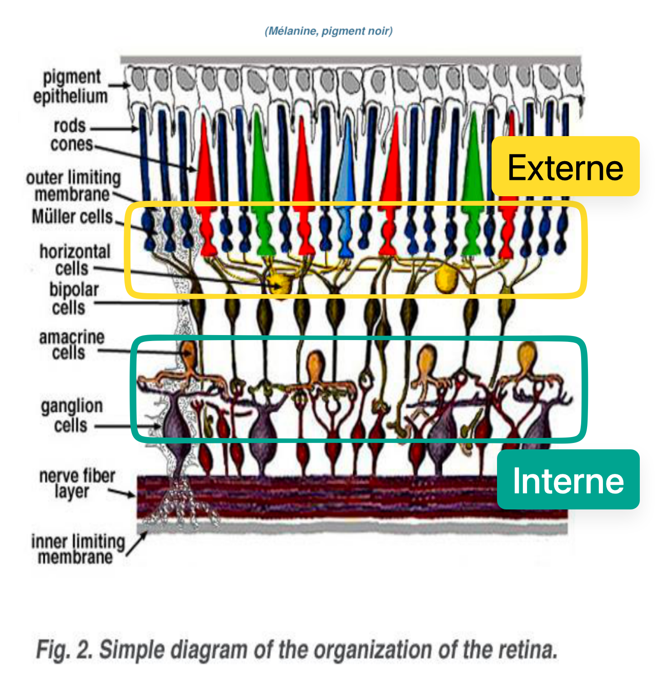

**Couche plexiforme externe** : Lieu de connections synaptiques entre les
photorécepteurs, les cellules horizontales et les cellules bipolaires

**Couche plexiforme interne** : Lieu de connections synaptiques entre les
cellules bipolaires, les cellules amacrines et les cellules ganglionnaires

### 2. Expliquer et décrire l'acuité

Le même processus d'échantillonnage discret opère pour les bâtonnets.
C'est-à-dire qu'on a une limite dans notre sensibilité aux détails, mise par la
finesse physique des récepteurs. Plus ils sont gros, moins les détails sont
fins. Il y a environ 130 millions de bâtonnets, soit 95% des récepteurs, et pour
la plupart des animaux ils ont que des bâtonnets.

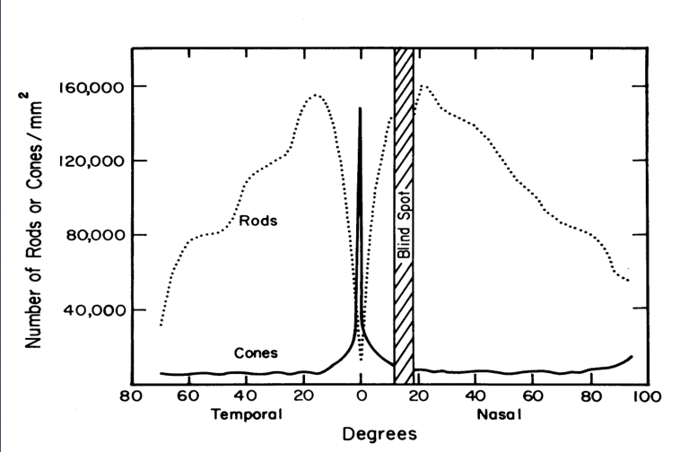

- **Fovéa** : Environ 1.5 mm soit 5 degrés dans le champs visuel. Grande densité
  de cônes, bâtonnets absents du centre de la fovéa (2 degrés).

- **Para fovéa** (Macula Lutea) ou « tache jaune ». Partie circulaire d'un
  diamètre d'environ 6 mm (15 à 20 degrés).

- **Périphérie** : Essentiellement des bâtonnets.

Il existe plusieurs phénomènes expliquant la baisse d'acuité périphérique :

1. 40x plus de cônes en en fovéa qu'en périphérie
2. On a 1 cône pour 2 ou 3 cellules ganglionaires pour les cônes fovéa, alors
   que pour pour les bâtonnets on en compte en moyenne 1500
3. Plus haute densité corticale de neurones traitant les informations fovéalesk

|                             | Système Photopique                         | Système Scotopique      |
| :-------------------------- | :----------------------------------------- | :---------------------- |
| Récepteurs                  | Cônes                                      | Bâtonnets               |
| Nombre de photorécepteurs   | 5 millions                                 | 120 millions            |
| Photo pigments              | 3 opsines différentes                      | Rhodopsine              |
| Sensibilité                 | Faible, vision diurne                      | Élevée, vision nocturne |
| Localisation dans la rétine | Fovéa et Para-fovéa                        | Hors de la fovéa        |
| Taille du champ récepteur   | Petit en fovéa et s'agrandit en périphérie | Plus grand              |

La précision de la rétine va être déterminée par la distance séparant 2
photorécepteurs (environ 2.5µm), et qui est de 60c (**cycles**) par degrés. La
longueur d'onde est définie comme des fréquences spatiales déterminées en cycles
par degrés. Deux points sont perçus commet séparés (dits "résolus") si leur
séparation angulaire est supérieure à $a_s$, avec $\lambda$ longueur d'onde de
la source et $d$ diamètre de la pupille.

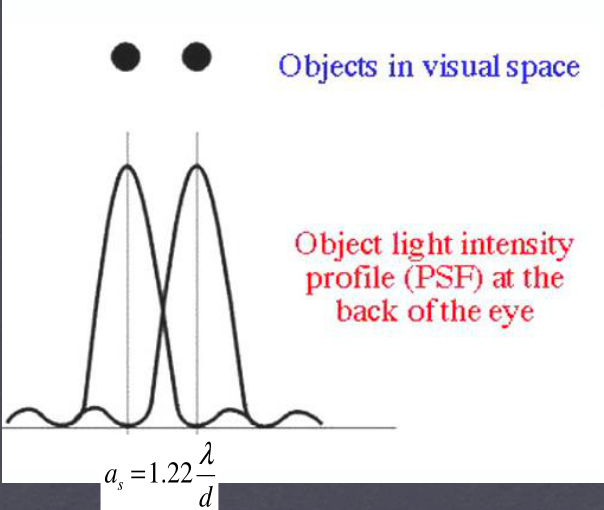

Jusqu'à où pouvons nous descendre pour voir une différence entre 2 stimulus ? On
va utiliser des sinusoïdes qui va être définie par une amplitude et une
**fréquence spatiale** : nombre de fréquences qu'on peut faire passer par degré
d'angles visuels. Le **cycle** est le moment où la sinusoïde passe par le même
point. Notre **acuité maximale** va donc être de 60 cycles par degrés. Celle-ci
peut être fonction de la distance.

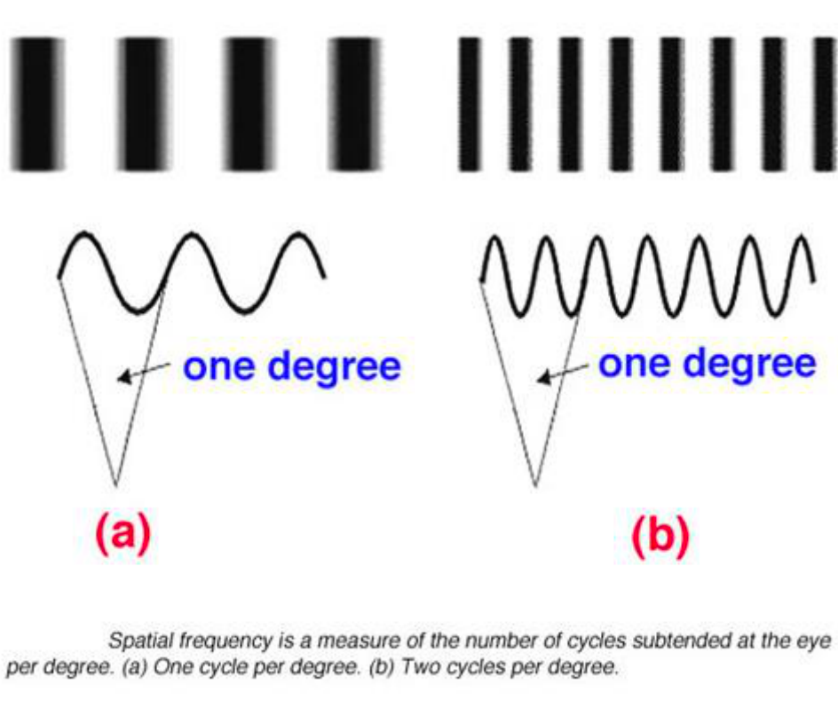

La différence d'acuité n'est pas seulement fonction de la finesse des détails,
mais aussi par le **niveau de contraste perceptif** déterminé par la capacité
d'un photorécepteur à transformer un photon à une information perceptive.

On utilise des outilis informatiques qui permet une mesure rapide et précise
appelé **root mean square** ou **RMS contrast** :

$$C_{RMS} = \frac{L_\sigma}{L_\mu}$$

On prend la variance des pixels de l'image qu'on diminue par la moyenne de
l'image, qui donne le contrate moyen dans une image. On peut aussi le faire pour
tous les canaux de couleur.

Notre système perceptifs à d'autres caractérisitques qui lie le système visuel
au contrate (je crois ?). On a une zone optimale pour l'acuité, vers 7 cycles
par degré (alors que notre max est de 60 c/degrés).

L'image suivante est la **contrast sensitivity function** et décrit une
différence d'acuité qui dépend de l'excentricité. Celle-là est pour la vision
centrale, mais plus on est périphérique, plus ça diminue, part un rapport
$\frac{1}{n}$.

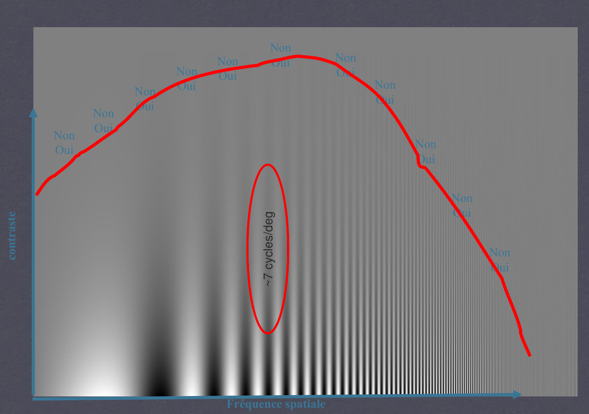

Cette capcité dépend aussi de la maturation du système visuel, qui continue de
se développer jusqu'à l'âge adulte.

### 3. Fréquences spatiales : Approche psychophysique

Dans l'expérience suivante, on stimule les neurones de basse fréquence en haut
et haute fréquence en bas, on va donc les fatiguer, on va donc percevoir les
barres du B qui sont l'inverse des barres A. Cela suggère qu'on a probablement
des voies neuronales différentes pour des stimuli de différences fréquences
spatiales. On aurait des **populations de neurones différentes en fonction de la
résolution de l'image**.

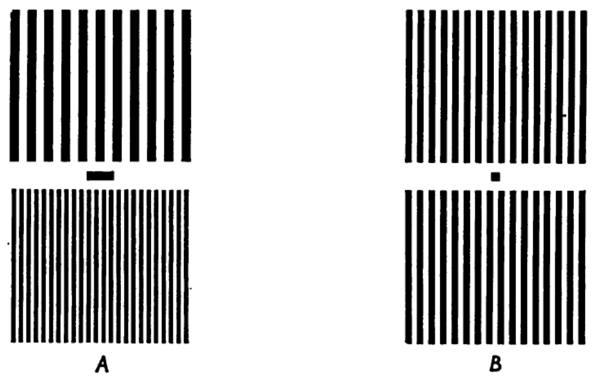

Ce phénomène existe par fréquence spatiales, mais aussi par orientation : tous
les 20º d'orientation visuelle : si on passe du A au D on a pas d'effets. Cela
suggère qu'on a des populations neuronales (colonnes) spécifiques à des
orientations et fréquences spatiales spécifiques.

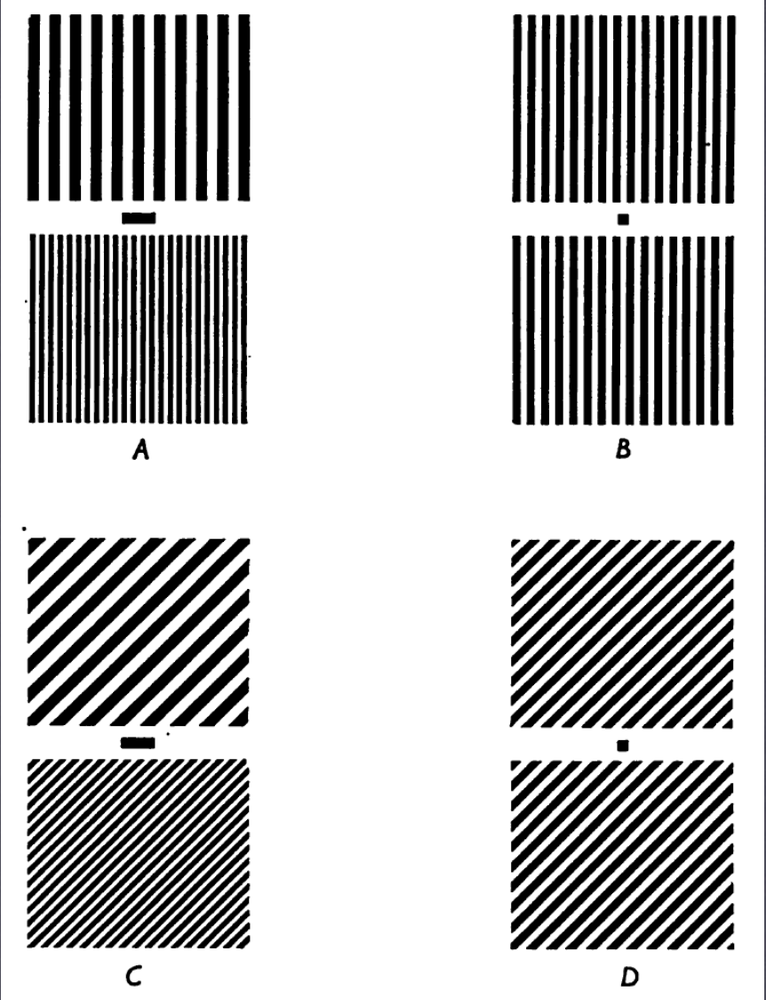

Mais cette preuve est psychologique, on passe par des preuves comportements pour
supposer un effet. On va donc utiliser de manière complémentaire la neuro et
l'intelligence artificielle.

### 4. Fréquences spatiales : Approche computationnelle

Fourier à démontré que : à l'arrivée d'un signal discret (0 ou 1, carré), on
peut le reconstruire par des sommes de sinusoïdes. Mais pourquoi et comment ?

Comment : on prend une sinusoïde fondaemental qui explique le plus de la
variance du signal. Mais si on veut mieux approximer ces sinusoïdes on va mieux
approximer le signal fondamentale. Le E ressemble le plus à A car on la combine
à C et D (exemple plus tard). Donc en gros faire des sommes de sinusoïdes pur
reconstruire un signal de départ.

Les sommes de sinusoïdes idk dik mais JPEG c'est la compression de l'information
visuelle pour prendre moins de place par la transformation de Fourier. Quand on
le fait, on peut choisir le niveau de compression. Ce processus peut être
appliquée sur une image de contexte

Dans l'image suivant, nous pouvons voir le fonctionnement de la transformation
de fourrier cherchant à reproduire le signal à en n'utilisant que des
sinusoïdes. On part de la fréquence fondamentale ($b$) à laquelle on ajoute des
fréquences plus en plus haute, ($c$) et ($d$), ce qui nous done une image
reconstruite ($e$) ressemblant à la fréquence de référence ($a$) par la somme
des fréquences.

Mais ça c'est pour les sinusoïdes unidimensionnelles, nous on travaille sur des
images en 2 dimensions.

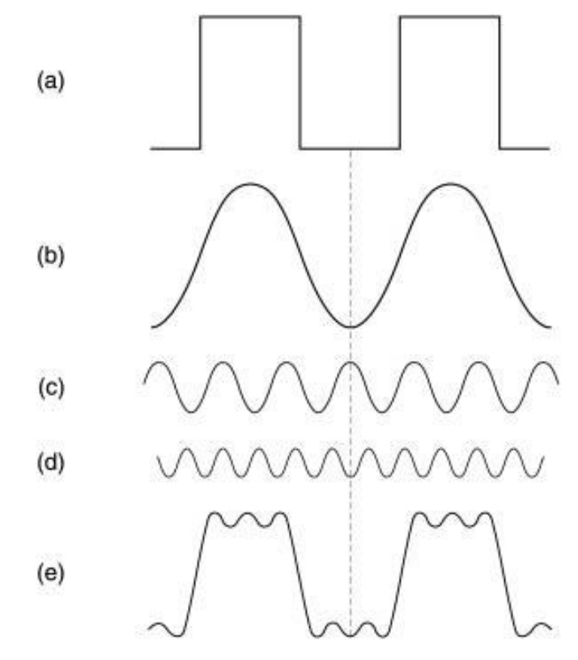

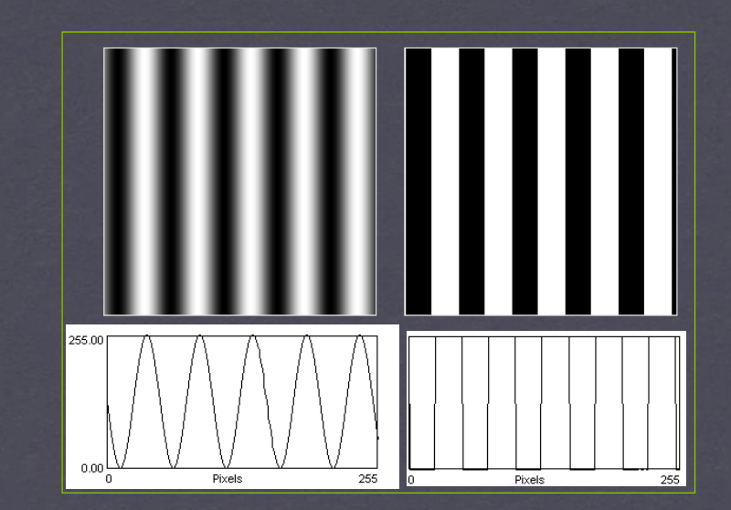

---

<!-- source: 2_approche_neuro_freq.md -->

## CM2 Cognition Visuelle

- [[i_approche_neuro_freq]]
- [[ii_approche_neuro_freq]]
- [[iii_approche_neuro_freq]]

La vision périphérique est en basse fréquencre spatiale est centrale haute
fréquence, mais pourquoi ?

La transformation de fourier fait blalbablabla. Plus c'est clair plus
l'amplitude est grande. Cette image est un spectre d'amplitude qui permet
presque de reconstruire l'image, si on y ajoute la phase. Avec les 3
informations 3 valeurs définissant les sinusoïdes (amplitude, fréquence, phase)
on sait reconstruire l'image d'origine.

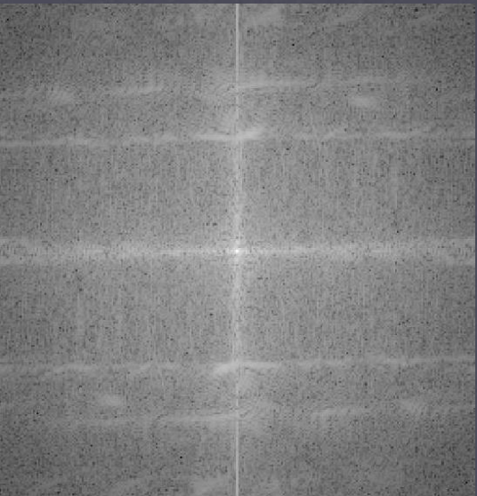

On code les barres verticales par des sinusoïdes horizontales (penser aux
sinusoûdes simples qui font plein de lignes parallèles). On a au centre les
hasses fréquences, les hautes fréquences ne périphérie, plus haute amplitude
pour les basse fréquences et rotation à 90º du spectre d'amplitude. La symétrie
qu'on peut lire dessus est due au fait qu'on reccueille les sinusoïdes x puis y
de l'image à 2 dimensions, donc il y a une symétrie parfaite car l'unité
d'information est une ligne entière de l'image.

On peut s'en servir pour faire des expériences de psychologie et neurosciences.
On peut faire cette transformation et appliquer un filtre, ici en éliminant les
hautes fréquences

![[2_approche_neuro_freq 2026-11-16 14.41.59.excalidraw]]

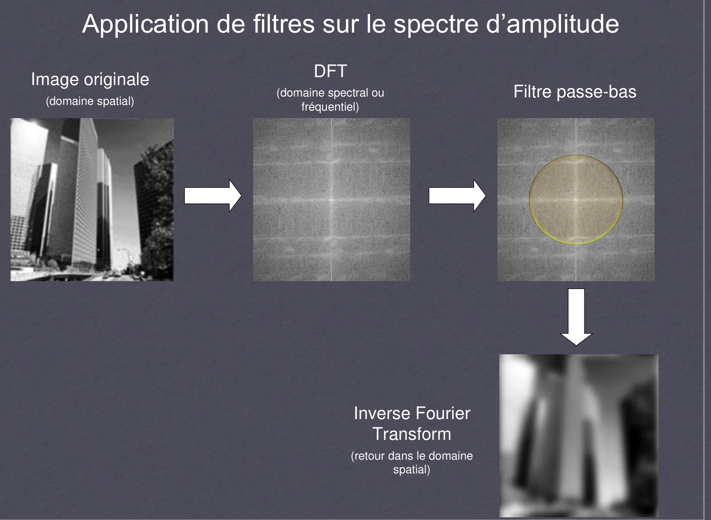

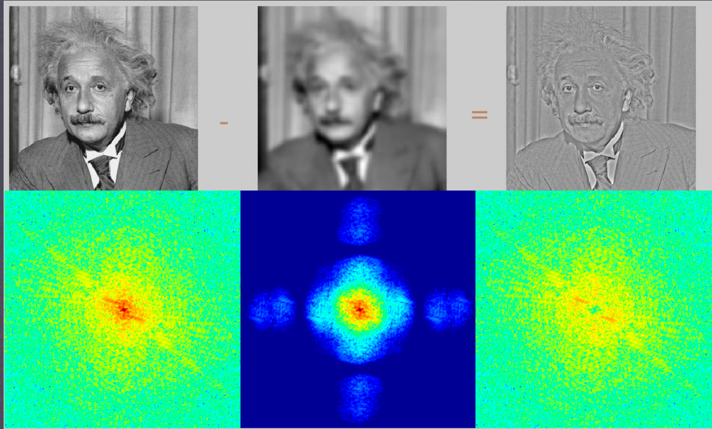

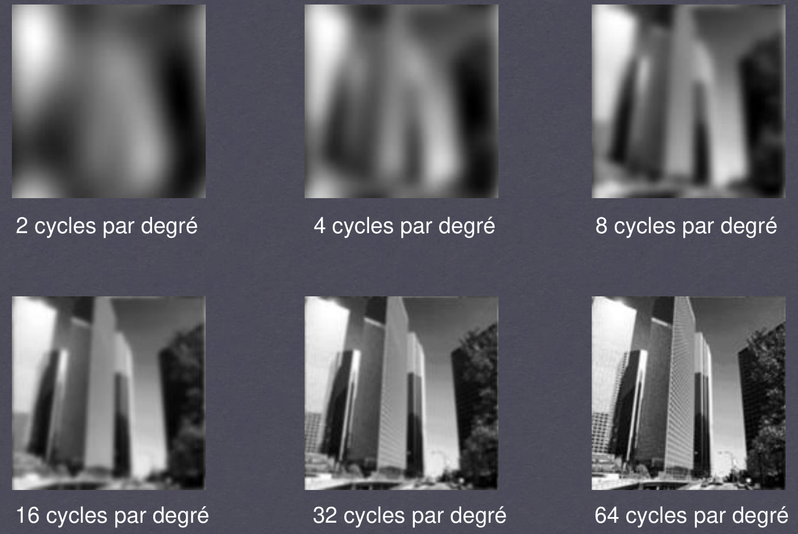

Ici on élargit la gaussienne qui fait office de filtre (pas importande savoir
comment je crois). Sinon, on peut avoir une "bande", et au lieu avoir un
passe0bas qu'on élargie, on va avoir une bande de fréquences sptiales,
fréquences spatiales pour l'utitlié cognitive de différentes fréquences.

Oliva et al. ont montré que quand on prend des spectres d'images, si on découpe
le spectre d'amplitude pour différentes fréquences spatiales, on peut réussir à
classifier les images.

### 5. Fréquences spatiales : Approche neurophysiologique

Goldstein et al. en 2001 testent le champs récepteur des neurones des yeux de
chats en mettant une électrode dans les cellules ganglionnaires. On a mesuré
l'activité suite à un spot lumineux (le chat ne peut pas bouger). La partie
activatrice du champs récepteur réagit avec une hausse d'activation, l'inverse
pour la partie inhibitrice. C'est ici un champs récepteur à centre OFF.

Les photorécepteurs sont reliés aux cellulues ganglionnaires par les cellules
bipolaires, ici une cellule ganglionnaire centre ON contour OFF. Ça explique
donc la forme de champs récepteur en "cible".

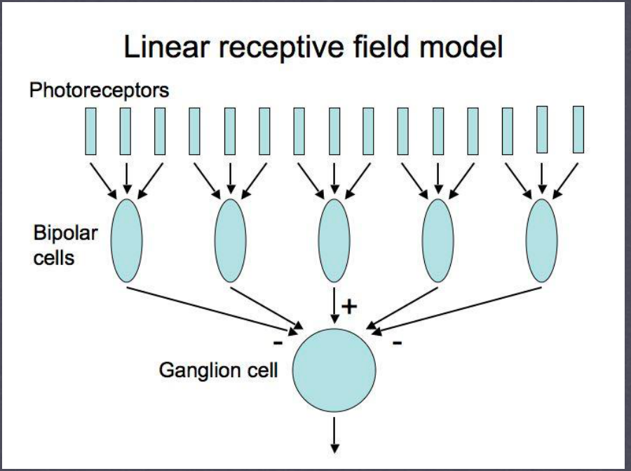

On se rend compt que les champs récepteurs sont adaptés à la capture des
contrastes.

Mais comment est-ce qu'on peut le simuler ? Avec un différence de gaussienne :
une première activatrice avec forte amplitude (rouge) et une deuxième plus
étendue, qui donne la représentation 3d

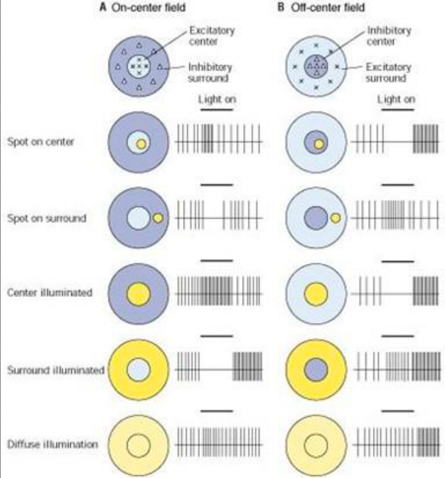

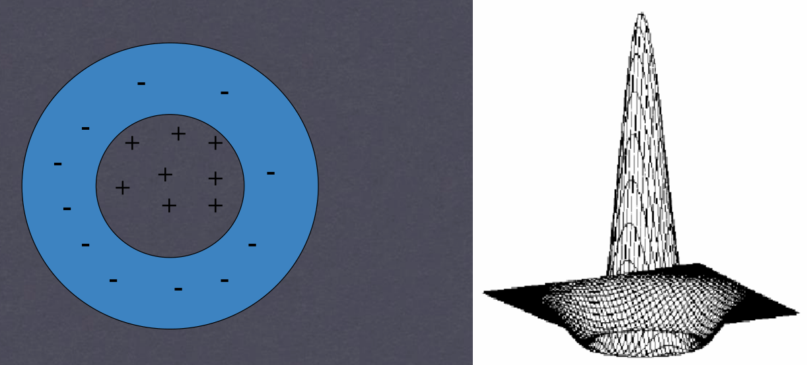

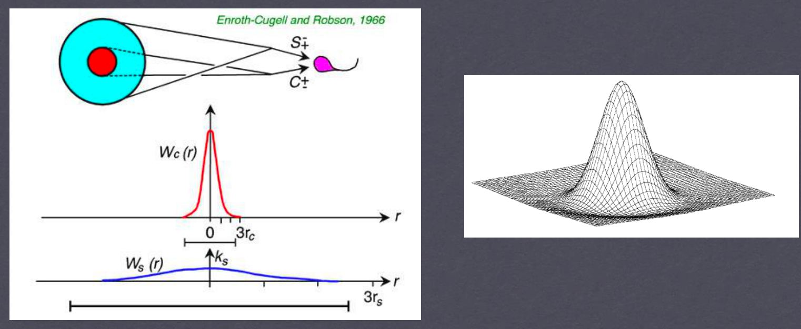

On peut donc représenter une cellule ganglionnaire au niveau computationnel de
cette manière, et faire des simulations. On peut voir qu'elle réagit de telle ou
telle manière selon le stimulus de contraste qu'elle voit. On augmente donc les
contrastes sur les zones qui sont plsu sombres, on fait un réhaussement des
contrastes, c'est-à-dire **blanchir le spectre de Fourier**, ce qui permet une
meilleure reconstruction de l'image.

Blanchir le spectre = l'aplatir : un spectre "blanc" a la même amplitude à
toutes les fréquences, comme la lumière blanche a toutes les longueurs d'onde.
Le filtre centre-périphérie retire les basses fréquences redondantes, ce qui
égalise l'énergie entre fréquences et fait ressortir les contours (l'image garde
sa structure, pas sa luminance absolue).

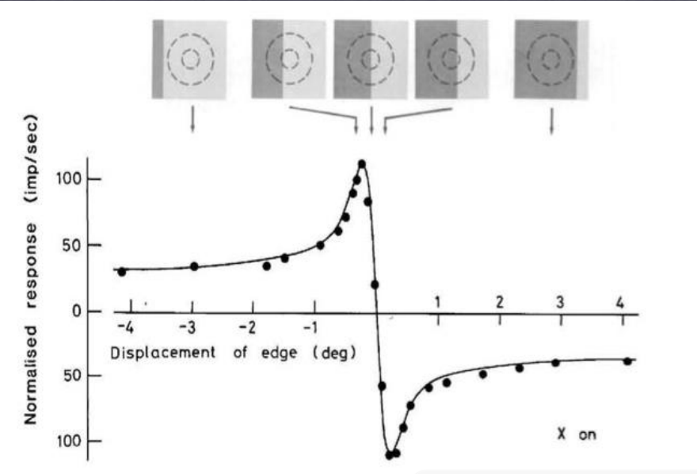

Les cônes ont une réponse **tonique** : il envoie continuellement du spike tant
qu'il est stimulé. Cependant, les bâtonnets ont une réponse **phasique**, ils
ont une meilleure précision temporelle.

Dans le LGN il y aurait une voie directe qui permettrai la voie directe vers
hippocampe-amygdale, qui font lien émotionnel (peur, etc), et on a montré que
dans le LGN on a toujorus ces différences de gaussiennes (des champs
récepteurs). Une autre de leur caractéristiques est leur différentes voies :
quand on fait une coupe du LGN on a plusieurs couches parvocellulalaires,
reliées aux hautes fréquences soit la foveea, et magnocellulaire, dont la taille
de la gaine de myéline permet une réponse plus rapide, en lien avec la réponse
phasique (rapide) qui permet la réactivité de cette voie.

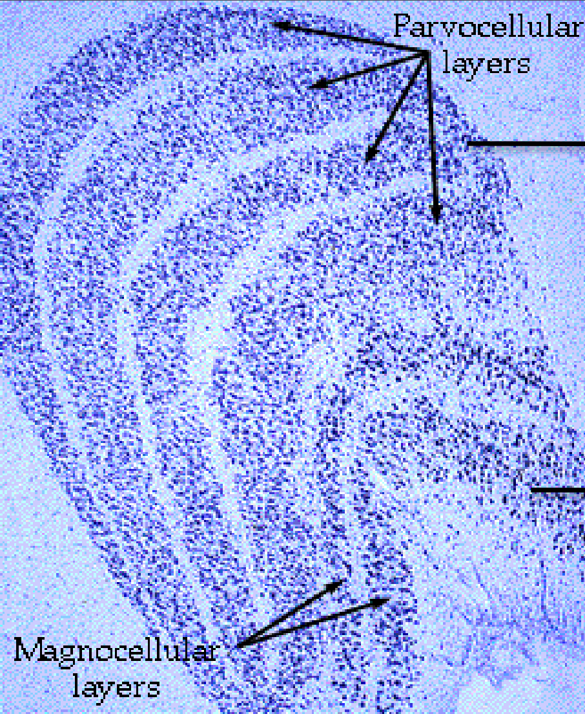

Toutes les cellules :

- Alpha : beaucoup de dendrites et donc convergence vers les magnocelluluaires
- Beta : connectés aux parvocellulaires, opposition vert/rouge
- Gamma : reliées aux konyocellulaires, beaucoup plus éparses, connecté via Lgn
  et colliculus supérieur, opposition bleu/jaune

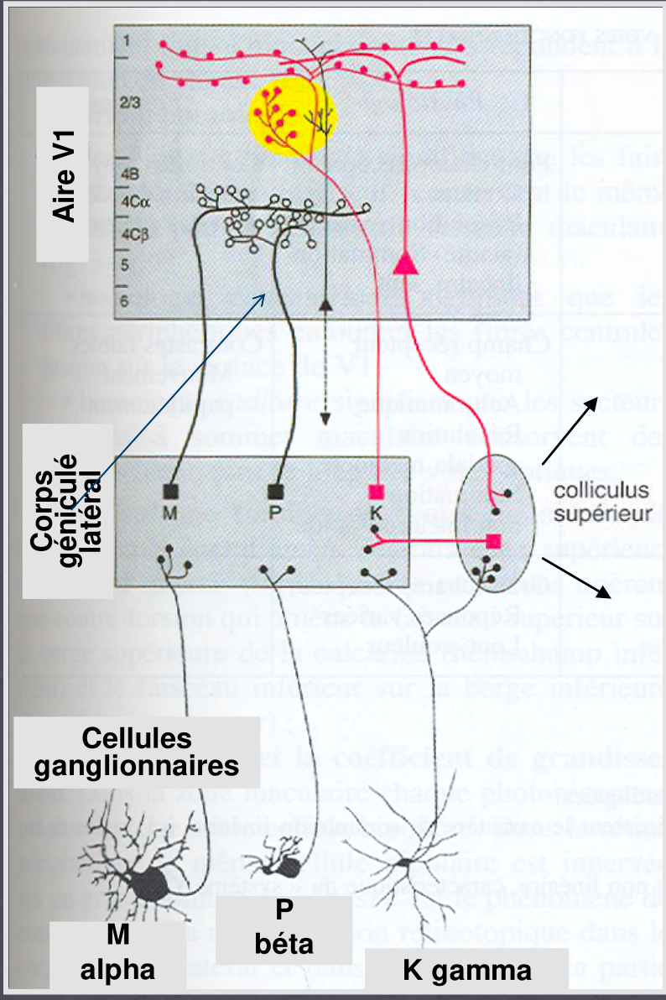

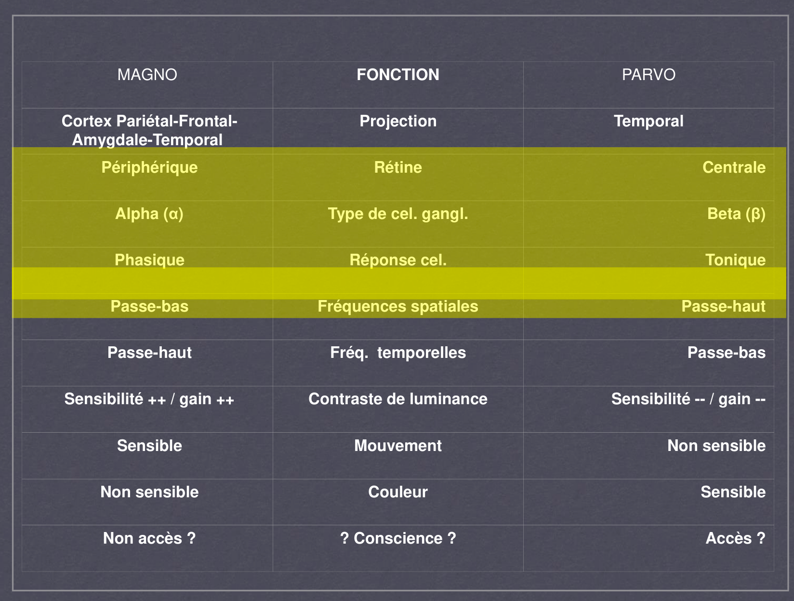

Plusieurs cellules ganglionnaires forment un nouveau type de champs récepteut
par **pooling** au niveau des cellules de V1, et forme ici une fonction de
Gabor. On passe donc de différences de gaussiennes à fonctions de Gabor. Cette
fonction est une sinusoïde à deux dimensions.

![[2_approche_neuro_freq 2026-11-16 16.13.13.excalidraw]]

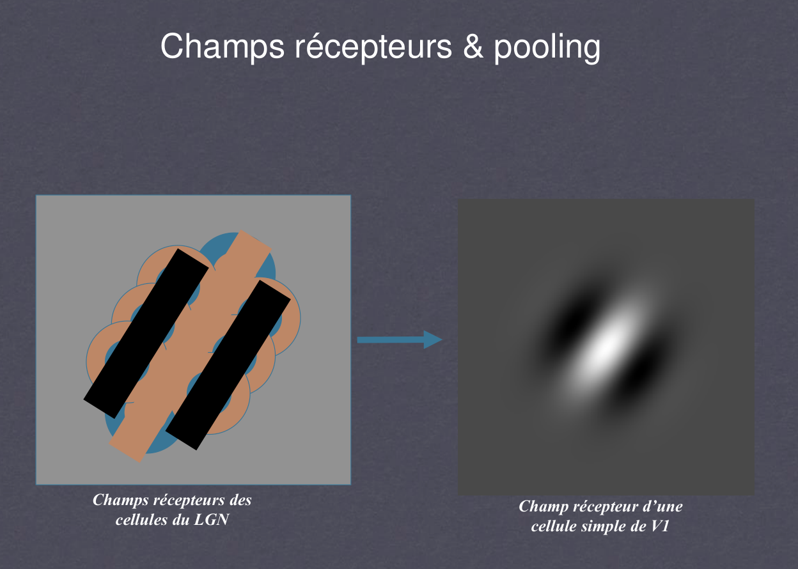

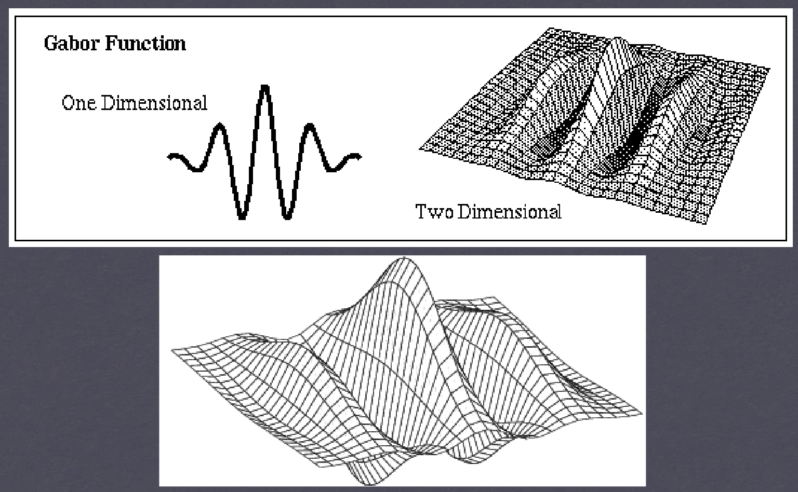

Donc les neurones de V1 appliqueraient des Gabor de différentes fréquences et
orientation (tous les 20º d'angle visuel). Donc on a des pooling par Gabor sur
différentes fréquences et orientation, autrement dit des détecteurs de barres
orientées avec une fréquence spatiales préférentielles.

Gabor est définie par une sinusoïde (fréquence et orientation) et une gaussienne
(zone de réception dans un petit espace local). Soit "quelle fréquence à quel
angle", et "où". Ça modélise bien le pooling car les cellules de V1 regroupenent
plusieurs centres récepteurs qui forment un "filtre allongé", sélectif à une
orientation car est dans une direction partiuclière et fréquence car la distance
entre zones ON et OFF détermine la largeur de la barre qu'il peut détacher.

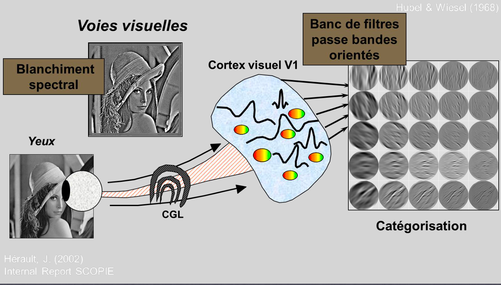

Il se déroule ensuite un nouveau processus dans pooling dans V1 qui récupère
pusieurs cellules simples codant pour la mˆ´me fréquence spatiale et orientation
à différnetes parties du champs visuel. Cela donne une **cellule complexe**
codant indépendamennt de la position : c'est pour ça que le spectre de phase
n'est pas si important.

> TODO: mais dcp qu'est-ce qui code la sinusoïde ? si chaque sinusoïde est pas
> sur la même phase comment on peut coder des gabor ?

Ça nous arrange car, quand on faisait des IA à l'époque, c'étrait très couteux
de faire des convolutions sur toute une image.

Rosenblat découvre le perceptron, avec règle de Hebb, et un gars plus tard
perceptron multicouche qui fonctionne avec de l'information

---

<!-- source: 3_cog_visuelle.md -->

# CM3 cog visuelle

Preuves mathématiques sont arrivées en 2018 pour montrer que modèles convolutifs
sont insensibles à la phase, bien après les CNN qui l'ont fait, donc on a eu les
modèles bio-inspirés avant les mathématiques.

Dans V1 (organisation rétinotopique) information de couleur se situe dans les
blobs. Attention aux panneaux d'incendie. Le vélo, c'est très bien quand on est
en ville.

## Chapitre 2

Vision est un quart du cortex.

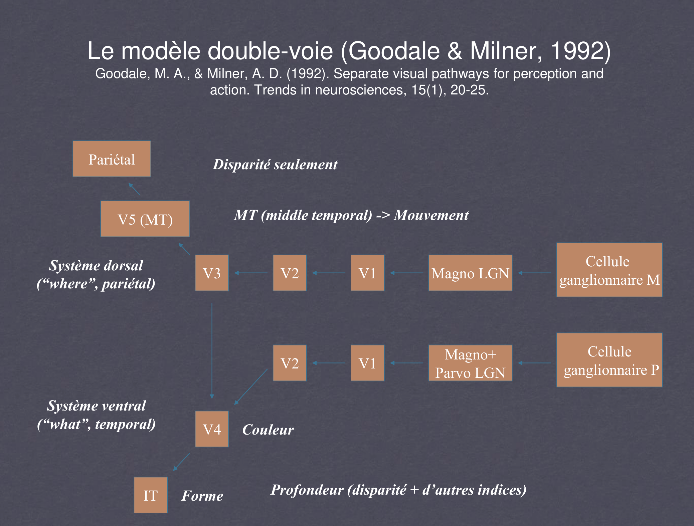

Dans le cortex inféro-temporal, on a des neurones qui sont sensibles à des
formes spécifiques, comme des étoiles avec beaucoup d'angles. On découvre même
des neurones **category-specific**, spécifiques à la catégorie de stimulus
chaise. C'est-à-dire un neurone chaise. Mais c'est tout à fait envisageable avec
une vision distribuée de la cognition. Ceux-ci sont indépendants de la position
grâce au processus de convolution-pooling qui augment processus d'abstraction.
On observe aussi une invariance à la taille, Quelle que soit la distance, on est
capables de coder pour l'objet, ainsi qu'aux caractéristiques de surface.

Conclusions :

- Les cellules répondent à des fautes ou catégories, mais il n'y a pas de
  cellules grand-mère
- Diverses propriétés d'invariance observée
- Organisation en champs récepteurs/pooling similaire aux processus à l'œuvre
  dans le deeping learning

Quand on donne une scène naturelle à un CNN, il fait toujours des Gabor à partir
des stimulus dans les premières couches. Mais qu'est-ce qu'une convolution ?

---

<!-- source: 4_cog_visuelle.md -->

# CM4 Cognition Visuelle

Histoire des IA

On a remplacé loi hebbienne par loi de descente du gradient, qui optimise
l'apprentissage et permet de trouver de fonctions non-linéaires, qui limitait
avant le premier perceptron. Toute la puissance de l'IA est de créer des modèles
non linéaires.

On peut compresser l'information par les convolutions des champs récepteurs. Ces
convolutions sont des matrices de 3x3 qui vont coder des formes primitives, et
une fois compressé, on fait du pulling pour rassembler les traits utiles pour
une tâche donnée. On passe de filtres élémentaires à généraux. Et par
apprentissage, on retrouve des Gabor qui vont eux-mêmes être convolués et pull,
et on va monter en abstraction vers des vraies figures de nez, visages...
L'information n'est pas pour autant localisée, on reste distribué.

Dans des premiers modèles d'IA, on passe de transformation de Fourier, à filtres
de Gabor (cellules complexes), puis dans le perceptron multicouche.

Rosenblatt a fait le premier réseau de neurone artificiel. 80's on passe de
perceptrons aux perceptrons multicouches, avec l'utilisation de descente du
gradient avec les dérivées des erreurs. La nouvelle révolution est le couplage
de perceptrons multicouche et couches convolutions-pulling et ils proposent les
deep neural network ou DNN.

Conférence NIPS 2012 a montré la puissance du deep learning. On a montré qu'il
fallait just des données à ces systèmes pour apprendre, ils sont donc allés voir
Google. 3 grands facteurs de la révolution :

- Marketing avec rebranding en "deep learning" de ce qui existe depuis les
  années 80
- Grosses bases de données
- Cartes graphiques

Les transformeurs sont des multiplications de matrices, appelées couches
attentionnelles, on prend des séquences de mots appelés tokens qu'on multiplie
en matrices de covariance de données d'entrée. C'est ce qu'apprend le perceptron
multicouche qui capte des relations à longue distance.

On s'est ensuite intéressé à dépasser l'imitation de la perception et passer à
l'intelligence humaine. On le faisait avec plein de jeux vidéos, puis échecs et
go, qu'on ne pensait pas pouvoir se faire battre, car trop de possibilités. On
va utiliser des algorithmes génétiques, ils font des cycles d'apprentissage sur
les meilleurs et meilleurs modèles, et puis ça réussit. On a confronté ce modèle
à Stockfish qui lui explore juste toutes les possibilités avec force brute de
computation.

Mais la vraie vie est différente que les échecs, on a fait jouer des **réseaux
de neurones à StarCraft, le jeu de la vie humaine.** From scratch, il se fait
battre. Là il nous explique comment fonctionne StarCraft, certains gars, il faut
rush pour gagner en trois minutes, on utilise les Zergs ici. L'IA a utilisé
Protos pour faire du rush ce qui serait du jamais vu. Donc, on s'éloigne de
l'imitation de modèles, enfin en fait, elle génère ses propres règles.

IA mieux que humains pour coopérer avec les humains. League of Legends c'est
Dota avec moins de farming, dérivé de Warcraft. Emplois en ergonomie cognitive
chez Riot Games. Vrai adversaire est le maillon faible de notre équipe, et quand
le maillon faible se fait tuer alors adversaire est trop fort et c'est très
énervant. Les humains il s'insultent et ici elles sont meilleures que les
humains, elles quittent pas la game.

Limites éthiques de IA : AlphaFold qui peut faire des virus, autre qui fait
atômes entre eux et fait des découverte bien plus rapide que tout le monde.

Mais qu'est-ce que l'IA peut faire de bien ? CNN fonctionnent similairement à la
cognition visuelles, avec certaines différentes.

On a plus de connections top-down que l'inverse dans le cerveau. Les LGN ont 70%
de connexions latérales ou d'afférences do cortex. C'est pas le cas des IA je
crois.

---

<!-- source: 5_oeil.md -->

