# Partie II - E. Dupierrix

## Introduction

Il y a l'expérience phénoménologique consciente immédiate en 3D, riche,
détaillée, unifiée, continue. Il y a plusieurs processsus qui produisent cette
expérience, sensoriels, perceptifs, attentionnels, cgonitifs, et décisionnels
moteurs. On peut donc considérer que c'est le résultat de plusieurs processus
complexes non conscients.

Il faut donc vraiment faire la distinction expérience phénoménologique,
processus objectifs, et la mesure (VD). On se demande si la perception est
modulée par les processus cognitifs. 2 extrêmes : encapsulée (Fodor) ou très tôt
influencée par les processus cognitifs (perméabilité cognitive). Il faut enfin
faire la distinction entre processus purs et non perceptifs (e.g. décisionnels
moteurs). On va donc souvent utiliser des méthodes psychophysiques pour faire la
différence entre processus sensoriels/perceptifs et des processus décisionnels,
dont on essaie de s'extraire.

La sensation serait la détection d'une stimualtion visuelle par les récepteurs
sensoriels. La perception est le produit du traitement de l'information visuelle
par le système visuel & cognitif. La grosse distinction est que la sensation on
ne sait pas ce que c'est, c'est juste une détection sans le traitement de
l'information, l'interprétation. Pas de frontière précise.

Percevoir n'est pas que la reconnaissance des scènes ou objets. Bien que ça
l'inclut, il y a la lecture, perception des émotions, perception de l'espace
(3D, taille, distances, positions orientation). De manière plus particulière,
les processus attentionnels, qui compliquent les choses car ils prennent une
part inconnue de la perception (et ce n'est pas uniquement la direction du
regard).

Pour répondre aux enjeux de neuropsychologie (prendre en charge, rééduquer,
compenser les troubles), il faut donc qu'on agisse sur la vision. On va donc
essayer d'isoler les processus importants dans la perception visuelle, malgré
les contraintes du traitement du signal visuel.

## Chapitre 1 - Traitement précoce de l'information visuelle : Extraction des caractéristiques visuelles de la scène

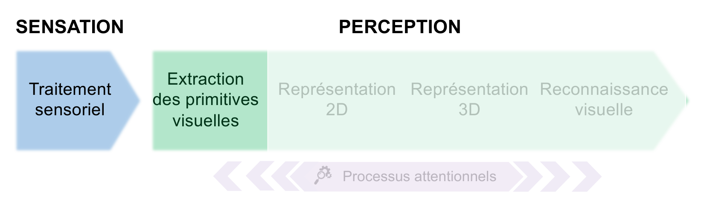

::: {.callout-tip title="Objectifs pédagogiques"}
- Comprendre les **contraintes biologiques**
- Comprendre les conséquences de ces contraintes sur le traitement du signal et
  de la fonction visuelle de manière générale
- Identifier les principales atteintes, précoces, périphériques et centrales et
  leurs conséquences sur le traitement du signal et la fonction visuelle
- Atteintes du système visuel sur le fonctionnement du système visuel et le
  traitement précoce du signal
- Quand on voit une pathologie, il faut qu'on se demande en quoi c'est cohérent
  avec les modèles et en quoi ça permet d'expliquer.
:::

### A. Organisation hiérarchique de la voie rétino-géniculo-corticale

#### 1. L'œil et la rétine : du signal lumineux à la représentation neuronale

##### Les contraintes du système optique sur le signal visuel

Le signal transmis du système optique ("**transduction**") est assez pauvre, il
ne transmet pas une scène, et exerce des contraintes sur le système visuel et va
participer à une sorte de **décomposition** ou "dégradation" (mais pas au sens
négatif, c'est vis-à-vis de l'expérience subjective) du signal. Par exemple, la
tâche aveugle va créer une perte d'information à un endroit donné. Information
compensée par reconstruction grâce au signal de l'autre œil.

Caractéristiques de la rétine :

- Distribution particulière des cônes et bâtonnets (on connaît)
- Convergence des photorécepteurs différente selon la position (on connaît)

Le **signal va surtout être contraint** en acuité visuelle par différents
phénomènes :

- **Diffraction** : du fait quel a lumière traverse un système aqueux, elle se
  transforme en onde au niveau de la rétine, on va donc perdre de l'acuité. Il
  faut donc un espace minimum entre 2 points pour les différencier.
- **Échantillonnage** : espacement entre les photorécepteurs
- **Taille des photorécepteurs**
- Taille du **champ récepteur** de la cellule ganglionnaire
- **Résolution non homogène** de l'œil

Exemple : on a 2 points dans l'environnement, qui doivent stimuler 2 récepteurs
séparés. Il faut donc 3 photorécepteurs. Quelle est donc l'acuité rétinienne max
?

Ces contraintes s'expriment dans une expérience où on présente aux sujets
plusieurs dégradations de floutage autour d'un élément d'une même scène
visuelle. On fait fixer ce point ou non, et si on fixe on ne voit pas que
l'image n'est pas nette. Ça indique que le floutage correspond à la perte
naturelle d'acuité visuelle.

Hyper représentation de la **vision fovéale-centrale** à cause de 4 facteurs,
qui font que notre système visuel est donc centré sur le traitement du centre du
champ visuel :

- Petitesse des cônes
- Densité accrue des récepteurs
- Champs récepteurs plus petits
- Macula, qui ne fait qu'un pourcent de la surface rétinienne est représentée
  sur la moitié du cortex strié

L'œil ne fournit pas une copie de l'environnement. C'est un **organe "actif"**
en quête constante d'informations. Il explore la scène par plusieurs mouvements :

- Saccades (sélection de l'information)
- Réflexe opto-cinétique ou nystagmus (stabilité de l'image)
- Micro saccades de l'œil (légers tremblements)

On va avoir des périodes de "trous informationnels" à cause des saccades de
l'œil. On a donc pas du tout la scène globale qui est transmise au cerveau.

##### Évaluer l'acuité visuelle

Q'est-ce que la définition légale de ne pas voir ? On a 5 catégories de
déficiences (la personne doit être évaluée avec ses lunettes ou lentilles de
contact) :

- Légère
- Modérée
- Sévère
- Cécité
- Déficience pour la vision de près

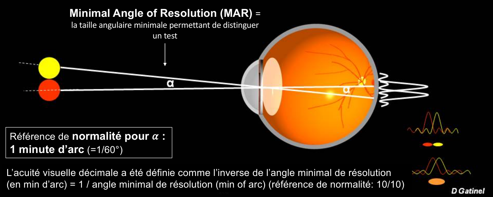

L'**acuité visuelle** (AV) mesure le pouvoir séparateur de l'œil à contraste
maximal.

- **Minimal Angle of Resolution (MAR)** : taille angulaire minimale permettant
  de distinguer un test.
- **Acuité visuelle décimale** : inverse de l'angle minimal de résolution
  exprimé en minutes d'arc, soit $AV = \frac{1}{MAR}$ (référence de normalité :
  10/10).

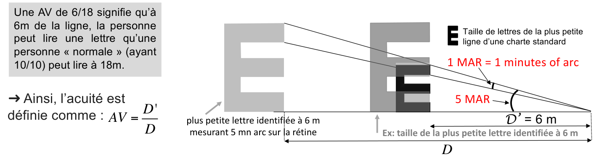

**Acuité de Snellen**, première mesure de l'acuité :

::: {.columns}
::::: {.column width="67%"}
- **La mesure** : on cherche la plus petite ligne d'une charte de lettres que le
  patient est capable de lire à 6 m.
- **La calibration de la charte** : la distance est réglée pour que, sur la
  rétine, les lettres de cette ligne mesurent 5 minutes d'arc et les traits qui
  les constituent 1 minute.
- **$D'$** : la distance à laquelle une personne sans déficience visuelle
  (10/10) doit pouvoir lire cette ligne --- soit 6 m pour un 10/10. À 10/10, **1
  cycle = 2 MAR**, soit **30 c.p.d**.
- **$\alpha$** : la taille d'un **optotype** (la plus petite distance qu'on peut
  voir sur la charte du médecin, je pense). On ne le calcule donc pas sur un
  cycle : on n'est pas sur le même principe. C'est la distance $\alpha$ entre 2
  objets.
- **Lire un score** : une acuité de 6/18 signifie qu'à 6 m de la ligne, la
  personne lit une lettre qu'une personne normale lit à 18 m (≈ 0,33 en acuité
  décimale).
:::::

::::: {.column width="33%"}
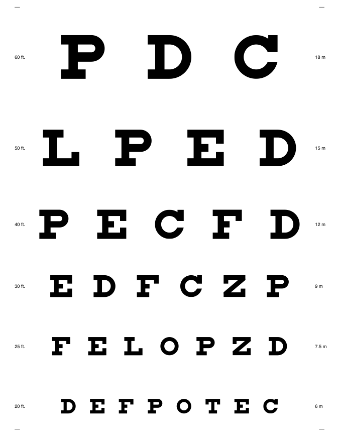
:::::
:::

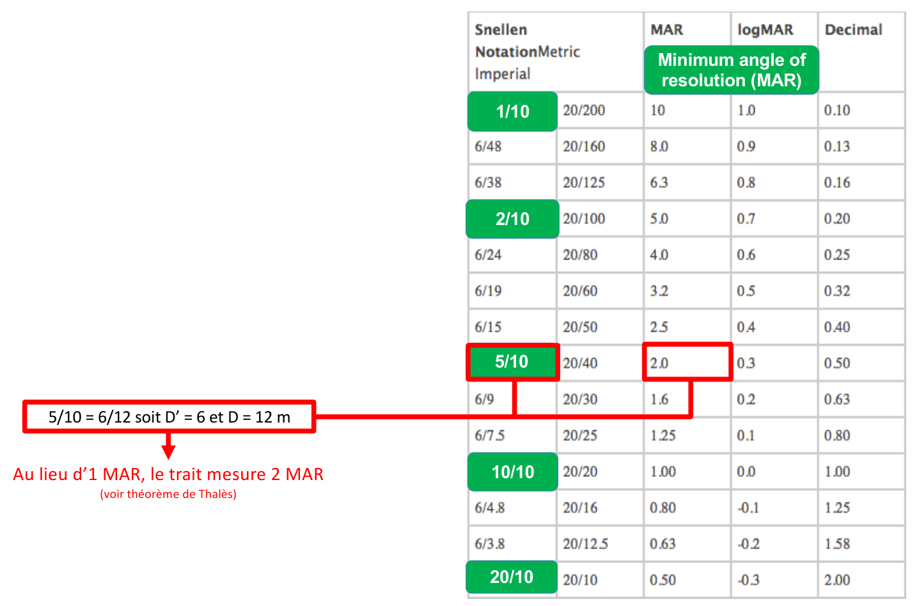

Limites :

- L'acuité mesurée avec des optotypes ne mesurent que la **résolution maximale**
  du sujet
- Mesure non écologique, qui s'applique mal aux objets **moins contrastés**

On en a tenté une variante, avec une charte du même type où les lettres sont de
moins en moins contrastées plutôt que de plus en plus petites. Mais il , mais
évalue toujours en vision centrale.

On va donc utiliser la **contrast sensibility function** (CSF) (x : fréquence
spatiale, y : contraste) qui peut être faite à différentes excentricités : on
place le patient à 1m et lui demande jusqu'à quelle hauteur il est possible de
percevoir l'alternance de bandes claires et foncées. L'acuité change donc en
fonction du contraste.

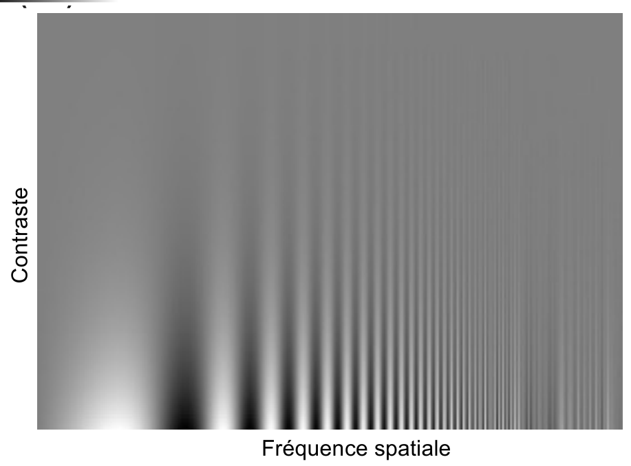{width="70%"}

Unités liées aux fréquences spatiales (différentes des dernières !) :

- $L$ : largeur d'un cycle en centimètres
- $D$ : distance d'observateur par rapport à l'écran en centimètres
- $\alpha$ : valeur angulaire de $L$ (ou **période**)

La fréquence se déduit de la valeur angulaire d'un cycle, $L = \alpha$
(période), par la formule $F = \frac{1}{\alpha}$. On exprime l'acuité d'un
patient en cycles par degré (*c.p.d*). (Rappel : une minute d'arc fait 60
degrés).

Donc, pour faire la **conversion avec l'acuité de Snellen** :

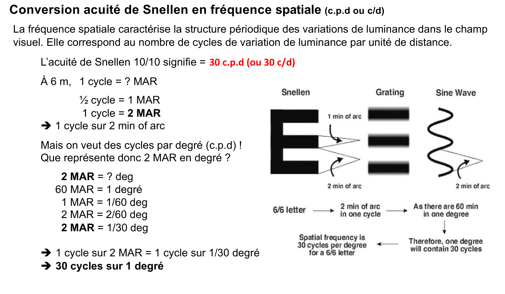

#### 2. Les atteints visuelles périphériques et syndrome de Charles Bonnet

Ces pathologies ont un impact sur le signal visuel envoyé au cerveau, et on veut
savoir comment le cortex va s'y adapter et comment le cerveau va changer. (but
de cette section est juste d'avoir une idée générale)

**Dégénérescence maculaire liée à l'âge** (DMLA) :

::: {.columns}
::::: {.column width="50%"}
Accumulation de "drusens" au niveau de la macula qui évolue vers une
dégénérescence des cellules, dégradant donc la macula. Manifestations cliniques :

- Perte de la vision centrale progressive
- Baisse d'acuité visuelle, difficultés de lecture, déformations de certains
  objet surtout lignes droites
- Tâche centrale noire ou grise
:::::

::::: {.column width="50%"}
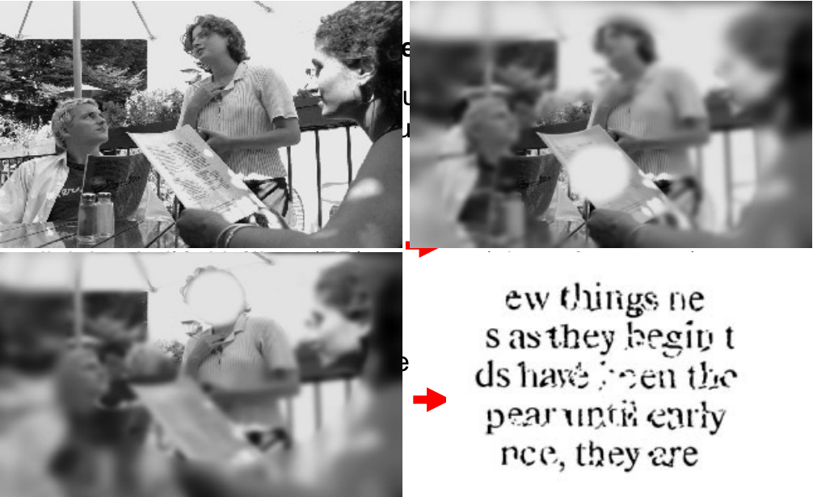
:::::
:::

Remédiation par médicaments, suppléments, bref traitement oculaire.

<!-- source: 6_cog_visuelle.md -->

**Dépigmentations rétiniennes** : perte des pigments des récepteurs, bâtonnets
puis cônes. Se développe par une vision en tunnel puis vision centrale jusqu'à
cécité. Bilatéral et grande variabilité.

**Glaucome** : pression dans l'œil causé par un manque d'évacuation de l'humeur
endommage le nerf optique.

**Cataracte** : opacification pathologique du cristallin qui réduit
progressivement la vision. Altération de la vision des couleurs.

**Rétinopathies diabétiques** : 40% des diabétiques, perte de l'étanchéité des
capillaires rétiniens, ischémie, donc néovascularisation comme en DMLA causant
des œdèmes oculaires décollant la rétine.

Le **syndrome Charles Bonnet**, pouvant survenir dans toutes ces pathologies
périphériques, cause des hallucinations visuelles, mais pas de psychose, le
patient est conscient du trouble. Hallucinations visuelles rétinopathies ou
ophtalmopathiques.

Ça fait penser au membre fantôme : déficit à un membre, qui cause des
perceptions là-dedans. Ça fonctionnerait par rétro-injection sur V1, provenant
des aires visuelles devenues excitables par l'absence de stimulation, qui ne
reçoit plus d'afférences sensorielles rétiniennes signalant l'absence signal
visuel.

<!-- Règle de contro-latéralité de la vision : effet de superposition verticale -->
<!-- médiane visuelle. Dans la figure du haut, la zone de chevauche ?? -->

#### 3. De la rétine vers le cortex moteur primaire

::: {.callout-info}
Cette partie à très peu de notes car beaucoup de choses déjà vues en licence.
:::

Il y a une angle d'environ 2º d'angle visuel de chaque côté de la fovéa où les
hémichamps visuels se chevauchent, ce qui veut dire que cette bande (ainsi que
la fovéa) est traitée par les deux hémisphères.

Structure en 6 couches du **LGN** pour séparer les cellules M et P. P sur les 4
couches supérieures, M les deux inférieures. Dans V1, il y a un codage
**spatial, local et dimensionnel**. On analyse la scène champ récepteur par
champs récepteur. Les dimensions codées localement sont luminance, couleur,
orientation, fréquence spatiale, mouvement, disparités. On a donc un codage
d'une multitude de cartes rétinotopiques.

#### 4. Atteintes des radiations optiques ou du cortex primaire

##### Hémianopsie & Blindsight

**Hémianopsie latérale homonyme** (HLH) : hémianopsie dans laquelle la perte du
champ visuel se situe du côté opposee à la lésion l'ayant entrainée. Homonyme
car le champ visuel perdu est, par rapport au malade, du même côté pour les 2
yeux. C'est une preuve de l'organisation rétinotopique du système au niveau de
V1.

Dans la cécité corticale (atteinte de V1) : rétrécissement du champ visuel,
manifeste phénomène de **blindsight**. Il y en a 2 types dans la littérature :

- **Type 1** est performance supérieure au hasard sans perception
- **Type 2**, impression vague, expérience subjective floue, et toujours
  supérieur au hasard.

::: {.columns}
::::: {.column width="50%"}
L'**analyse périmétrique** est une tâche comportementale qui permet de savoir
précisément la topographie du champ visuel aveugle. On présente des baguettes
orientées, et il doit donner 3 types de réponses : verbalement, réponse
manuelle, réponse motrice (attraper la baguette).
:::::

::::: {.column width="50%"}
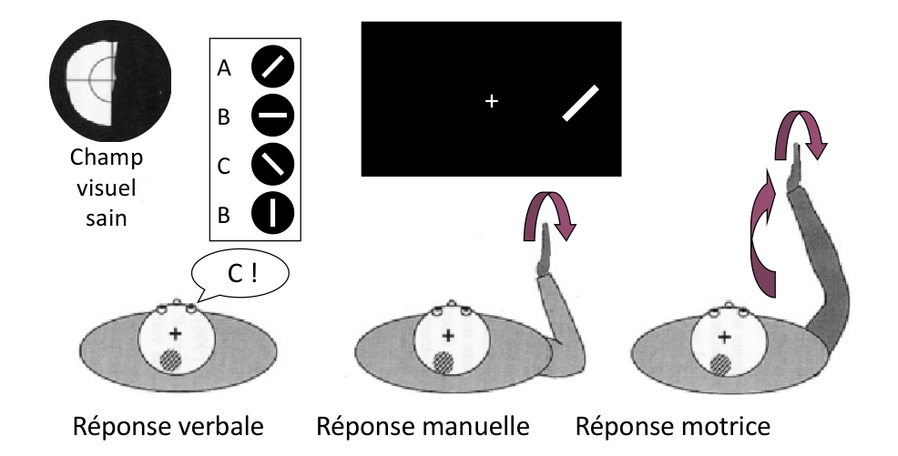
:::::
:::

- Tâche : estimer l'orientation de la baguette présentée dans l'hémi-champ
  visuel "aveugle"
- VI principale : modalité de la réponse (verbale vs manuelle vs motrice)
- VI 2 : oreintation de la baguette (horizontale, verticale, 45º, -45º)
- VD : orientation estimée (0 à 180º)
- VT : corrélation VI 2 / VD

Bonne corrélation pour reach (motrice) mais pas pour les autres. Il y a donc des
bonnes capacités résiduelles dans la partie aveugle, **que dans la tâche
motrice**. On peut revenir sur nos modèles neurofonctionnels. Dans V1, il y a
deux grandes voies de traitements : voie de perception pour l'**action**
(dorsale) et pour l'**identification** (ventrale). Il y a des aires
spécialisées.

Pour avoir des données causales, on va faire une tâche avec singes lésés à V1
pour explorer ces voies et compétences résiduelles. On fait du conditionnement
pour leur apprendre à réaliser des saccades oculaires vers un indice, même après
la lésion quand il est présenté dans la partie aveugle.

::: {.columns}
::::: {.column width="67%"}
Pour le même type de données chez les humains, on fait une manipluation où on
inhibe V1 par TMS. Quand ils ne sont plus conscient du stimulus qu'on leur
présente lors des essais, on leur demande de :

- Deviner l'orientation
- Donner une évaluation de leur certitude

Chez chacun des sujets, réponses au-delà du hasard. Il y a donc un traitement
implicite.
:::::

::::: {.column width="33%"}
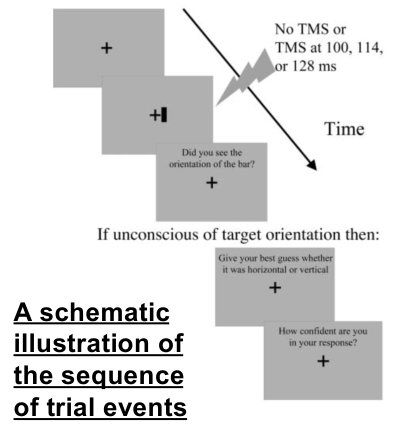
:::::
:::

Ce traitement visuel implicite ne se manifeste pas uniquement pour les patients
blindsight, on le met aussi en valeur pour des patients avec des lésions du
**cortex extrastrié**, avec la tâche de la boîte aux lettres qui sont capables
de poster, mais pas d'orienter. On le voit aussi dans les patients sains, dans
une tâche d'amorçage subliminale où le participant doit dire le plus vite
possible si le chiffre est plus grand ou plus petit que 5, et être amorcé par
des chiffres facilite ou inhibe la réponse motrice.

<!-- source: 7_cog_visuelle.md -->

##### Modèle pathologique : double rôle de V1 et voies sous-corticales

On reste pour l'instant dans un modèle qu'ascendant. On va essayer d'expliquer
deux phénomènes :

- "*Sight in blindisght*" : alors qu'il ne sait pas reporter la présence d'un
  objet dans la partie aveugle, il a des capacités résiduelles. On propose que
  c'est par les voies sous-corticale qui vont se projeter sur les aires
  extra-striées (au-delà de V1).
- "*Blind in blindsight*" : pas capable de reporter les stimuli qui vont
  pourtant activer les aires extra-striées

3 hypothèses sur le rôle de V1 dans la conscience visuelle :

1. L'activation des aires extrastriées qui dépend des afférences massives de la
   voie géniculo-striée
2. La rétropropagation des signaux issus des aires corticales de niveau
   supérieur. Donc pas de conscience car l'information n'est pas réinjectée et
   traitée par V1. Aller de V1 aux aires supérieures n'est pas nécessaire.
3. Absence d'une double activation de V1 par boucle de rétroinjection avec aller
   et retour, nécessaire à la conscience.

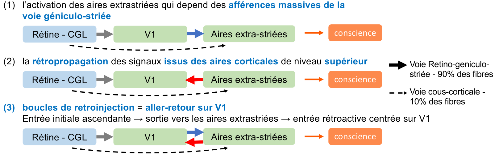

Cette dernière **hypothèse de rétroinjection** est défendue par une étude. On
présente des trigrammes aux sujets au temps 0, puis on perturbe V1 par TMS à un
intervalle variable au cours de l'étude entre 0 et 200 ms. On va avoir une
baisse de performance quand la TMS est active entre 800 et 100 ms après le
stimulus. Sachant que V1 actif de 40 à 60 ms. Cortex inféro-temporal actif à
partir de 100-120 ms. On retrouve donc activité de V1 au même moment qui serait
crucial pour catégoriser. Mais pour montrer qu'on a une rétro-injection il
faudrait montrer qu'inhiber les zones supérieures baisse aussi les performances.

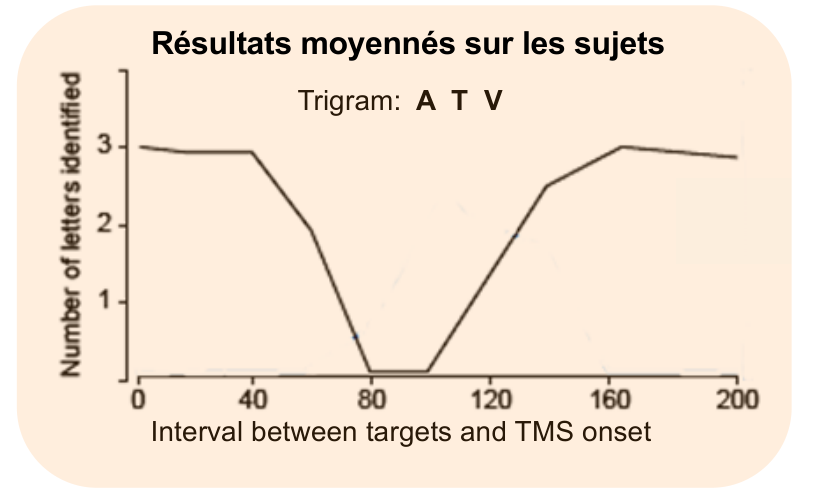{width="40%"}

##### Traitement : peut-on restaurer la vision des patients hémianopsiques ?

Il peut y avoir une récupération spontanée après quelques mois, par exemple s'il
y a eu une hémorragie, mais au-delà de ça on peut la considérer comme
irréversible. Il y a des thérapies compensatoires, ou de réhabilitation.

**Thérapies de compensation** : apprendre à mieux explorer le champ visuel. Par
mécanisme top-down (réhabilitation oculomotrice) ou bottom-up (stimulation dans
le cortex pour renforcer orientation et regard). Dans les mesures périmétriques,
ça amène à des baisses de TR dans des tâches, élargissement du champ de
recherche visuelle, et dans les scores au questionnaire d'évaluation subjective.

**Thérapies de réhabilitation** : on va proposer des tâches dans la partie "zone
grise" de détection du patient. On va faire des tâches de discrimination de
formes, etc. Résultats avec récupération variable. Aussi, on va faire des tâches
pour rendre explicites des traitements implicites. On entraîne à choix forcé, et
ça se répercute sur les tâches explicites (mais prendre ses gardes assez peu de
réplications).

### B. Organisation hiérarchique, connexions descendantes et boucles de rétro-injection

#### 1. Modèle de Bullier

Il se place dans un contexte de modèles qui tentent d'expliquer la
reconnaissance visuelle. Il défend que les boucles de rétroinjections permet
reconnaissance d'objet (et non pas conscience comme avant). Il propose un modèle
qu'on aura un traitement très rapide de l'information qui va faire une première
analyse, qui sera rétroinjectée au niveau de V1 et V2, qui agiraient comme des
tableaux noirs sur lesquels les aires supérieures vont écrire.

::: {.columns}
::::: {.column width="50%"}
Integrated model :

- Large arrows represent the activity carried by the M pathway that activates
  the visual areas first
- Feedback connections from the parietal and temporal cortex are supposed to
  carry signals to be retroinjected in lower order areas in time for the arrival
  of the P wave of activity illustrated by the narrower arrow
:::::

::::: {.column width="50%"}
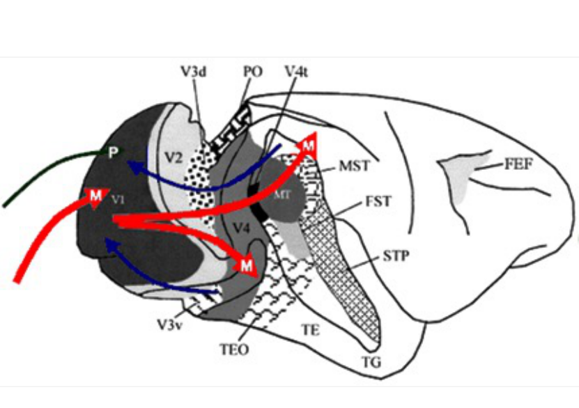
:::::
:::

Il remet en question les modèles hiéarchiques, traitement du global vers le
local, de 3D à 2D. Il permet différentes prédictions :

- Global avant local
- Global 3D module analyse locale
- Première analyse supprimée par supression de l'information de luminance, et
  robuste à un faible contraste

#### 2. Les connexions descendantes et boucles de rétro-injections

Bullier se base sur des études qui montrent la latence d'activité de différentes
aires. On s'attend à un rôle sur la spécialisation fonctionnelle précoce. Étude
IRM où on mesure activité des aires visuelles. Que le stimulus soit présent ou
pas, le pic d'activation n'est pas dépendante de la présence ou non du stimulus.
Donc ça va à l'encontre de l'idée que l'activité de V1 est uniquement causée par
le stimulus.

Activité BOLD plus forte quand on perçoit la cible. Donc plus liée à la
**performance qu'à la présence du stimulus**. Les auteurs vont donc défendre
l'idée que ça renvoie à de l'**attention descendante**.

Dans une autre tâche, V1, normalement très bas niveau, répond pourtant aux
contours illusoirs de figures de Kanizsa. Ça suggère donc qu'il y a une
activation top-down de V1 par des effets interactifs, **qu'il y a donc une
organisation perceptuelle interactive à des étapes précoces**.

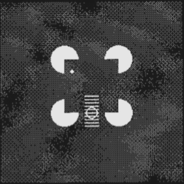{width="30%"}

<!-- Truc de V5 pourrait expliquer tous les effets contextuels dans la vision.
-> jsp ce que je voulais dire par la -->

::: {.columns}
::::: {.column width="67%"}
Quel rôle de V1 pour la perception visuelle ? Tâche de discrimination
figure/fond avec des macaques. Différenciation du signal à 90 ms. Il y a donc 2
phases distinctes dans V1 : une réponse précoce liée au traitement ascendant et
une tardive vers 90 ms qui apparaît que lorsque l'animal détecte la figure.
Montre en aucun cas que c'est lié aux rétroinjections, même défaut que toutes
les études précédentes.
:::::

::::: {.column width="33%"}
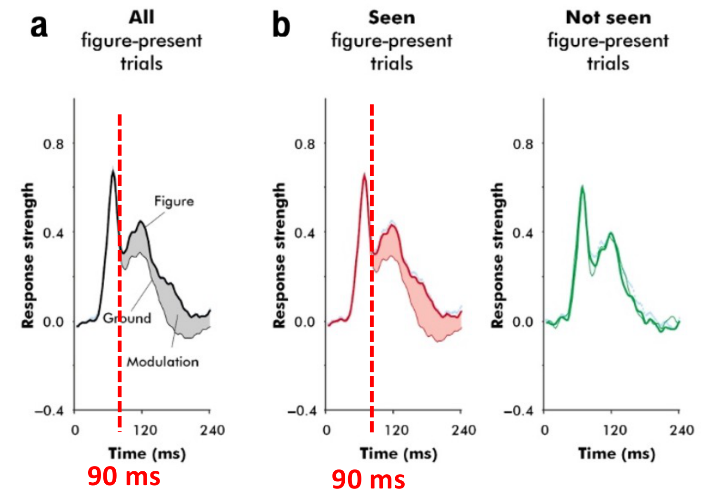
:::::
:::

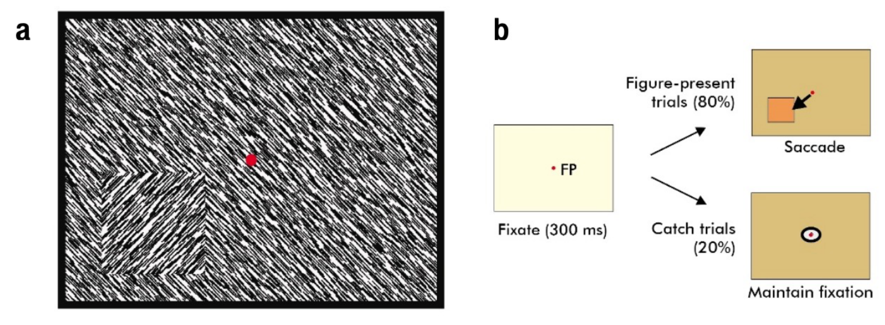{width=70%}

Donc étude qui tente d'y remédier par TMS à la fois sur V5 et V1. Inhiber V5 va
faire voir une phosphène en mouvement. Ils vont donct inhiber V5 et perturber V1
avant ou après la perturbation de V5. On remarque donc que V1 a un rôle causal
sur la vision de phosphènes qu'après l'inhibition de V5, ce qui serait donc au
moment où les rétroinjections arrivent.

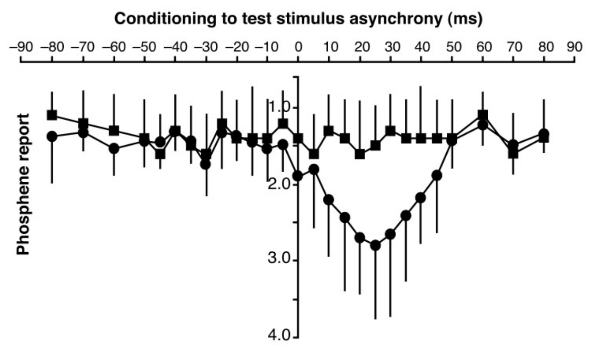{.column width="70%"}

- x : temps auquel V1 se fait inhiber par rapport à V5
- y : rapport de présence de phosphènes, 1 = présent et en mouvement, 4 = rien
- shape : control / test

Mais comment c'est possible qu'on puisse continuer de voir un objet immobile
alors que V1 est inhibé ? V5 aurait donc une rétroaction aussi sur d'autres
zones comme V2. Ou qu'on a perturbé le retour de V5 spécifiquement et pas les
autres j'ai pas tout compris je crois pas que ce soit trop important lol si tu
lis ça bonne chance

<!-- CM8 -->

### C. Les voies sous-corticales

V1 n'est pas le seul passage pour que le signal visuel atteigne les voies
associatives. En effet, il peut les atteindre par le **colliculus supérieur**,
situé à la surface du mésencéphale représentant 10% des fibres, il a surtout un
rôle dans l'orientation des mouvements des yeux et de la tête, et de
l'attention. Celui-ci pourrait beaucoup nous renseigner sur le blindsight.

Pour le savoir, on fait une expérience. Un macaque doit produire saccade en
réponse à un stimulus, soit vers champ visuel sain soit vers le champ visuel
déficitaire. On va enregistrer l'activité des aires extra-striées. On lèse une
portion des radiations optiques, ce qui cause une cécité dans une portion de
l'hémichamp droite. On démontre un phénomène de blindsight car il répond
au-dessus du hasard (ici 1/3).

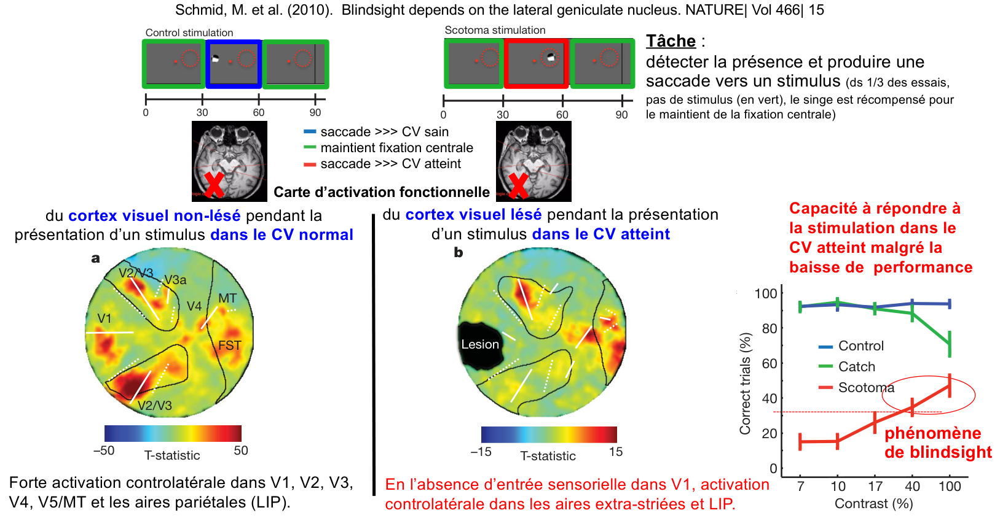

On retrouve une activité des aires extra-striées même quand V1 est lésé, même si
moindre. Donc traitement de la cible, sans apparition dans la conscience, car V1
n'est pas recruté. Ils vont ensuite désactiver le LGN pour savoir si cette
activation extra-striée disparaît, et c'est le cas qui s'associe à la
disparition des résultats comportementaux. Le modèle cognitif reste donc valide.

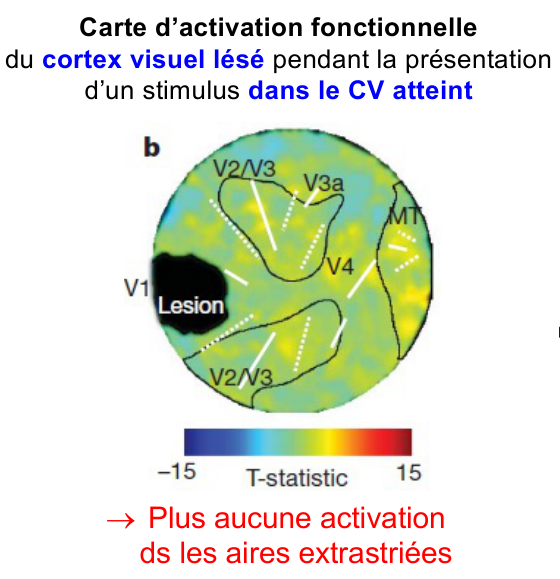{width=40%}

Chez l'homme, on a observé chez les patients de blindsight une plus haute
association LGN/cortex extrastriés que chez patients sains.

--------------------------------------------------------------------------------

::: {.callout-important}
FIN DU COURS REPRIS CORRECTEMENT
:::

##### Perception des formes, des objets et des scènes

##### A. Caractéristiques de la perception visuelle

La perception est :

- En 3D
- Rapide
- Unifiée (en tant qu'expérience totale, à partir d'une scène multimodale
  morcelée)
- FIX: un autre truc

##### B. Les contraintes anatomo-fonctionnelles et modularité du traitement visuel

On va traiter l'hypothèse qu'on ait des modules de traitements indépendants des
autres.

V1 accueille une multitude de cartes rétinotopiques, et on va devoir
reconstruire la scène en réintégrant spatialement e dimensionnellement ces
informations. Dans V1, les champs récpteurs augmentent le long de la hiéarchie
du traitement visuel. Cela nous permet d'extraire des caractéristiques de plus
en plus complexe. L'intégartion des mouvements locaux en un mouvement glboal
peut être difficile.

Ça fait qu'il y a des aires spécialisées. Par exemple, V4 est spécialisé dans la
couleur (mais le traitement de la couleurs reste diffus dans un réseau, et V4 ne
fait pas que de la couleur). On **plusieurs aires spécialisées organisées en
hiéararchie**, ainsi que deux voies de traitements, appuyées sur ventrale et
dorsale.

##### Double voie du traitement visuel

##### Double modèle de Goudale et Milner

> Il faut faire la différence netre modèles psychologiques et contraintes
> biolgoiques, même si les deux sont intemement liés

<!-- FIX: diapo du modèle -->

Ils vont proposer que le traitement se différencierai selon les voies de
traitements, qui seraient "séparées" :

- Ventrale : à la fois magno et parvo, perception pour l'action
- Dorsale : que magno, perception pour l'identification

Ils vont supposer que ces processus sont **indépendants** fonctionnellement.
Elles pourraient avoir des communications, mais elles seraient indirectes.

##### Modèles pathologique

On va voir 2 pathologies : agnosie et ataxie.

Sebastian sait où et comment agir sur les objets, mais pas le "quoi".

La tâche de la lettre montre une double dissociation :

- Autre patient à qui on demande de mettre une feuille de papier dans une fente,
  quand elle doit la mettre, pas de soucis, mais quand on demande de reproduire
  l'orientation de la fente, alors il échoue.
- Autre patient sont incapables de mettre la lettre pour poster, mais peuvent
  orienter

C'est à partir de là qu'on propose la distinction de ces deux voies.

Ataxie :

Ils auront du mal à produire un geste visuomoteur, alors que la capacité
d'identification va être préservée. On peut quand même montrer qu'il est capable
de faire ses gestes si on lui impose un délai. C'est-à-dire qu'on présente une
cible et qu'on lui donne comme consigne :

- De pointer immédiatement : pointage imprécis
- De pointer après un délai (indiqué dans la tâche) : amélioration du pointage

Donc on propose que la mobilisation de la voie dorsale se fait pour des gestse
précis et rapides. Mais quand on doit agir sur une cible "mémorisée", on peut
passer par la voie ventrale.

Maintenant, on va voir des limites des arguments présentés précédemment.

##### Arguments expérimentaux chez le sujet sain

On va regarder, au lieu de l'effet d'une lésion, d'une condition expérimentale.

Illusion des cercles décrit un effet de contexte : on décrit la taille du cercle
relativement aux choses qui sont autour (on a parlé des effets de contexte hier
par les rétroinjections). Quand on fait une tâche de saisie de ces cercles
centraux, on se rend compte que la **pince est correctement ajustée** à la
taille du cercle, et non la taille perçue. C'est une **simple dissociation** en
faveur de l'indépendance fonctionnelle.

Face illusion : masque représentant un visage, avec partie concave et convexe,
qui va tourner de convexe à concave. On n'arrive pas à voir le visage concave
comme convexe. Condition de notre tâche :

FIX: pas tout écouteé

Histoire d'information binoculaire. Floute et met entille un œil pour ne pas
utiliser informations bincoulaires

1. Luminosité ne mettant pas en valeur que c'est un visage creux
2. 

Ils vont demander aux sujets de dessinner sur une feuille la position du point
de référence et donc estimer la distance. Il doit pointer soit sur la cible soit
sur sa propre tête. Soit pointer soit dessiner je crois.

Condition pointage normal : sujetp ointe bien point de référence. Condition
illusion : dissociation car dans traitement explicite, reésultat illusoire,
alors que dnas l'autre pointe bien vers la cible, en arrière du point e
référence (graph de gauche / graph de droite). Ça montre que la voie de la
percpetion pour l'dientificdation est affectée apr l'illusion mais perception
pour la'ction ne l'est pas. Ça montre une dissociation simple.

Autre type de tâche : illusion de Ponzo, barre du premier plan apparaît plus
petite que celle à l'arrière plan, car on traite la perspective. La taille de la
pince n'est pas affectée par le stimulus illusoire, mais la vitesse et force de
préhension sont bien affectées par l'illusion.

Illusion affecdte donc non seulement la voie ventrale mais aussi la voie
drosale. La critique de ces auteurs est donc qu'on ne regarde pas tous les
apramtres de la tˆåche visuo-motrice, et donc on se met dans les meilleures
conditions pour mettre e névidence un effet.

2 autres illusions : on met contexte (carré incliné) et le sujet doit évaluer
orientation de la barre (c'est le road and frame test). On est biaisé dans le
sens du cadre.

On va analyse la méthode uq'on a utilisé pour mettre en valeur double
dissociation, donc une modularité du traitement. La simple dissociation qu'on a
observé (par lésion ou conditions expérimentales). Sauf que la tâche où il y a
un déficit peut être plus difficile que la tâche B. Une simple dissociation
pourrait surgir juste d'une disposition asymétrique des tâches.

double dissociation

  | Header   | Tache A  | Tache B  |
  | -------- | -------- | -------- |
  | Lésion A | Déficit  | Préservé |
  | Lésion B | Préservé | Déficit  |

Ici on peut rejeter l'idée qu'une tâche est plus dure que l'autre. On peut donc
mieux conclure à une différence fonctionnelle (processus distincts dans ces deux
voies) mais pas indépendance fonctionnelle, car les 2 tˆåchesp ourraient faire
intervenir un processus particulier différent alors que le reste des processus
mis en œuvre restent en commun.
