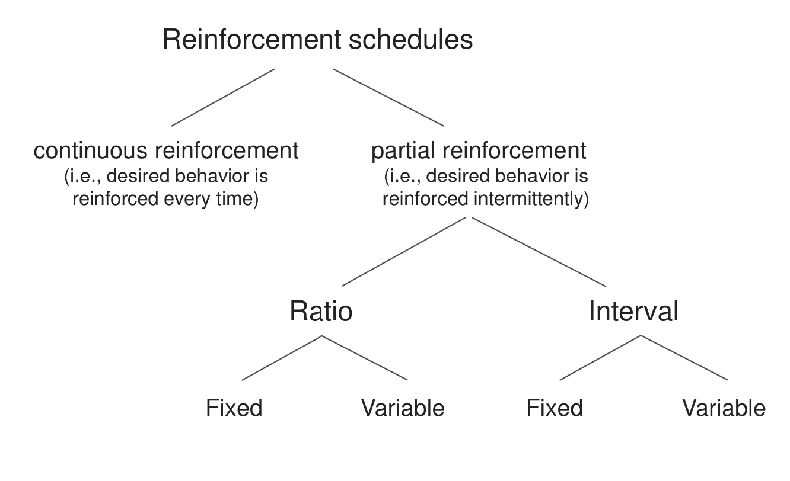
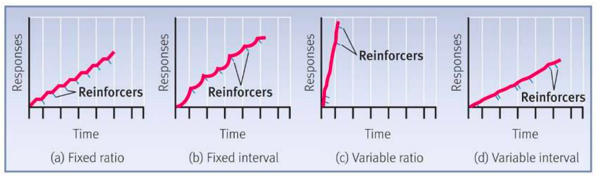
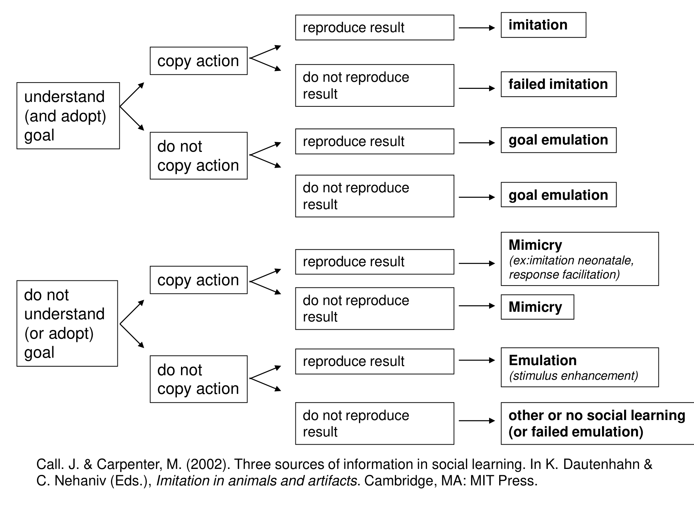
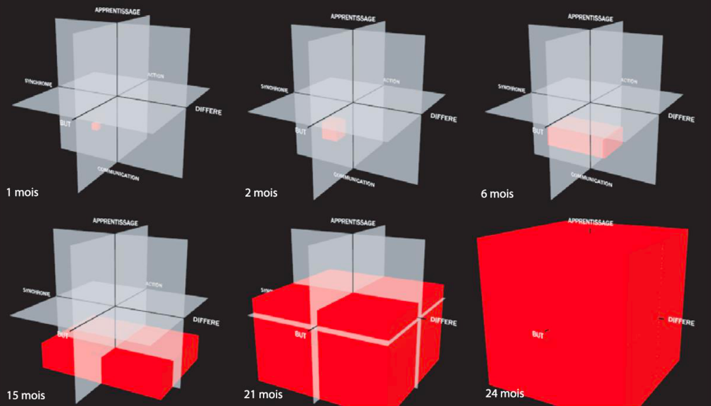
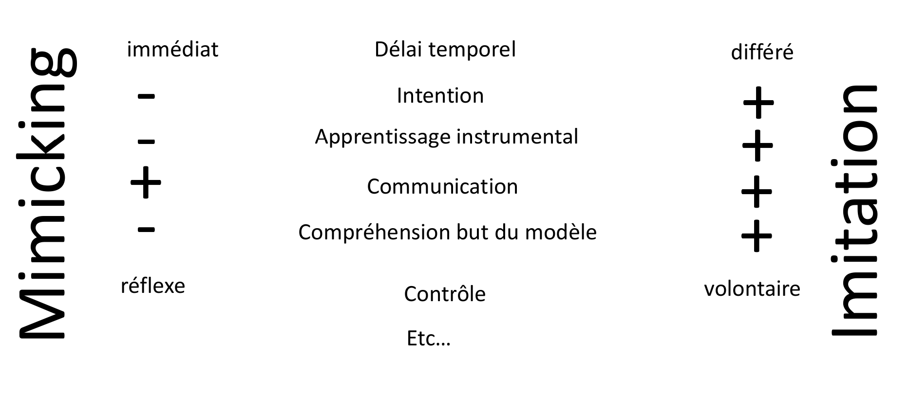

<!-- source: 1_conditionnement_rappel.md -->

# Partie I - Imitation

## CM1 - Conditionnement Rappel

- [[i_conditionnement_rappel]]
- [[ii_conditionnement_rappel]]
- [[iii_conditionnement_rappel]]

Approches comportementalistes sont centrées sur l'environnement, alors que
cognitivistes plutôt sur l'individu, avec les approches constructivistes qui
font le lien entre les deux (en tant que paradigme général qu'on se construit en
fonction de l'environnement et l'individu).

L'**apprentissage** est toute modification durable du comportement en lien avec
l'expérience. Sont exclus les changements temporaires dus à la maladie, les
lésions, la maturation, les psychotropes.

Plan :

- Apprentissage et conditionnement
- Imitation et apprentissage
- Reconnaitre les visages
- Développement social
- Vision plus globale : les piliers de l'apprentissage

## 1. Apprentissage et conditionnement

### 1.1. Le conditionnement classique

Pavlov se rend compte que ses cobayes anticipent et se basent sur des événements
de l'environnement qui prédisent l'arrivée de la nourriture. Il faut qu'il y ait :

- Un "**réflexe**", au sens large, soit un lien stimulus/réponse
- Un stimulus inconditionnel, le stimulus du réflexe
- Réponse inconditionnelle : la réponse du réflexe
- Un stimulus neutre : pas lié à la boucle réflexe et ne peut déclencher en
  aucun cas la réponse inconditionnelle

Le son devient associé à l'arrivée future de la viande. On a donc une
modification du comportement, et on ne peut pas revenir à l'état initial. C'est
un conditionnement de **premier ordre**. Ça se manifeste par exemple quand on
ressent du confort par les lumières rouges, associées à la chaleur.

On peut imaginer des conditionnements sur des conditionnements. On conditionne
un chien à saliver sur Beethoven, puis on conditionne un stimulus neutre comme
une lumière jaune à Beethoven. Dire "Attention !" à quelqu'un qui va mettre sa
main sur une plaque chauffante rentre dans la définition. C'est donc un
**conditionnement de second ordre**.

Les bases neurofonctionnelles sont la plasticité neuronale :

- Facilitation présynaptique : augmentation des neurotransmetteurs émit par les
  neurones pré-synaptiques
- Potentialisation à long terme (PLT), post-synaptique. Si un neurone reçoit
  l'activité de plusieurs neurones, ce dernier va répondre à la corrélation de
  la réponse des neurones pré-synaptiques. S'appuie sur la démonstration du
  développement de nouvelles dendrites lorsqu'un réseau est stimulé

Points terminologiques :

- **Acquisition** : transformation d'un stimulus neutre en un stimulus
  conditionné
- **Extinction** : diminution de la réponse conditionnée lorsque le stimulus
  inconditionnel n'est plus associé au stimulus conditionné
- **Récupération spontanée** : une récupération partielle de la réponse
  conditionnée après une phase d'extinction
- **Généralisation du SC** : tendance à produire la RC pour des stimuli autres
  que le SC (petit Albert)

Expérience où ils cherchent à voir si on généralise aux significations des mots
:   on mesure réponse electrodermale après douleur associée au mot "*large*", et
    la généralisation est perceptive et non sémantique.

Il y a des conditions nécessaires au conditionnement classique :

- Stimulus conditionné doit être neutre au départ
- Contiguïté temporelle : SC doit se produire avant le SI, il doit le signaler
- Contingence : si le SC n'est plus suivi du SI, la RC s'éteint
- Récupération spontanée : même après extinction, la relation SC-RC peut
  réapparaitre

Si ces conditions sont remplies, n'importe quel stimulus neutre devrait pouvoir
devenir un stimulus conditionné. **Principe d'équipotentialité.** Mais on a
montré chez le rat que ce principe a des limites, car certaines associations
sont prédisposées, comme goût est nausée (positivement), et son et nausée
(contre-prédisposé). Pour conditionner, il faut donc **suivre la structure du
SNC**, on ne peut pas associer tout équitablement. La portée du conditionnement
classique est donc limitée.

### 1.2. Le conditionnement opérant

Se base sur le principe qu'un comportement produit des conséquences, pouvant
être agréables ou désagréables. On va donc apprendre à se comporter en fonction
de la suite. La suite d'un comportement va donc modifier la probabilité de le
reproduire.

Types de stimuli :

- Stimulus appétitif : un stimulus plaisant
- Stimulus aversif : un stimulus déplaisant
- Renforcement positif : renforcement par un stimulus appétitif
- Punition positive : punition par la présentation d'un stimulus aversif
- Renforcement négatif : renforcement par le retrait d'un stimulus aversif
- Punition négative : punition par le retrait d'un stimulus appétitif

Plusieurs catégories de renforçateurs :

- Renforçateurs primaires : non appris, naturel, satisfaisant un besoin primaire
- Renforçateurs secondaires : appris
  - Tangible : argent etc
  - Intangible : donné par autrui, comme approbation admiration

Conditions d'efficacité :

- Renforçateur doit être présenté immédiatement après le comportement (cas
  simple de la boite de Skinner)
- Fréquence de reforcement, qu'on peut conceptualiser avec un planning de
  reforcement (voir après). C'est très intéressant, car ratio variable est le
  plus efficace, en effet l'extinction est très difficile étant donné qu'il est
  normal de ne pas avoir le renforçateur

Le sommeil de l'enfant bla bla bla, il faut pas l'aimer on le détsete

Association entre mouvement de la jambe et plaisir du mobile qui bouge. S'il y a
eu conditionnement, même si on détache le fil, il devrait bouger son pied. À 3
mois, la mémoire fail si :

- Couleur du crib change
- Odeurs ambiantes changes
- Bruit ambiant...

Donc très sensible au contexte

--------------------------------------------------------------------------------

<!-- source: 2_imitation.md -->

# CM2 - Imitation

- [[i_imitation]]
- [[ii_imitation]]
- [[iii_imitation]]

### Le conditionnement opérant (suite)

Tâche du train : table avec petit chemin de fer avec train, puis enfant a une
barre en fer le train se met en route. C'est une version pour bébé de la boîte
de skinner. Dès 9 mois on peut observer des délais de rétention de 2 mois.

On utilise ce genre de tâches pour étudier la mémoire et délais de rétention
chez les bébés.

Plusieurs domaines sont reliés au conditionnement.

**Désensibilisation**, qui vise à diminuer la réponse comportementale et/ou
émotionnelle a un stimulus. Peut être mis en place par différentes procédures.

- **Contreconditionnement** : réponse conditionnelle peut être éliminé plus
  efficacement si une réponse qui est incompatible avec la réponse
  conditionnelle est reliée au stimulus conditionnel en même temps que la
  réponse conditionenlle disparait. C'est un cadre pavlovien. Y'a aussi thérapie
  par aversion où on met en place une situation où la réponse de plaisir est
  changée en une réponse de déplaisir
- **Habituation progressive** : sujet est exposé par degrés à la situation
  anxiogène dans le but de l'habituer et de diminuer la réponse émotionnelle
  excessive l'ayant amené à consulter. Cette approche est utilisée pour le
  traitement des phobies en particulier
- D'autres

Il y a cependant des choses qui vont limiter les approches de l'environnement à
l'époque :

- **Apprentissages sans conditionnement**, comme le rat dans le labyrinthe, qui
  ne devrait pas être encouragé à apprendre le labyrinthe sans récompense, mais
  pourtant. Mais on peut critiquer ces études qu'il y a aurai des renforçateurs
  dans le labyrinthe qui ne permettent pas de garantir l'absence de
  conditionnement
- **Apprentissage par observations** venant que des congénères dans une
  situation ressentent quelque chose
- **Non équipotentialité** des stimuli

  |              | Répondant              | Opérant                           |
  | ------------ | ---------------------- | --------------------------------- |
  | Comportement | Involontaire (réflexe) | Volontaire (non réflexe)          |
  | Association  | Événement (SC & SI)    | Action & renforcement             |
  | Attentes     | Que SC prédise le SI   | Que le comportement soit renforcé |

C'est opérant parce que c'est l'action du sujet qui apporte une conséquence

## 2. Imitation et apprentissages

### Imitation Néonatale

Est-ce que l'imitation néonatale est une forme d'apprentissage ? Ce n'est pas
très clair. On va chercher à faire des imitations néonatales chez des macaques.
On arrive à le reproduire, mais ça pose plusieurs problèmes méthodologiques :

Peut-être que l'action est déjà dans le répertoire du participant, mais on peut
dire qu'à la naissance les zones de la mâchoire sont largement immatures. Chez
le nouveau-nez les zones préfrontales sont largement sous-utilisées au profit
des aires motrices. On va donc faire des expériences sur des actions qui sont
moins probables d'être dans le répertoire d'action de l'enfant, comme les
mouvements de la main. On va coder les actions de 1 à 3 :

1. Lève la main
2. Extension incomplète du doigt
3. Extension du doigt

Ils montrent une augemtnation de probabilité sélective de production des actes
imités. Surtout, au fur et à mesure qu'on expose les bébés au stimulus, la
probabilité augmente et les mouvements deviennent de plus en plus précis. Pas
d'effet de latéralité. Situation d'imitation a une augmentation du rythme
cardiaque par rapport au repos.

La prochaine expérience montre que chaque situation d'imitation augmente de
manière sélective la probabilité que le beebé fasse des gestes en particulier. 4
groupes de gestes :

- Protusion de la langue
- Head tilt and loop-up
- Deux doigts
- Trois doigts

Les bébés ne font pas la même fréquence de chacun de ces mouvements selon les
gestes qu'on leur présente. Dans toutes les situations, on n'a pas augmenté la
probabilité de faire bouger des doigts.

FIX: je copmrends pas l'intérêt de cette étude

On remarque que l'imitation prend la forme d'échanges, de proto-conversations,
et que l'imitation aurait une fonction sociale dans cet aspect, et l'acte
s'appelé ici "provocation". On considère que l'imitation par l'enfant est un
acte volontaire.

On a fait différente hypothèse pour savoir comment ça marche. On a un signal
dans nos champs visuel, qui a une structure. À l'issue de cette perception,
augmentation de la fréquence motrice de la séquence observée (il faut que le
geste soit dans le répertoire à la naissance les mouvements complexes ne sont
pas possibles). Elles cherchent à expliquer l'origine du lien entre observation
et production.

- **Innate realising mechanism**, on augmente juste la fréquence d'un acte
  réflexe
- **Active intermodal mapping theory**: on encode de manière amodale un acte et
  une perception
- **Mirror neuron system** (non-inhibition) -> théorie de la simulation, qui est
  plus vieille que MNS

--------------------------------------------------------------------------------

<!-- source: 3_dev_cog.md -->

# CM3 dev cog

- [[i_cm3_dev_cog]]
- [[ii_cm3_dev_cog]]

Mais comment fonctionne ce mécanisme d'imitation ? On sait qu'il faut mettre en
correspondance l'action observée et le système moteur, mais il y a différents
niveaux de complexité de ces actes imités.

- Innate releasing mechanism a du mal à expliquer les actes complexes, car selon
  elle, ils devraient être dans le répertoire dès la naissance
- Active intermodal mapping theory l'explique plus naturellement
- MNS

On va se concentrer sur le MNS, qui a un problème : comment est-ce qu'on ne
produit pas tout le temps les actions qu'on observe si ce système existe ? On
doit avoir un phénomène d'inhibition, qui expliquerait les déficits comme
inhibition.

La théorie de simulation et résonance par des années 60 avec le "mouvement
imaginé", qui est un effet qu'imaginer un mouvement prends autant de temps que
réellement le produire. Il y aurait donc une composante motrice à ce processus
d'imagination. **Jeannerod** propose que lorsqu'on fait de la cognition motrice
on active ce système de simulation. Se représenter l'intention d'une action est
aussi mettre en place les processus permettant de la produire. Ces processus
peuvent être conscients ou non :

- Conscient :
  - Imagine
  - Actions dans les rêves
- Conscient et non conscient
  - Intention
  - Observation d'actions faites par les autres
- Non conscient :
  - Prospective action judgement
  - Perceptually based decisions
  - Observation of graspable object

Viviani fait la théorie de résonateurs (penser à la propagation de vibrations
physiques) : des résonateurs perceptifs font une forme de couplage et j'ai pas
trop copmris.

Pour en revenir à l'imitation, la plupart des actions produites par les enfants
à la naissance sont très simples. L'imitation comme mécanisme d'apprentissage
doit donc impliquer plus que des actions déjà présentes dans le répertoire. On
va la définir comme *the copying of a novel or otherwise improbable act or
utterance, or some act for which there is clearly no instinctive tendency*
(Thorpe, 1963).

On propose que cette imitation à une fonction **sociale** de communication, et
de l'autre côté une fonction **instrumentale** qui nous permet d'apprendre
quelque chose sur un objet ou une action possible. Ces deux apprentissages se
font par la **démonstration**.

Mais il manque certains éléments pour comprendre la compréhension de l'intention
d'action dans l'imitation instrumentale. Ce concept vient nuancer le propos : le
**mimicking** est une copie de la forme d'une action qui se fait sans
reproduction de l'intention du but. Qu'est-ce qui est imité ? Plein de choses,
comme accents, le débit verbal, les rythmes verbaux, les expressions faciales,
les humeurs, la posture, les manières, les mouvements idiosyncratiques...

À noter que l'inclusion des expressions faciales, donc de l'imitation
néo-natale, fait débat, car dans la définition du mimicking, il faut que
l'action ne soit pas dans le répertoire de l'enfant, ce qui n'est pas le cas
pour l'imitation néo-natale. Mais elle se fait sans représentation du but, il y
a donc une zone grise.

Il y a trois sources d'informations à la démonstration d'une action imitée
instrumentalement : le **but**, l'**action** et le **résultat**.

Ce mode d'apprentissage social n'est pas l'unique exemplaire de ce mode
d'apprentissage :

- Émulation : l'apprenant obtient le même résultat final en utilisant ses
  propres actions
- Émulation du but : apprenant atteint le but voulu du démonstrateur en
  utilisant ses propres actions
- Apprentissage par imitation : apprenant copie l'action du démonstrateur, et, à
  l'inverse du mimicking, l'apprenant fait ça avec une compréhension du but du
  démonstrateur

Thèse de K. Prepin en sciences cognitives qui propose que l'imitation soit un
espace varié pour définitions multiples avec trois axes : *structure
temporelle*, *fonctionnalité* et *objet*. Les manifestations de l'imitation
évoluent au cours du développement de l'enfant, ici au cours des deux premières
années, au cours d'interaction avec un robot, je crois ?

Meltzoff argumente que quand on fait une imitation et qu'on a le résultat, il
peut être vécu comme un renforcement

Il est important de considérer que l'imitation peut être différée, car si on ne
peut pas imiter une action après longtemps, alors on peut dire que
l'apprentissage n'a pas vraiment été fait.

On s'est donc mis à étudier la force de la trace (dans le temps) des
apprentissages. On fait un test avec une action d'assemblage d'un petit jouet
qui fait gling gling, en leur montrant, mais ne laissant pas l'occasion de
reproduire.

On a fait cette tache à des adultes cérébro-lésés, et ils sont capables de
reproduire l'action que si les systèmes temporaux-médiaux sont intacts, avec
activation de l'hippocampe.

La tâche de la poupée est une variante de cette tâche pour les enfants : on
montre à un enfant une poupée se faire démonter (je crois lol). Entre 6 et 9
mois, ils retiennent 24h, et de 12 à 14 pendant 7 jours. Mais comme on l'a vu au
début du cours, ces apprentissages dépendent fortement du contexte, et dans ce
cas d'imitation, cet effet se manifeste à 12 mois, mais plus à 18 mois. Dans
cette période, il y aurait donc un changement de la nature de la mémoire, qui se
**décontextualise**.

Capacité à distinguer actions intentionnelles et accidentelles peut être très
important. On peut montrer qu'à 14 mois l'enfant imitera beaucoup plus si
l'adulte a appuyé sur le fait que l'action est intentionnelle, avec des
expressions théâtrales par exemple. À 18 mois, une action intentionnelle, mais
échouée, peut être imitée dans l'intention originelle et donc réussie. À trois
ans, ils savent compléter nos phrases.

Donc, on peut utiliser l'imitation pour comprendre les bases de la compréhension
d'autrui. Ça nous renseigne aussi sur la structure des relations entre action et
perception. Ça nous permet aussi d'avoir des informations sur la manière dont
l'enfant se représente les autres et comment il entend la correspondance entre
soi et autrui, ainsi qu'une première représentation des états internes d'autrui.

Les fœtus peuvent bâiller, et quand la maman regarde une vidéo de quelqu'un qui
bâille et que ça déclenche chez elle un bâillement, ça augmente la probabilité
que l'enfant bâille lui-même. Mais est-ce que c'est de l'imitation ?
