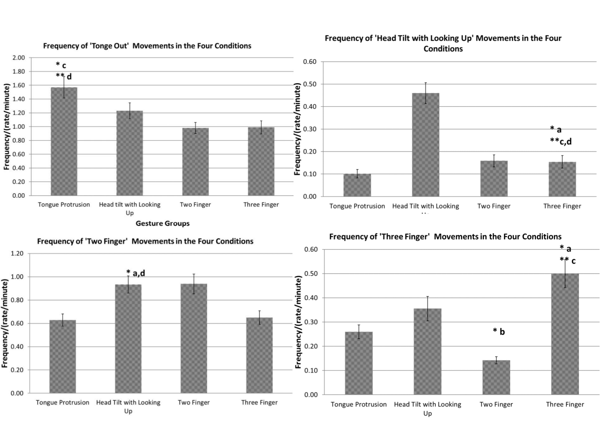
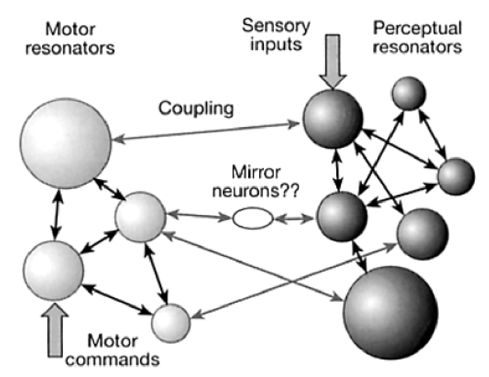
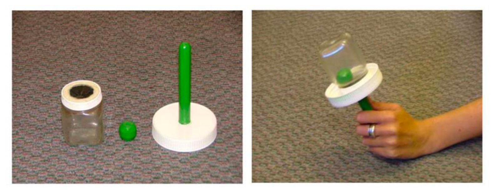
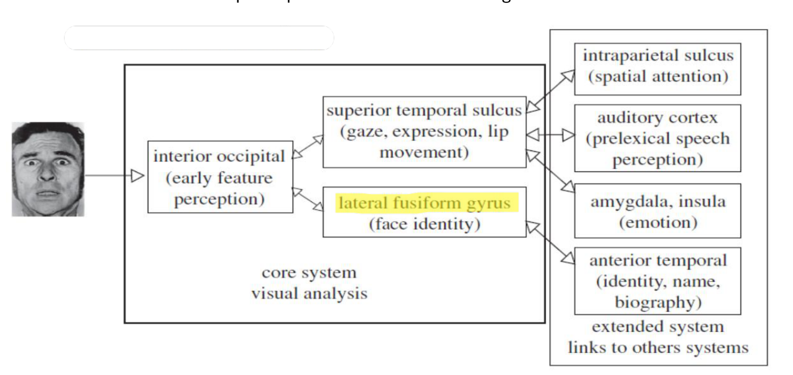
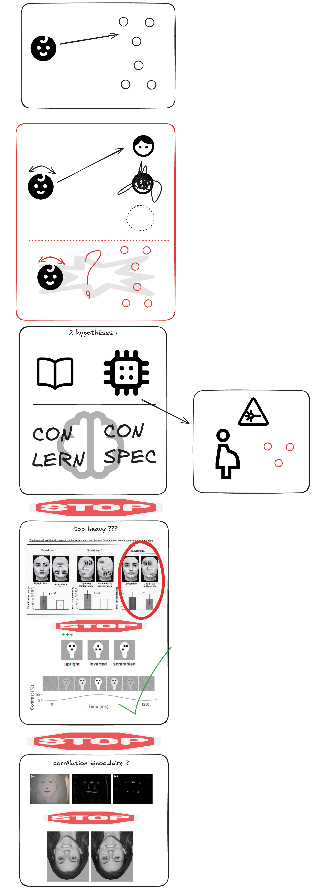
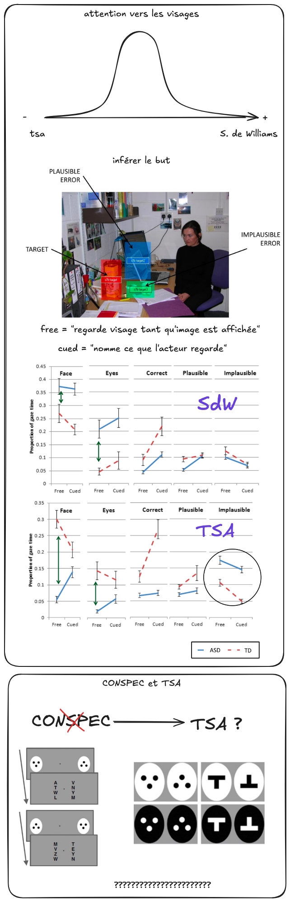

<!-- source: 1_conditionnement_rappel.md -->

# Partie I - Imitation

::: {.callout-note}
Estimation de l'intégrité de la prise de note : `8/10`
:::

Approches comportementalistes sont centrées sur l'environnement, alors que
cognitivistes plutôt sur l'individu, avec les approches constructivistes qui
font le lien entre les deux (en tant que paradigme général qu'on se construit en
fonction de l'environnement et l'individu).

L'**apprentissage** est toute modification durable du comportement en lien avec
l'expérience. Sont exclus les changements temporaires dus à la maladie, les
lésions, la maturation, les psychotropes.

Plan :

- Apprentissage et conditionnement
- Imitation et apprentissage
- Reconnaitre les visages

## 1. Apprentissage et conditionnement

### 1.1. Le conditionnement classique

Pavlov se rend compte que ses cobayes anticipent et se basent sur des événements
de l'environnement qui prédisent l'arrivée de la nourriture. Il faut qu'il y ait :

- Un "**réflexe**", au sens large, soit un lien stimulus/réponse
- Un **stimulus inconditionnel**, le stimulus du réflexe
- **Réponse inconditionnelle** : la réponse du réflexe
- Un **stimulus neutre** : pas lié à la boucle réflexe et ne peut déclencher en
  aucun cas la réponse inconditionnelle

Le son devient associé à l'arrivée future de la viande. On a donc une
modification du comportement, et on ne peut pas revenir à l'état initial. C'est
un conditionnement de **premier ordre**. Ça se manifeste par exemple quand on
ressent du confort par les lumières rouges, associées à la chaleur.

On peut imaginer des conditionnements sur des conditionnements. On conditionne
un chien à saliver sur Beethoven, puis on conditionne un stimulus neutre comme
une lumière jaune à Beethoven. Dire "Attention !" à quelqu'un qui va mettre sa
main sur une plaque chauffante rentre dans la définition. C'est donc un
**conditionnement de second ordre**.

Les bases neurofonctionnelles sont la plasticité neuronale :

- **Facilitation présynaptique** : augmentation des neurotransmetteurs émit par
  les neurones pré-synaptiques
- **Potentialisation à long terme** (PLT), post-synaptique. Si un neurone reçoit
  l'activité de plusieurs neurones, ce dernier va répondre à la corrélation de
  la réponse des neurones pré-synaptiques. S'appuie sur la démonstration du
  développement de nouvelles dendrites lorsqu'un réseau est stimulé

Points terminologiques :

- **Acquisition** : transformation d'un stimulus neutre en un stimulus
  conditionné
- **Extinction** : diminution de la réponse conditionnée lorsque le stimulus
  inconditionnel n'est plus associé au stimulus conditionné
- **Récupération spontanée** : une récupération partielle de la réponse
  conditionnée après une phase d'extinction
- **Généralisation du SC** : tendance à produire la RC pour des stimuli autres
  que le SC (petit Albert)

La généralisation a des limites selon la structure cognitive : expérience où ils
cherchent à voir si on généralise aux significations des mots. On mesure la
réponse electrodermale après une douleur associée au mot "*large*", et la
généralisation est perceptive et non sémantique, donc les sujets ont répondu
qu'aux mots perceptivement similaires et non sémantiquement similaires.

Il y a des conditions nécessaires au conditionnement classique :

- Stimulus conditionné doit être **neutre au départ**
- **Contiguïté temporelle** : SC doit se produire avant le SI, il doit le
  signaler
- **Contingence** : si le SC n'est plus suivi du SI, la RC s'éteint
- **Récupération spontanée** : même après extinction, la relation SC-RC peut
  réapparaitre

Si ces conditions sont remplies, n'importe quel stimulus neutre devrait pouvoir
devenir un stimulus conditionné. **Principe d'équipotentialité.** Mais on a
montré chez le rat que ce principe a des limites, car certaines associations
sont prédisposées, comme goût est nausée (positivement), et son et nausée
(contre-prédisposé). Pour conditionner, il faut donc **suivre la structure du
SNC**, on ne peut pas associer tout équitablement. La portée du conditionnement
classique est donc limitée.

### 1.2. Le conditionnement opérant

Se base sur le principe qu'un comportement produit des conséquences, pouvant
être agréables ou désagréables. On va donc apprendre à se comporter en fonction
de la suite. La suite d'un comportement va donc modifier la probabilité de le
reproduire.

Types de stimuli :

- Stimulus appétitif : un stimulus plaisant
- Stimulus aversif : un stimulus déplaisant
- Renforcement positif : renforcement par un stimulus appétitif
- Punition positive : punition par la présentation d'un stimulus aversif
- Renforcement négatif : renforcement par le retrait d'un stimulus aversif
- Punition négative : punition par le retrait d'un stimulus appétitif

Plusieurs catégories de renforçateurs :

- Renforçateurs primaires : non appris, naturel, satisfaisant un besoin primaire
- Renforçateurs secondaires : appris
  - Tangible : argent etc
  - Intangible : donné par autrui, comme approbation admiration

Conditions d'efficacité :

- Renforçateur doit être présenté **immédiatement après le comportement** (cas
  simple de la boite de Skinner)
- **Fréquence de renforcement**, qu'on peut conceptualiser avec un planning de
  renforcement (voir après). C'est très intéressant, car ratio variable est le
  plus efficace, en effet l'extinction est très difficile étant donné qu'il est
  normal de ne pas avoir le renforçateur

Association entre mouvement de la jambe et plaisir du mobile qui bouge. S'il y a
eu conditionnement, même si on détache le fil, il devrait bouger son pied. À 3
mois, la mémoire fail si :

- Couleur du crib change
- Odeurs ambiantes changes
- Bruit ambiant...

Donc très sensible au contexte

<!-- source: 2_imitation.md -->

**Tâche du train** : table avec petit chemin de fer avec train, puis enfant a
une barre en fer le train se met en route. C'est une version pour bébé de la
boîte de skinner. Dès 9 mois on peut observer des délais de rétention de 2 mois.

On utilise ce genre de tâches pour étudier la mémoire et délais de rétention
chez les bébés.

**Désensibilisation**, qui vise à diminuer la réponse comportementale et/ou
émotionnelle a un stimulus. Peut être mis en place par différentes procédures.

- **Contreconditionnement** : réponse conditionnelle peut être éliminé plus
  efficacement si une réponse qui est incompatible avec la réponse
  conditionnelle est reliée au stimulus conditionnel en même temps que la
  réponse conditionenlle disparait. C'est un cadre pavlovien. Y'a aussi thérapie
  par aversion où on met en place une situation où la réponse de plaisir est
  changée en une réponse de déplaisir
- **Habituation progressive** : sujet est exposé par degrés à la situation
  anxiogène dans le but de l'habituer et de diminuer la réponse émotionnelle
  excessive l'ayant amené à consulter. Cette approche est utilisée pour le
  traitement des phobies en particulier
- D'autres

Il y a cependant des choses qui vont limiter les approches de l'environnement à
l'époque :

- **Apprentissages sans conditionnement**, comme le rat dans le labyrinthe, qui
  ne devrait pas être encouragé à apprendre le labyrinthe sans récompense, mais
  pourtant. Mais on peut critiquer ces études qu'il y a aurai des renforçateurs
  dans le labyrinthe qui ne permettent pas de garantir l'absence de
  conditionnement
- **Apprentissage par observations** venant que des congénères dans une
  situation ressentent quelque chose
- **Non équipotentialité** des stimuli

  |              | Répondant              | Opérant                           |
  | ------------ | ---------------------- | --------------------------------- |
  | Comportement | Involontaire (réflexe) | Volontaire (non réflexe)          |
  | Association  | Événement (SC & SI)    | Action & renforcement             |
  | Attentes     | Que SC prédise le SI   | Que le comportement soit renforcé |

C'est opérant parce que c'est l'action du sujet qui apporte une conséquence

## 2. Imitation et apprentissages

### 2.1. Imitation Néonatale : Définition

**Est-ce que l'imitation néonatale est une forme d'apprentissage ?** Ce n'est
pas très clair. Elle est pour l'instant définie comme "*capacité des bébés à
produire un comportement en réponse à l'observation du comportement d'un
tiers*". On va chercher à faire des imitations néonatales chez des macaques. On
arrive à le reproduire, mais ça pose plusieurs problèmes méthodologiques :

L'imitation, qui doit donc être un acte nouveau pour constituer un
apprentissage, ne peut pas qualifier si l'action est dans le répertoire d'action
de l'enfant. Les études célèbres les imitations de mouvements de la bouche sont
donc à risque de ne pas être valides. On va donc faire des expériences sur des
actions qui sont moins probables d'être dans le répertoire d'action de l'enfant,
comme les mouvements de la main. On va coder les actions de 1 à 3 :

1. Lève la main
2. Extension incomplète du doigt
3. Extension du doigt

Ils montrent une augmentation de probabilité sélective de production des actes
imités. Surtout, au fur et à mesure qu'on expose les bébés au stimulus, la
probabilité augmente et les mouvements deviennent de plus en plus précis. Pas
d'effet de latéralité. Situation d'imitation a une augmentation du rythme
cardiaque par rapport au repos. Il semblerai donc que l'imitation néonatale
existe véritablement.

Ils sont arrivés à des conclusions similaires dans une autre expérience, où
chaque situation d'imitation a augmenté de manière sélective la probabilité que
le bébé fasse des gestes en particulier. 4 groupes de gestes :

- Protrusion de la langue
- Head tilt and loop-up
- Deux doigts
- Trois doigts

Les bébés ne font pas la même fréquence de chacun de ces mouvements selon les
gestes qu'on leur présente, suggérant l'existence d'imitation néonatale.

On remarque que l'imitation prend la forme d'échanges, de proto-conversations,
et que l'imitation aurait une fonction sociale dans cet aspect, et l'acte
s'appelé ici **provocation.** On considère que l'imitation par l'enfant est un
acte volontaire.

### 2.2. Les mécanismes de l'imitation néonatale

On a fait différente hypothèse pour savoir comment ça marche. On a un signal
dans nos champs visuel, qui a une structure. À l'issue de cette perception,
augmentation de la fréquence motrice de la séquence observée (il faut que le
geste soit dans le répertoire à la naissance les mouvements complexes ne sont
pas possibles). Elles cherchent à expliquer l'origine du lien entre observation
et production :

- **Innate realising mechanism**, on augmente juste la fréquence d'un acte
  réflexe
- **Active intermodal mapping theory**: on encode de manière amodale un acte et
  une perception
- **Mirror neuron system** (non-inhibition) -> théorie de la simulation, qui est
  plus vieille que MNS

<!-- source: 3_dev_cog.md -->

Ils doivent tous mettre en correspondance l'action observée et le système
moteur, mais il y a différents niveaux de complexité de ces actes imités.

- Innate releasing mechanism a du mal à expliquer les actes complexes, car selon
  elle, ils devraient être dans le répertoire dès la naissance
- Active intermodal mapping theory l'explique plus naturellement

On va se concentrer sur le MNS, qui a un problème : **comment est-ce qu'on ne
produit pas tout le temps les actions qu'on observe si ce système existe ?** On
doit avoir un phénomène d'inhibition, qui expliquerait les déficits comme
inhibition.

La théorie de simulation et résonance part des années 60 avec le "mouvement
imaginé", qui est un effet qu'imaginer un mouvement prends autant de temps que
réellement le produire. Il y aurait donc une composante motrice à ce processus
d'imagination. **Jeannerod** propose que lorsqu'on fait de la cognition motrice
on active ce système de simulation. Se représenter l'intention d'une action est
aussi mettre en place les processus permettant de la produire. Ces processus
peuvent être conscients ou non :

- Conscient :
  - Imagine
  - Actions dans les rêves
- Conscient et non conscient
  - Intention
  - Observation d'actions faites par les autres
- Non conscient :
  - Prospective action judgement
  - Perceptually based decisions
  - Observation of graspable object

Viviani fait la théorie de résonateurs (penser à la propagation de vibrations
physiques) : des résonateurs perceptifs font une forme de couplage avec des
résonnateurs moteurs, la relation étant modérée par les neurones miroires.
Ainsi, une stimulation sensitive pourrait entrainer en résonnance avec le
système moteur.

### 2.3. Fonctions et caractéristiques de l'imitation

Pour en revenir à l'imitation, la plupart des actions produites par les enfants
à la naissance sont très simples. L'imitation comme mécanisme d'apprentissage
doit donc impliquer plus que des actions déjà présentes dans le répertoire. On
va la définir comme "**the copying of a novel or otherwise improbable act or
utterance, or some act for which there is clearly no instinctive tendency**"
(Thorpe, 1963).

On propose que cette imitation à une fonction **sociale** de communication, et
de l'autre côté une fonction **instrumentale** qui nous permet d'apprendre
quelque chose sur un objet ou une action possible. Ces deux apprentissages se
font par la **démonstration**.

Mais il manque certains éléments pour comprendre l'intention d'action dans
l'imitation instrumentale. Ce concept vient nuancer le propos : le **mimicking**
est une copie de la forme d'une action qui se fait sans reproduction de
l'intention du but.

Qu'est-ce qui est imité ? Plein de choses, comme accents, le débit verbal, les
rythmes verbaux, les expressions faciales, les humeurs, la posture, les
manières, les mouvements idiosyncratiques... À noter que l'inclusion des
expressions faciales, donc de l'imitation néo-natale, fait débat, car dans la
définition du mimicking, il faut que l'action ne soit pas dans le répertoire de
l'enfant, ce qui n'est pas le cas pour l'imitation néo-natale. Mais elle se fait
sans représentation du but, il y a donc une zone grise.

Il y a trois sources d'informations à la démonstration d'une action imitée
instrumentalement : le **but**, l'**action** et le **résultat**.

Ce mode d'apprentissage social n'est pas l'unique exemplaire de ce mode
d'apprentissage :

- **Émulation** : l'apprenant obtient le même résultat final en utilisant ses
  propres actions
- **Émulation du but** : apprenant atteint le but voulu du démonstrateur en
  utilisant ses propres actions
- **Apprentissage par imitation** : apprenant copie l'action du démonstrateur,
  et, à l'inverse du mimicking, l'apprenant fait ça avec une compréhension du
  but du démonstrateur

Thèse de K. Prepin en sciences cognitives qui propose que l'imitation soit un
espace varié pour définitions multiples avec trois axes : *structure
temporelle*, *fonctionnalité* et *objet*. Les manifestations de l'imitation
évoluent au cours du développement de l'enfant, ici au cours des deux premières
années, au cours d'interaction avec un robot.

Meltzoff argumente que quand on fait une imitation et qu'on a le résultat, il
peut être vécu comme un renforcement

Il est important de considérer que l'imitation peut être différée, car si on ne
peut pas imiter une action après longtemps, alors on peut dire que
l'apprentissage n'a pas vraiment été fait.

On s'est donc mis à étudier la force de la trace (dans le temps) des
apprentissages. On fait un test avec une action d'assemblage d'un petit jouet
qui fait gling gling, en leur montrant, mais ne laissant pas l'occasion de
reproduire. On a fait cette tache à des adultes cérébro-lésés, et ils sont
capables de reproduire l'action que si les systèmes temporaux-médiaux sont
intacts, avec activation de l'hippocampe. Il semble donc qu'un hippocampe
intègre est nécessaire à la conservation d'un apprentissage par imitation.

La tâche de la poupée est une variante de cette tâche pour les enfants : on
montre à un enfant une poupée se faire démonter (je crois lol). Entre 6 et 9
mois, ils retiennent 24h, et de 12 à 14 pendant 7 jours. Mais comme on l'a vu au
début du cours, ces apprentissages dépendent fortement du contexte, et dans ce
cas d'imitation, cet effet se manifeste à 12 mois, mais plus à 18 mois. Dans
cette période, il y aurait donc un changement de la nature de la mémoire, qui se
**décontextualise**.

Capacité à **distinguer actions intentionnelles** et accidentelles peut être
très important. On peut montrer qu'à **14 mois** l'enfant imitera beaucoup plus
si l'adulte à appuyer sur le fait que l'action est intentionnelle, avec des
expressions théâtrales par exemple. À **18 mois**, une action intentionnelle,
mais échouée, peut être imitée dans l'intention originelle et donc réussie. À
trois ans, ils savent compléter nos phrases.

Donc, on peut utiliser l'imitation pour comprendre les bases de la compréhension
d'autrui. Ça nous renseigne aussi sur la structure des relations entre action et
perception. Ça nous permet aussi d'avoir des informations sur la manière dont
l'enfant se représente les autres et comment il entend la correspondance entre
soi et autrui, ainsi qu'une première représentation des états internes d'autrui.

Les fœtus peuvent bâiller, et quand la maman regarde une vidéo de quelqu'un qui
bâille et que ça déclenche chez elle un bâillement, ça augmente la probabilité
que l'enfant bâille lui-même. Mais est-ce que c'est de l'imitation ? who knows
idk

<!-- source: 5_visages.md -->

## 3. Reconnaître les visages

### 3.1. Le débat sur l'origine de la préférence pour les visages

::: {.callout-note}
Cette partie est résumée graphiquement dans @fig-controverse.
:::

#### 3.1.1. Les expériences fondatrices et la controverse

Fantz, en utilisant l'eye-tracking récemment inventé par Yarbus, explore en 1973
la préférence des bébés pour des stimuli "face-like", en mesurant le temps de
fixation pour différents stimuli. Il montre que les **enfants regardent plus les
visages**, mais n'en tire pas de conclusions. D'autres auteurs s'y intéressent.
D'autres chercheurs s'y collent, avec des stimuli très primitifs de 3 points
dans un sens ou dans l'autre. Ceux-ci montrent que les nouveaux-nés regardent
beaucoup plus les visages que non, et proposent l'existence d'un **mécanisme
spécifique**.

En 1991, on fait 2 expériences sur nouveaux-nés, où on mesure le degré de
rotation de la tête vers un stimulus, selon qu'il est un visage, brouillé ou
vide. On regarde les visages plus. Ils ont par la volée montré timuli de la
précédente, et n'ont pas reproduit leurs résultats, qui a produit une
controverse. On remet en question l'importance des structures des stimuli dans
la perception néo-natale, alors qu'on a deux hypothèses fortes et crédibles
qu'on soit prédisposés à la perception des visages :

- Apprentissage ultra-rapide
- Prédisposition hardwired

#### 3.1.2. Le débat top-heavy

En 2017, Reid et al. cherchent à l'explorer chez les enfants dans le ventre, par
l'utilisation de lasers, avec les stimuli en triangle classiques et mesurant les
mouvements de l'enfant. L'enfant de 7-8 mois *in utero* suit les mouvements des
lasers. C'est donc un argument très fort vers un précablage pour la préférence
des visages.

Ils proposent des structures neuronales dans le TC qui serviraient de
détecteur-ultra précoce primitif spécifique aux visages, appelé CONSPEC
(*conspecific specification*). Et CONLERN (*conspecific learning*) se développe
plus tard et permet une identification bien plus précise.

Mais on propose une hypothèse qui met à mal : que ces mécanismes ne sont pas
spécifiques aux visages, mais aux stimuli qui ont plus de choses en haut qu'en
bas ("top-heavy"). Pour le montrer, on fait une tâche où on utilise des stimuli
de visages recomposés ne pouvant pas être perçus comme véritables visages :

- Configuration top-heavy
- Configuration bottom-heavy
- Visages à l'endroit
- Visages à l'envers

Et entre upright et top-heavy, pas de différence. Ça suggère fortement qu'on est
juste plus sensible à l'endroit où il y a le plus d'informations, qui se trouve
être au haut du visage.

Comment a-t-on tranché ? Avec un **frequency-tagging paradigm** en EEG. On
présente une information peu présente dans du bruit, on augmente son contarste
par rapport au bruit, puis on fait revenir le bruit. On la passe en boucle. On
mesure l'activité EEG, et on cherche une réponse spécifique à la fréquence de la
présentation de notre stimulus. On obtient des pics d'énergie par unité
temporelle. On utilise trois types de stimuli : **upright, inverted, scrambled
top-heavy**. Visages fait beaucopu plus qu'inversé, mais aussi plus que
top-heavy, à un âge ou les structures temporales du nouveau-né ne sont pas
matures pour traiter les visages. On est donc pour l'instant vers une
supériorité des arguments vers un système inné de détection des visages.

Dernier paradigme. Nos yeux doivent reconstituer une image en compensant un
décalage, par **corrélation binoculaire**, qui trouve le matching de 2 images
qui donnent le meilleur résultat. On va donc faire une hypothèse incarnée, que
les visages ont un statut particulier que, si on ne fait pas la corrélation, on
voit les gens en double. Ça fait que l'image non corrélée à beaucoup d'énergie
dans son "œil central", simplement parce que c'est séparé d'une même quantité
d'espace. On sait que les nouveaux-nés ont une préférence pour les barres
horizontales que verticales, ou même des dispositions de carrés. Ceci peut être
expliqué par le décalage de la décorrélation. Mais ça pose une problème, car on
observe pas d'effet d'orientation je crois ? Mais leur modèle permet pas
d'expliquer l'effet d'orientation, et effet tatcher (endroit / envers).

#### 3.1.3. Effet Thatcher et effets en faveur d'un système spécifique

On a tenté cet effet chez les nouveaux-nés : on les familiarise, moitié avec le
visage à l'envers, l'autre à l'endroit. En phase de test, on présente des
visages normaux et altérés. À l'envers, pas de différence de réponse, alors que
surprise et orientation quand c'est à l'endroit. Traitement serait donc
**similaire à l'adulte** à quelques jours de vie. On aurait donc bien un système
spécifique de détection des visages.

On peut cependant noter un certain nombre de subtilités dans ce traitement,
comme effet Thatcher, où on fait un traitement très **globaliste** des visages
comme le montre les visages coupés mélangés. On peut aussi s'intéresser à
l'**information locale** : soit les traits du visage (**premier ordre**) ou des
relations entre les traits (second ordre). Si on fait un changement de
configuration (écarter les yeux, etc.). Pour les visages à l'envers, il est plus
simple de détecter des changements de premier ordre que de second. Dans les
modèles de traitement des visages, on implique des aires très variées pour le
traitement des visages. On aurait 2 systèmes différents : un qui analyse regard,
expression, etc., autre qui fait l'identité. Au bout de trois mois, on aurait un
système corticalisé capable de tout ça.

### 3.2. Le regard : un signal social particulier

#### 3.2.1. L'ajustement à l'identification des visages

Certains éléments composant les visages ont eux-mêmes une structure
particulière. L'humain même particulièrement, ont le plus grand contraste, grâce
à une sclérate très blanche. On propose une explication évolutionnaire, que ça
aide à communiquer. **Mais dans quelle mesure ces structures de l'œil vont aider
au traitement des visages ?** Il y a beaucoup de travaux dans cette veine. Les
nouveaux-nés préfèrent les visages qui les regardent, même dans les
représentations schématiques.

Études dans la perception des expressions, montrant qu'on détecte plus la peur
que tout. On construit des visages où on mélange différentes par de peur à joie.
Dès sept mois, on présente des détections d'émotions et réponse spécifique aux
émotions. Lors de la première année, on organise donc un système permettant de
reconnaître les expressions. Beaucoup de chercheurs explorent comment est-ce que
ce **système s'ajuste**. On va reprendre l'effet de perceptual narrowing, avec
des visages d'humains et de singes. On peut formuler l'hypothèse qu'on a un
meilleur potentiel de discrimination jeune qu'adulte, même pour les primates
non-humains. C'est le cas, les enfants perdent la capacité à séparer les images
de primates. Mais comment est-ce possible ? Cette discrimination ne sert à rien,
voilà pourquoi. Ça s'exprime aussi dans "l'*other race effect*".

L'analyse visuelle d'une scène implique des **parcours d'exploration
spécifique**. Les visages ont souvent la même structure. Dans les situations
réelles, cette exploration s'adapte aux demandes du contexte (par exemple por
comprendre quelqu'un qui parle dans du bruit). Entre 6 et 9 mois, ils font très
attention aux mouvements de la bouche. Les visages et les humains qui les
portent sont dse signaux très important pour le développement de la cognition
sociale, car on y fait très attnetion. **Si on veut apprendre à fonctionner
socialement, il faut faire attention aux éléments qui sont socialement
importants.** Il faut les détecter, les déchiffrer, et y répondre de manière
appropriée.

#### 3.2.2. L'identification des regards dans le développement atypique

::: {.callout-note}
Partie résumée graphiquement dans @fig-dev-atypique.
:::

Syndrome de Williams est un déficit génétique rare, qui s'associe à une
attention extrêmement prolongée vers les visages. Déficits de cognition sociale,
hyper sociables. Dans TSA c'est réduction de l'attention vers les visages qui
est associé à des déficits sociaux. Modulation du regard est maladroite. On
prend des enfants du même âge, avec des nouveaux distincts de compétences
nonverbales dû au développement typique ou atypique. Effet principal du type de
développement sur le temps de fixation sur les visages, TSA moins et William's
plus. On va s'intéresser à la capacité d'infére l'objet fixé à partir de
l'information extraite à partir des informations du visage. On code 3 types de
réponse : cible, erreur plausible, erreur implausible. Quand on donne
instruction qu'il faut regarder, les enfants TSA peuvent le faire. Mais si on
regarde le pattern, on passe beaucoup de temps sur le visage mais on fait
beaucoup d'erreurs, ils ne sont pas trop capable d'inférer l'objectif. Si on
leur donne comme consigne de détecter l'objet regardé, ils passeront plus de
temps à détecter les visages. Enfants WD font aussi plus d'erreur malgré
beaucoup de temps passé.

Très vite une hypothèse est venue : le TSA vient d'un déficit du CONSPEC, le
mécanisme primitif d'orientation des visages. On prend des adultes avec TSA :
point de fixation, et subliminalement on flashe un proto-visage en périphérie de
la croix de fixation, puis 2 série de 4 lettres. Tâche d'identification d'une
lettre particulière. On fait varier position du proto-visage : congruence avec
position de la lettre, incongruence. Mesure du temps d'identification
(droite/gauche). Du côté congruent, on fait baisser vitesse de détection de
manière significative. Même résultats chez enfants et adultes, donc argument que
système fonctionne correctement.

On suit un groupe de familles dont un enfant à du TSA. On attend que la maman
soit de nouveau enceinte. On a donc un groupe à risque d'autisme, et un autre
sans risque d'autisme. À 3 ans on fait passer un diagnostique de TSA, puis on
fait suivre 10 ans. Ils font un modèle de prédiction du risque TSA, dont le but
est que ce soit déterminable vers 6 mois. Résultat fondamental est que
l'attention sur les yeux est présent à la naissance mais décline entre 2 et 6
mois. Donc pas de déficit néo-natal chez enfants qui vont être diagnostiqués
TSA. Ça correspond à période du narrowing et mécanisme corticalisé.

--------------------------------------------------------------------------------

{#fig-controverse}

{#fig-dev-atypique}
