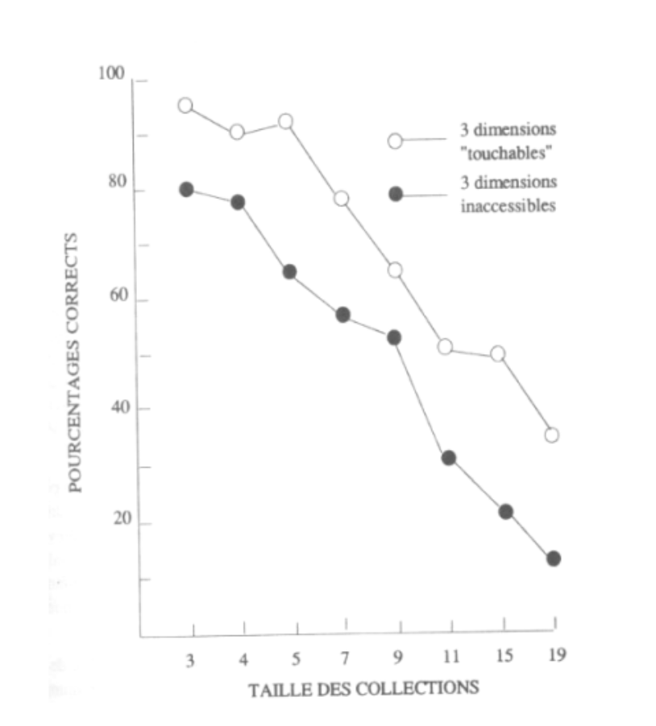
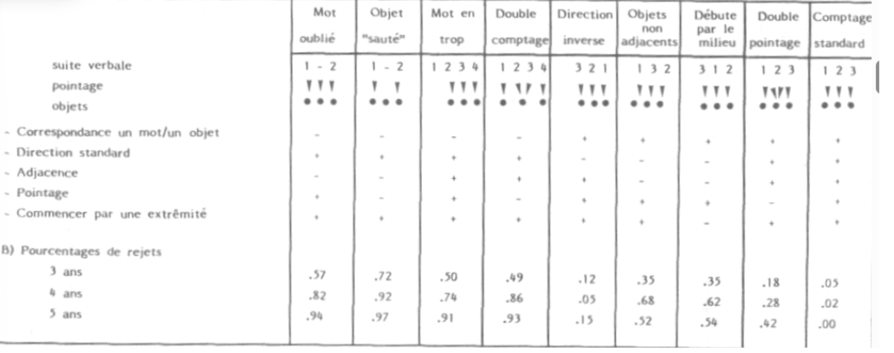
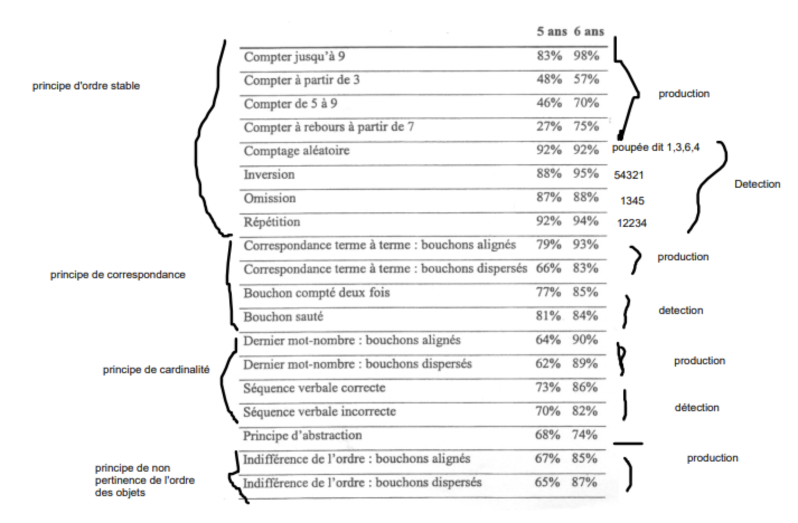
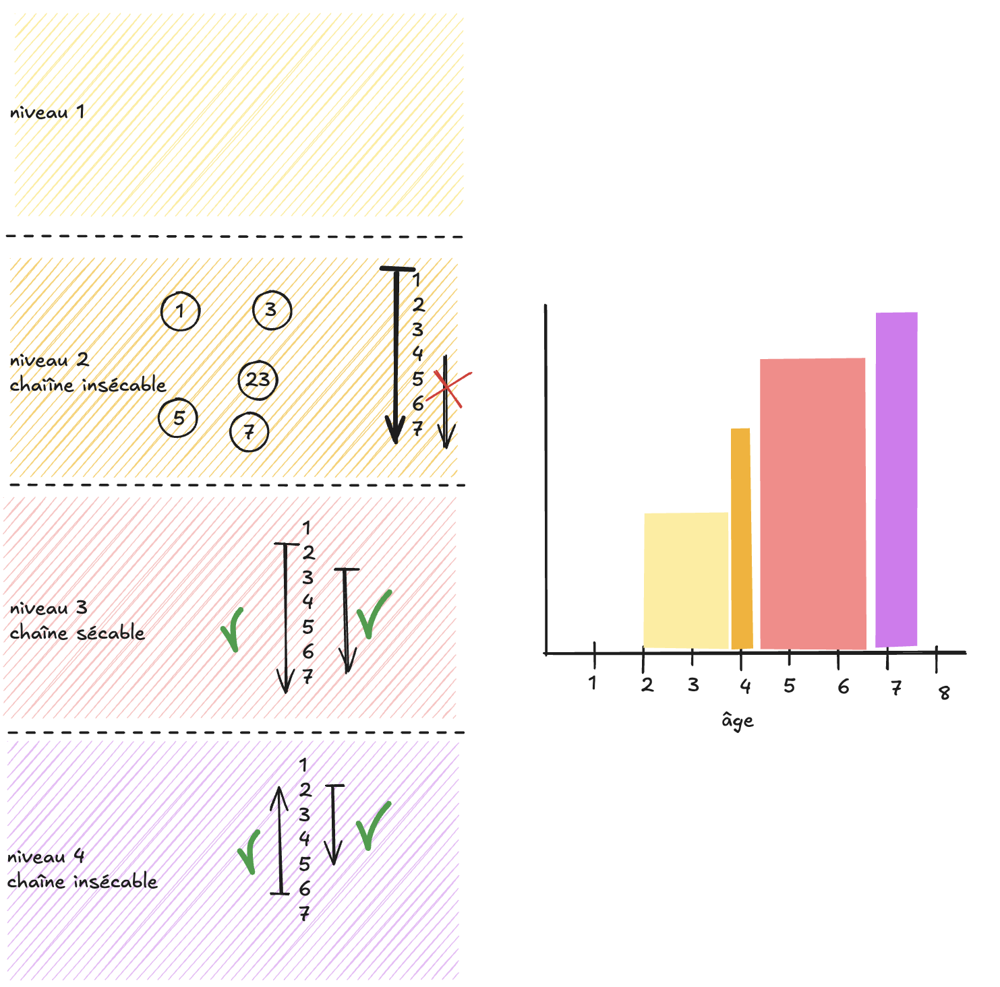
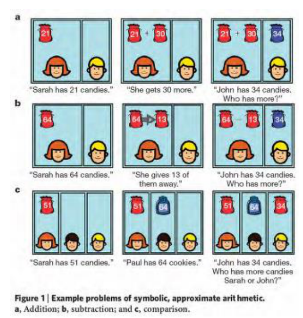
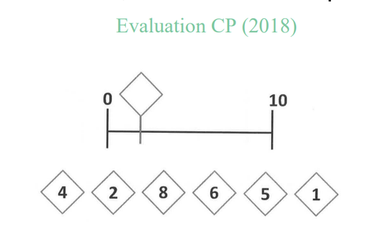
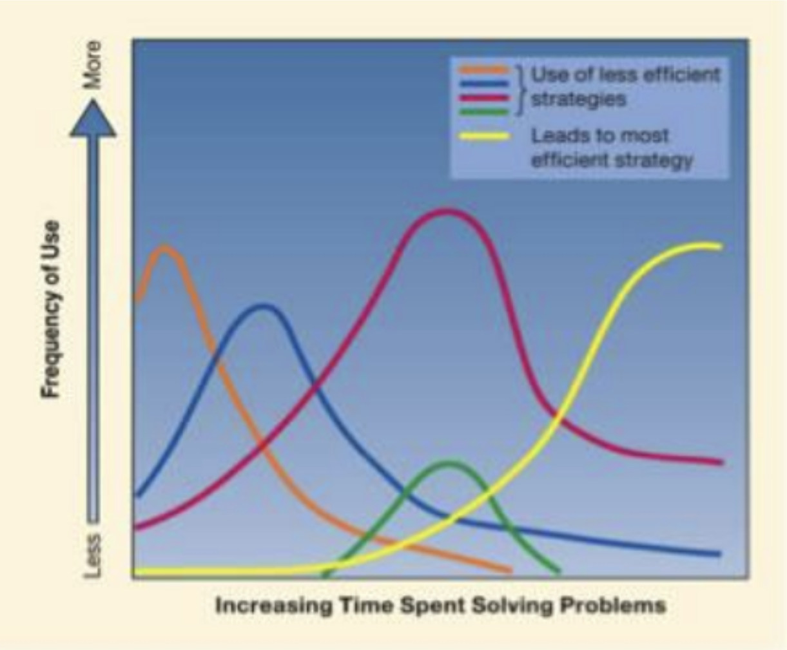
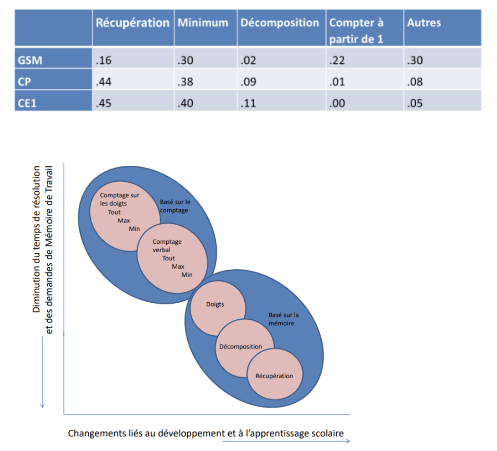
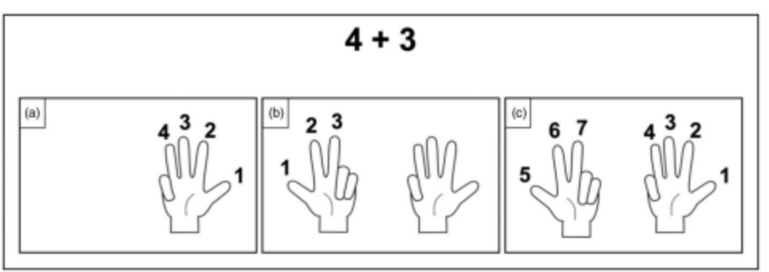
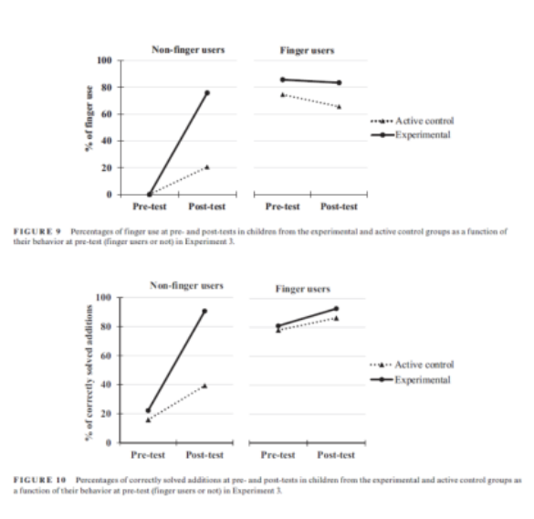

<!-- sourc : 4_dev_cog.md -->

# Partie II - Développement du Nombre

::: {.callout-note}
Estimation de l'intégrité de la prise de note : `8/10`
:::

## 1. Histoire du nombre

Chiffres : unités qui nous permettent d'écrire les nombres. Ils ont une histoire
chaotique et mondiale. Les nombres n'ont longtemps pas existé. Les 3 premiers
nombres ont un statut particulier et, pour les deux premiers, sont toujours
nommés dans les cultures. En revanche, 3 veut souvent dire "plus que 2". C'est
un peu la limite de notre perception pour voir un en coup d'œil, au-delà duquel
il faut faire un traiement séquentiel. En français, trois vient de très qui
vient de trans (au-delà). En latin aussi, en anglais aussi, arabe.

**Premier niveau : quantification agie** : correspondance terme-à-terme, quand
on fait correspondre à chaque élément d'une collection les éléments d'une autre
collection. On utilise des moyens concrets en égalisant des collections de
choses. Entailles dans la roche pour compter le bétail en Mésopotamie. On peut
aussi compter avec le corps humain pour cette correspondance terme-à-terme. Ils
vont nommer leurs parties du corps et les utiliser à la place de chiffres.

**Deuxieme niveau : représentation concrète des nombres élevés.** On va
remplacer les cailloux par des bâtonnets, qui donne le niveau de représentations
concrètes des nombres élevés (premiers par vers la symbolisation, apparition de
la base). On va commencer à remplacer des grosses quantités de petits cailloux
par des gros cailloux. Base 10 vient des doigts de la main. Base 60 en
mésopotamie viendrait du croisement de deux populations utilisant la base 5 et
l'autre 12 (provenant des articulations de la main) et on multiplie le tout.
12000 ans avant JC, on remplace cailloux par bâtons d'argile (calculies).

**3e niveau : graphisme remplace les calculies.** Civilisation de Sumer, où les
comptables écrivent sur des tablettes d'argiles, où on représente des quantités
par des signes.

**4e niveau : quand on bascule des symboles (lien entre signifié et signifiant)
vers les signes (pas de lien entre signifié et signifiant)**. Les civilisations
ont souvent des symboles jusqu'au 3. On développe alors des signes pour les
quantités, ce qui nous renvoie à ce qu'on disait au début du cours sur les
limites de la perception.

**5 niveau : on a un signe pour chaque chiffre, le principe de position, et le
0** qui apprait en 500 avanat jésus-christ au nord de l'Inde. Le principe de
position est qu'on met les unités à droite, puis dizaines à gauche, et centaines
encore à gauche etc. Les arabes vont après diffuser ces chiffres dans le reste
du monde.

## 2. Approche structuraliste du nombre (Piaget)

On a deux types de nombres : le **nombre ordinal** repose sur sériation et de
relations asymétriques entre les quantités. Le **nombre cardinal** est la
quantité, le nombre d'éléments dans un ensemble. Repose sur la notion
d'inclusion de classes. Dans 7, il y a toutes les quantités jusqu'à 7 qui sont
incluses.

Piaget part de ces deux aspects du nombre, et regardent comment ils se
construisent chez l'enfant. On aurait deux systèmes logiques propres à chacun.
La logique du nombre sera acquise quand l'enfant maîtrise les deux. Celles-ci se
construisent simultanément. Il met au point des épreuves sur la logique de
l'enfant dans ces fonctions. Pour étudier la logique du nombre ordinal il étudie
la sériation, et cardinal l'inclusion des classes. Il va aussi étudier le
développement de la conservation du nombre. Le nombre d'éléments d'un ensemble
est identique quelque soit la disposition spatiale des objets qui le compose.

**Épreuve des jetons** : on présente une ligne de jetons à l'enfant, on demande
"est-ce qu'il y a la même chose de jetons dans les deux lignes ?"

- Intuition simple : 4-5 ans
- 5-6 ans : intution articulée par correspondance terme-à-terme, mais si on
  écarte ou ressere les jetons et qu'on pose la question ils pensent qu'ils y en
  a plus
- Réussite opératoire : 7 ans, arguments d'identité (« c'est les mêmes, on n'a
  rien enlevé ni ajouté »), de réversibilité (« on peut remettre les jetons
  comme avant »), de compensation (« la ligne est plus longue mais les jetons
  sont plus espacés »)

**Épreuve de sériation** : ranger des baguettes de la plus petite à la plus
grande. 3 niveaux de réussite :

- Intuition simple (avant 5 ans) : font des groupes de deux, avec une petite,
  une grande, mais n'utilise pas toute la série; ou rangent le haut des
  baguettes dans un ordre croissant sans prendre en compte leur taille réel
  (erreur perceptive)
- Intuition articulée (5 ans) : les enfants font la série par tâtonnement par
  essai/erreur
- Réussite opératoire (6 ans et plus) : utilisent des méthodes systématiques :
  - Algorithme extremum : met les plus extrêmes en premier
  - Insertion : compare les baguettes en paires

Ça lui permet de comprendre le **principe de transitivité** : si A < B et B < C
alors A < C.

Épreuve de **classification et de quantification de l'inclusion des classes**.
On prend une classe (fleurs) avec deux types de fleurs (rose et marguerite). On
vérifie qu'il sait bien que les deux sont des fleurs. On va mettre plus de
marguerites que de roses. On lui demande de comparer le nombre de marguerites
aux nombres de fleurs.

Pour construire les classes logiques, l'enfant doit comprendre la relation entre
compréhension et extension : les critères d'une classe et les objets qu'elle
contient. Ces deux aspects varient en sens inverse : plus on ajoute de critères,
plus la classe est restreinte (« fleur » a une extension large, « rose » une
extension étroite).

- **Compréhension** : ensemble des propriétés (ressemblances et différences) qui
  définissent la classe, c'est-à-dire les critères auxquels on reconnaît qu'un
  élément en fait partie.
- **Extension** : ensemble des éléments qui satisfont ces critères, autrement
  dit la classe elle-même, dans sa portée.

Chez l'enfant de moins de 8 ans, il répond qu'il y a plus de marguerites car il
n'y a que 2 roses. Au lieu de comparer A à B (marguerites aux fleurs), il
compare A à A' (marguerites aux roses). Réussir cette épreuve veut dire qu'il
peut réussir 2 opérations :

- **Réunion** : A et A' font partie de B (B = A + A')
- **Dissociation** : B - A' = A

Donc pour Piaget, qui s'intéresse à la logique, il y a 3 opérations nécessaires
à la logique du monde. Décomposer les nombres est très important pour le calcul,
il faut que l'enfant réussisse ces épreuves.

<!-- sourc : 6_nombres.md -->

## 3. Approche fonctionnaliste

Cette approche s'intéresse à la fonction des comportements de nombre.

**Dénombrement** : mise en correspondance terme à terme des éléments d'une
collection avec les éléments de la suite conventionnelle des noms des nombres
(correspondance terme à terme). Deux théories expliquent son développement.

La première est la **théorie innéiste de Gelman** : théorie des principes en
premier (83). Si les animaux sont capables de traiter les nombres, alors ça doit
aussi exister chez l'homme. Chomsky (linguiste) dit qu'il y a un programme
langage inné, grammaire universelle. Si ça existe pour les animaux, ça peut
exister chez les enfants.

On fait une expérience pour observer comment ça se passe chez les petits enfants
(compétence basique de compter les petits objets) :

- Effet de la taille des collections (plus ils sont grands, plus taux d'erreur
  est grand)
- Effet de la manipulation (meilleure performance quand peuvent toucher les
  objets)

**Conclusion** : le dénombrement met en jeu d'**autres activités que la simple
énumération des nombres** (pointage, contrôle visuel). De plus, la possibilité
de garder la trace du déjà compté par rapport à ce qui reste à compter dépend
d'éléments **facilitateurs ou inhibiteurs** : taille des collections, agencement
spatial (si en ligne ça va mais si dispersé faut avoir une bonne stratégie pour
pas compter 2x le même objet), accessibilité des éléments (si on peut les
déplacer), stratégies dont dispose l'enfant...

Il faut aussi faire la différence entre compétence et performance :

- **Compétence** : potentialité qu'on a, ce qu'on est capable de faire de
  manière générale.
- **Performance** : résultat à un moment donné, dans une tâche donnée (c'est ce
  qu'on mesure)

Donc on peut avoir la compétence sans avoir la performance. Mais quand on est
psychologue, il faut s'approcher au plus près de la compétence et pas que
mesurer la performance (difficile). Retour à Gelman : ils approchent au plus
près de la compétence, mettent dans des conditions optimales pour montrer que la
compétence existe.

**Expérience 2** : une poupée compte à la place de l'enfant et il doit juste
dire si le comptage est correct ou non.

Conclusion : L'activité de dénombrement est susceptible d'être analysée et
dissociée en composantes plus élémentaires (voir les 5 principes). Ces
composantes concernent au moins :

- Le **repérage spatial ou temporel du déjà compté** par rapport à ce qui est
  encore à compter. Enfant avec difficultés visuo-spatiales en échec, même s'ils
  maîtrisent le dénombrement.
- L'**énumération à bon escient de la série numérique** (faut connaître la
  chaîne numérique verbale sans faire d'erreurs (1,2,3,4,5 etc et pas 1,2,6,4,8)
- La **coordination de ces deux activités** pour éviter le double comptage ou
  l'oubli (a et b)

Toute aggravation des contraintes situationnelles liées à l'exécution de l'une
ou l'autre de ces composantes entraîne chute de perf. À l'inverse, moins de
contraintes révèle des compétences plus précoces. Ici, Gelman allège beaoup ses
taches pour voir les compétences, Piaget faisait l'invers : il piège pour voir
si la logique suit. Attention, dans une tâche, l'échec peut être à cause de la
tâche ou de la compétence qui manque chez l'enfant.

Les 5 principes fondamentaux de comptage (Gelman, 78) :

- Principe d'**ordre stable de la chaîne verbal** : les mots nombres doivent
  être engendrés dans le même ordre à chaque comptage
- Principe de **stricte correspondance terme à terme entre objets comptés et les
  noms de nombre** : chaque élément de collection doit être désigné par un
  mot-nombre et un seul
- Principe de **cardinalité** : le mot nombre qui désigne le dernier élément
  compté d'une collection représente le nombre total d'éléments.
- Principe d'**abstraction** : seules sont abstraites des éléments comptés,
  leurs caractéristiques d'entités distinctes. L'hétérogénéité des collections
  n'a aucune incidence sur le dénombrement. Quand on compte, on s'en fout de ce
  que c'est comme objet. compter jouet ou voiture c pareil si on doit compter
  des jouets
- Principe de **non-pertinence de l'ordre des objets** : l'ordre dans lequel les
  éléments d'une collection sont énumérés n'affecte pas le résultat du comptage,
  à condition que le principe de correspondance terme à terme soit respecté.

C'est une **approche innéiste**, car on pense que les enfants auraient très tôt
la maîtrise de ces principes. Inné ne veut pas dire que la performance existe
déjà à la naissance, mais plutôt que c'est programmé dans le développement et
que ça va se découvrir seul. La compétence se dévoile en fonction de
l'environnement (maturation, tâche).

Résultat d'expérience sur cette théorie : les enfants maîtrisent-ils précocement
ces principes (Briars et Siegler, 84) ? 3 groupes d'âges (3,4,5). Tâche : poupée
qui compte et enfant doivent dire si comptage de la poupée est ok ou faux.

Les principes testés :

- Stricte correspondance terme à terme : double comptage, mot oublié, mot en
  trop, objet sauté : poupée ne respecte pas le principe
- **Pas** principe d'ordre stable : car elle dit toujours 123 dans l'ordre
- Principe de non-pertinence de l'ordre des objets : direction inverse, débute
  par le milieu, objets non adjacents.
- **Pas** principe de cardinalité car on ne demande pas à l'enfant combien à des
  jetons en tout à la fin

Résultats chez des adultes : `100, 100, 100, 100, 0, 0, 0, 0, 0`

Résusltats chez les enfants, par principe testé :

- Principe de stricte correspondance terme à terme : les enfants font de plus en
  plus de rejet correct au fur et à mesure de leur développement (au-dessus de
  90% dans toutes les conditions à cinq ans)
- Principe de non-pertinence de l'ordre des objets : les enfants font beauoup de
  rejets incorrects : plus de 50% et augmentent avec l'âge (sauf sur direction
  inversée).

Les principes sont loin d'être innés à trois ans. Mais gros effet de l'âge (du
développement) sur correspondance terme à terme. Les enfants progressent sur le
principe : performance meilleure à trois ans qu'à quatre ans.

C'est à cause de l'environnement et de l'école que les performances baissent :
ils apprennent à compter avec les procédures que tout le monde utilise. Ils
intègrent que faire un bon comptage, c'est d'aller de gauche à droite. Donc
quand on fait autrement, ils rejettent le comptage. Les performances remonteront
par ailleurs. Donc ce principe pas inné non plus, mais on constate influence de
l'école et de l'apprentissage.

Donc cette étude de Briars et Siegler remet en question le principe inné de
cette théorie.

Expérience : Grégoire et Van Nieuwenhoven (95)

Sur une population de 439 enfants de 5 ans et 103 enfants de 6 ans (entrée en CP
à six ans).

Principes testés :

- Principe d'ordre stable : tout le premier bloc de comptage (production) + le
  premier bloc de détection
- principe de stricte correspondance terme à terme : production bouchons alignés
  \+ dispersés + les 2 détections d'en dessous
- Cardinalité : dernier mot nombre alignés et dispersés en production + séquence
  verbale correcte et incorrecte en détection
- Principe d'abstraction : production
- Indifférence de l'ordre : alignés et dispersés en production.

Meilleur performance en détection qu'en production (plus facile de détecter les
erreurs des autres personnes). Globalement, meilleurs performance à six ans qu'à
cinq ans. Donc globalement, l'école marque des changements importants dans les
perfs.

**Théorie des principes après** (ou des procédures d'abord) : les principes
seraient progressivement abstraits d'une pratique répétée des procédures de
dénombrement acquises par imitation.

Ce qu'il faut retenir : Travaux de Gelman très influents et importants.
Complémentarité sur Piaget, car pas la même logique. Mis l'accent sur
distinction compétence et perf et décomposé la tâche de dénombrement en pleins
de principes.

Aujourd'hui en test de dyscalculie : épreuve de logique, épreuve avec les
principes de Gelman.

## 4. Que faut-il privilégier dans les apprentissages (activités logico-mathématiques ou activités numériques) ?

Expérience de Clements (84) : Enfant de quatre ans, début d'apprentissage du
nombre. Entraînement sur différentes tâches (numérique ou logico-mathématiques) :
3 séances de 20 minutes par semaine pendant 8 semaines. Les 2 types de tâches :

- Activités numériques : activités avec des stratégies de comptage, trouver et
  produire des numérosités (combien d'éléments dans un ensemble)
- Activités logiques : activités à propos de la sériation et classification.

En post test, on donne les mêmes activités qu'en pré-test. Groupe contrôle :
activité de lecture pour éviter l'effet Hawthorne. Résultats :

- Groupes expérimentaux ont un gain plus important que les contrôles.
- Gains en épreuve logique identiques pour les deux groupes expérimentaux.
- Gains beaucoup plus important pour le groupe numérique sur les épreuves
  numériques. Mais aussi sur les épreuves de conservation.

**Transfert du nombre vers la logique plus probable que l'inverse.** Sur
l'épreuve de conservation le groupe numérique avance plus vite que le groupe
logique. On peut donc conclure que faire des travaux juste centrés sur la
logique ne sont pas si pertinentes que ça.

## 5. Nombres et langage

Le nombre est un apprentissage qui se fait dans une culture donnée. Les nombres
vont donc être rencontrés par l'enfant dans différents contextes :

- Mathématiques :
  - Cardinal
  - Ordinal
  - Mesure (quantité donnée avec unité)
- Renvoyant aux outils culturels
  - Contexte de séquence
  - Contexte de dénombrement (combien est-ce qu'on va être à table pour les
    couverts ?)
  - Contexte de lecture : quand l'enfant apprend à reconnaître les chiffres
    écrits
  - Contexte de situations quasi numériques (lignes de bus, téléphone, heure)

Étapes du développement de la chaîne numérique verbales :

- Niveau 1 : **niveau du chapelet** (2-4 ans), on répète je crois mais ça veut
  pas dire qu'on sait compter
- Niveau 2 : **chaîne insécable** (4 ans), les mots sont bien individualisés,
  commencent à être associés à des objets, commencent à être capables de compte
  jusqu'à un nombre donné, avec fort taux de contrôle. Mais ils ne peuvent pas
  compter à partir d'un nombre donné, d'où le terme "insécable"
- Niveau 3 : **chaîne sécable** (4-6 ans), est capable de partir d'un nombre
  donné, ou entre 2 nombres. Développent de la flexibilité dans l'utilisation de
  la chaîne numérique verbale
- Niveau 4 : **chaîne terminale** (7 ans), peut compter n à partir de x dans
  n'importe quel sens. Commence à comprendre le rapport entre les nombres

Il faut garder en tête que les nombres oraux ont des nombres de phonèmes assez
importants. Deux façons principales d'écrire les nombres : chiffres indo-arabes
ou alphabétique. Le lexique en français contient 26 mots permettant de
construire tous les nombres. Il contient les nombres de 0 à 16. En français,
c'est le bordel, donc l'enfant fait des erreurs. **Surtout, les règles ne sont
pas les mêmes à l'oral qu'à l'écrit, d'où les problèmes de transcodage, par
exemple écrire "1002" quand on demande "102".** En chinois la chaîne verbale est
beaucoup plus logique, ce qui les avantage.

## 6. Procédures de quantification

### 6.1. Dénombrement et subitizing

- **Dénombrement** : c'est la correspondance terme à terme des éléments d'une
  collection avec les éléments de la suite conventionnelle des noms de nombres.
- **Subitizing** : processus permettant de déterminer très rapidement et aec
  exactitude de la numérosité de petites collections d'éléments (3-4). Dans les
  collections plus grandes, il faut utiliser des capacités intentionnelles pour
  faire un dénombrement

Mandler et Shebo constatent que plus les collections augmentent, plus on met du
temps à répondre et on fait des erreurs, alors que de 1 à 3, c'est identique, ce
qui impliquerait que les processus attentionnels ne sont pas recrutés, ce sont
pas les mêmes processus.

**Mais comment est-ce que les enfants acquièrent le sens cardinal des petits
nombres ?** Par le comptage ou le subitizing ? On fait 2 tâches sur enfants de 3
à 5 ans où on présente des collections de 1 à 6 points.

- Dans une première tâche, la **présentation est simultanée,** les collections
  sont présentées rapidement sur un écran d'ordinateurs. L'enfant doit dire
  combien il y a de points.

- La seconde, en **présentation successive**, les éléments sont présentés
  séquentiellement. L'enfant doit compter les points au fur et à mesure de leur
  présentation et ensuite indiquer combien il y en a.

Pour chacune des présentations, on va utiliser des configurations familières
(dés) ou non familières. Taille des collections : petites numérosités (de 1 à 3)
et grandes numérosités (de 4 à 6).

L'essentiel des résultats est que :

- Présentation simultanée > présentation séquentielle pour petites collections.
  Le subitizing permettrait ici aux enfants de déterminer les nombres d'éléments
  dans les petits ensembles
- À 4 ans, problème de la cardinalité après le comptage
- À 5 ans, pas de différence entre les tâches

Effet du type de configuration (familière vs non familière) indépendamment de
l'âge.

**Le subitizing est donc important dans le comptage pour exprimer la
cardinalité.**

### 6.2. L'estimation : système du nombre approximatif (SNA)

**L'estimation est une procédure peu précise sur des grandes collections.**
C'est un système universel présent chez les animaux, être humaine dès la
naissance, chez l'adulte dans toutes les cultures.

Il y a des illusions reliées, comme celle du solitaire : les points plus denses
donnent une impression d'être plus nombreux que moins denses.

Estimation dépend de la loi de Weber : la capacité à différencier deux quantités
ne dépend pas de leur différence absolue, **mais de leur différence relative
(ratio)**. Avec le développement, les enfants détectent des différences de
quantités avec des rations de plus en plus proches de 1.

Les enfants s'appuient-ils sur le **système du nombre approximatif (SNA)** pour
réaliser des calculs symboliques approximatifs ? Étude sur enfants de 5 ans, ne
savant donc pas faire de calcul exact, à qui on va raconter des petits scénarios
dans lesquels on demande lequel de 2 personnages ont plus ou moins de bonbons.
Réponses bien au-dessus du hasard qui veut dire que ces enfants sont **capables
de faire du calcul approximatif**.

C'est surprenant qu'il y ait ce système de nombre approximatif qui permet
d'exprimer des quantités et peut faire du calcul approximatif. Et pourtant,
quelques années plus tard, au terme d'une intense application, un écolier
conclut sans sourcilier que 317 moins 81 fait 376, c'est qu'il y a un problème
avec l'école française.

<!-- source : 7_nombres.md -->

Système du nombre approximatif meilleur = meilleur apprentissage des maths. Et
inversement. Mais on constate une différence entre les individus qui ne vont pas
du tout à l'école et ceux qui n'y vont pas (chez des enfants d'amazonie). Chez
les premiers, la précision de l'approximate number sense.

## 7. Nombre, quantité et espace

### 7.1. Effets Stroop

On perçoit des quantités quand on perçoit des nombres. Quand on perçoit un
nombre, le cerveau active une quantité. On fait un Stroop avec des chiffres où
on fait varier leur taille physique. Effet de la congruité de la taille des
nombres (décider si un nombre est plus grand qu'un autre, en présentation de
paires de nombres). C'est pour ça qu'on l'a appelé effet Stroop-nombre. Mais
chez les enfants, c'est dur à faire, car mesure de temps de réponse et doivent
être familiers avec les nombres symboliques.

3 effets importants :

- **Effet de distance** : le temps nécessaire pour décider lequel de deux
  nombres est le plus grand diminue avec l'augmentation de la distance numérique
  avec ?? Cet effet de distance existe très tôt.
- **Effet de taille** : plus les nombres à comparer sont grands, plus les temps
  de réponses sont lents. Cela s'expliquerait par la fréquence plus grande des
  petits nombre, qui leur confère une représentation plus précise
- **Effet SNARC (Spatial Numerical Association Response Codes)**, les petits
  nombres sont inconsciemment associés au côté gauche du corps et les grands au
  côté droit. La tâche est plus facile pour les suejts qui doivent dire petit
  avec la main gauche que l'inverse

### 7.2. Ligne numérique mentale

On va associer aux nombres des quantités qui sont continues : quand on entend 65
on active 65 et les quantités environnantes.

Travaux rendent compte de ligne numérique mentale, qui tentent de rendre compte
comment les nombres sont représentés dans notre système cognitif, surtout
représentation spatiale.

On présente aux enfants une ligne numérique qui va par exemple de 0 à 100, qui
ne sera pas graduée. On va demander à l'enfant "où est-ce que tu placerait 28
?". Les enfants ont des échelles logarithmiques.

- Enfant (entre GS et CE2) : échelle logarithmique → échelle linéaire
- Ligne de 0 à 10 : le % d'erreurs passe de 14% en fin de CP à 4% en fin de CE2.
- Ligne de 0 à 100 : le % d'erreurs passe de 19% en fin de CP à 8% en fin de
  CE2.

Puis nouvelle tâche pour enfants au début du CP. Forme plus classique : position
à mettre sur la ligne à partir d'un nombre donné. Que mesure cette épreuve ?
Magnitude des nombres, mais évolution des stratégies avec l'âge.

Il a été mis en valeur que le lien entre la qualité de la ligne numérique (donc
avoir une représentation linéaire) est associé à la réussite en maths, surtout
au CP et CE1.

Représentation unifiée de la genèse et développement de la représentation de la
quantité et du nombre :

## 8. Modèles développementaux

Pas à apprendre par cœur donc je relis même pas bonne chance

## 9. Calcul

### 9.1. Stratégies

Les opérations arithmétiques sont des manipulations de symboles. Elles doivent
aboutir aux mêmes résultats que la manipulation d'objets concrets. Il faut donc
apprendre à manipuler des symboles.

Pour mettre en œuvre les opérations arithmétiques, il faut :

- Des connaissances conceptuelles : analyser la situation, choisir la stratégie,
  mettre en œuvre
- Connaissance de certains faits arithmétiques : pour exécuter la stratégie
  choisie, il faut connaître certains faits numériques, utilisables sans
  calucules (par exemple : 3+3 font 6)
- Connaissance des algorithmes : suites d'étapes à appliquer suivant
  rigoureusement l'ordre et les règles (par exemple : additions avec retenues)

Une **stratégie** est une procédure ou ensemble de procédure permettant
d'atteindre un but cognitif. Le calcul mental est une activité fondamentale qui
est mise en œuvre quotidiennement. Il y a plusieurs stratégies, surtout plus
jeunes, qui disparaissent avec l'âge pour laisser place à des stratégies plus
élaborées. Cette progression est illustrée dans le modèle des **vagues qui se
chevauchent**. Ici, les stratégies sont en compétition, l'une va dominer les
autres à un moment donné dans une situation donnée.

Ce modèle est applicable au calcul mental, mais pas à d'autres compétences qui
demandent des stratégies.

<!-- sourc : 8_nombres.md -->

Le temps de résolution diminue avec le temps (donc apprentissage) et la
récupération sollicite beaucoup moins la mémoire de travail que d'autres
stratégies. Donc plus on avance, moins on utilise la MdT pour ces calcules afin
de la conserver pour autre chose.

Qu'est-ce qui fait qu'un enfant choisit une stratégie plutôt qu'une autre ?

- Difficulté du problème
- Temps dont dispose l'enfant
- Facteurs cognitifs : sa base de connaissance en calcul (bon = récupération,
  mauvais = calcul)
- Facteurs conatifs : confiance que l'enfant a en lui et en ses réponses,
  anxiété

### 9.2. Compter sur les doigts

Compter sur les doigts serait très adapté, car ça fait une bonne stratégie qui
est tout le temps accessible. Il faut tout de même passer d'une stratégie
externalisée à une stratégie internalisée

Les enfants entre 4 et 6 ans qui utilisent leurs doigts ont leurs perfs plus
élevées en calcul et capacité élevée de MdT. À huit ans, c'est le contraire.

On a fait un protocole pour entraîner les enfants au comptage sur les doigts. On
entraîne par 2 stratégies différentes : la stratégie "tout", ou par répétition
par cœur des mêmes calculs (groupe contrôle actif). Entraînement dure sur 2
semaines, 6 \* 10 minutes, 15 additions au total.

Les enfants qui n'utilisaient pas leurs doigts l'utilisent plus, et ont aussi de
meilleurs performances grâce à l'entraînement.

### 9.3. Les multiplications

On va plus utiliser la mémoire pour les multiplications. Cependant, les traces
ne sont pas indépendantes, elles sont **associatives**, il peut donc y avoir des
interférences entre elles. C'est délétère, car un calcul active plein de
résultats différents ($6 \times 7 = 42\ \text{or}\ 49$) par exemple.

Cet effet se manifeste dans une tâche où on demande de sélectionner la bonne
réponse pour $6 \times 7$ parmi 4 propositions. Tout le monde n'a pas la même
sensibilité à l'interférence, ce qui va pénaliser certains à l'apprentissage des
tables.

## 10. Approche neuropsychologique

### Modèle du triple code

C'est un modèle très connu et utilisé, provenant de la neuropsy de l'adulte, sur
des patients cérébro-lésés. On aurait différents codes ayant chacun un substrat
anatomique particulier.

- Code analogique, ou des quantités, dans les zones pariétales bilatérales,
  souvent codé symboliquement, qu'on peut représenter de 2 manières différentes.
  - Par des quantités concrètes (points)
  - Par une ligne numérique mentale
- Code verbal : mot "six", oral ou écrit. Dans les aires du langage de l'HG
- Code arabe : nombre écrit en chiffres arabes. Zone occipito-temporale

Code verbal et arabe sont des symboles, alors que le code analogique renvoie à
l'aspect sémantique du nombre, c'est lui qui lui confère son sens. L'adulte fait
très facilement du transcodage entre ces codes. Mais c'est plus dur pour les
enfants. Ils développent en premier le code des quantités, puis verbal, puis
arabe. Le plus important est le développement du transcodage, qui doit se faire
vite et sans difficultés. C'est ce sur quoi on les fait beaucoup travailler.

Lien entre maturation du lobe pariétal et de la représentation des quantités. On
cherche un lien causal anatomo-fonctionnel entre le **degré de maturation du
lobe pariétal et les capacités de représentations des quantités**. Plus
précisément, on s'attend à ce que les **performances perceptivo-tactiles
permettent mieux de prédire les performances arithmétiques que le développement
intellectuel**. On a fait une étude longitudinale sur enfant de GS, CP et CE2.
On leur a évalué :

- Le développement intellectuel
- Habiletés perceptivo-tactiles, gnosie digitale
- Arithmétique
- Épreuve de français au Ce2

Résultats : dans l'écriture du nombre, QD est le meilleur prédicteur, mais pour
la quantité, score neuropsy.
