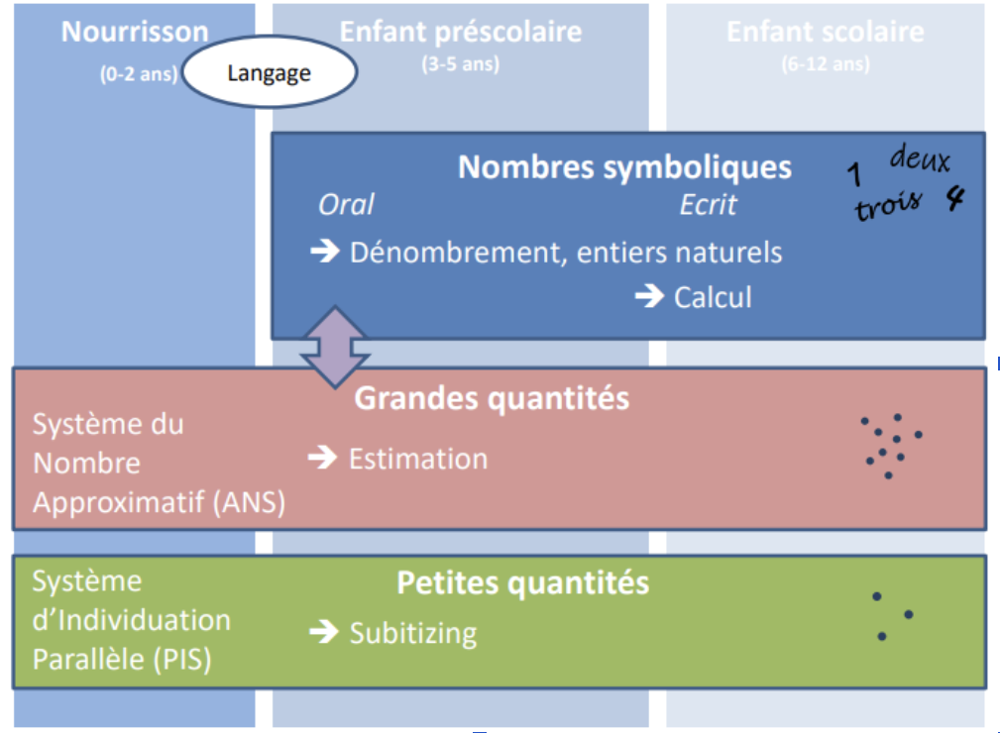
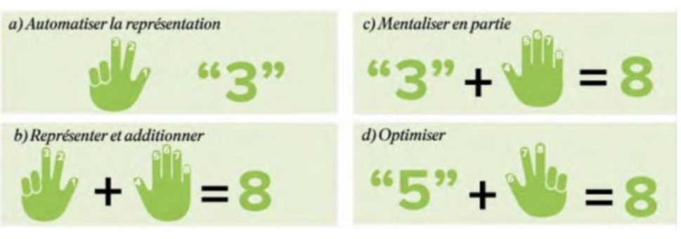
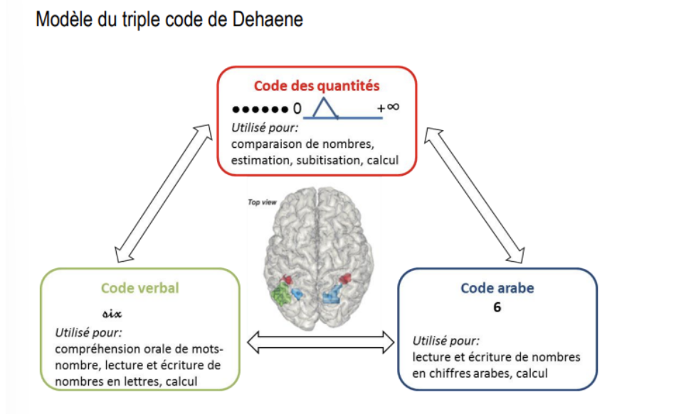

<!-- source: 4_dev_cog.md -->

# Partie II - Développement du Nombre

- [[1_4_dev_cog]]
- [[ii_dev_cog]]
- [[iii_dev_cog]]

## Histoire du nombre

Chiffres : unités qui nous permettent d'écrire les nombres. Ils ont une histoire
chaotique et mondiale. Les nombres n'ont longtemps pas existé. Les 3 premiers
nombres ont un statut particulier et, pour les deux premiers, sont toujours
nommés dans les cultures. En revanche, 3 veut souvent dire "plus que 2". C'est
un peu la limite de notre perception pour voir un en coup d'œil, au-delà duquel
il faut faire un traiement séquentiel. En français, trois vient de très qui
vient de trans (au-delà). En latin aussi, en anglais aussi, arabe.

Premier niveau de la quantifiaction agie// nous la correspondance terme-à-terme,
quand on fait correspondre à chaque élément d'une collection les éléments d'une
autre collection. On utilise des moyens concrets en égalisant des collections de
choses. Entailles dans la roche pour compter le bétail en mésopotamie. On peut
aussi compter avec le corps humain pour cette correspondance terme-à-terme. Ils
vont nommer leurs parties du corps et les utiliser à la place de chiffres.

On va remplacer les cailloux par des bâtonnets, qui donne le niveau de
représentations concrètes des nombres élevés (premiers par vers la
symbolisation, apparition de la base). On va commencer à remplacer des grosses
quantités de petits cailloux par des gros cailloux. Base 10 vient des doigts de
la main. Base 60 en mésopotamie viendrait du croisement de deux populations
utilisant la base 5 et l'autre 12 (provenant des articulations de la main) et on
multiplie le tout. 12000 ans avant JC, on remplace cailloux par bâtons d'argile
(calculies).

3e niveau : graphisme remplacer les calculies. Civilisation de Sumer, où les
comptables écrivent sur des tablettes d'argiles, où on représente des quantités
par des signes.

4e niveau : quand on bascule des symboles (lien entre signifié et signifiant)
vers les signes (pas de lien entre signifié et signifiant). Les civilisations
ont souvent des symboles jusqu'au 3. On développe alors des signes pour les
quantités, ce qui nous renvoie à ce qu'on disait au début du cours sur les
limites de la perception.

5 niveau : on a un signe pour chaque chiffre, le principe de position, et le 0
qui apprait en 500 avanat jésus-christ au nord de l'Inde. Le principe de
position est qu'on met les unités à droite, puis dizaines à gauche, et centaines
encore à gauche etc. Les arabes vont après diffuser ces chiffres dans le reste
du monde.

## Acquisition du nombre au cours du développement

On a deux types de nombres : le **nombre ordinal** repose sur sériation et de
relations asymétrique entre les quantités. Le **nombre cardinal** est la
quantité, le nombre d'éléments dans un ensemble. Repose sur la notion
d'inclusion de classes. Dans 7 il y a toutes les quantités jusqu'à 7 qui sont
incluses.

FIX: je pense qu'il me manque un truc là sur les logiques de piaget

Piaget part de ces deux aspects du nombre, et regardent comment ils se
construisent chez l'enfant. On aurait deux systèmes logiques propres à chacun.
La logique du nombre sera acquise quand l'enfant maîtrise les deux. Celles-ci se
construisent simultanément. Il met au point des épreuves sur la logique de
l'enfant dans ces fonctions. Pour étudier la logique du nombre ordinal il étudie
la sériation, et cardinal l'inclusion des classes. Il va aussi étudier le
développement de la conservation du nombre. Le nombre d'éléments d'un ensemble
est identique quelque soit la disposition spatiale des objets qui le compose.

Épreuve des jetons : on présente une ligne de jetons à l'enfant, on demande
"est-ce qu'il y a la même chose de jetons dans les deux lignes ?"

![[4_dev_cog 2026-10-22 20.01.40.excalidraw]]

- Intuition simple : 4-5 ans
- 5-6 ans : intution articulée par correspondance terme-à-terme, mais si on
  écarte ou ressere les jetons et qu'on pose la question ils pensent qu'ils y en
  a plus
- Réussite opératoire : 7 ans, arguments d'identité, de réversibilité, de
  compensation <!-- FIX: les détailler -->

Épreuve de sériation : ranger des baguettes de la plus petite à la plus grande.
3 niveaux de réussite :

- Intuition simple (avant 5 ans) : font des groupes de deux, avec une petite,
  une grande mais n'utilise pas toute la série. ou font qqch de croissant sur le
  haut des baguettes mais sans prendre en compte la taille réelle des baguettes
  (perceptif)
- Intuition articulée (5 ans) : les enfants font la série mais par tâtonnement
  par essai/erreur
- Réussite opératoire (6 ans et plus) : utilise des méthodes systématiques :
  - Algorithme extremum : met les plus extremes en premier
  - Inserrtion : compare les baguettes en paires

Ça lui permet de comprendre le principe de transitivité : si A < B et B < C
alors A < C.

![[4_dev_cog - conservation et seriation 2026-10-22 20.43.52.excalidraw]]

Épreuve de classification et de quantification de l'inclusion des classes. On
prend une classe (fleurs) avec deux types de fleurs (rose et marguerite). On
vérifie qu'il sait bien que les deux sont des fleurs. On va mettre plus de
marguerites que de roses. On lui demande de comparer le nombre de marguerites
aux nombres de fleurs.

Pour construire les classes logiques, l'enfant doit comprendre la relation entre
compréhension et extension : les critères d'une classe et les objets qu'elle
contient. Ces deux aspects varient en sens inverse : plus on ajoute de critères,
plus la classe est restreinte (« fleur » a une extension large, « rose » une
extension étroite).

- **Compréhension** : ensemble des propriétés (ressemblances et différences) qui
  définissent la classe, c'est-à-dire les critères auxquels on reconnaît qu'un
  élément en fait partie.
- **Extension** : ensemble des éléments qui satisfont ces critères, c'est-à-dire
  la classe elle-même, dans sa portée.

Chez l'enfant de moins de 8 ans, il répond qu'il y a plus de marguerites car il
n'y a que 2 roses. Au lieu de comparer A à B (marguerites aux fleurs), il
compare A à A' (marguerites aux roses). Réussir cette épreuve veut dire qu'il
peut réussir 2 opérations :

- **Réunion** : A et A' font partie de B (B = A + A')
- **Dissociation** : B - A' = A

Donc pour Piaget, qui s'intéresse à la logique, il y a 3 opérations nécessaires
à la logique du monde. Décomposer les nombres est très important pour le calcul,
il faut que l'enfant réussisse ces épreuves.

![[4_dev_cog - inclusion des classes 2026-10-22 20.34.19.excalidraw]]

--------------------------------------------------------------------------------

<!-- source: 5_visages.md -->

# CM5 dev cog

- [[i. visages]]
- [[ii_visages]]

## 1. Introduction et méthodes d'étude

Pourquoi s'intéresser aux visages ? C'est un élément essentiel de notre
environnement. On étudie ça par préférence visuelle, comparaison visuelle par
paires et habituations/réaction à la nouveauté.

## 2. Le débat sur l'origine de la préférence pour les visages

### Les expériences fondatrices et la controverse

Yarbus, en 1967, pionner de l'eye-tracking, compare les patterns d'exploration
selon les consignes d'exploration visuelle d'un tableau.

Fantz en 1973 explore la préférence des bébés pour des stimuli "face-like", en
mesurant le temps de fixation pour différent stimuli. Il montre que les enfants
regardent plus les visages, mais n'en tire pas de conclusions. D'autres auteurs
s'y intéressent. D'autres chercheurs s'y collent, avec des stimuli très
primitifs de 3 points dans un sens ou dans l'autre. Ceux-ci montrent que les
nouveaux-nés regardent beaucoup plus les visages que non, et proposent
l'existence d'un mécanisme spécifique.

En 1991, on fait 2 expériences sur nouveaux-nés, où on mesure le degré de
rotation de la tête vers un stimuli, selon qu'il soit un visage, brouillé ou
vide. On regarde les visages plus. Ils ont par la volée montré les stimuli de la
précédente, et n'ont pas reproduit leurs résultats, qui a produit une
controverse. On remet en question l'importance de la structures des stimuli dans
la perception néo-natale, alors qu'on a une hypothèse forte et crédible qu'on
soit prédisposés à la perception des visages. En vérité, ça se distingue en deux :

- Apprentissage ultra-rapide
- Prédisposition hardwired

En 2017, Reid et al. cherchent à l'explorer chez les enfants dans le ventre, par
l'utilisation de lasers, avec les stimuli en triangle classiques et mesurant les
mouvements de l'enfant. L'enfant suit les mouvements des lasers. Enfants de 7-8
mois in utero. La différence est très significative.

### L'hypothèse spécifique : CONSPEC et CONLERN

Ils proposent des structures neuronales dans le TC qui serviraient de
détecteur-ultra précoce primitif spécifique aux visages, appelé CONSPEC
(*conspecific specification*). Et CONLERN (*conspecific learning*) se développe
plus pour mieux les détecter je crois.

### L'hypothèse généraliste : le biais top-heavy

Mais on propose une hypothèse qui met à mal : que ce mécanismes ne sont pas
spécifiques auvs visages, mais aux stimuli qui ont plus de choses en haut qu'en
bas ("top-heavy"). On utilise des stimuli de visages : endroit-enverse ;
configuration top-heavy à bottom-heavy, qui ne peuvent pas être vus comme des
visages, impliquant qu'on est sennsible au otp heavy. Et entre upright et
top-heavy, pas de différence. Gros argument de juste que haut des visages ont
plus d'informations.

### Le test EEG en frequency-tagging

Qu'est-ce qu'il faut croire alors ? On utilise en frequency-tagging paradigm en
EEG. On présente une information peu présente dans du bruit, on augmente son
contarste par rapport au bruit, puis on fait revenir le bruit. On la passe en
boucle. On mesure l'activité EEG, et on cherche une réponse spécifique à la
fréquence de la présentation de notre stimuli (par transformation de Fourier).
On obtient des pics d'énergie par unité temporelle. On utilise 3 types de
stimuli : upright, inverted, scrambled top-heavy. On cherche à montrer que
visage = top-heavy. Visages fait beaucopu plus qu'inversé, mais aussi plus que
top-heavy, à un âge ou les structures temporales du nouveau-né ne sont pas
matures pour traiter les visages. Donc c'est bizarre.

### L'hypothèse incarnée : la corrélation binoculaire

Dernier paradigme, de corrélation binoculaire. Nos yeux doivent reconstituer une
image en compensant un décalage, par corrélation binoculaire, qui trouve le
matching de 2 images qui donne le meilleur résultat. On va donc faire une
hypothèse incarnée, que les visages ont un statut particulier que si on ne fait
pas la corrélation, on voit les gens en double. Ça fait que image non corrélée à
beaucoup d'énergie dans son "œil central". Juste parce que c'est séparé d'une
même quantité d'espace. On sait que les nouveaux-nés ont une préférence pour les
barres horizontales que verticales, ou même de carrés. Ceci peut être expliqué
par le décalage de la décorrélation. Mais ça pose une problème, car on observe
pas d'effet d'orientation je crois ? Mais leur modèle permet pas d'expliquer
l'effet d'orientation, et effet tatcher (endroit / envers).

## 3. Effet Thatcher et arguments en faveur d'un système spécifique

On a tenté cet effet chez les nouveaux-nés : on les familiarise, moitié avec le
visage à l'enverse, l'autre à l'endroit. En phase de test on présente viasge
normal et altéré. À l'envers, pas de réponse différent, alors que surprise et
orientation quand c'est à l'endroit. Traitemnet serait donc similaire à l'adulte
à quelques jours de vie. On aurait donc bien un système spécifique de détection
des visages.

![[5_visages 2026-11-10 11.13.52.excalidraw]]

## 4. Le traitement holistique et configural

On peut cependant noter un certain nombre de subtilités dans ce traitement,
comme effet Thatcher, ou qu'on fait un traitement très globaliste des visages
comme le montre les visages coupés mélangés. Très holistique et amène à traiter
information différament. On peut aussi s'intéresser à l'information locale :
soit les traits du visage (premier ordre) ou des relations entre les traits
(second ordre). Si on fait un changemnet de configuration (écarté les yeux,
etc.). Pour les visages à l'envers, il est plus simple de détecter des
changements de premier ordre que de second. Dans les modèles de traitement des
visages, on implique des aires très variées pour le traitement des visages. On
aurait 2 systèms différents : un qui analyse regard, expression, etc., autre qui
fait l'identité. Au bout de 3 mois on aurait un système corticalisé capable de
tout ça.

<!-- FIX: diapo modèle -->

## 5. Le regard : un signal social particulier

Certains éléments composant les visages ont eux-même une structure particulière.
L'humain même particulièrement, ont le plus grand contraste, grâce à une
sclérate très blanche. On propose une explication évolutionnaire, que ça aide à
communiquer. Mais dans quelle mesure ces structures de l'œil vont aider au
traitement des visages ? Il y a beaucoup de travaux dans cette veine. Les
nouveaux-nés préfèrent les visages qui les regardent, même dans les
représentations schématiques.

## 6. Expressions faciales et perceptual narrowing

Études dans la perception des expressions, montrant qu'on détcte plus la peur
que tout. On construit des visages où on mélange différentes par de peur à joie.
On présente des détections d'émotions et réponse spécifique aux émotions dès 7
mois. Lors de la première année, on organise donc un système permettant de
reconnaître les expressions. Beaucoup de chercheurs explorent comment est-ce que
ce système s'ajuste. On va reprendre l'effet de perceptual narrowing, avec des
visages d'humains et de singes. On peut formuler l'hypothèse qu'on a un meilleur
potentiel de discriminiation jeune qu'adulte, même pour les primates
non-humains. C'est le cas, les enfants perdent la capacité à séparer les images
de primates. Mais comment est-ce possible ? Cette discrimination ne sert à rien,
voilà pourquoi. Ça s'exprime aussi dans "l'*other race effect*".

![[5_visages 2026-11-10 13.58.21.excalidraw]]

## 7. Exploration visuelle et cognition sociale

L'analyse visuelle d'une scène implique des parcours d'exploration spécifique.
Les visages ont souvent la même structure. Dans les situations réelles, cette
exploration s'adapte aux demandes du contexte (par exemple por comprendre
quelqu'un qui parle dans du bruit). Entre 6 et 9 mois, ils font très attention
aux mouvements de la bouche. Les visages et les humains qui les portent sont dse
signaux très important pour le développement de la cognition sociale, car on y
fait très attnetion. Si on veut apprendre à fonctionner socialement, il faut
faire attention aux éléments qui sont socialement importants. Il faut les
détecter, les déchiffrer, et y répondre de manière appropriée.

## 8. Attention aux visages dans le développement atypique

Syndrome de Williams est un déficit génétique rare, qui s'associe à une
attention extrêmement prolongée vers les visages. Déficits de cognition sociale,
hyper sociables. Dans TSA c'est réduction de l'attention vers les visages, qui
est associé à des déficits sociaux. Modulation du regard est maladroite. On
prend des enfants du même âge, avec des nouveaux distincts de compétences
nonverbales dû au développement typique ou atypique. Effet principal du type de
développement sur le temps de fixation sur les visages, TSA moins et William's
plus. On va s'intéresser à la capacité d'infére l'objet fixé à partir de
l'information extraite à partir des informations du visage. On code 3 types de
réponse : cible, erreur plausible, erreur implausible. Quand on donne
instruction qu'il faut regarder, les enfants TSA peuvent le faire. Mais si on
regarde le pattern, on passe beaucoup de temps sur le visage mais on fait
beaucoup d'erreurs, ils ne sont pas trop capable d'inférer l'objectif. Si on
leur donne comme consigne de détecter l'objet regardé, ils passeront plus de
temps à détecter les visages. Enfants WD font aussi plus d'erreur malgré
beaucoup de temps passé.

## 9. TSA et hypothèse CONSPEC

Très vite une hypothèse est venue : le TSA vient d'un déficit du CONSPEC, le
mécanisme primitif d'orientation des visages. On prend des adultes avec TSA :
point de fixation, et subliminalement on flashe un proto-visage en périphérie de
la croix de fixation, puis 2 série de 4 lettres. Tâche d'identification d'une
lettre particulière. On fait varier position du proto-visage : congruence avec
position de la lettre, incongruence. Mesure du temps d'identification
(droite/gauche). Du côté congruent, on fait baisser vitesse de détection de
manière significative. Même résultats chez enfants et adultes, donc argument que
système fonctionne correctement.

## 10. Études prospectives et trajectoire développementale

On suit un groupe de familles dont un enfant à du TSA. On attend que la maman
soit de nouveau enceinte. On a donc un groupe à risque d'autisme, et un autre
sans risque d'autisme. À 3 ans on fait passer un diagnostique de TSA, puis on
fait suivre 10 ans. Ils font un modèle de prédiction du risque TSA, dont le but
est que ce soit déterminable vers 6 mois. Résultat fondamental est que
l'attention sur les yeux est présent à la naissance mais décline entre 2 et 6
mois. Donc pas de déficit néo-natal chez enfants qui vont être diagnostiqués
TSA. Ça correspond à période du narrowing et mécanisme corticalisé.

![[5_visages 2026-11-11 10.22.07.excalidraw]]

--------------------------------------------------------------------------------

<!-- source: 6_nombres.md -->

- [[i_nombres]]
- [[ii_6_nombres]]
- [[iii_6_nombres]]

> FIX: rraattrrappeerr

**Transfert du nombre vers la logique plus probable que l'inverse.** Sur
l'épreuve de conservation le groupe numérique avance plus vite que le group
logique. On peut donc conclure que faire des trvaux juste centrés sur la
logiques ne sont pas si pertinentes que ça.

C'était les deux grandes théoriques classiques du développement du nombre chez
l'enfant.

## Nombre et langage

Le nombre est un apprentissage qui se fait dans une culture donnée. Les nombres
vont donc être rencontrés par l'enfant dans différents contextes :

- Mathématiques :
  - Cardinal
  - Ordinal
  - Mesure (quantité donnée avec unité)
- Renvoyant aux outils culturels
  - Contexte de séquence
  - Contexte de dénombrement (combien est-ce qu'on va être à table pour les
    couverts ?)
  - Contexte de lecture : quand l'enfant apprend à reconnaître les chiffres
    écrits
  - Contexte de situations quasi numériques (lignes de bus, téléphone, heure)

Étapes du développement de la chaîne numérique verbales :

![[6_nombres 2026-11-03 08.42.45.excalidraw]]

- Niveau 1 : niveau du chapelet (2-4 ans), on répète je crois mais ça veut pas
  dire qu'on sait compter
- Niveau 2 : chaîne insécable (4 ans), les mots sont bien individualisés,
  commencent à être associés à des objets, commencent à être capables de compte
  jusqu'à un nombre donné, avec fort taux de contrôle. Mais ils ne peuvent pas
  compter à partir d'un nombre donné, d'où le terme "insécable"
- Niveau 3 : chaîne sécable (4-6 ans), est capable de partir d'un nombre donné,
  ou entre 2 nombres. Développent de la flexibilité dans l'utilisation de la
  chaîne numérique verbale
- Niveau 4 : chaîne terminale (7 ans), peut compter n à partir de x dans
  n'importe quel sens. Commence à comprendre le rapport entre les nombres

Nombre oral, nombre écrit, et transcodage (passer d'un nombre à un autre)

Il faut garder en tête que les nombres oraux ont des nombres de phonèmes assez
importants. Deux façons principales d'écrire les nombres : chiffres indo-arabes
ou alphabétique. Le lexique en français contient 26 mots permettant de
construire tous les nombres. Il contient les nombres de 0 à 16. En français,
c'est le bordel, donc l'enfant fait des erreurs.

Surtout, les règles ne sont pas les mêmes à l'oral qu'à l'écrit, d'où les
problèmes de transcodage, par exemple écrire "1002" quand on demande "102". En
chinois la chaîne verbale est beaucoup plus logique, ce qui les avantage.

## 6. Procédures de quantification

### 6.1. Dénombrement et subitizing

- Dénombrement : c'est la correspondance terme à terme des éléments d'une
  collection avec les éléments de la suite conventionnelle des noms de nombres.
- Subitizing : processus permettant de déterminer très rapidement et aec
  exactitude de la numérosité de petites collections d'éléments (3-4). Dans les
  collections plus grandes il faut utiliser des capcités intentionnelles pour
  faire un dénombrement

Mandler et Shebo constatent que plus les collections augmentent, plus on met du
temps à répondre et on fait des erreurs, alors que de 1 à 3 c'est identique, ce
qui impliquerai que les processus attentionnels ne sont pas recrutés, ce sont
pas les mêmes processus.

**Mais comment est-ce que les enfants acquièrent le sens cardinal des petits
nombres ?** Par le comptage ou le subitizing ? On fait 2 tâches sur enfants de 3
à 5 ans où on présente des collections de 1 à 6 points. Dans une première tâche,
la **présentation est simultanée,** les collections sont présentées rapidement
sur un écran d'ordinateurs. L'enfant doit dire combien il y a de points. La
seconde, en **présentation successive**, les éléments sont présentés
séquentiellement. L'enfant doit compter les points au fur et à mesure de leur
présentation et ensuite indiquer combien il y en a. Pour cahcune des
présentatinos on va utiliser des configurations familières (dés) ou non
familières. Taille des collections : petites numérosités (de 1 à 3) et grandes
numérosités (de 4 à 6).

L'essentiel des résultats est que :

- Présentation simultanée > présentation séquentielle pour petites collections.
  Le subitizing permettrait ici aux enfants de déterminer les nombres d'éléments
  dans les petits ensembles
- À 4 ans, problème de la cardinalité après le comptage
- À 5 ans, pas de différence entre les tâches

Effet du type de configuration (familière vs non familière) indépendamment de
l'âge.

**Le subitizing est donc important dans le comptage pour exprimer la
cardinalité.**

### 6.2. L'estimation

**L'estimation est une procédure peu précise sur des grandes collections.**
C'est un système universel présent chez les animaux, être humaine dès la
naissance, chez l'adulte dans toutes les cultures.

Il y a des illusions reliées, comme celle du solitaire : les points plus denses
donnent une impression d'être plus nombreux que moins denses.

Estimation dépend de la loi de Weber : la capacité à différencier deux quantités
ne dépend pas de leur différence absolue, **mais de leur différence relative
(ratio)**. Avec le développement, les enfants détectent des différences de
quantités avec des rations de plus en plus proches de 1.

Les enfants s'appuient-ils sur le **système du nombre approximatif (SNA)** pour
réaliser des calculs symboliques approximatifs ? Étude sur enfants de 5 ans, ne
savant donc pas faire de calcul exact, à qui on va raconter des petits scénarios
dans lesquels on demande lequel de 2 personnages ont plus ou moins de bonbons.
Réponses bien au-dessus du hasard qui veut dire que ces enfants sont **capables
de faire du caclul approximatif**.

C'est surprenant qu'il y ai ce système de nobmre approximatif qui permet
d'exprimer des quantités et peut faire du calcul approximatif. Et pourtant,
quelques années plus tard, au terme d'une intense application, un écolier
conclut sans sourcilller que 317 moins 81 fait 376, c'est qy'il y a quelque
chose de pourri au royaume de Charlemagne.

--------------------------------------------------------------------------------

<!-- source: 7_nombres.md -->

# CM7 - Nombres

- [[ii_nombres]]
- [[iii_nombres]]

Système du nombre approximatif meilleur = meilleur apprentissage des maths. Et
inversement. Mais on constate une différence entre les indvidus qui ne vont pas
du tout à l'école et ceux qui n'y vont pas (chez des enfants d'amazonie). Chez
les premiers, la précision du approximate number sense.

## 5. Nombre, quantité et espace

### Effets Stroop

On perçoit des quantités quand on perçoit des nombres. Quand on perçoit un
nombre, le cerveau active une quantité. On fait un stroop avec des chiffres où
on fait varier leur taille physique. Effet de la congruité de la taille des
nombres (décider si u nnombre est plus grand qu'un autre, en présentaiton de
paires de nombres). C'est pour ça qu'on l'appelé effet stroop-nombre. Mais chez
les enfants c'est dur à faire car mesure de temps de réponse et doivent être
familiers avec les nombres symboliques.

3 effets importants :

- **Effet de distance** : le temps nécessaire pour décider lequel de deux
  nombres est le plus grand diminue avec l'augmentation de la distance numérique
  avec ?? Cet effet de distance existe très tôt.
- **Effet de taille** : plus les nombres à comparer sont grands, plus les temps
  de réponses sont lents. Cela s'expliquerait par la fréquence plus grande des
  petits nombre, qui leur confère une représentation plus précise
- **Effet SNARC (Spatial Numerical Association Response Codes)**, les petits
  nombres sont inconsciemment associés au côté gauche du corps et les grands au
  côté droit. La tâche est plus facile pour les suejts qui doivent dire petit
  avec la main gauche que l'inverse

### Espace

On va associer aux nombres des quantités qui sont continues : quand on entend 65
on active 65 et les quantités environnantes.

Travaux rendent compte de ligne numérique menrtal, qui tente d erendre compte
comment les nombres sont représentés dans notre système cognitif, surtout
représentation spatiale.

On présente aux enfants une ligne numérique qui va par exemple de 0 à 100, qui
ne sera pas graduée. On va demander à l'enfant "où est-ce que tu placerai 28 ?".
Les enfants ont des échelles logarithmiques.

- Enfant (entre GS et CE2) : échelle logarithmique → échelle linéaire
- Ligne de 0 à 10 : le % d'erreurs passe de 14% en fin de CP à 4% en fin de CE2.
- Ligne de 0 à 100 : le % d'erreurs passe de 19% en fin de CP à 8% en fin de
  CE2.

Puis nouvelle tâche pour enfants au début du CP. Forme plus classique : position
à mettre sur la ligne à partir d'un nombre donné. Que mesure cette épreuve ?
Magnitude des nombres, mais évolution des stratégies avec l'âge.

Il a été mis en valeur que le lien entre la qualité de la ligne numérique (donc
avoir une représentation linéaire) est associé à la réussite en maths, surtout
au CP et CE1.

Représentation unifiée de la genèse et développement de la représentation de la
quantité et du nombre :

## 8. Modèles développementaux

Pas à apprendre par cœur donc je relis même pas

## 9. Calcul

### Stratégies

Les opérations arithmétiques sont des manipulations de symboles. Elles doivent
aboutir aux mêmes résultats que la manipulation d'objets concrets. Il faut donc
apprendre à manipuler des symboles.

Pour mettre en œuvre les opérations arithmétiques, il faut :

- Des connaissances conceptuelles : analyser la situation, choisir la stratégie,
  mettre en œuvre
- Connaissance de certains faits artihmétiques : pour exécutrer la stratégie
  choisie, il faut chonnaître certains faits numeeriques, utilisables sans
  calucules (par exemple : 3+3 font 6)
- Connaissance des algorithmes : suites d'étapes à appliquer suivant
  rigoureusement l'ordre et les règles (par exemple : additions avec retenues)

Une **stratégie** est une procédure ou ensemble de procédure permettant
d'atteindre un but cognitif. Le calcul mental est une activitee fondamentale qui
est mise en œuvre quotidiennement. Il y a plusieurs stratégies, surtout plus
jeunes, qui disparaissent avec l'âge pour laisser place à des stratégies plus
élaborées. Cette progression est illustrée dans le modèle des **vagues qui se
chevauchent**. Ici, les stratégies sont en compétition, l'une va dominer les
autres à un moment donné dans une situation donnée.

Ce modèle est applicable au calcul mental, mais pas à d'autres compétences qui
demandent des stratégies.

--------------------------------------------------------------------------------

<!-- source: 8_nombres.md -->

# CM8 Dev

- [[i_8_nombres]]
- [[ii_8_nombres]]

Le temps de résolution diminue avec le temps (donc apprentissage) et la
récupération sollicite beaucoup moins la mémoire de travail que d'autres
stratégies. Donc plus on avance, moins on utilise la MdT pour ces calcules afin
de la conserver pour autre chose.

Qu'est-ce qui fait qu'un enfant choisit une stratégie plutôt qu'une autre ?

- Difficulté du problème
- Temps dont dispose l'enfant
- Facteurs cognitifs : sa base de connaissance en calcul (bon = récupération,
  mauvais = calcul)
- Facteurs conatifs : confiance que l'enfant a en lui et en ses réponses,
  anxiété

### Compter sur les doigts

Compter sur les doigts serait très adapté, car ça fait une bonne stratégie qui
est tout le temps accessible. Il faut tout de même passer d'une stratégie
externalisée à une stratégie internalisée

Les enfants entre 4 et 6 ans qui utilisent leurs doigts ont leurs perfs plus
élevées en calcul et capacité élevée de MdT. À huit ans, c'est le contraire.

On a fait un protocole pour entraîner les enfants au comptage sur les doigts. On
entraîne par 2 stratégies différentes : la stratégie "tout", ou par répétition
par cœur des mêmes calculs (groupe contrôle actif). Entraînement dure sur 2
semaines, 6 \* 10 minutes, 15 additions au total.

Les enfants qui n'utilisaient pas leurs doigts l'utilisent plus, et ont aussi de
meilleurs performances grâce à l'entraînement.

### Les multiplications

On va plus utiliser la mémoire pour les multiplications. Cependant, les traces
ne sont pas indépendantes, elles sont **associatives**, il peut donc y avoir des
interférences entre elles. C'est délétère, car un calcul active plein de
résultats différents ($6 \times 7 = 42\ \text{or}\ 49$) par exemple.

Cet effet se manifeste dans une tâche où on demande de sélectionner la bonne
réponse pour $6 \times 7$ parmi 4 propositions. Tout le monde n'a pas la même
sensibilité à l'interférence, ce qui va pénaliser certains à l'apprentissage des
tables.

## 10. Approche neuropsychologique

### Modèle du triple code

C'est un modèle très connu et utilisé, provenant de la neuropsy de l'adulte, sur
des patients cérébro-lésés. On aurait différents codes ayant chacun un substrat
anatomique particulier.

- Code analogique, ou des quantités, dans les zones pariétales bilatérales,
  souvent codé symboliquement, qu'on peut représenter de 2 manières différentes.
  - Par des quantités concrètes (points)
  - Par une ligne numérique mentale
- Code verbal : mot "six", oral ou écrit. Dans les aires du langage de l'HG
- Code arabe : nombre écrit en chiffres arabes. Zone occipito-temporale

Code verbal et arabe sont des symboles, alors que le code analogique renvoie à
l'aspect sémantique du nombre, c'est lui qui lui confère son sens. L'adulte fait
très facilement du transcodage entre ces codes. Mais c'est plus dur pour les
enfants. Ils développent en premier le code des quantités, puis verbal, puis
arabe. Le plus important est le développement du transcodage, qui doit se faire
vite et sans difficultés. C'est ce sur quoi on les fait beaucoup travailler.

### Nombre et doigts

Lien entre maturation du lobe pariétal et de la représentation des quantités. On
cherche un lien causal anatomo-fonctionnel entre le **degré de maturation du
lobe pariétal et les capacités de représentations des quantités**. Plus
précisément, on s'attend à ce que les **performances perceptivo-tactiles
permettent mieux de prédire les performances arithmétiques que le développement
intellectuel**. On a fait une étude longitudinale sur enfant de GS, CP et CE2.
On leur a évalué :

- Le développement intellectuel
- Habiletés perceptivo-tactiles, gnosie digitale
- Arithmétique
- Épreuve de français au Ce2

Résultats : dans l'écriture du nombre, QD est le meilleur prédicteur, mais pour
la quantité, score neuropsy.
