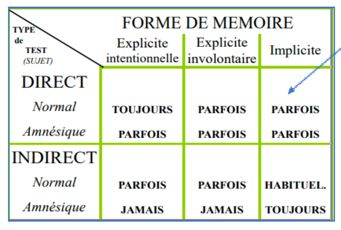
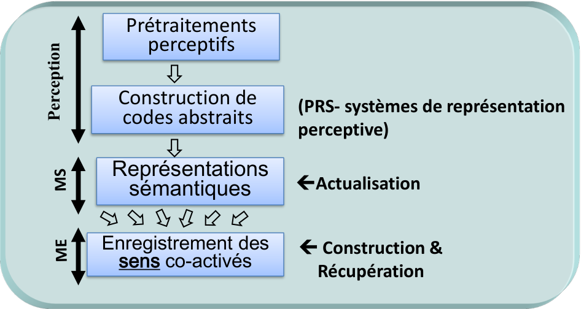
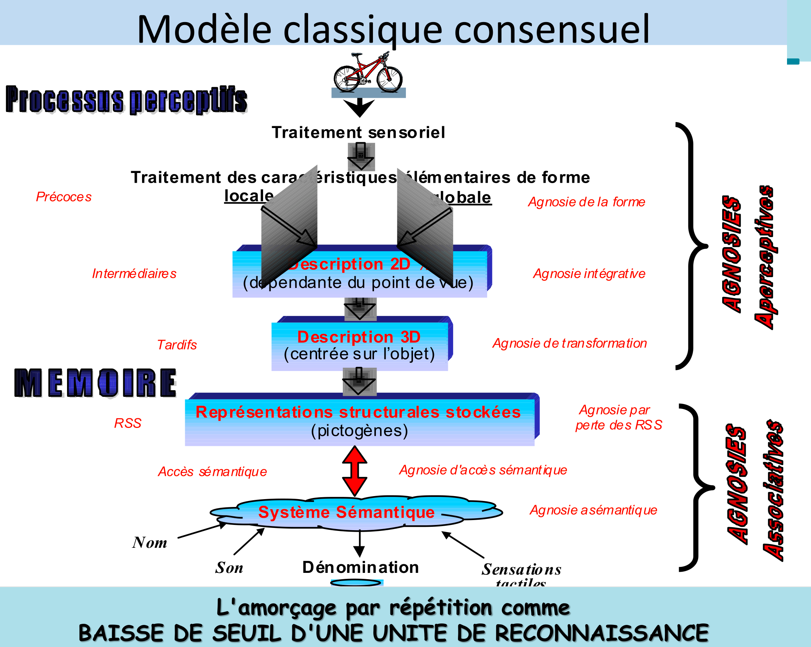
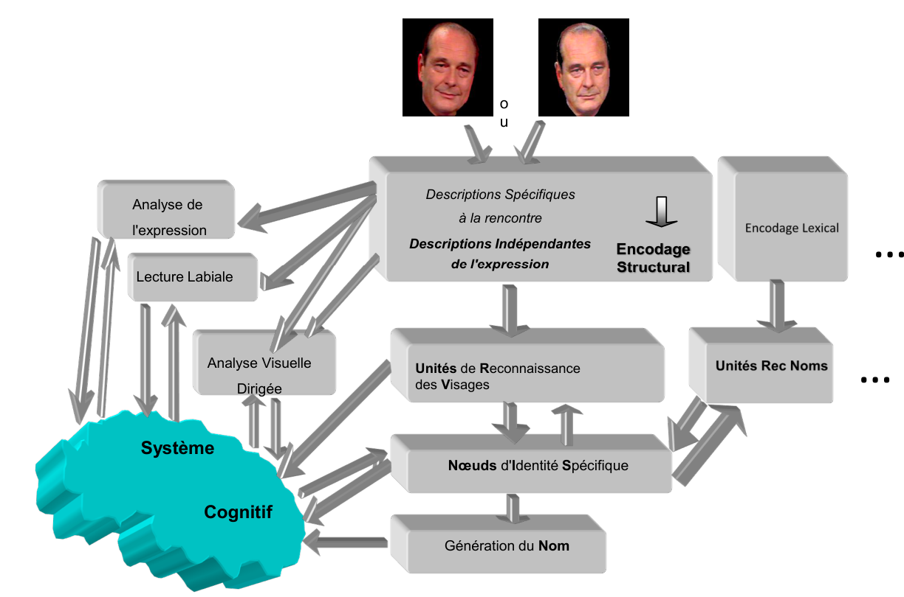
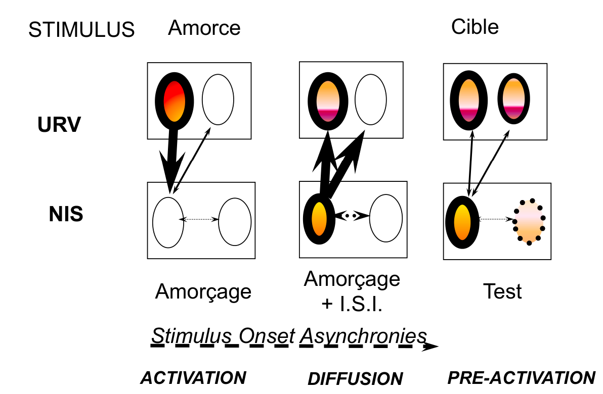
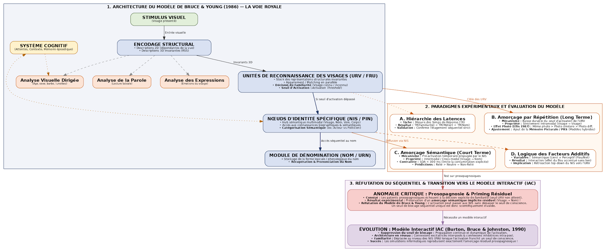
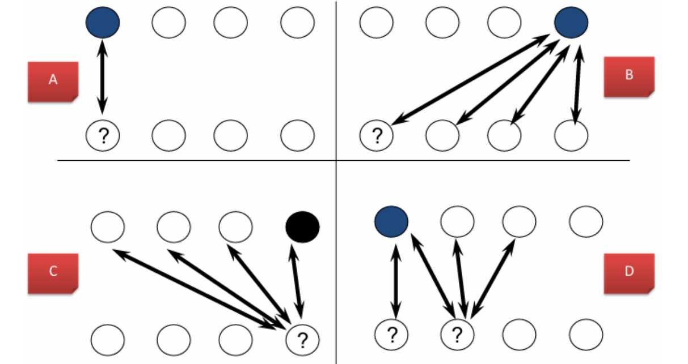
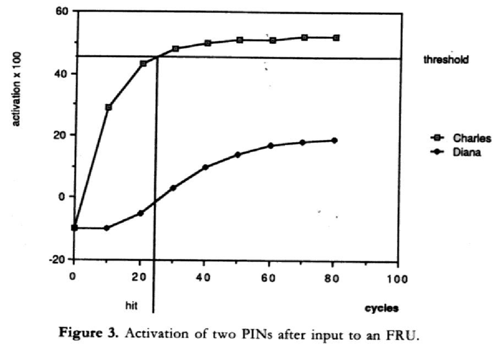
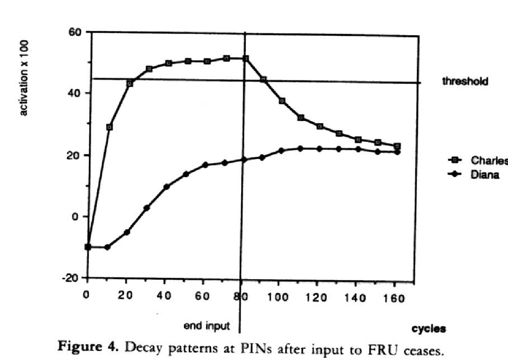
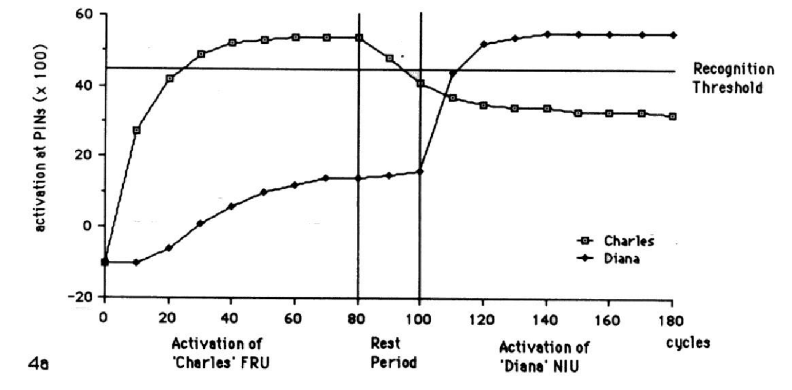

<!-- source: 1_modele_memoire.md -->

# Partie I - Mémoire Sémantique

- [[i_modele_memoire]]
- [[ii_modele_memoire]]

## 1. Rôle et nature des modèles en Psychologie Cognitive

Qu'est-ce qu'on attend d'un psychologue ? Manière de penser et prendre des
problemes et avoir une démarche de curisosité et comprenant enjeux et
conséquences à la fois sur la connaissance et le cas qu'on a en face de nous. On
ne cherche pas a enseigner des savoirs, qui sont trop changeants, mais du
savoir-faire. Pour comprendre le domaine il faut comprendre ses enjeux.

Fortement conseillé de prendre des notes. Le cours est très lié au cours de
l'année dernière. Il y aura des TD qui commencent tard et qui sont très
importants.

### 1.1. Quelles contraintes pour un modèle de la mémoire ?

Le concept de mémoire peut s'exprimer de 3 manière différentes :

1. Mémoire par apprentissage, en vivant, notre système se modifie, notre
   comportement est modifié. On a pas besoin de conscience qu'on a vécu cet
   apprentissage. Marcher est une expression de mémoire. Même une porte à de la
   mémoire
2. Mémoire permettant de comprendre le monde. Demande d'avoir conscience que le
   monde existe en dehors du moi actuel. On a un sens des choses, c'est-à-dire
   qu'on sait ce que sont les objets dans le monde et les relations entre eux.
   Quelles ont été les régularités
3. Mémoire des évènements singuliers vécus qui permet d'expérimenter mentalement
   une situation ancrée dans une situation spatio-temporelle précise, c'est le
   "remember"

![[1_modele_memoire 2026-09-10 11.26.39.excalidraw]]

Ces expressions ne correspondent pas nécéssairement à des systèmes de mémoire
différents. On ne connait pas les relations entre les mécanismes les
sous-tendant.

Comment peut-on intervenir dans cette affaire ? On va tenter de remédier le
fonctionnement de l'être humain, on doit donc agir dessus et devons alors le
comprendre. Mais on a un gros problème : on peut être sur que chaque instant est
différent de l'instant passé. Chaque situation est inédite. C'est très important
car la mémoire est l'influence du passé sur le présent mais ce dernier est
toujours différent du premier. Il faut donc que notre système soit capable de
**généralisation** soit ici la capacité de gérer des ressemblances de stimuli
présents avec des représentations en mémoire.

Fun fact campus de Grenoble a été crée pour faire des robots qui se balladaient
dans l'environnemnet. Un ordinateur est très performant car il transforme un
environnement mouvant en quelque chose de fixe. On a une interface entre le
monde et l'ordinateur qui est son utilisateur. Mais si on veut plonger un
système directement dans l'environnement, il faut qu'il gère intelligemment
cette généralisation.

### 1.2. Pourquoi recourir aux modèles et prédominance de la métaphore spatiale-représentationnelle ?

Comment s'y prendre ? De manière scientifique standard, ce qu'on doit expliquer
est quelque chose à expliquer et non quelque chose sur quoi j'ai des impulsions
non définies ? On doit expliquer quelque chose qu'on ne connait pas. On imagine
donc que ça fonctionne comme quelque chose que je connais et qui a les même
propriétés de fonctionnement. Par expérimentation on peut voir si humain à les
mêmes propriétés de fonctionnement que le modèle.

Actuellement, 80% des recherches qu'on pourra lire, et 99% des autres recherches
qui se servent de la mémoire, partagent le fait d'avoir choisi un certain type
de modèle pour réfléchir sur la mémoire. C'est que la **mémoire est un espace**,
où on y range des choses. Il est donc important d'être conscient des choix qui
ont été faits. Ce sont des paris et non des réalités.

Cette manière de considérer la mémoire, en tant qu'espace, est la manière
standard d'y penser chez nous. Ce consensus permet d'avancer. Une fois qu'on
sait ça plein de choses deviennent évidentes : on a une pseudo-définition de la
mémoire. Qu'est-ce que la mémoire ? Procédure encodage-stockage-récupération.

Mais si donc la mémoire est un stocakge, on peut pas tenir le monde extérieur
dans la tête. À partir de cet extérieur, on doit faire un **codage**
(transformer le stimulus en queqlue chose de même nature que jsp quoi), qui nous
donne une objet intérieur. Espace intérieur =/= extérieur. Se servir de la
mémoire est retrouver la chose qu'on a mis à un endroit particulier
(récupération, réactivation).

Mais donc si on vit des choses différentes à chaque instant, ça fait que ce
modèle résiste très mal au phénomène de généralisation, car rien ne se ressemble
vraiment, chaque stimulus est différent. Le système doit être capable de dire
que "cette chose qui arrive" ressemble assez à "cette chose stockée".

### Les trois manifestations de la mémoire

La solution conventionnelle a été apportée par Tulving et a restructuré les
connaissances. Les 3 comportements de la mémoire correspondent à 3 systèmes
différents, définis de plusieurs manières.

La **première** fait toujours consensus, très philosophique, en termes des
"niveaux de conscience". Ces systèmes sont différents mais emboîtés :
procédurale est mémoire de base, puis sémantique sous partie de procédurale,
etc.

- La mémoire procédurale s'exprime sans conscience du monde et de soi-même
  (anoétique).
- La mémoire sémantique permet de connaître le monde, on sait ce qu'est une
  pomme et que je n'aime pas les pommes. Elle permet de nous faire comprendre
  que le monde existe indépendament de nous-même (noèse).
- Épisodique est une capacité à revivre un moment passé : dmeande une conscience
  de nous-même, notre existance permanente, réflexif, qu'on peut appeler voyage
  mental.

![[1_modele_memoire 2026-09-10 11.42.00.excalidraw]]

La **deuxième** définition est génétique, en suivant les étapes de développement
:   la mémoire épisodique arrive forcément après la sémantique, ce qui peut
    donner l'impression que les enfants n'en ont pas. Mais ca colle pas trop
    avec certaines données. Cet emboîtement est plus critiqué que la première
    définition.

Cet emboîtement est extrèmement contraint par le type de modèle qu'on a choisi.
On a 3 comportements de mémoire : procédural, sémantique, épisodique. Ils ne
sont pas tous aussi facilement concilliées avec le modèle sptial.

- La mémoire sémantique a le mécanisme le plus simple à théoriser et définir. On
  stocke des représentations qu'on connait. C'est donc une mémoire qui va
  extrêmement bien avec la métaphore spatiale. Elle peut être organisé de
  plusieurs manières.
- La mémoire procédurale ne colle pas très bien elle, pas demanière très
  efficace. La conséquence est qu'on a beaucoup de règles de fonctionnemnet mais
  très peu d'explications.
- La mémoire épisodique elle est définie comme une activation de représentations
  par la scène actuelle, recodage d'évènements. Pour s'en souvenir, il faut un
  système capable de très rapidement créer un index qui va relier les choses
  activées. Elle arrive donc après la mémoire sémantique.

OK celui la je suis pas sur pas trop prendre au sérieux par pitié ne pas faire
trop confiance à ce schéma

![[1_modele_memoire 2026-09-10 11.49.51.excalidraw]]

--------------------------------------------------------------------------------

<!-- source: 2_taches_squire.md -->

# CM2 Modèles de la mémoire

- [[i_taches_squire]]
- [[ii_taches_squire]]
- [[iii_taches_squire]]

Vu que la mémoire sémantique est la base de la mémoire épisodique, si on la perd
on doit perdre la mémoire épisodique. Mais donc comment s'assurer qu'il s'agit
bel et bien de systèmes distincts et non pas un seul ? Les **agnosies** sont des
troubles de la mémoire sémantique. On a 2 types d'agnosies :

- Spécifiques à une modalité : spécifique à une entreée sensorielle
- Catégories spécifiques : perdent le sens de certaines catégories d'objets
  (animaux, meubles...)

On a des lourds problèmes à montrer la dépendance de ces deux, qui est recquis
pour supporter le modèle de l'emboîtement. Imaginons que nous avons des patients
avec une agnosie totale (perdent complètetement le sens des mots objets et
choses), on ne pourrait pas falsifier notre hypothèse car on ne peut pas le
tester étant donné qu'on ne peut pas communiquer avec lui.

Imaginons alors qu'on a un patient qui a une amnésie antérograde : il sait
reconnaitre un hippopotame mais ne se souvient pas de ses expériences avec.
Oublie épisodique, mais pas des connaissances, on peut donc avoir la mémoire
épisodique sans mémoire sémantique.

Déficit dégénératif, particulièrement la démence sémantique, ces patients
montrent des énormes difficultées sémantiques mais très peu épisodiques. Ça
remet en question l'emboîtement mais argumente vers leur distinctivité.

Dichotomie de tulving :

  |              | Sémantique              | Épisodique                |
  | ------------ | ----------------------- | ------------------------- |
  | Unités       | Concepts$^1$            | Épisode                   |
  | Question     | Quoi, Qui               | Quand, où                 |
  | Réponse      | Je sais                 | Je me souviens            |
  | Tâche        | Connaissances générales | Épisodes particuliers$^2$ |
  | Vérité       | Consensus social        | Croyances personnelles    |
  | Éducation    | Très importante         | Sans rapport              |
  | Utilité      | Forte                   | Faible$^3$                |
  | Récupération | Activation              | Ecphorie                  |

$^1$ Concept implique d'avoir des choses stockées en mémoire et qui peuvent
s'activer, alors que notion d'épisode signifie un ensemble de concepts reliés.

$^2$ Mais les tests de mémoire épisodiues anciences sont extrêments durs à faire
très du de vérifier des souvenirs. Mais sur les tests à court terme c'est très
simple, l'expérimentateur peut être garant de ce qui s'est passé.

$^3$ Jusqu'à qu'on rencontre quelqu'un avec des troubles de la mémoire
épisodique

On va voir :

1. Vérification de phrases
2. Identification sémantique catégorielle et spécifique
3. Décision lexicale
4. Identification perceptive
5. Complétions dem ots ou fragments

- Tâche très utilisée par le passée de **vérification de phrase** où on
  demandait de vérifier une phraes, style "Les perroquets ont des plumes",
  réponse attendue : "Oui".
- Tâches d'identification sémantique très différentes :
  - **Catégorielle** : on peut répondre sans connaître le stimulus particulier.
    On sait répondre sans connaître l'exemplaire, par exemple on montre un
    cheval, réponse attendue "cheval"
  - **Spécifique** : on doit répondre en connaissant l'exemplaire particulier :
    par xemple on montre l'Autriche, réponse attendue "Autriche"
- **Décision lexicale** : on cherche à voir si un mot est dans notre lexique
  interne et nos représentations.
- **Identification perceptive** : on va demander d'identifier des items en
  conditions dégradées, c'est-à-dire très peu longtemps, brouillé, etc...
- **Complétion de mots ou de fragments** : il faut compléter des phrases à trous
  avec la première chose qui vient à l'idée.

Tests de mémoire épisodique :

1. Rappel libre
2. Rappel indicé
3. Reconnaissances d'occurrence

- **Rappel libre** : on pose des questions qui forcent le sujet à revivre un
  évènement, par exemple la tâche rappel libre, mais on a un gros problème : on
  est très nuls pour ça. Donc si on a très peu d'items que notre VI peut faire
  varier, on a une mesure très nulle.
- Le **rappel indicé** remédie à cette limite en donnant des indices comme la
  catégorie de mots. **Incident intentionnel** est le fait de présenter un truc
  dont le sujet ne se doute pas qu'il va devoir s'en rappeler et puis lui
  demander je crois.
- **Reconnaissance d'occurence** est la question "est-ce que le stimulus à
  occuré pendant une phase d'apprentissage". Y répondre nécessite de revivre
  l'évènement

On fait donc un nouveau modèle, qui ressemble beaucoup à l'ancience, mais avec 2
nouveaux sous-systèmes. Entre la mémoire épisodique et sémantique on a rajouté
la **mémoire de travail**. Elle gère les représentations sémantiques pour les
indexer plus clairement dans la mémoire épisodique (notion de buffer
épisodique).

Le **système de représentation perceptive**, inventé car plus rien ne marchait
avec nos prédictions, on l'a rajouté entre mémoire procédural et sémantique.
Vivre un épisode change notre manière d'être et va affecter notre mémorisation
des choses je crois.

Ce modèle propose aussi 3 acceptations :

- L'information est encodée de façon **sérielle** dans les différents systèmes
  (interdépendances)
- L'information est stockée de manière **parallèle** dans les différents
  systèmes
- L'information peut être récupérée de manière **indépendantes** dans les
  différents systèmes.

Modèle plus ancien que Tulving. Ce dernier tentait de comprendre les mécanismes,
alors que Squire est seulement descriptif, cherche juste à classifier les
comportements :

- Mémoire
  - Déclarative
    - Sémantique
    - Épisodique
  - Non déclarative (procédurales chez Tulving)
    - Habileté (moteur)
    - Conditionnement
    - Apprentissage non associatif (qui ne nécessite pas d'associer des
      connaissances en mémoires)

De fait, dans les études sur la mémoire sématnique, on se concentre plus sur
l'assocations de représentations existantes, on peut donc considérer qu'aucune
des mémoires déclaratives ne se base sur autre chose ue l'assocation de
connaissances en mémiore (par opposition à l'apprentissage non associatif).

Ce modèle à donc aucun problème à faire une double dissociation entre mémoire
sémantique et épisodique ? Il peut rendre compte sans problème de manière
directe qu'on peut avoir des connaissances qui au départ sont purement
épisodiques, peuvent par la suite passer en sémantique, soit la **sémantisation
des épisodes**. Tulving en rend compte un peu aussi mais de manière très
complexe, on considère Squire comme meilleure à ce niveau. Garder en tête que
c'est la création de nouveaux lien en mémoire sémantique plutôt que de nouvelles
connaissances.

## 2. Comment faire appel à la mémoire ?

### 2.1. Le point de vue de l'expérimentateur : direct/indirect

> WARN: alterte important pour l'examen

> NOTE: revue ??? où on demande aux vieux chercheur de revenirs sur leur
> données.

> FIX: pas trop compris cette partie help (dont les dichotomies)

Richardson-Klavehn

On va opposer des tests directs de mémoire à des tests indirects de mémoire :

Il existe 2 dichotomies permettant d'organiser les évaluations de la mémoire. La
première est directe/indirecte :

- **Direct** : instructions du tests de mémoire fait référence à un ou plusieurs
  éléments cibles qui font partie de l'histoire du sujet, c'est-à-dire qui a été
  appris. "Quelle est la capitale de l'Italie" fait référence à quelque chose
  que le sujet à appris à un moment donné.
- **Indirect** : informations font uniquement référence à la tâche en cours sans
  faire référence à des éléments précédents, ces derniers étant la cible du
  test. On interroge le sujet sans faire référence à la mémoire qu'on cherche à
  mesurer. Par exemple l'amorçage par répétition où on modifie la mémoire du
  sujet préalablement à la présentation de l'item test.

Par exemple lors d'une tâche d'amorçage par répétition :

- On modifie expérimentalement la mémoire du sujet préalablement à la
  présentation de l'item test grâce à la présentation en amorce d'un stimulus
  qui sera répété lors de la tâche
- On propose une tâche pour vérifier si les items présentés en amorce vont
  induire une différence de comportement positive ou négative par rapport à ceux
  qui n'ont pas été présentés en amorce

Autre dichotomie : implicite/explicite

### 2.2. Le point de vue du sujet : explicite/implicite

**Implicite** : "la mémoire implicite est mise en évidence quand la performance
dans uen tâche est facilitée en absence de recollection consciente"

**Explicite** : "demande une recollection d'expériences passées", "demande une
connaissance consciente de l'épisode d'apprentssage pour réussir la tâche"

On peut différencier 2 types d'explicites : involontaire et intentionnel

- **Explicite involontaire** : on présente un visage, et on se souvient
  automatiquement sans chercher à le faire qu'on l'a vu quelques minutes plus
  tôt dans le couloir
- **Explicite intentionnelle** : le sujet a volontairement fait l'effort de
  l'accès conscient de la connaissance
- **Implicite** : pas de conscience du souvenir

On va maintenant croiser ces deux dichotomies de forme de mémoire et forme de
test



Quand on fait un test direct, on espère qu'il va toujours y avoir une
contribution que la meemoire implicite intentionnelle. Quand demande qu'est-ce
qu'est quelque chose, on va cherche à savoir ce que c'est.

> TODO contaminatino de tests diercts par la mémoire explicite : on fait plus
> passer la dernière tâche car la ????????

--------------------------------------------------------------------------------

<!-- source: 3_unites_reconnaissance.md -->

# CM3 Modèles de la mémoire

- [[i_unites_reconnaissance]]
- [[ii_unites_reconnaissance]]
- [[iii_unites_reconnaissance]]

On va souvent tester les connaissances sémantiques par les tests indirects. Ça
n'a rien avoir avec effet de récollection en mémoire épisodique. Toujours pas
compris ce qu'est la contamination, mais ça s'appelle contamination par la
explicite. Et les tâches indirectes rendent improbables la contamination par la
mémoire épisodique.

Les processus explicites prennent plus de temps que les processus implicites
(surtout faire la recherche en mémoire), l'utilisation de tests indirects
doivent être contraints par deux critères : la facilité et la rapidité de
réponse. S'il répond très vite, la probabilité de contamination est infime. Par
exemple les tâches de familiarité, "est-ce que je connais cet objet ou non ?".

Une tâche de complétion de fragment est la présentation de stimuli et on doit le
poursuivre avec premier truc qu'on a en tête.

## 3. Les modèles de la mémoire sémantique

### 3.1. Contraintes issues de la métaphore représentationnelle

#### 3.1.1. Présentation synthétique de l'évolution des modèles

La notion de mémoire **abstractive** veut dire que la mémoire est un stock de
représentations nécessairement abstraites, devant donc être créées, placées en
mémoire, et atteintes par la suite. C'est donc un espace représentationnel qui
duplique le monde. Les connaissances sont stockées en mémoires sous forme
d'unités ou symboles qui représentent les choses du monde externe. Il faut que
les connaissances soient organisées telles que l'humain puisse se comporter dans
le monde de manière cohérente.

Schéma présentant la structure de base de tous les problèmes qu'on va regarder.
On a un niveau de mémoire sémantique, qui est ce "monde réel dupliqué". Il faut
donc avoir une interface entre le monde non oragnisé arrivant sous forme de
stimulations et ce monde sémantique.



Sur la mémoire sémantique, on n'apprend pas de choses nouvelles, mais on
"*actualise*" nos représentations sémantiques pré-existantes. Mais les épisodes
se construisent à partir de la mémoire sémantique, avec des phénomènes de
constructions sur des éléments pré-existants.

Il y a un moment, on s'intéressait tous à la forme de l'organisation de la
mémoire sémantique chez l'adulte. On avait deux types de modèles : la
**métaphore spatiale** (Réseau Sémantique), et la **métaphore linguistique**
(règles formelles) Les deux ont des mécanismes formels, et ont les mêmes
prédictions expérimentales, donc on n'en a rien à faire.

Puis modèle du **réseau sémantique hiérarchique** qui propose différents niveaux
à la mémoire sémantique, très économique, car les propriétés pouvaient être
définies qu'à un niveau super-ordonnés si elles sont partagées par beaucoup, qui
en héritent. Ce modèle est surtout testable (falsifiable), par exemple en
vérifications de phrases le nombre de diffusions (passages de nœuds) devrait
être proportionnel au temps de traitement.

Maintenant, on pense qu'il n'y a aucune organisation ou contrainte, les choses
sont juste liées entre elles, toute organisation est donc possible. Mais ce
modèle n'est pas falsifiable et peut expliquer tout résultat. On va alors avoir
une différence entre un niveau central contenant le symbole **sémantique**, soit
les mots, et un niveau **perceptif** qui le précède, contenant les éléments
perceptifs associés (traits, lettres, etc).

#### 3.1.2. L'accès aux représentations, un problème crucial pour les modèles représentationnels

Mais le problème est que le monde n'est pas organisée, et que la mémoire
sémantique doit représenter de manière stable et permanente des choses. Mais
comment un système biologique peut faire ça quand le monde change de manière
continue et que rien ne se reproduit jamais ? Il faut donc nécessairement une
**interface** entre le monde et la mémoire qui doit transformer des stimulations
pour être capable de trouver la structure de ce qu'on est en train de faire.

Par exemple dans le modèle de Marr, on extrait des primitives puis on extrait de
la 2.5D puis 3D et cette représentation est confrontée aux représentations 3D
stockées en mémoire. La perception est donc vue comme quelque chose qui a pour
simple but de reconstruire les objets perçus. Le modèle le plus bête et simple
ont les mêmes bases fonctionnelles que des modèles compliquées : on imagine une
interface entre la perception et la mémoire, constituée de choses appartenant
aux deux mondes. Mais elle contiendra des choses de nature perceptive.

Donc quand on perçoit des choses, on va reconstruire sa structure, ses
invariants. On va donc extraire les stimuli de toutes ses caractéristiques
**idiosyncratiques**, soit susceptibles de varier pendant les prochaines
rencontres.

Donc en résumé, le principe de base des **modèles à unités de reconnaissance**
est premièrement que la perception donne naissance à une représentation
invariante, et que l'appariement de cette représentation perceptive avec la
représentation mnésique de même type contenue dans une **unité de
reconnaissance** permet d'activer celle-ci.

Il est ensuite possible d'envisager une cognition sous forme d'activations
inter-symboliques : on va supposer que pour toutes les entités qu'on connaît, on
a une unité de reconnaissance qui contient le ou les invariants correspondant
aux stimuli, et ces invariants vont contacter en même temps toutes les unités de
reconnaissance.

**Appariement** : les invariants se confrontent aux unités de reconnaissance et
quand l'appariement est bon, l'activation en mémoire se produit. Cette
activation va devenir une propriété de l'unité elle-même. Et si cette unité est
activée, elle propage cette activation à toutes les autres unités liées.

![[3_unites_reconnaissance 2026-09-29 14.58.53.excalidraw]]

L'amorçage par répétition comme baisse de seuil d'une unité de reconnaissance :
il est nécessaire d'avoir des seuils d'activation dans les modèles par
appariement, afin d'éviter des associations inutiles et impertinentes. On
propose qu'à la naissance, chaque unité a un seuil équivalent. Il se fait
dépasser si l'activation est assez forte, et ça produire une réponse
conditionnée et sensation de familiarité. Ici (durant toute la vie) se
manifesterait un mécanisme d'abaissement du seuil, qui permet de rendre compte
par exemple de l'effet de fréquence des mots. CETTE PHASE DE SEUIL EST A LONG
TERME.

Nous pouvons faire un test indirect de ce modèle par un amorçage par répétition
avec deux principes :

- "Modifier" expérimentalement la mémoire du sujet préalablement à la
  présentation de l'item test
- Proposer une tâche qui pourrait être faite même si la première phase n'avait
  pas eu lieu et vérifier si les items traitées dans la première phase
  produisent une différence de comportement par rapport aux items qui n'y ont
  pas été traités

Mais il y a une limite à l'effet de ce mécanisme : s'il était linéaire, on
aurait continuellement l'impression de voir les visages de nos proches partout.
Donc plus ça baisse, moins l'effet de ce mécanisme est fort. La baisse du seuil
permet de tester le reste du modèle.

> TODO: j'ai pas noté la fin du cours de tessa car je ne sais pas si c'est
> important ou si ça vient même du cours



--------------------------------------------------------------------------------

<!-- source: 4_amorcage_semantique.md -->

# CM4 Modèles de la mémoire

- [[i_amorcage_semantique]]
- [[ii_amorcage_semantique]]

On a des unités de reconnaissances pour chaque caractéristique d'une personne,
soit par **modalité.** Par définition, l'effet d'amorçage par répétition est
intramodal, c'est-à-dire qu'il faut repasser pas la même unité dans le même
modalité pour bénéficier de la baisse de seuil. À partir de là, on peut donc
proposer une architecture globale dans le domaine des visages.



En lecture, on a la particularité de pouvoir lire de mots qu'on ne connaît pas.
On a donc une voie de traitement qui sera dédiée à notre capacité de production
de mots qu'on ne connaît pas. Nous n'avons pas cette autre voie pour les
visages. La perception va donc recréer en le plus d'invariants possibles le
stimulus courant. Invariant par rapport à l'expression, par rapport à la pose...
On est particulièrement sensibles aux effets d'inversion (à l'envers, on est
mauvais) donc l'invariance à moins ça comme limites. Puis appariement aux
connaissances.

En présentation de mot, on a un encodage lexical par extraction des invariants
du mot et pour chaque mot connu il y a une unité contenant les invariants des
mots écrits. Même chose pour la prosodie. Puis les invariants peuvent emprunter
deux voies.

La première voie est la voie **lexicale** : en cas de dépassement du seuil,
propagation dans les unités sémantiques (qui je crois ne sont pas reliées entre
elles). Cette activation permet d'activer l'unité sémantique correspondante. La
baisse du seuil fonctionne pour les unités de reconnaissance, mais pas pour les
unités sémantiques. On peut après accéder à une unité de sortie qui génère le
mot lors de son activation : elle contient du code de prononciation à partir de
la sémantique (comme unité de reconnaissance inversée).

Mais qu'est-ce qui justifie ce modèle séquentiel hiérarchique (passer au module
suivant nécessite l'accomplissement du module présent) ? Ces modèles sont très
utilisés, car simples, mais maintenant, on a des indices très forts que ces
modèles-là ne fonctionnent pas. Ce qui les prouverait, c'est une tâche avec
laquelle on observe une hiérarchie des temps de réponse.

Tâche avec 3 réponses possibles en oui/non

- 1 : familiarité
- 2 : sémantique : est-ce que c'est un homme politique ?
- 3 : nom : est-ce que c'est Charles (à la présentation du visage) ?


Le TR est systématiquement plus court sur familiarité, puis sémantique. C'est
donc un indice fort de la séquentialité. On ne trouvait pas non plus de patient
qui pouvait retrouver le nom d'une personne sans d'autres contenus sémantiques.
Par ailleurs, ce modèle ne contient que des flèches unidirectionnelles
(bottom-up), en revanche, quand on est au niveau sémantique, on en retrouve des
bidirectionnelles.

Principes Fodorien que la perception est **encapsulée** : les processus qui
permettent d'accéder aux représentations doivent être imperméables au reste du
système cognitif. Si notre système était biaisé, alors la perception ne serait
plus une représentation, car sinon la représentation de Rousset ne
correspondrait pas à ce qui se trouve à l'extérieur. Mais il y a plein de
modèles qui ne marcheraient pas selon les principes fodoriens, comme reconnaître
quelqu'un qui sourit ?

Bruce et Young, auteurs du modèle de reconnaissance des visages vu plus haut,
proposent donc de rajouter des modules de plus bas niveau que l'extraction
d'invariant pour rendre compte de tout ce qu'on peut faire sur le stimulus autre
que de l'identification. Ça constitue l'autre voie de cette reconnaissance. La
partie "système cognitif" du modèle est le sac avec lequel l'on met tout ce
qu'on n'explique pas.



Le modèle nous permet de voir les allers-retours entre unités sémantiques et de
reconnaissance. L'effet d'amorçage sémantique qui est très différent que par
répétition. Dès qu'un lien d'activation passe, il peut y avoir un retour
d'activation médiatisé par le lien sémantique. À bout d'un moment, il y aura
déjà donc un peu ?? d'activation alors qu'on n'a pas présenté Mitterrand.

*Note : URV = Unité de Reconnaissance des Visages, et NIS = Nœuds d'Identité
Spécifique*

Mais il ne faut pas que trop remonte, car si c'était le cas, il aurait
l'impression qu'il y a deux personnes qui sont Jacques Chirac quand on voit
Mitterrand. Cette activation de retour ne doit donc pas dépasser le seuil. On
présente donc un stimulus dans le but d'en activer un autre inconsciemment. Et
surtout, il n'y a pas de baisse de seuil, juste un peu de préactivation, qui
accélère TR. Mais ça ne permet pas de faire des prédictions différentes ?

> FIX: clarifier prochain paragraphe

Nécessairement ces phénomènes d'activations doivent être temporaires, sinon le
système rentrerait dans un phénomène d'hystérie. L'activation doit donc se
dissiper très rapidement. On est donc obligés de faire du "one-to-one", on
présente l'amorce puis la cible (et c'est un test indirect). C'est des effets de
modifications structurales, on peut donc faire ça en bloc-à-bloc, alors que
naturellement amorçage sémantique est sensé être amorce-cible sur un court
moment. On cherche une diffusion d'activation automatique donc euh mémoire
sémantique implicite.


Mais pour le même phénomène, on pourrait très bien faire la même tache en se
servant explicitement de notre mémoire sémantique. On se retrouve avec amorce ->
intervalle inter-stimuli -> cible. Mémoire explicite prend plus de temps alors
que propagation d'activation va très rapidement. Donc si on laisse du temps, il
doit y avoir des phénomènes d'attentes, de stratégies de mémoire explicite. On
ne va donc pas laisser le temps. Il faut donc une nouvelle mesure de temps de
réflexion : **SOA** soit *Stimulus Onset Asynchronies*, qui est le temps
séparant le début de la présentation du premier stimulus de celui du second.
Généralement ça correspond à temps de présentaiton du stimulus + délai. On va
souvent en utiliser un court, avec une amorce en subliminal.

Il faut toujours comparer 3 conditions. Ici quand il n'y a pas de stratégies :

- Amorce reliée ou $R$ : partage unité sémantique, par exemple Chirac et
  Mitterrand
- Amorce non reliée ou $NR$ : ne partage pas d'unité sémantique, reste dans la
  même catégorie, par exemple "personne célèbre" chez Chirac et Mirelle
  Matthieu. Sans préactivation.
- Amorce neutre ou $N$ : aucune diffusion d'activation, par exemple un visage
  d'inconnu. Ça correspond au temps d'activation d'une unité car pas de
  préactivation

Si tout va bien, alors $\text{Neutre} = \text{Non relié}$. En cas de stratégie
consciente :

- Inconnu : pas d'attente, toujours au niveau de base sur le neutre
- Laurel : je m'attends à Hardy donc meilleur $R$
- Hardy : on s'attend à Laurel et on présente Shakira, gène $NR$

En cas de SOA courts, on a plutôt ce type de configurations : $R > N = NR$. Dès
qu'ils deviennent longs, on va avoir cette différence qui ressort :
$R > N > NR$.

On a vu que l'amorçage par répétition était amodal. En revanche, on peut se
demander si c'est le cas pour le sémantique, que se passe-t-il si on met nom
puis visage ? Comme on active par unité sémantique, il doit par définition être
intermodal. Peu importe que l'amorce et la cible soient de la même modalité.
Résultats le montrent.

On aime les interactions par la logique des facteurs additifs. Si deux variables
jouent sur deux processus différents, alors leurs effets vont s'additionner. En
cas d'interaction, on sait que ce qu'on obtient n'est pas juste la somme des
deux effets, les deux variables ont donc joué sur le même processus. On observe
ici une interaction entre flou et relation d'amorce.


--------------------------------------------------------------------------------

Diagramme fait par notebooklm :



Diagramme Excalidraw :

![[4_amorcage_semantique - synthese 2026-10-22 22.09.07.excalidraw]]

--------------------------------------------------------------------------------

<!-- source: 5_modeles_memoire.md -->

# CM5 Modèles de la mémoire

- [[i_5_modeles_memoire]]
- [[ii_5_modeles_memoire]]

> Cette note reprend la fin du CM4 (prosopagnosie et modèle de Burton, Bruce &
> Johnston) puis le CM5 proprement dit. Elle est complétée à partir du PDF «
> EC10 -- CMs Stéphane Rousset ».

## 1. L'amorçage sémantique chez les patients prosopagnosiques : remise en cause de la hiérarchie

La notion de **performance résiduelle** est liée à la définition de la
pathologie : un trouble se définit par un écart à la population normale. Dans
les prédictions, on considère souvent que ce qu'on étudie est totalement absent,
alors que le trouble est rarement total. Il peut donc rester quelque chose.

### 1.1. Réapprentissage de visages célèbres

Des expériences ont été menées chez **deux patients belges prosopagnosiques**
(étude citée en cours sous le nom de Bruyer). Ces patients ne reconnaissaient
pas un très grand nombre de visages. On leur a fait réapprendre des visages,
soit avec l'association correcte (visage de Chirac + nom de Chirac), soit avec
une association modifiée (visage de Chirac + nom de Giscard). Après de
nombreuses sessions d'apprentissage, ils apprennent plus vite les **bonnes
paires** que les mauvaises : c'est un **effet de congruence visage--nom**. Il
restait donc bien quelque chose du traitement des visages.

### 1.2. Amorçage sémantique implicite

Une autre expérience a été réalisée avec un patient prosopagnosique qui avait
une connaissance des personnes intacte, mais ne reconnaissait pas leurs visages :
ce n'était donc pas un problème sémantique. Ce patient permet un bon contrôle
des effets de contamination.

On présente une cible (nom connu ou inconnu) et une amorce visage **reliée**,
**non reliée** ou **neutre**. On observe un **effet d'amorçage sémantique
implicite** : les performances sont meilleures pour le visage relié que pour le
neutre ou le non-relié. Ces résultats montrent des performances résiduelles et
un amorçage sémantique par des processus de diffusion non consciente et
automatique.

### 1.3. Conséquence : le seuil du modèle séquentiel est invalidé

Dans le modèle séquentiel hiérarchique de Bruce & Young, l'activation ne peut
atteindre les NIS que si l'activation des URV **dépasse leur seuil**. Or, le
patient est incapable de dire si le visage est connu : le seuil d'activation
n'est donc pas dépassé. Pourtant, l'activation passe des URV aux NIS. Cela
invalide la structure séquentielle et hiérarchique du modèle, en particulier la
notion de **seuil d'activation**.

À partir des années 1980--2000, on passe à des **modèles en cascade ou
interactifs**. La notion de processus indépendants n'a plus de sens, et la
logique des facteurs additifs devient difficile à appliquer.

## 2. Le modèle interactif de Burton, Bruce & Johnston (1990)

### 2.1. Une architecture en trois niveaux

Le modèle **IAC** (*Interactive Activation and Competition*) de Burton, Bruce &
Johnston (1990) a deux intérêts : comprendre ce que sont les systèmes
interactifs, et montrer qu'il n'y a pas de correspondance anatomo-clinique
directe sans présupposés clairs. Il a été proposé parce que le modèle précédent
ne fonctionnait pas et parce que ce type de modèle était à la mode à l'époque.

En s'inspirant de la reconnaissance des mots (les mots sont décomposables en
lettres), les auteurs supposent que les visages sont décomposables en nez, yeux,
bouche, etc. : ce sont les **UCV** (unités des composantes des visages). Cette
partie est à la fois incohérente et non testée ; on l'ignore dans la suite du
cours.

- **URV / URN** : unités de reconnaissance des visages et des noms.
  Contrairement au modèle précédent, **l'activation au niveau des UR ne mène pas
  à une réponse comportementale de familiarité**.
- **NIS** : nœuds d'identité spécifique. Ils portent le même nom que dans le
  modèle précédent, mais ne contiennent plus que le **concept de la personne**.
  La décision de familiarité se prend à ce niveau. Les URV et URN d'une personne
  sont reliées uniquement à son NIS, avec une association **1 à 1**.
- **UIS** : unités d'information sémantique. On y retrouve la sémantique
  classique, mais aussi les informations liées au nom. Le nom est donc une
  information sémantique comme une autre, alors que dans Bruce & Young il avait
  un module séparé. La connectivité NIS--UIS n'est pas 1 à 1 : une UIS peut être
  reliée à plusieurs NIS.

*Penser aux unités de reconnaissance comme à des clés d'accès à la mémoire.*

### 2.2. Plus de seuil d'activation, mais un seuil de conscience

Le modèle supprime le **seuil d'activation** qui bloquait la propagation. Il
conserve un **seuil de conscience**, paramètre fixe : quand l'activation d'un
NIS le dépasse, le concept de la personne est activé et donne le sentiment de
familiarité. On ne peut pas jouer sur ce seuil, sinon le modèle devient
infalsifiable.

Pourquoi ce changement ? Dans un système avec rétroaction et uniquement de
l'activation, deux états sont possibles : l'explosion (l'« hystérie ») ou
l'inactivité (l'activation s'auto-entretient et fait boule de neige). Les seuils
servaient à empêcher l'explosion. Il faut donc ajouter de l'**inhibition** : le
modèle combine activation et inhibition.

### 2.3. Le schéma du modèle

```{mermaid}
graph TD
    subgraph E["Entrées"]
        V["Visage de Mitterrand"]
        N["Nom « Mitterrand »"]
    end

    subgraph R["UR — unités de reconnaissance, spécifiques à la modalité"]
        URV["URV<br/>visage"]
        URN["URN<br/>nom"]
    end

    subgraph I["NIS — amodal, un seul nœud par personne"]
        NISM["NIS<br/>Mitterrand"]
    end

    subgraph S["UIS — informations sémantiques"]
        S1["« président »"]
        S2["« François »"]
        S3["« socialiste »"]
    end

    V --> URV
    N --> URN
    URV --> NISM
    URN --> NISM
    NISM --> S1
    NISM --> S2
    NISM --> S3

    style E fill:#181825,stroke:#585b70,color:#cdd6f4
    style R fill:#181825,stroke:#585b70,color:#cdd6f4
    style I fill:#181825,stroke:#585b70,color:#cdd6f4
    style S fill:#181825,stroke:#585b70,color:#cdd6f4

    classDef entree fill:#313244,color:#cdd6f4,stroke:#585b70
    classDef ur fill:#89b4fa,color:#11111b,stroke:#89b4fa
    classDef nis fill:#cba6f7,color:#11111b,stroke:#cba6f7,stroke-width:2px
    classDef uis fill:#a6e3a1,color:#11111b,stroke:#a6e3a1

    class V,N entree
    class URV,URN ur
    class NISM nis
    class S1,S2,S3 uis

    linkStyle default stroke:#6c7086,stroke-width:1.5px
```

Une amorce par le visage active le NIS Mitterrand ; une cible « Mitterrand »
présentée par le nom passe par l'URN mais retombe sur le même nœud --- d'où
l'amorçage intermodal. Dans un même ensemble, les unités s'inhibent mutuellement :
un stimulus non relié intercalé active un autre NIS et fait chuter l'effet.

### 2.4. Deux sources de gain : répétition et sémantique

```{mermaid}
graph TD
    A["Amorce (t1)<br/>visage de Mitterrand"]
    A --> U["URV<br/>seuil abaissé<br/>Bruce & Young"]
    A --> N["NIS<br/>reste activé<br/>Burton et al."]
    U --> C1["Cible (t2)<br/>même visage<br/>→ intramodal"]
    N --> C2["Cible (t2)<br/>nom « Mitterrand »<br/>→ intermodal"]
    C1 --> R["Réponse plus rapide"]
    C2 --> R

    classDef entree fill:#313244,color:#cdd6f4,stroke:#585b70
    classDef by fill:#f9e2af,color:#11111b,stroke:#f9e2af
    classDef bu fill:#fab387,color:#11111b,stroke:#fab387
    classDef cible fill:#45475a,color:#cdd6f4,stroke:#6c7086
    classDef gain fill:#a6e3a1,color:#11111b,stroke:#a6e3a1

    class A entree
    class U by
    class N bu
    class C1,C2 cible
    class R gain

    linkStyle default stroke:#6c7086,stroke-width:1.5px
```

À la première présentation (t1), Bruce & Young abaissent durablement le seuil de
l'URV (amorçage par répétition) ; Burton laisse le NIS activé (amorçage
sémantique). À la deuxième présentation (t2), la cible repasse par l'unité déjà
modifiée, donc la réponse est plus rapide. Le gain dû à l'URV est propre à la
modalité (intramodal) ; celui dû au NIS est amodal et transfère à l'autre
modalité (intermodal).

## 3. Les principes du modèle IAC

### 3.1. Unités, ensembles et connexions

On reste dans les modèles représentationnels : chaque **unité** est un concept,
regroupé en **ensembles** (ou *pools*) qui ont un sens (les NIS forment un pool,
les URV un autre, etc.).

Les connexions entre ensembles sont **excitatrices** et sans seuil : dès qu'il y
a un peu d'activation, elle se propage. Au sein d'un même ensemble, les
connexions sont **inhibitrices** : chaque unité est reliée à toutes les autres
unités de son ensemble et les inhibe. Les connexions excitatrices inter-pool
sont plus fortes que les connexions inhibitrices intra-pool. L'inhibition
intra-pool est uniforme, plutôt faible et non soumise à apprentissage ; les
connexions inter-pool, elles, ont un sens.

### 3.2. Activation et inhibition

Un système uniquement activateur ne peut pas fonctionner. Dans les réseaux
sémantiques classiques, on parlait de diffusion de l'activation avec trois
principes :

1. l'activation émise est moindre que celle reçue ;
2. l'activation est divisée par le nombre de connexions ;
3. les activations de plusieurs sources s'additionnent.

Les deux premiers principes sont à oublier ; seul le troisième reste vrai.

Avec l'activation et l'inhibition, le système évolue vers un **équilibre**. Il
faut prendre en compte la dynamique et les temps de latence.

### 3.3. Cycles, latence et seuil de conscience

Un **cycle** (ou **époque**) est le moment où tous les neurones calculent en
parallèle leur état d'activation. Après un calcul (époque 1), on obtient un
nouvel état, puis on recommence (époque 2), etc. L'état de repos est une légère
inhibition.

Un **seuil de conscience** est défini pour les unités : quand leur activation le
dépasse, leur contenu devient conscient. La réponse de familiarité correspond au
dépassement du seuil de conscience d'un NIS.

Dans un modèle séquentiel, le temps de latence est difficile à expliquer. Dans
IAC, la latence correspond au **nombre de cycles** nécessaires pour dépasser le
seuil de conscience. On peut l'exprimer en ms : plus de ms signifie plus de
cycles.

## 4. Quelques phénomènes basiques de IAC

On a deux ensembles : les NIS en haut, les UIS en bas. On présente un visage :
tant qu'il est sous les yeux, il active en continu l'URV correspondante.



### 4.1. Cas A : deux unités seulement

Si le modèle ne contient que deux unités reliées (NIS--UIS), l'UIS reçoit de
l'activation du NIS à l'époque 1 et lui en renvoie à l'époque 2. Le NIS continue
d'envoyer de l'activation car le visage est toujours présent. Très vite, le
seuil de conscience est dépassé et le système explose en l'absence d'inhibition
intra-pool.

### 4.2. Cas B : plusieurs UIS

Si le NIS est relié à plusieurs UIS, l'inhibition intra-pool se met en place. À
l'époque 1, on est dans la même situation que dans A. Dès l'époque 2, l'UIS est
moins activée que dans A, car les autres unités de son ensemble l'inhibent. Elle
reste activée car l'inhibition intra-pool est plus faible que l'excitation
inter-pool.

### 4.3. Cas C : plusieurs URV

Si une UIS est connectée à plusieurs URV, le modèle s'active plus vite : à
l'époque 2, l'activation est renvoyée vers plusieurs NIS ; à l'époque 3, l'UIS
reçoit de l'activation de plusieurs NIS en même temps, au lieu d'un seul avec
l'inhibition intra-pool.

### 4.4. Cas D : plusieurs UIS et plusieurs NIS

La deuxième UIS s'active plus vite que la première : elle reçoit l'inhibition de
la première, mais aussi plus d'activation des NIS. Par défaut, toutes les
informations sémantiques sont liées à différents NIS ; le nom étant spécifique à
une personne, il est plutôt sur un lien unique et sera plus difficile à
retrouver que les autres informations sémantiques.

### 4.5. Le problème de la dénomination

Deux unités d'un même ensemble peuvent avoir des difficultés différentes à
s'activer. Une unité qui ne reçoit de l'activation que d'une seule unité d'un
autre ensemble sera plus difficile à activer qu'une unité qui en reçoit de
plusieurs. Donc une chose X peut être systématiquement plus difficile qu'une
chose Y tout en faisant partie du même ensemble.

On ne peut plus se baser uniquement sur la **chronométrie** et l'étagement des
latences pour montrer la hiérarchie des modules : au sein d'un même module, les
latences ne sont pas les mêmes pour toutes les unités.

## 5. Activation des NIS et structure des courbes

On trace le niveau d'activation de deux NIS en fonction du nombre de **cycles**,
en maintenant une entrée perceptive au niveau d'une UR. Si on présente le visage
de Charles, le NIS « Charles » est activé à chaque cycle. Au temps 0, on a une
légère inhibition (état de repos). Puis l'activation augmente : l'URV envoie de
l'activation au NIS, qui en envoie aux UIS ; les trois niveaux s'envoient de
l'activation en aller-retour.



Après un certain temps, le NIS « Charles » dépasse le **seuil de conscience**
(différent du seuil d'activation) : le système répond que le stimulus est
familier. La latence de base correspond au nombre de cycles nécessaires pour
atteindre ce seuil. Ensuite, l'activation se stabilise (≈ plafond).



L'activation de « Charles » active « noble » et « anglais » dans les UIS, ce qui
active à son tour « Diana » dans les NIS (elle est noble et anglaise).
L'inhibition entre NIS se met en place : « Diana » inhibe « Charles » et empêche
son explosion. « Diana » s'active moins que « Charles » car elle reçoit moins
d'activation des autres ensembles et que « Charles » l'inhibe plus fortement. Il
faut quelques cycles pour que « Diana » s'active, le temps que l'activation se
propage par les UIS.

Après la perturbation, les courbes atteignent un nouvel équilibre. Continuer à
présenter Charles ne change rien. Si on cesse de présenter Charles, l'activation
du NIS « Charles » baisse (moins d'activation des URV) ; celle de « Diana »
augmente légèrement car l'inhibition de Charles diminue. Les deux NIS passent
sous le seuil de conscience et se rapprochent, car ils partagent beaucoup
d'informations sémantiques.

## 6. Simulation d'amorçage sémantique



Si on présente le nom de Diana, l'URN « Diana » est activé ; le NIS « Diana »
augmente et le NIS « Charles » diminue (plus d'inhibition de Diana). Dans la
simulation, Charles avait besoin d'une vingtaine de cycles pour dépasser le
seuil quand on présentait son visage ; Diana n'en a besoin que de moins de dix
quand on présente son nom, car elle avait déjà été activée par la présentation
de Charles. Le modèle rend donc compte de l'amorçage sémantique.

### 6.1. Le temps n'est plus le facteur critique

Dans l'ancien modèle, l'amorçage sémantique dépendait d'un SOA court : il
fallait que l'activation n'ait pas le temps de se dissiper. Ici, l'état
d'équilibre atteint après l'arrêt de la présentation s'auto-entretient : on peut
laisser passer de nombreux cycles sans que l'activation bouge. Ce n'est donc pas
le temps qui compte, mais les **stimuli qui interviennent** entre l'amorce et la
cible.

Pour diminuer l'activation des NIS, il faut présenter autre chose : d'autres
unités s'activent et inhibent Charles/Diana. Un visage non relié pendant l'ISI
fait baisser l'amorçage. Dans la vraie vie, plus on laisse passer de temps, plus
de l'activation arrive dans tous les sens (on pense à autre chose). Le modèle
est donc valable sur des temps courts, pas sur des temps longs.

### 6.2. Prédictions

- **Bruce & Young** : $R > N = NR$.
- **Burton et al.** : $R >>> N > NR$. Il faut se battre contre l'inhibition qui
  vient de l'amorce en NR. L'effet $R > N$ est plus facile à détecter que
  $N > NR$, car il est plus fort.

### 6.3. Interférence

On observe de l'interférence quand le SOA est nul : un visage non relié gêne le
visage relié en présentation simultanée. Deux sources d'activation en même temps
→ inhibition plus forte ; la compétition est plus difficile ; les effets
d'activation sont plus faibles et les effets d'inhibition plus forts.

## 7. Inférence dans un système interactif : le modèle « prosopagnosique »

### 7.1. V-N et N-N chez le sujet sain

On peut simuler une prosopagnosie en baissant l'efficacité des liens
**URV--NIS**. On présente le visage de Charles puis le nom de Diana (V-N), ou le
nom de Charles puis le nom de Diana (N-N).

Chez les contrôles, V-N donne les résultats habituels. N-N donne les mêmes
résultats, car l'amorçage sémantique est **transmodal**.

### 7.2. Modèle lésé

Chez le modèle lésé, l'activation se propage dans tout le système si on présente
le visage de Charles, mais elle ne dépasse jamais le seuil de conscience car les
activations passent moins bien. Cela suffit à monter un peu l'activation du NIS
« Diana » par propagation. À la présentation de son nom, il est plus facile
d'atteindre le seuil : c'est l'amorçage sémantique sur la décision de
familiarité du nom Diana.

En N-N, le modèle lésé dépasse le seuil pour « Charles » et montre un effet
d'amorçage sémantique. Globalement, on obtient la même chose qu'un sujet sain,
car la prosopagnosie n'atteint pas les noms. Mais il faut plus de cycles qu'un
sujet sain pour dépasser le seuil, et le gain d'amorçage est moins fort, alors
que seuls les visages sont lésés.

### 7.3. Conséquence : la correspondance anatomo-clinique

On a donc un déficit comportemental sur les noms sans lésion du traitement des
noms. L'idée d'une **correspondance anatomo-clinique directe** s'effondre : dès
que le système est interactif, on ne peut plus faire correspondre directement un
déficit à une lésion.

Pourquoi ce résultat n'est-il pas étonnant ? Chez un sujet contrôle, les
allers-retours URV--NIS se mettent en place même en présentation du nom : le NIS
bénéficie des allers-retours URN--NIS et URV--NIS. Chez un patient
prosopagnosique, les allers-retours URV--NIS sont lésés. Le patient n'est donc
pas totalement pathologique sur les noms, mais « seulement » très mauvais.

## 8. Effet de surface dans l'amorçage par répétition : un problème en suspens

### 8.1. Le renforcement synaptique

Les modèles précédents expliquaient l'amorçage par répétition par une baisse
d'activation des URV, où se faisait la décision de familiarité. Maintenant, la
décision se fait au niveau des NIS. Or l'amorçage par répétition est
**intramodal et les NIS ne séparent pas les modalités**.

Les auteurs considèrent donc qu'on **renforce les synapses** entre deux unités
quand on présente une stimulation : l'activation passe plus facilement.
L'amorçage par répétition est expliqué par le renforcement de la connexion
UR--NIS.

Pratiquement, les prédictions sont exactement les mêmes que celles de la baisse
de seuil dans Bruce & Young. On peut donc rester sur une réflexion de baisse de
seuil, plus simple.

### 8.2. Le problème de l'intramodalité

Si on pousse le modèle IAC, les allers-retours d'activation devraient renforcer
de nombreuses synapses. La présentation du nom après un visage devrait donc
faciliter la dénomination : le modèle prédit un amorçage par répétition
**intermodal**, alors que les résultats montrent un effet **intramodal**.

Dans ce cours, on reste donc sur **Bruce & Young** pour expliquer l'amorçage par
répétition : baisse à long terme du seuil d'activation de l'UR, qui est propre à
une modalité, donc effet intramodal.

Une expérience classique (Warren & Morton, 1982) le montre : le seuil
d'identification d'images baisse après un amorçage par la même image (35,7 ms),
mais pas après un amorçage par le nom (43,6 ms, proche du non-amorcé à 43,8 ms).

### 8.3. Ellis, Young, Flude & Hay (1987)

Dans le cadre de Bruce & Young, on peut conclure, à partir des résultats de
cette étude, qu'il existe des **unités des visages**. L'étude montre que
l'amorçage par un visage est plus efficace que l'amorçage par un nom ou par un
corps, ce qui soutient l'existence d'unités spécifiques aux visages.

Dans l'expérience 1, la latence d'estimation de familiarité est de 774 ms après
un amorçage par le visage, 850 ms après un nom écrit, 845 ms sans amorçage. Dans
l'expérience 2, elle est de 788 ms après un visage, 897 ms après un corps, 909
ms sans amorçage.

### 8.4. Bruce & Valentine (1985)

Tâche : estimer la familiarité d'un visage (oui/non). VI : correspondance de
forme de surface entre l'amorçage et le test (même image, image similaire mais
un peu différente, nom, pas d'amorce). VD : latence pour estimer la familiarité
du visage en phase test.

Si l'amorçage passait par la même unité de visage, même image et image similaire
devraient donner le même effet. Les résultats montrent une différence de latence
entre ces deux conditions (863 ms vs 952 ms), ce qui invalide Bruce & Young.

Une tâche avec des temps de présentation très brefs serait idéale, mais elle est
très sensible à la contamination : les participants cherchent à voir quelque
chose dans des stimuli présentés trop brièvement pour être perçus consciemment.

### 8.5. Vers les modèles hybrides

Les modèles hybrides apparaissent alors pour tenter de résoudre ce problème. Ils
distinguent l'amorçage généralisateur (baisse de seuil des UR, abstrait, qui
permet la généralisation et prouve l'existence des UR) et l'amorçage spécifique
à la photographie (effet de bas niveau, mémoire picturale, qui ne peut pas
généraliser). La suite --- l'échec du modèle hybride et les systèmes de
représentations perceptuelles (PRS) de Tulving & Schacter (1990) --- est traitée
dans le CM6.

--------------------------------------------------------------------------------

<!-- source: 6_modeles_memoire.md -->

# CM6 modèle mémoire

[[i_modeles_memoire]] [[ii_modeles_memoire]]

### Unités de reconnaissance des visages ?

Si on lèse la partie lésée, on lèse une partie qui fait de l'interaction. Donc
dans ce genre de modèles, on ne peut pas faire d'hypothèses anatomo-cliniques,
mais uniquement sur les mécanismes.

Amorçage par répétition dans les modèles classiques est une baisse à long terme
du seuil. Mais on verra que quand 2 neurones sont activés au dessus du seuil de
conscience, alors la force de la synapse qui relie les deux neurones est
augmentée. Dans Bruce & Young on baisse le seuil, et dans l'autre on fait que ça
peut partir plus facilement. Donc les deux ont les mêmes prédictions. Donc faut
pas se casser la tête.

Prédictions : a-t-on une seule ou plusieurs unités de reconnaissance ? On peut
amorcer par le visage ou le corps, et on remarque qu'avec cible visage le corps
n'amorce pas. Ça va dans le sens d'une unité unique du visage pour les visages.

### Modèle hybride

On va aller plus loin. On va faire une expérience (Bruce & Valentine, 1985) ou
le réslultat attendu n'est pas celui qu'on voit au ta bleau. Une condition où on
est amorçee par visage, une par le nom, et dans le visage, soit ils voient
exactement le même image en etst ou légèrement différente ("similaire") ou de la
même personne mais lpus différente ("différente"). Logiquement, dans les 2 cas
de visage, la baiasse devrait être équivalent si elles sont liées à la même
unité de reconnaissanc. Le résultat contredit le modèle : différence
significative entre même image et image similaire.

On va donc séparer l'amorçage par répétition en 2 parties : le "vrai", **la
baisse de seuil**, constituant un amorçage généralisateur, où les
caractéristiques propres du stimulus ne comptent pas, mais ce qui compte est "ce
que c'est". L'autre est "**pictural**" : il sert à expliquer le résultat
précédent, il y aurait également une facilitation de très bas niveau dû au fait
qu'on présente exactement la même image. S'il existe, alors il faut que ça
marche uniquement quand c'est la même image. Et ça marche très bien : non amorcé
et nom pas de baisse, similaire baisse de seuil dû à la baisse de seuil et même
image ça et mémoire de très bas niveau. Cette mémoire picturale est donc solide.
*Mais elle ne peut pas généraliser : elle ne sait aller que d'une image à
elle-même. On ne peut pas partir d'une image vers une image similaire, sinon les
URv ne servent plus à rien : elles ont justement été inventées pour généraliser,
c'est-à-dire pour reconnaître le même visage malgré ses caractéristiques de
surface (maquillage, lunettes, noir et blanc). L'amorçage généralisateur repose
uniquement sur les UR : il ne dépend pas des caractéristiques propres du
stimulus, mais de « ce que c'est ». C'est lui qui prouve l'existence des UR.*

*Le modèle hybride, c'est donc l'addition des deux : on garde le modèle de Bruce
& Young (l'URv et sa baisse de seuil, qui généralise) et on lui ajoute un second
mécanisme, la mémoire picturale, qui n'intervient que sur une image identique.
Une image identique cumule alors les deux effets (baisse de seuil + aide de bas
niveau) ; une image similaire ne bénéficie que de la baisse de seuil.*

### Le système de représentations perceptives (PRS)

Le modèle hybride ne marche pas, *parce qu'il prédit une égalité entre « photo
similaire » et « photo différente » : aucune des deux ne profite de la mémoire
picturale, et toutes les deux passent par la même URv, donc elles devraient
amorcer pareil. Or les résultats montrent bien une différence entre les deux
(Ellis, Young, Flude & Hay, 1987 : 697 ms en similaire contre 726 ms en
différente). Les UR sont donc sensibles à la similarité, alors qu'elles
devraient généraliser.* Et c'est embêtant car c'est la base du modèle, et on a 2
choix possible : dire que le modèle de base est faux, soit essayer de
l'accomoder pour que ça marche. On va rajouter un nouveau système de mémoire
dans les années 2000. On peut plus dire que l'amorçage *prouve l'existence des
unités de reconnaissance : s'il s'agit d'un effet d'apprentissage, il relèverait
de la mémoire procédurale (on est meilleur en perception parce qu'on s'est
entraîné), et pas de la sémantique. Du coup on n'a plus rien pour prouver les
UR.* On dit qu'il est du à des phénomènes procéduraux de construction
d'invariants, on aurait une meemiore procéedural particulière pour la
construction de code invariant.

Et ça serait le **PRS, perceptual representation system**. On va se baser sur
une seule tâche, de décision d'objet. Est-ce que cet objet est possible ou
impossible en 3 dimensions ? On défend qu'on peut construire un **code
structual, donc des invariants, sur les objets possibles uniquement**. On
devrait donc avoir un effet d'amorçage répétition sur les objets possibles, et
non sur les impossibles en raison de la défaillance des processus de
construction d'objet.

Et ça marche très bien, les prédictions sont confirmées par les résultats. Mais,
pour que ça marche, il faut qu'il y ait une tâche en première phase qui demande
de décision, et le problème c'est que ça **ressemble beaucoup à la tâche de
test**. Et ça pose problème, car on a une énorme chance de **contamination par
la mémoire épisodique** ; de plus, les deux phases se ressemblent. On suspecte
donc énormément ce risque. Enfin, la notion d'un objet "possible" revient
presque à dire que cet objet existe et qu'on le connaît, soit la familiarité.
Donc cette tâche se rapproche aussi d'une **tâche de décision de familiarité**.

Analyse de tâche : on peut avoir **plusieurs sources pour répondre** : la
familiarité, la récupération de l'information épisodique. Comment ça va jouer
pour les items possibles ? En positif sur les deux. Cependant, ça va aussi faire
tendre à dire **"possible" pour les items impossibles par familiarité**. Mais va
aider à dire que c'est **impossible par récupération de l'information
épisodique**. Donc si un **sujet a ces deux sources**, et si elles sont aussi
importantes, alors pas d'amorçage pour les items impossibles, et si pas aussi
importants, alors l'effet sera dans tous les cas plus faible que pour possible.

En fait, il y a trois sources : la récupération épisodique, la dextérité
perceptive (pouvoir manipuler mentalement l'objet) et le sentiment de
familiarité. Pour un objet **impossible, seule la familiarité pousse à répondre
"possible"**.

On va tenter de démontrer que ça est vrai ? (Ratcliff et McKoon). Probabilité de
répondre « possible » en phase 2 :

  | Phase 1    | Phase 2    | Total | RT < 900 ms | RT > 900 ms |
  | ---------- | ---------- | ----- | ----------- | ----------- |
  | Possible   | Possible   | 0,67  | 0,67        | 0,65        |
  | Non vu     | Possible   | 0,58  | 0,59        | 0,56        |
  | Impossible | Impossible | 0,42  | 0,42        | 0,41        |
  | Non vu     | Impossible | 0,41  | 0,36        | 0,48        |

Ce qu'on a dans le total est que pour un item possible déjà vu, on a 67% de
réponse "possible". Pour un item possible pas vu en phase 1, 58% de réponses
"possible". Donc plus quand ils ont été amorcés que non. Pour un impossible vu
en phase 1, 42% de "possibles". *Pour un impossible pas vu en phase 1, 41%.* Il
y aurait donc un petit effet d'amorçage où ils commettent un peu plus d'erreur
sur les amorcés que sur les non-amorcés.

On va donc faire condition où on force à répondre rapidement et lentement. On
fait donc un pré-entrainement, les participants comprennent vite, et on
recueilli des réponses rapides et lentes. Les rapides ont moins de risque de
contamination, donc, par rapport au tableau précédent des sources, il n'y aurait
pas a la partie épisodique. Sur les objets possibles, on a bien un effet
positif. *Sur les objets impossibles, on a un amorçage négatif (42% contre
41%),* mais c'est bien un effet de mémoire, on a un amorçage.

L'idée des PRS, qu'on a pas d'amorçage de répétition sur les objets impossibles,
n'est pas validé. *Pour trancher, il faut des patients sans mémoire épisodique :
chez eux, tout effet résiduel ne peut être qu'implicite.* Donc on va prendre des
patients amnésiques antérograde (on pourrait aussi faire attention divisée mais
bon), et on a amorçage positif pour les possibles et négatifs sur les
impossibles. Mais ils n'obtiennent pas d'effet d'amorçage.

Donc les unités de reconnaissances ont étées très importantes, utiles, ont été
beaucoup de bases, et montrent que l'évaluation expérimentale de la réalité est
pas facile facile.
