<!-- source: 1_chris_moulin.md -->

# Partie II - Mémoire Épisodique

Partie de l'examen où on regarde et explique les données d'une expérience, puis
synthèse où on rédige quelque chose sur un thème. Exemples sur moodle.

Plan :

1. La mémoire épisodique : définitions
2. Quelques modèles
3. Un point de départ : rappel et reconnaissance
4. L'encodage et le contexte

## Introduction

### i. La mémoire épisodique : définitions

Important : l'organisation de la MLT qu'on connaît n'est pas un modèle, car ça
ne fait pas de prédictions.

Les définitions de la mémoire :

- Basé sur les **contenus** : la mémoire épisodique et sémantique sont 2 stocks
  différents : le dernier de choses générales, et le premier, un stock des
  évènements personnellement vécus.
- Basé sur les processus de récupération, particulièrement basé sur les
  **sentiments liés à la récupération**. Proposé par Tulving, qu'on a avec la
  mémoire épisodique la conscience autonoétique qui nous fait voyager dans le
  temps. La mémoire sémantique vient elle à l'esprit sans effort, c'est la
  connaissance noétique. À ce niveau on parle de conscience plutôt que de
  mémoire pour la qualifier.

Mémoire implicite/explicite se différencie sur le mode de récupération. Incident
revient au test de mémoire indirect : dans un test explicite, on demande de
rappeler des mots appris dans une phase précédente. Implicite on fait implicite
quois.

### ii. Quelques modèles

3 gros processus dans la mémoire :

- Encodage
- Stockage
- Récupération

Mais pose problème pour la falsification : pour pouvoir mesurer l'encodage il
faut passer aussi par les 3 autres étapes.

Test d'apprentissage et rétention des abbréviations sur un enfant, CJ, qui a une
tumeur qui a affecté son hippocampe et sa mémoire épisodique. Sa sœur était le
contrôle. On trouve un résultat surprenant : on a une courbe typique pour la
sœur, et une semaine 2 elle se souvient de la moitié de la liste. Mais pour le
frère, il a autant d'informations à la fin de la session 1 qu'au début de la
session 2. Cependant son apprentissage est beaucoup plus lent. Il peut tout de
même maîtriser la liste que le montre les prochaines sessions. Et 5 ans plus
tard, il se souvient beaucoup mieux que sa sœur.

Si on a pas les infos de la phase d'encodage, on va prendre les items comme
jsute des connaissances, qui donne un maintien très stable car c'est de la
mémoire sémantique et non épisodique. Ça explique les résultats précédents, il
apprendrait tout avec la mémoire sémantique.

Modèle d'Atkinson & Shiffrin :

Modèle abandonné mais toujours utilisé par certaines personnes. C'est très
inspiré des ordinateurs : on à un transferet d'informations des registres
sensoriels vers la MLT. Organisation basée sur la durée de stockage.

Ce modèle a été appuyé par l'observation de patients amnésiques déficients en
MCT, qui ne pouvaient pas encoder en MLT. Mais d'autre patient.es ont forcé la
réfutation de ce modèle, car il existe une double dissociation de patient.es
ayant des troubles de la MLT pouvant faire tests de MCT mais pas MLT et
inversement.

- HM: MCT intacte, mais pas MLT, ce qui correspond très bien avec transfert
  d'informations, car il pourrait pas mettre dans le stock permanent
- Patient KF à eu l'inverse

Il y aurait donc un encodage parallèle, et non sériel, pour la MCT et la MLT.
C'est aussi probablement le cas pour la mémoire épisodique et sémantique. Ce
modèle est malgré tout utile en clinique.

<!-- FIX: j'ai rien compris faut demander à tessa -->

### iii. Un point de départ : rappel et reconnaissance

La dyslexie à un profil très similaire : scores très bas en MCT chez certain
patient, donc y'a pas qu'une question de stockage et registre. On observe bien
ça dans les expériences de rappel de longues listes montrant les effets de
primauté et récence.

Donc la mémoire n'est pas organisée comme un ordinateur. Son modèle préféré et
Bastin, complexe, qui montre les entrées différentes.

Maladie d'Alzheimer, qui est récemment étudiée par les neuropsychologues, était
considérée comme une maladie faisant oublier les informations de manière
accélérée, d'une conversation à l'autre. Cette vision a été testée et mise à
l'épreuve avec nos modèles, mais pour expliquer ça il faut comprendre le
fonctionnement de la mémoire lors du rappel de liste de mots :

- Effet de récence : mémoire primaire (MCT)
- Effet de primauté : mémoire secondaire (MLT)

L'attribution de ces mécanismes est justifié par la forme que prennent les
réponses des participants lors de ces tâches : les mots récents sont répétés
dans l'ordre (fonctionnement de la boucle phonologique de la MCT), alors que ce
n'est pas le cas pour les mots de primauté.

2 groupes de personnes avec Alzheimer selon la sévérité du troubles. On remarque
en général un oublie accéléré. On voit surtout que part rapport au contrôle, le
rappel différé est altéré, et surtout la proportion de MCT utilisée par ces
patients est forte, et il y a un plafond à l'utilisation de la MLT qui est
autant utilisée dans les tˆåches mixtes que dans les tâches de MLT pure.

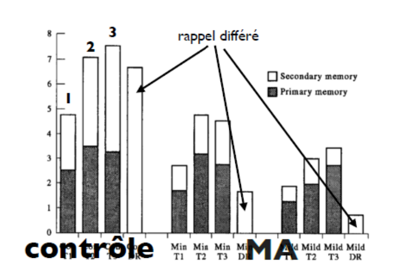

**La mémoire de travail**

Baddeley ajoute une composante dans son modèle, de **buffer épisodique**, pour
exlpiquer quelque chose qui n'était pas possible avant. Quand on regarde un
film, il est nécessaire de stocker le nom des personnages. On ne peut pas le
faire dans la MCT à cause de la durée du film, et pourtant on y arrive. On
aurait donc un stockage des informations temporaires multimodales, épisodiques
car dans un moment spécifique, stocké quelque part entre MCT et MLT. Buffer car
temporaire.

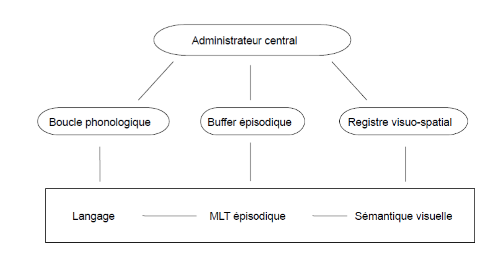{width=400}

### iv. L'encodage et le contexte

Pour Craik et Tulving, l'**apprentissage incident** se fait quand il n'y a pas
de consigne explicite d'encoder. Plus il y a d'élaboration sémantique, plus on
apprend. On a uen combinaison de la mémoire implicite et exlpicite dans cet
effet

Niveaux de traitements de Craik et Tuvling, propose que traiter des informations
laisse des traces en MLT. Paradigme a été très important, manipulation
d'encodage pour mesurer le résultat où on donne de l'argent je crois je sais pas
trop.

<!-- FIX: diapo craik & tulving -->

Il y a 20 ans, beaucoup d'études s'intéressaient à l'évolution de la mémoire.
Méthodes simples et élégantes, mais pas les conclusions. Il y a phase
d'encodage, mais au lieu de demander des taches comme "est-ce que ce mot rime
avec un autre" etc., on demande aux participants si l'objet dans la liste est
utile pour la survie. On raconte une histoire où on doit survivre dans la
savanne sans rien, et à ce moment on présente une liste de choses, et pour
chacune on doit dire si c'est utile ou pas. Performance plus grande quand on
demande si c'est des mots utiles pour la survie que non je crois. On s'est servi
de ces résultats comme preuve évolutionnaire de l'utilité de la mémoire
épisodique

**Modèle de la trace mnésique** : si on a suffisamment d'activation, on peut
reconnaître une information, et si on en a encore plus, on peut le rappeler.

Pour tous types de mémoire, on a la disponibilité de quelque chose quelque part
dans le cerveau, et accessibilité nécessaire (+ fort est + difficile).

  |                   | Disponibilité | Accessibilité                           |
  | ----------------- | ------------- | --------------------------------------- |
  | Mémoire implicite | Oui           | Un peu - comportement - sans conscience |
  | Reconnaissance    | Oui           | Fort                                    |
  | Rappel libre      | Oui           | Très fort                               |

On a un modèle qui date des annés 60 génération / reconnaissance. Dans le
rappel, on produit spontanément des informations pertinentes et plausibles, puis
on identifie une information comme anciennce dans la reconnaissance. La
reconnaissanc est toujours mieux que la reconnaissance, et si on observe
l'inverse, faut tout revoir.

4 phases dans l'expérience de Tulving et Thomson 1973 :

- Phase d'encodage : paires de mots ("hope HIGH")
- Génération : indice de mots très proches, comme "how" pour "high", "lake" pour
  "water"
- Reconnaissance : on montre les mots et demande d'entourer les mots si vu
  pendant la phase d'encodage. 24% de ces mots sont entourés.
- Rappel : indicee, avec indices de la premières phases

Contexte est donc important pour la mémoire épisodique : le chevauchement entre
encodage et test favorise les performances.

<!-- FIX: bien revoir derni`´re partie` -->

<!-- source: 2_familiarite.md -->

## 1. La familiarité

::: {.callout-note}
Courbes ROC seront probablement à l'examen
:::

### 1.1. Contexte théorique

#### 1.1.1. Rappel théorique

On va voir la familiarité, sur quoi on se base pour dire qu'on a déjà vu quelque
chose. Il y a deux mécanismes principaux :

- **Recollection** : récupération consciente d'un souvenir dans son contexte
- **Familiarité** : processus automatique qui permet la reconnaissance sans
  récupération de détails contextuels associés

Cette distinction est proposée pour la première fois par Adams (1967), qui
cherchait à parler de processus perceptuels et conceptuels :

- Différents processus perceptuels qui permettent de capter des signaux er faire
  du **matching**, comparer ce qu'on est en train de vior à ce qu'on a en
  mémoire, et si c'est fait, on a la familiarité. C'est sensé être très rapide,
  ascendant, de bas niveau, sans contexte.
- Processus conceptuels : de haut niveau, conscient, raisonnement, etc.

**Yonelinas** (2002) propose :

- Que la **familiarité** est une sensation subjective d'avoir déjà vu le
  stimulus, sans récupération explicite du contexte initial d'apprentissage.
  Automatique, rapide, implicite, basé sur la force mnésique, et contient donc
  des degrés de familiarité
- Que la **récupération** est un rappel conscient et volontaire d'un évènement
  passé et de son contexte d'apprentissage. Il est controlé, lent, détaillé, et
  se base sur un seuil de récupération d'informations qualitatives /
  associatives. On ne se souvient ou se souvient pas

::: {.columns}
::::: {.column width="50%"}
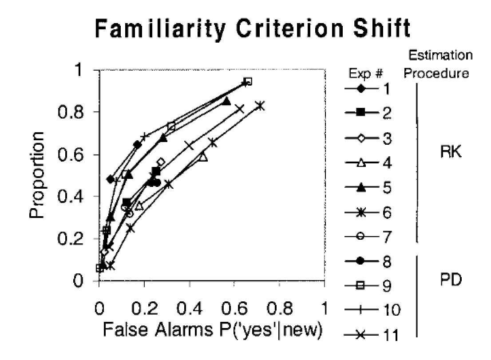
:::::

::::: {.column width="50%"}
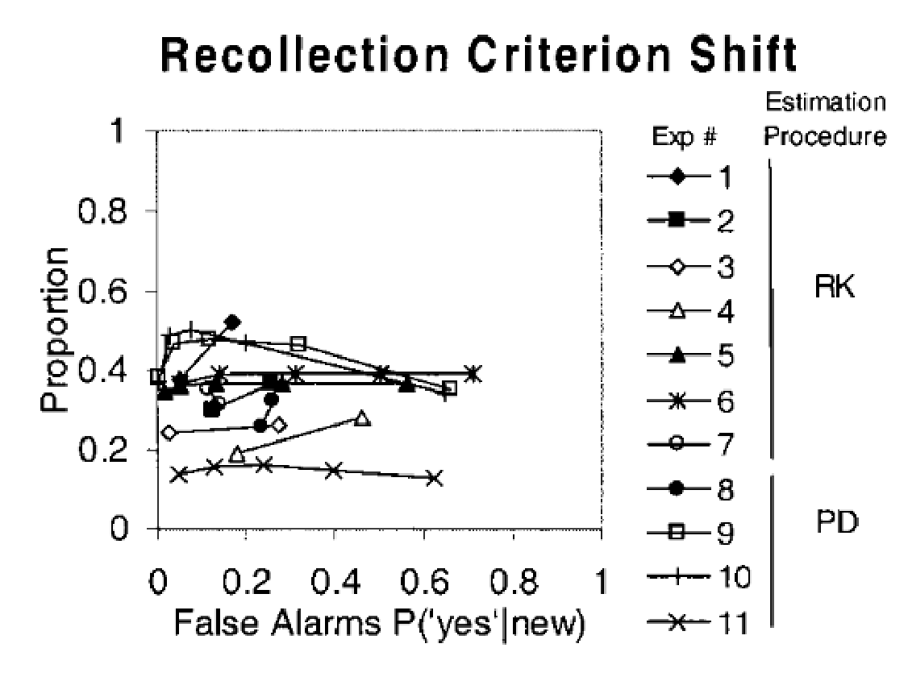
:::::
:::

::: {.callout-tip collapse=true title="Lecture du grahpique"}
*Tout cette explication est faite par IA car on y comprenait rien désolé :(*

**Comment lire les deux graphes (ROC).** Chaque courbe correspond à une
expérience (Exp #1 à 11) et chaque point d'une courbe à un **critère de
réponse** différent. Le critère est le seuil de preuve/confiance à partir duquel
on répond « ancien » plutôt que « nouveau » : un critère conservateur fait dire
« ancien » seulement quand on est très sûr (peu de réponses « ancien », vraies
comme fausses) ; un critère libéral fait dire « ancien » dès qu'on ressent
quelque chose (beaucoup de réponses « ancien », vraies comme fausses).

Le critère n'est pas une propriété du stimulus ni d'un essai isolé : c'est une
règle de décision propre au participant, qui peut varier chez la même personne
selon la tâche, la consigne, les gains/pénalités, la fatigue ou le niveau de
confiance. Il n'est pas observé directement : on l'infère à partir des hits et
des fausses alarmes. Dans les graphes, chaque point correspond à un critère
(souvent un niveau de confiance) ; l'axe x n'est pas le critère lui-même, mais
le taux de fausses alarmes qu'il produit. Chaque courbe est une expérience
agrégée sur plusieurs participants : les points sont des moyennes de groupe pour
chaque critère.

- **Axe x** : `P('yes'|new)`, le taux de fausses alarmes, c'est-à-dire la
  proportion d'items nouveaux jugés « ancien ». C'est l'indice du critère : plus
  il est élevé, plus le critère est libéral.
- **Axe y** : la proportion de réponses relevant du processus considéré
  (familiarité à gauche, récollection à droite).
- **Graphe de gauche** : familiarité. **Graphe de droite** : récollection.

**Pourquoi ces formes ?**

- **Familiarité : courbe en arc (concave).** La familiarité est un signal
  continu, gradué. Les items anciens et nouveaux ont des distributions de force
  qui se chevauchent. Quand on rend le critère plus libéral, on accepte des
  items de plus en plus faibles : on gagne des hits, mais on prend aussi des
  fausses alarmes. Le compromis n'est pas linéaire : au début on gagne surtout
  des hits, ensuite surtout des fausses alarmes. Pouvoir se déplacer le long
  d'une courbe continue = signature d'un processus gradué.
- **Récollection : courbe plate.** La récollection est un seuil tout-ou-rien :
  on récupère ou on ne récupère pas. Changer le critère de réponse ne change pas
  la probabilité de récupérer ; ça ne fait varier que les réponses basées sur la
  familiarité ou le guessing. D'où une ligne plate : l'estimation de
  récollection est invariante au critère. C'est la signature d'un processus à
  seuil.

Donc la forme n'est pas un détail : elle teste directement si le processus est
gradué (familiarité) ou tout-ou-rien (récollection). Si la reconnaissance
n'était qu'un seul signal de force, les deux graphes auraient la même forme.
:::

#### 1.1.2. Modèle intégratif de la mémoire

Modèle intégratif de la mémoire à 2 composants clé :

- Système **représentationnel** :
  - Stocke et reconstruit les traces mnésiques. Dommage de ce système =
    dégradation du contenu de la mémoire
  - contient les sous-systèmes "cœurs" qui encodent et stockent les
    représentations spécifiques
- Système d'attribution/attention :
  - Plus haut niveau
  - Module l'utlisation des traces mnésiques en fonction de la tâche, des
    objectifs
  - Permet la réalisation des jugements explicites et la subjectivité des
    expériences

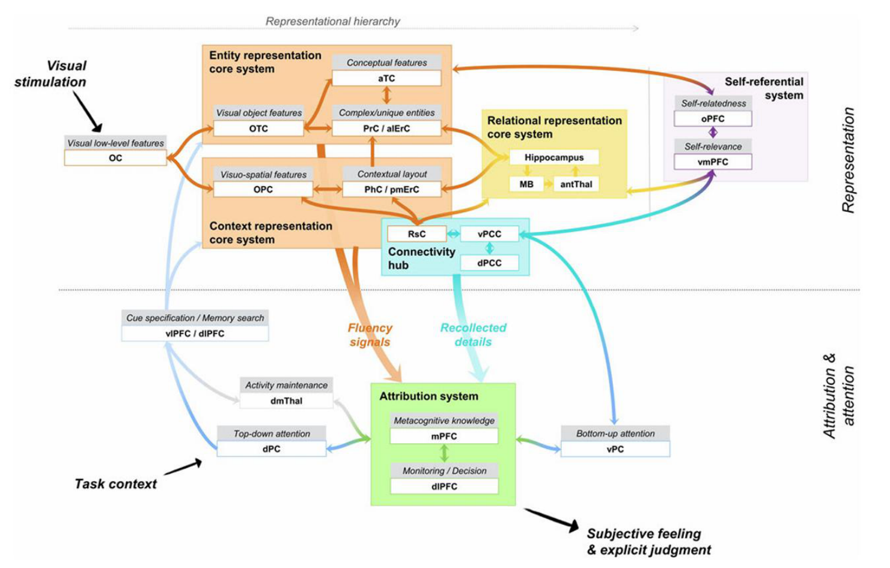

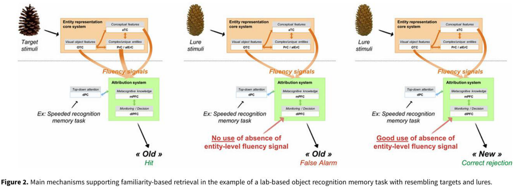

### 1.2. Corrélats neuronaux de la familiarité

**Système cœur des entités** (familiarité) : cortex périrhinal, enthorinal
antolatéral, occipito-temporal et temporal antérieur (réseau distribué). Ce
système intègre les traces en une représentation compelxe et unique, se
distinguant d'autres représentation stockées

**Système "cœur" relationnel** (recollection) : centré dans l'hippocampe,
subiculum, corps mamillaires et noyaux antérieurs du thalamus. Encodage rapide
de représentations détaillée de l'item associé à l'information contextuelle.

### 1.3. Phénomènes quotidiens

#### 1.3.1. Effet de simple exposition

Les signaux de fluence arrivent à nous, et le **système de distribution** doit
faire une décision. Parler d'effet de **simple exposition** peut nous aider : la
simple présentation d'un stimulus peut provoquer une préférence accrue vers
celui-ci. Le modèle de **fluence perceptive** propose que la fluence est
attribuée selon le contexte de la tâche ; et le modèle de **fluence hédonique**
propose que l'expérience de fluence est considérée comme intrinsèquement
plaisante.

On se questionne de l'influence de la familiarité inconsciente sur les attitudes
surtout dns dans la reconnaissance consciente.

<!-- TODO: reprendre cette étude -->

#### 1.3.2. Boucher-dans-le-bus

Boucher-dans-le-bus est dû à rencontrer quelqu'un en dehors de son contexte, et
retrouver le bon contexte est très dûr. C'est une expression de la **spécificité
de l'encodage**.

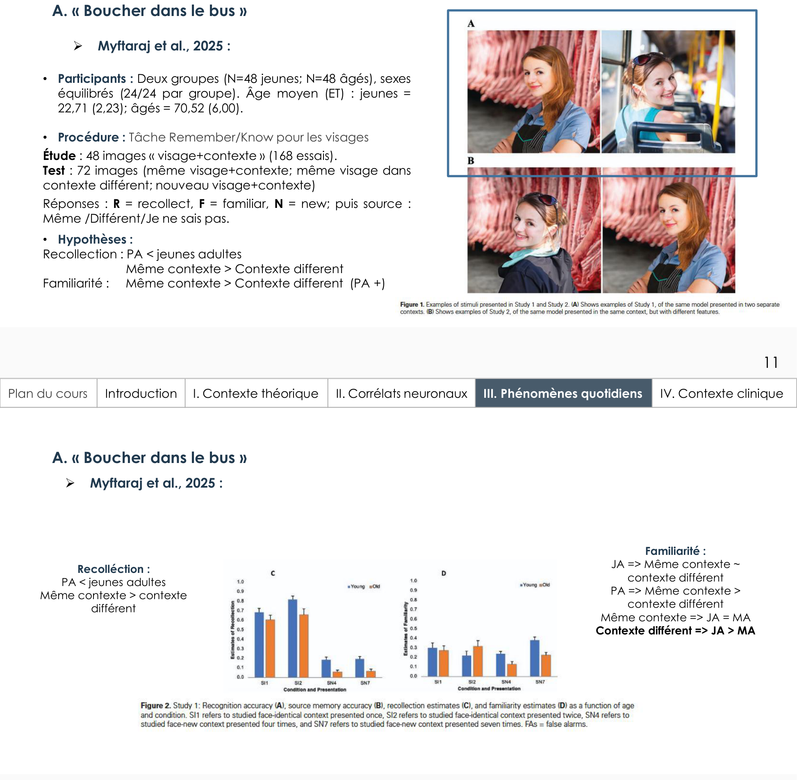

On fait une étude où on voulait tester qu'est-ce qui change dans la spécificité
d'encodage avec le vieillissement, sachant que les capacités évoquées déclinent
avec l'âge. Tâche de **Remember/Know** avec phase d'apprentissage, puis phase de
test où on demande si c'est totalement nouveau, si c'est un peu familier, ou
s'il s'en souvient :

- Apprentissage : 48 images "visage + contexte"
- Test : 72 images (même visage + contexte; même visage dans contexte différent;
  nouveaux visage + contexte)

Prédictions :

- Personnes âgées moins performantes en recollection
- Récupération plus forte dans le même contexte en recollection
- Contraste plus favorable pour les jeunes en recollection
- Familiarité plus basse hors contexte surtout pour les âgés

Pas de différence significative pour les contextes chez les jeunes, pareil pour
les âgées. Contexte différent ont familiairté plus forte chez les jeuens que
chez personnes âgées qui perdent la notion de familiarité avec changement de
contexte.

#### 1.3.3. Phénomène de déja-vu

La **familiarité représentationnelle** est un résultat de match entre ce qu'on
est en train de percevoir et des représentations stockées en mémoire. Dans
l'effet de simple exposition, il y a bien un matching, donc familiairité
représentationnelle. Ça créé une fluence, mais pas forcément de **sensations
phénoménologique de familiarité**, mais par exemple de préférence.

Mais est-ce qu'on peut avoir l'un sans l'autre ? On peut manipuler sensation de
fluence avec différentes tˆåches. On peut faire apprendre des listes de mots,
puis ???. FIX:

Par exemple le changement de police peut jouer sur la familiarité à partir d'une
différence perceptive. On peut interpréter à tord que police moins lisible = mot
moins familier. Ça peut aussi se passer dans le déjà-vu, dont une théorie qui
propose qu'il y a pas de représentation stockée dans le déclenchement de
familiarité.

Donc dans l'effet de simple exposition il y a familiarité représentationnelle
mais pas phénoménologique. Il y a les deux dans le boucher-dans-le-bus. Déjà-vu
que phénoménologique.

Déjà-vu est défini "any subjectively inappropriate impression of amiliarity of a
present moment with an undefine past". Chris propose plutôt "the
phenomenological e xperience of recognizing a current situation and the
awareness that this feeling of recognition is inappropriate".

FIX: oops j'ai pas écouté

2 familles de théories explicant l'origine du déjà-vu : bottom-up et top-down.

- Bottom-up : quelque chose matcherai vraiment dans l'environnemnet avec quelque
  chose en mémoire, mais trop diffuse pour vraiment déclencher reconnaissance
- Top-down : rien dans l'environnement, mais juste des phénomènes neuronaux
  spontanés para-hippocampiques

FIX: hopla j'écoute pas du tout

-## 4. Familiarité dans le contexte clinique

--------------------------------------------------------------------------------

<!-- source: 3_familiarite_suite.md -->

partie test oùl les participants revoyaient des scènes et objets déjà vues, test

## 2. La récollection

### 2.1. Contexte théorique

#### 2.1.1. Modèle BIC

Le modèle "Binding of item and context" vient d'une revue de 30 études en
neuroimagerie, cherchant des corrélats neuronaux derrière familiarité et
récollection :

- Récollection : activité forte dans l'hippocampe et gyrus parahippocampique
  postérieur
- Familiarité : activité forte dans le gyrus parahippocampique antérieur
  (**cortex périrhinal**)

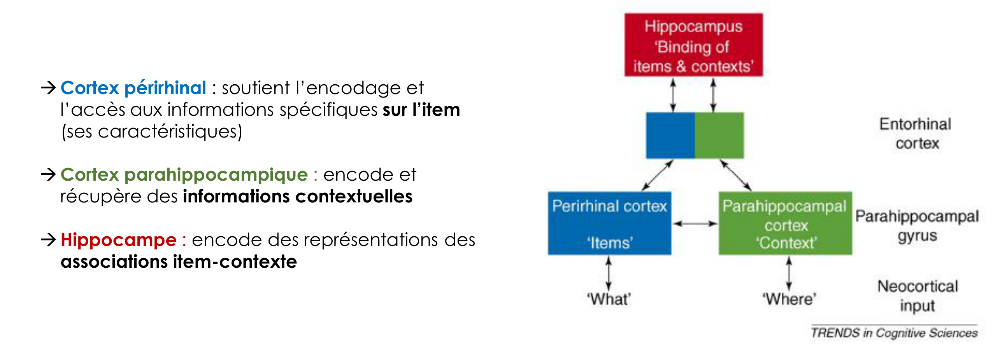

::: {.columns}
::::: {.column width="50%"}
On va tester ce modèle avec une étude où les participants doivent faire du
rappel indicé d'associations objet-scène. Dans la phase test, pour chaque
indice, faire un jugement parmis quatre : nouveau, familier, rappel remémoré,
autres détails remémorés sans rappel de l'associé. Deux phases :

1. Apprentissage : 180 paires objets + scènes, 3.5 s par paires
2. Test sous IRMf : 216 essais tests divisés en 6 blocs (indices : objets
   anciens, scènes anciennes, objet nouveaux, scènes nouvelles)
3. Post-test: 144 essais similaires
:::::

::::: {.column width="50%"}
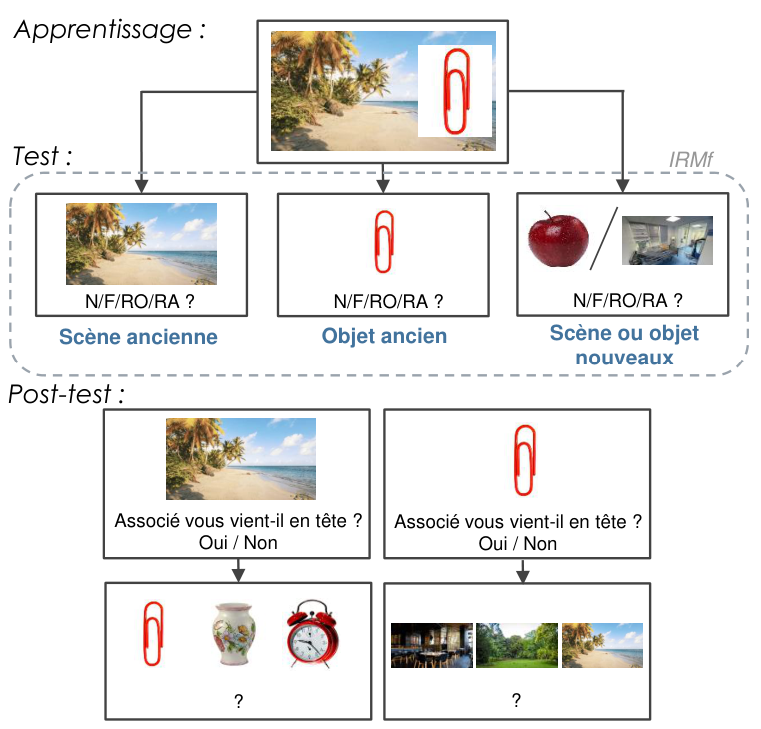
:::::
:::

Résultats par région d'intérêt :

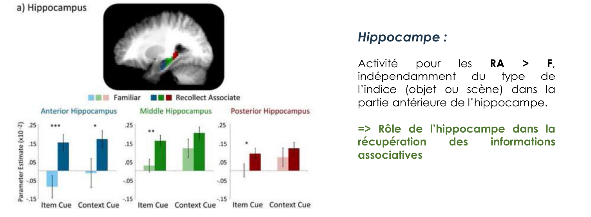

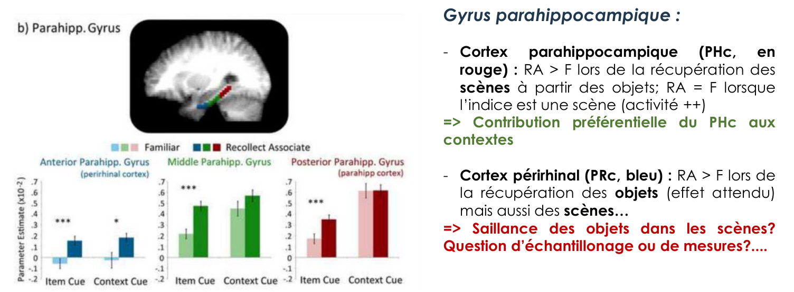

On voit que chaque objet avait sa propre scène. Mais ça ne ressemble pas à la
vraie vie : on se retrouve souvent dans les mêmes contextes et on doit retrouver
des informations dans ces mêmes contextes. Comme retrouver notre voiture sur un
parking particulier. Donc comment on fait pour distinguer des souvenirs issus du
même contexte ? Il peut se produire des interférences quand des souvenirs
partagent des éléments de contextes.

#### 2.1.2. Interférence et mémoire de source

L'**interférence** est le fait que des souvenirs partagent les mêmes indicse de
récupération se font concurrence au moment du rappel, ce qui produit l'oublie ou
des confusions. Elles sont rétroactives (RI) ou proactives (PI).

On va utiliser une tâche de **rappel ou apprentissage par anticipation** : dans
un test de mémoire, on s'attend à des présentations des mots. Ici, on va devoir
anticiper ce qu'il y aura par la suite : "est-ce que vous vous souvenez du mot
qu'on a appris ?", "non on n'a pas appris", "ok normal c chat", et on continue
comme ça, et quand on refait un passage, on sait répondre vu qu'on a appris
normalement. Au début, on n'a rien à anticiper, on a juste des trigrammes
("XCM", "KTQ"...). On fait 5 passage pour chaque liste.

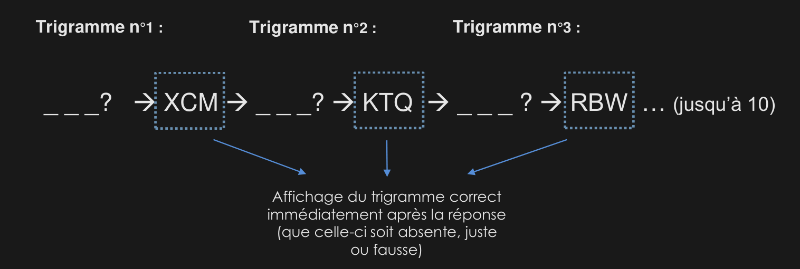

La similarité de deux types de listes apprises (A et B) est manipulée :

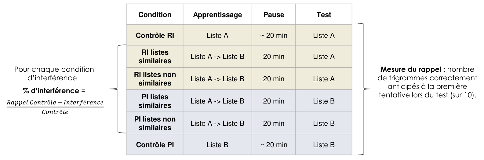

Résultats :

- Effet du type d'interférence, plus élevé dans la condition rétroactive
- Effet de la similarité des listes, plus élevé pour les listes similaires

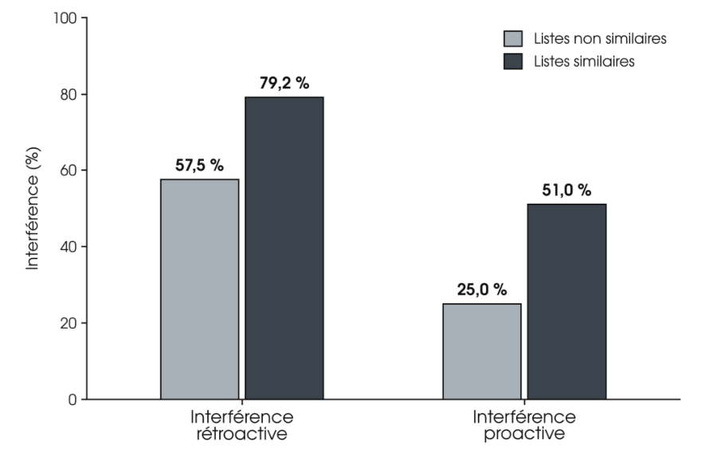{width=50%}

On propose que pour retrouver la **source du souvenir**, on doit retrouver le
contexte. On fait une tâche de mémoire d'items (reconnaissance, familiarité
et/ou récollection) puis tâche de mémoire de source (ou quand et comment l'ai-je
vu, surtout récollection).

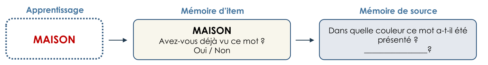{width=50%}

#### 2.1.3. Modèle intégratif de la mémoire

{width=70%}

On peut donc distinguer dans ce modèle comment distinguer des souvenirs
contextuellement similaires :

- À l'encodage :
  - Chaque entité reçoit une **représentation unique**, construite de façon
    distribuée et hiérarchique
  - Chaque épisode (même proche d'un autre) reçoit **sa propre trace** dans
    l'hippocampe
- Au rappel :
  - Récollection : une partie de l'épisode peut suffire à réactiver l'épisode
    complet
  - Les détails de l'épisode sont ensuite relayés vers le système d'attribution
  - Décision finale : le **système d'attribution** (cortex préfrontal) juge la
    pertinence des détails récupérés

Cependant ce qu'on a vu avant dépend de caractéristiques visuo-spatiales.
Comment est-ce qu'on sépare les souvenirs en termes de temps ? On touche ici aux
limites du modèle. On nous dit pas trop où est stocké le temps. Certains auteurs
pensent qu'on a des régions spécifiques qui stockeraient le temps, d'autres
pensent qu'il est distribué dans toutes les entités, qui permettrait de
distinguer les souvenirs temporellement.

### 2.2. Paradigmes expérimentaux

#### 2.2.1. Paradigme "remember/know" (Tulving, 1985; Gardiner, 1988)

On présente aux participants une liste de mots à mémoriser. Durant la phase de
test, on leur demande d'identifier des items préalablement étudiés, parmis les
distracteurs, selon deux types de jugements :

1. "**Remember**" : indique que le participant se souvient du contexte
2. "**Know**" : sentimenet de familiarité sans récupération explicite des
   détails contextuels précis

On va voir ce paradigme dans une étude de Davidson qui veut comparer les
performances de familiarité entre participants sains et Parkinson. On fait une
phase d'apprentissage de mots, puis de test après 10 minutes, où ils
auto-évaluent leur réponse remember/know/new aux mots présentés. Récollection
pas de différence, mais familiarité les sains ont des meilleurs scores. Mais il
y a plusieurs problèmes avec cette étude, surtout avec le fait de faire une
auto-évaluation des réponses :

1. Classification subjective (mesure indirecte)
2. Critères personnels variables
3. Des patients cérébrolésés peuvent avoir des souvenirs très précis mais faux
4. Suejts sains peuvent avoir des souvenirs vifs et détaillés qu'ils non jamais
   vus

#### 2.2.2. Paradigme de "dissociation de processus" (Jacoby, 1991)

Dissociation de processus est une mesure un peu moins directe. On produit de
contexte d'apprentissages différents, écrit ou verbalement. On présente aux
participants deux lisets de mots consécutives :

- Phase d'encodage :
  - Liste 1 : mots écrits présentés un par un
  - Liste 2 : mots présentés verbalement
- Phase de reconnaissance : liset 1, liste 2, mots nouveaux
  - Tâche d'**inclusion** : dire "ancien" pour tous les mots appris de la liste
    1 et 2
  - Tâche d'**exclusion** : dire "ancien" seulement pour les mots appris de la
    liste 2 (nécessite la récollection)

Utilisation de familiarité / récollection en fonction de la tâche et de la
justesse :

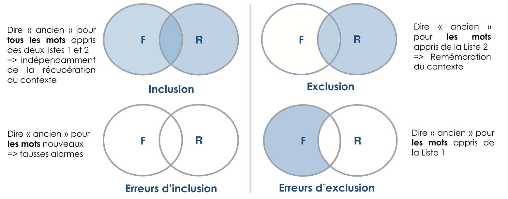{width=70%}

À partir de ça on peut calculer la part de récupération et familiarité dans ce
paradigme :

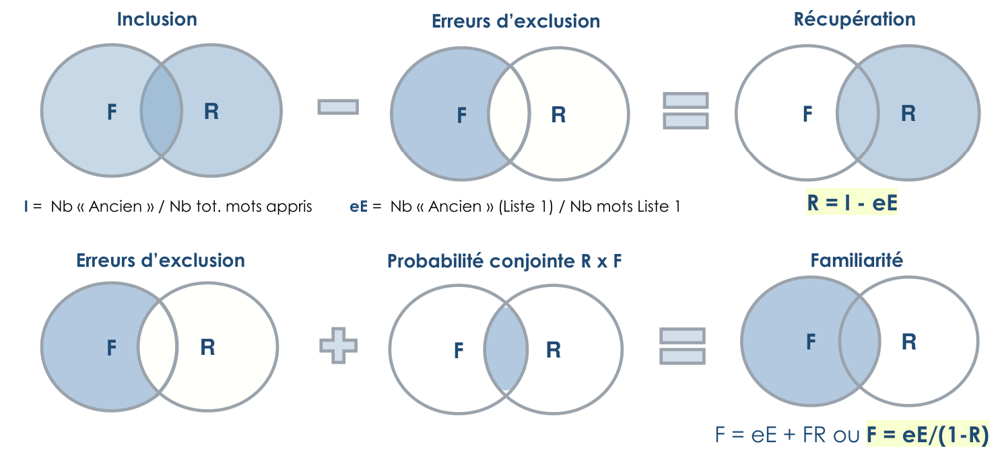

On va donc reprendre le but de la première étude avec ce paradigme. On a donc
deux groupes de patients, sains et Parkinson. On comparer l'utilisation des deux
mémoires : pas de différence pour la récollection, mais les patients Parkinson
utilsent beaucoup moins la **familiarité** (en $d'$).

### 2.3. Phénomènes quotidiens

Nos résultats sont donc assez robustes, avec 2 méthodes dfférentes on voit
différentes observations. C'est donc une méthode un peu plus objective, car ce
n'est pas les personnes qui jugent mais nous qui déduisons à partir des
personnes.//

#### 2.3.1. Faux souvenirs

##### Shopping mall

Expérience de "shopping mall" qui est une étude où on se demande si on peut
implanter un souvenir qui n'a jamais existé. On est allé voir les familles des
participants pour les interroger sur des épisodes de leur enfance, et pendant le
test, on rajoute un épisode faux, qui décrit un enfant en détresse qui s'est
perdu dans un centre commercial.

La tâche est que les participants ont reçu des descriptions de 4 souvenirs issus
de leur enfance (trois vrai un faux). Ils devaient écrire ce dont ils se
souvenaient de chaque. Ils le faisaient lors de deux entretiens (avec ce rappel
et une évaluation de la clarté de 1 à 10). 25% des participants y ont cru, mais
les faux souvenirs restent moins détaillés.

##### Imaginer un évènement puis s'en souvenir

Autre expérience, "**inflation par l'imagination**", où on fait 2 séances
espacées de 2 semaines :

1. 40 événements, "est-ce que c'est arrivé y'a 10 ans ?" jugé de 1 à 8, dont 8
   improbables
2. Imaginer 4 événements jugés improbables, puis remplir à nouveau le
   questionnaire (car le premier était "perdu")

La certitude que l'évènement s'est déjà produit augmente plus souvent pour les
événements imaginés. Comment ça pourrait marcher ? On propose qu'imaginer et se
souvenir sont toutes des simulations construites à partir des mêmes éléments
stockés (détails d'expériences passées, schémas). On pourrait donc faire une
**confusion de source**. Une fausse récollection n'est pas équivalente à
l'absencde du contenu en mémoire.

##### Le paradigme DRM

16 listes de 15 mots entendus, tous associés à un mot critique jamais présenté.
Reconnaissance : "ancien ou nouveau ?", si ancien, remember/know. Résultat : le
mot critique reçoit autant de réponses "remember" que les mots réellement
entendus. Les mots de la liste activent le mot critique par association. Si le
monitoring de sa source échoue, il est attribué à tort à la liste, soit une
fausse récollection.

On relie différents éléments en mémoire mais ce sont des situations probable, et
imaginer des choses ferait des liens entre des éléments probables. Donc, plus on
répète ces expériences, on rajoute des détails, on juge un évènement plausible.
Donc plus c'est détaillé et probable plus on y fait confiance.

Paradigme DRM qui montre qu'on peut avoir une sensation très forte de
familiarité alors qu'on a pas vu un item.

#### 2.3.2. Amnésie infantile

L'amnésie infantile est l'incapacité à se souvenir des événements vécus dans les
premières années la vie, il y a très peur de souvenirs avant 3 ans. Étude der
Peterson montre que l'âge des premiers souvenirs d'enfance se décale vers une
période plus tardive vers le temps, les souvenirs précoces des plus jeunes
enfants sont instables et souvent vite oubliés, et les souvenir des enfants agés
sont lpus conservés, reconnus et rappelés de façon cohérente.

L'hypothèse principale est que la maturation du cerveau fait que des zones se
développent de manière hétérogène, surtout pour le cortex préfrontal et
l'hippocampe.

<!-- source: 4_memoire_autobiographique.md -->

## 3. La mémoire autobiographique

### 3.1. L'empan de vie et le pic de réminiscence

La mémoire autobiographique prend en compte la mémoire sémantique ET épisodique.
On va parler du pic de réminiscence pour expliquer la théorie d'organisation de
mémoire autobiographique. Puis, on va parler du soi, et présenter le modèle
central su **Self Memory System**, puis exemples concrets des troubles de la
mémoire autobiographique.

La mémoire épisodique n'est pas la même chose qu'autobiographique. **C'est un
système dynamique pour stocker les souvenirs personnels et connaissances dans un
hiérarchie**, portée par l'identité et le soi.

On donne des mots et on demande aux gens de récupérer des souvenirs spécifiques
de leur passé. Mais la difficulté est d'évaluer si le souvenir est vrai ou faux.
Mais on s'en fiche, dans la mémoire autobiographique, on sait que la mémoire est
une reconstruction du passé, et on ne va pas vérifier les contenus de ces
souvenirs. On se rend compte qu'il y a amnésie infantile, puis **pic de
réminiscence** (15 à 25 ans). Celui-là se retrouve dans toutes les tâches de ce
genre, en excluant quelques différences individuelles.

Un article a tenté d'expliquer cet effet, en explorant les types de souvenirs.
On prend des gens et leur demande les évènements les plus importants de
l'histoire du monde au cours de leur vie. Et on retrouve aussi cet effet. On a
donc un effet systématique du pic de réminiscence. Et ce n'est pas un test de
mémoire autobiographique. Pareil pour les connaissances de culture générale.
Pareil si on demande aux gens leurs albums préférés et plein de trucs.

Mais pourquoi ? 5 théories.

- Combinaison des effets de nouveauté et primauté
- **Explication neuropsychologique** : lié à la maturation du cerveau, on a pas
  de très bonnes de structures de stockage avant 20 ans
- **Explication d'identité** : la période de pic de réminiscence est importante
  pour la formation du soi. Théorie stadiste pour expliquer le développement de
  la personalité. Et c'est débile
- **Explication adaptative** : c'est l'âge important pour la reproduction
- **Approche narrative** : prend en compte le récit de notre vie. Un **script
  culturel de vie** désigne un ensemble de repères temporels et d'événements de
  vie socialement partagés (par exemple : tomber amoureux, se marier, avoir un
  enfant), considérés comme typiques et normatifs dans une culture donnée. Ces
  scripts influencent la façon dont nous organisions et rappelons nos souvenirs
  autobiographiques.

Donc on fait une étude que je n'ai pas écoutée et on a un pic de réminiscence
surtout d'évènements positifs, et à partir de 31 ans la vie est horrible.

### 3.2. Le soi - The Self

#### 3.2.1. Effet de référence à soi

Le "soi" à différentes définitions, et en recherche c'est plutôt une définition
objective, de choses qui nous définissent. Il y a plusieurs manières de le
mesurer dans le contexte dans la mémoire.

**Effet de référence à soi** : test où on encode les informations où on encode
en relation à autre ou soi. Encoder par rapport à nous-même nous permet de
beaucoup mieux organiser les informations. Participants encodent 80 adjectifs (2
conditions d'encodage bloqués) : référence aux autres ("est-ce que ce mot
décxrit Einstein ?" -> yes/no) ou à soi ("est-ce que ce mot me décrit ?"
yes/no). Les résultats yes/no ne sont pas importants, mais quelle catégorie
d'information, on a le plus encodé. Et on se souvient donc beaucoup des choses
encodées par rapport à soi.

Pour chaque aspect de notre identité, on aurait une population de souvenirs
regroupée autour de ça. On a donc utilisé le TST (twenty-statements tests), fait
par les sociologues pour mesurer l'identité, ou description de la personne. On a
pris ces identités et demandé de récupérer les souvenirs liés aux aspects de
l'identité.

C'est pas l'âge qui compte mais les **relations entre évènemnts et identité**.
Donc l'idée c'est que les souvenirs autobiographiques sont regorupés aux moments
clés de la formation d'identité, quelque soit l'âge.

#### 3.2.2. SMS de Conway (système de mémore du soi)

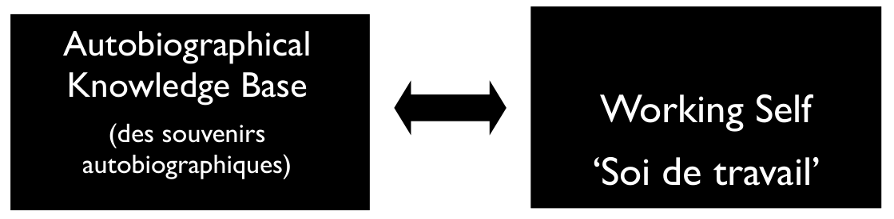{width=70%}

**Modèle self-memory systeme de Conway** : on a une base de données
autobiographiques, et le "soi de travail" en ref blague à Baddeley. Ça serait un
soi temporaire. C'est un modèle constructiviste de la mémoire, mais c'est un
problème, car il y a des liens bidirectionnels donc le soi va impacter les
souvenirs stockées, et les souvenirs récupérés vont influencer le soi. C'est
donc très difficile à tester.

On a une mémoire autobiographique qui serait une construction mentale très riche
faite d'une combinaison de **mémoire épisodique** qui donne une image
sensorielle très proche de ce qu'on a vécu, et du **Self à Long Terme**. Il y
aurait un schéma d'organisation des mémoires autobiographiques, sur les périodes
de vie (j'étais en thèse, en couple avec Tess...).

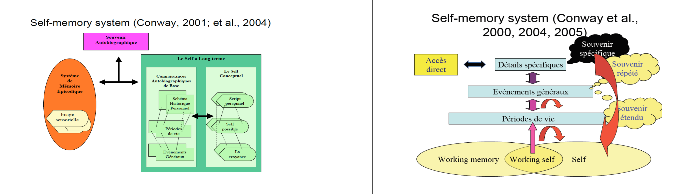

::: {.callout-tip title="Lecture des figures" collapse=true}
**Comment lire les deux figures** : (même modèle, deux niveaux : l'architecture
à gauche, la récupération à droite). /!\\ j'ai utilisé de l'ia sinon impossible
de comprendre lol désolé....... /!\\

Figure de gauche, la construction : un souvenir autobiographique n'est pas
stocké d'un bloc, il est assemblé. Le système de mémoire épisodique fournit une
image sensorielle proche du vécu ; cette image est indexée par le Self à long
terme, qui contient les connaissances autobiographiques de base (schéma
historique personnel, périodes de vie, événements généraux) et le self
conceptuel (script personnel, self possible, croyance). Les doubles flèches =
circulation dans les deux sens.

Figure de droite, la récupération, à lire par le bas :

- le **working self** est le moteur de la recherche, entre mémoire de travail et
  self à long terme ;
- la recherche remonte la hiérarchie périodes de vie → événements généraux →
  détails spécifiques (flèches roses), avec des allers-retours (flèches rouges)
  ;
- le format du souvenir dépend du niveau où on s'arrête : souvenir spécifique
  (détails), souvenir répété (événement vécu plusieurs fois), souvenir étendu
  (qui couvre une période de vie) ;
- l'**accès direct** permet de tomber directement sur les détails spécifiques,
  sans remonter la hiérarchie.

Les diapos ne légendent pas les flèches roses et rouges : le sens ci-dessus est
une lecture de la figure, pas du cours.
:::

#### 3.2.3. Perturbations de la mémoire autobiographique et le soi

- Confabulation : génération de faux souvenirs, pour combler trous de la mémoire
  ou identité
- Fugue dissociative
- Alzheimer : lien entre fonctions exécuives et la mémoire autobiographique.
  Impact sur l'identité, on trouve des baisses sur une mesure de "l'intensité de
  l'identité". Mais c'est corrélationnel.

Mais l'identité à une composante sémantique et épisodique, il est très très rare
de tout perdre.

<!-- source: 5_process_haut_niveau.md -->

## 4. La métamémoire

### 4.1. Définitions

Bons exemples de métamémoire est le mot sur le bout de la lampe qui est deux
choses : Échec de la récupération, mais avec une recherche de celle-ci. On
utilise ce sentiment pour orienter la recherche en mémoire. C'est la petite voix
de la **métamémoire**.

La **métacognition** est le contrôle et évaluation de nos propres processus
cognitifs. La **métamémoire** est la métacognition pour la mémoire. C'est très
utilisé pour étudier la conscience, mais vient du développement dans les années
80. Flavell, psychologue stadiste, proposait qu'il y a des processus
prédéterminant pour le développement, surtout fonction permettant la régulation
et l'orchestration des processus cognitifs. Ça a soutenu les approches types
"apprendre à apprendre".

Il y a les **connaissances métacognitives**, qui sont les connaissances
générales acquises, et les **expériences métacognitive**, qui sont les
connaissances en rapport avec une tâche en cours. Ces dernières comprennent
fluence, déjà-vu.

Modèle très connu de la métamémoire :

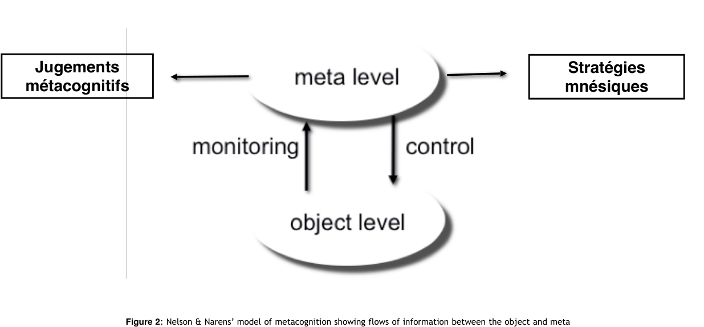{width=70%}

Entre les deux niveaux de mémoire, ce sont les processus représentant les flux
d'informations entre les niveaux de traitements. Cette boucle a donc la capacité
d'optimiser les processus de mémorisation.

### 4.2. Comment mesurer la métamémoire ?

Pour mesurer ces processus dans le cadre de la reconnaissance :

- Pour le **monitoring**, on utilise estimation/prédictions. On compare toujours
  celles-ci aux vraies performances : l'idée est que mesurer la performance est
  le niveau objet, et avoir une représentation de la performance est au niveau
  méta
- Pour le **contrôle**, on va mesurer les capacités des individus à
  utiliser/modifier les stratégies mnésiques

<!-- TODO: et dcp jol ou fok ? -->

#### 4.2.1. Judgement of learning (JOL)

Le **JOL** (Judgement of Learning) est la capacité à prédire le rappel d'un item
lors de l'apprentissage. Les JOLs peuvent se faire immédiatement après
l'encodage (immediate JOLs) ou après un délai (delayed JOLs). Généralement, on
le fait item par item en paires de mots

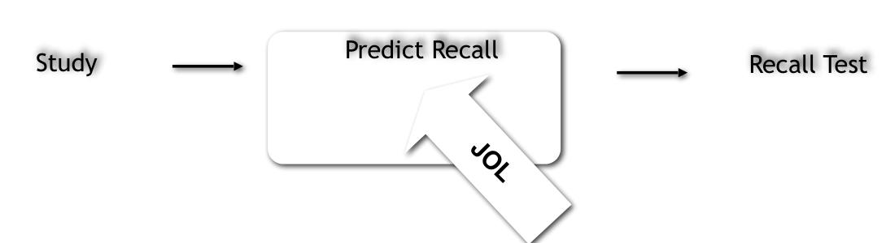

Nos prédictions avec les JOLs sont beaucoup plus précises après un délai. Et cet
effet est la base de beaucoup de théories en métamémoire. Donc pour la mesurer
dans cette situation, il faut avoir une mesure de précision : un bon niveau est
de savoir prédire notre performance, quels sont les mots mieux encodés que les
autres. On peut donc faire une corrélation ("gamma score") qui regarde
association entre prédictions et performances pour chaque individu. Et ce gamma
score est bien plus haut après un délai.

Comment ça fonctionne ? C'est évident : si on doit aller vite, l'information
reste en MdT donc il est dur de savoir si on va la perdre ou pas, alors que le
JOL différée se base uniquement sur la MLT (plus précis). Le JOL est basé sur la
récupération de l'information.

#### 4.2.2. Feeling of knowing (FOK)

FOK est la prédiction de reconnaissance d'items non récupérés en mémoire. // Le
mot sur le bout de la langue en est un cas extrême. Elle nous aide à orienter
une recherche pour pouvoir retrouver l'item.

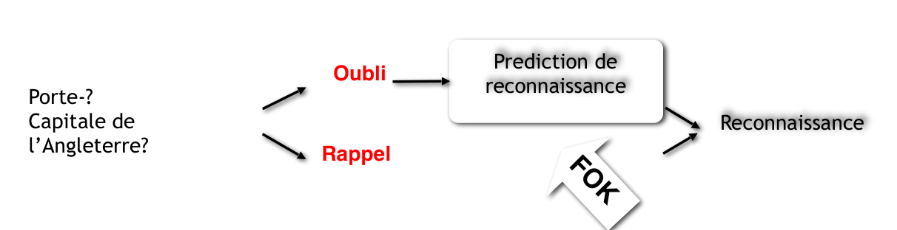

Mode de prédiction : échelle de pourcentage, ou prédiction binaire. C'est une
bonne mesure car ça représente quelque chose de la vie quotidienne, mais on
retrouve la même chose que pour le JOL : on a une prédiction item par item et
personne par personne ???

On peut faire exactement la même chose dans la mémoire sémantique (avant,
épisodique). C'est un paradigme idéal.

### 4.3. Théories des delayed JOL

#### 4.3.1. Théorie de l'accessibilité

On a des prédictions très peu précises, un gamma même légèrement négatif. Mais
il y a une différence entre mémoire sémantique et épisodique : uniquement la
mémoire épisodique est altérée. Mais comment expliquer tout ça en termes de
théories ?

L'**approche d'accessibilité** de Koriat dit que pour les JOLs il y a plusieurs
indices qu'on peut utiliser pour nos jugements métacognitifs. Certains sont plus
ou moins intéressants pour la mémoire et plus ou moins en lien avec les
expériences métacognitives :

- On a des indices **intrinsèques** comme les caractéristiques des items. On
  peut donc pendant une phase d'encodage utiliser ces facteurs pour évaluer
  notre performance (c'est long, c'est en anglais, c'est un prénom...)
- Indices **extrinsèques** (est-ce qu'il y a du bruit, combien d'items j'ai à
  mémoriser...)

Ces deux indices sont de la métacognition car c'est un contrôle de haut niveau
mais moins cool car pas de retour direct de la trace dans la mémoire. Les
**indices mnémoniques** sont l'évaluation du niveau d'apprentissage des items,
ressentis donnés par la trace en direct.

Deux possibilités pour l'origine des JOL et FOK dans ce modèle. Il y aurait 3
types d'indices sur lesquels on se base :

1. Intrinsèques : caractéristiques des items
2. Extrinsèques : caractéristiques de la tache
3. Mnémoniques : évaluation du niveau d'apprentissage des items

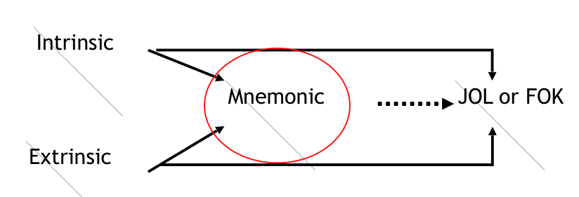{width=70%}

Le modèle a 2 possibilités :

1. Impact des facteurs intrinsèques et extrinsèques médiés par les indices
   mnémoniques
2. Impact des facteurs intrinsèques et extrinsèques par médiation des indices
   mnémoniques, et direct

Les indices mnémoniques :

- La **familiarité avec l'indice** : dans une tentative de rappel où il faut
  faire une prédiction pour la suite, on va utiliser la familiarité pour faire
  une prédiction du rappel de cette information. Permet une réponse rapide.
- La **facilité perçue d'encodage et de récupération** (fluente : "encoding and
  retrieval fluency")
- **Informations partielles** : même si on sait pas vraiment, on peut relier
  quelque chose de relié. Ça fait appel à la remémoration.

Patients d'alzheimer ne peuvent pas préidre la reconnaissance future d'un item
oublié.

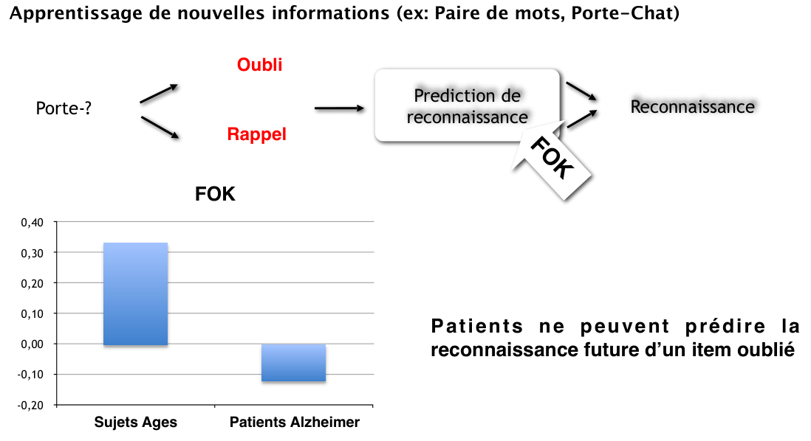

<!-- FIX: finir la ^ -->

::: {.callout-tip title="À retenir"}
On fait le tour des processus dans la mémoire qui sont métacognitifs, soit pour
faire un jugement sur paires de mots avec indices donnés, les processus utilisés
pour faire des prédictions sont les processus reliés à la mémoire et la
reconnaissance. C'es processus de haut niveau sont connaissancres et expériences
basées sur la reconnaissance te processus mnésiques déjà existants. Les
jugements métacognitifs utilisent des processus disponibles.
:::

## 5. L'inhibition

### 5.1. L'oubli

Idées importantes cherchant à exlpiquer l'oubli :

1. La trace se dégrade avec le temps
2. Perturbation de la récupération - disponibilité (car on peut pas être sûr
   qu'on "oublie" pour de vrai)
3. L'oubli serait une interférence
4. Inhibition : processus actif de suppression

### 5.2. Qu'est-ce que l'inhibition

Ce n'est pas une perte passive, mais une suppression active. Il y a des
processus qui existent pour diminuer l'activation des informations dans le
système. L'inhibition serait un mécanisme actif de **suppression des éléments
distracteurs** afin de laisser disponible l'efficacité des traitements pour la
cible. Elle serait également un phénomène adaptatif, car son effet sur les temps
de réponse dépend de la pertinence de l'information portée par le stimulus.

L'**oubli induit par la récupération (RIF)** est un phénomène montrant que la
récupération d'une information peut supprimer ou bloquer temporairement la
récupération d'autres informations liées. Cela montra la compétition entre des
items en mémoire.

### 5.3. Inhibition de la mémoire épisodique

#### 5.3.1. Oubli induit par la récupération

FIX: oublié de noter modèle théorique

Oubli induit par la récupération (RIF) : paradigme montre que processus de
récupération d'une chose inhibe récupération d'autres informations. On apprend
des items de différentes catégories sémantique. On va rappeler en continu des
informations dans une liste, et pour assurer. J'ai écouté mais le but c'est
juste de récupérer certaines informations.

Paradigme RIF :

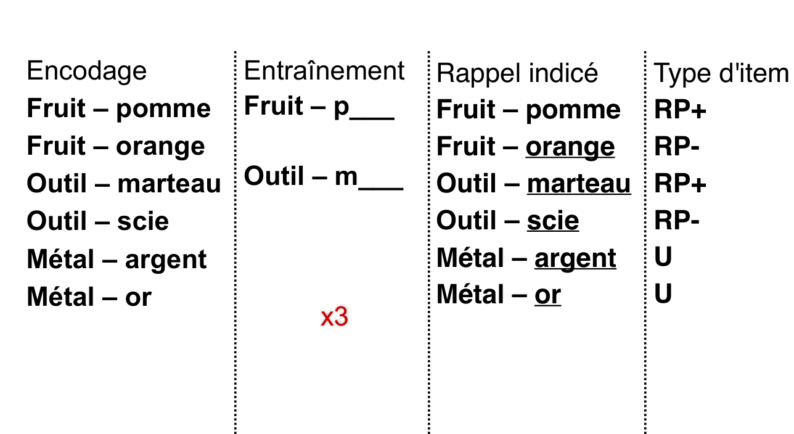

Pendant le rappel indicé, il y a trois types d'items :

- RP+ : items entrainés des catégories entraînés (pomme)
- RP- : des items non-entraînés des catégories entrainés (orange)
- U : items non-entraînés des catégories non-entrainés (argent)

Les résultats vont dans ce sens : $\text{RP+} > \text{U} > \text{RP-}$, ce qui
va dans le sens des hypothèse. En effet, on cherchait à montrer que les mots RP-
seraient inhibés par les traces mnésiques plus forte des RP+, en raison de leur
entrainemnet. Les mots U eux ne sont pas inhibés ou activés. Mais cette
expérience ne montre pas forcément que cette inhibition est faite sur les
représentations mnésqiues, car on teste le rappel grâce aux mêmes items que ceux
sur lesquels on les a entraîné.

**Modèle de suppression des caractéristiques** : on trouve des chevauchements
entre les catégories, qiu montre par exemple que tomate peut rentrer dans la
catégorie "fruits" ou "choses rouges". Sang et tomates étaient étudiés dans la
phase d'encodage comme choses rouges. Dans la phase test, on doit générer tous
les fruits qui étaient dans la liste initiale. On teste l'activation de tomate
avec l'indice fruit (et non rouge qui été utilisé pour sang dans
l'entraînement). On a une inhibition du rappel de tomate même avec l'autre
indice. L'inhibition est donc propre à la représentation mnésique.

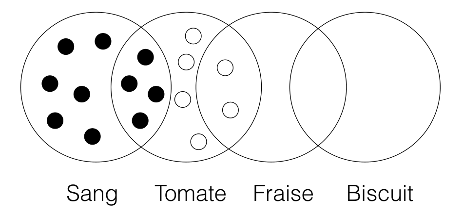

Donc l'inhbition eput travers les catégories, peu importe l'indice. C'est la
représentation qui est inhibée, et ça va traverser les catégories elon els
caractéristiques.

#### 5.3.2. Oubli dirigé

Oubli dirigé est un paradigme ("oh shit paradigm") où on fait genre qu'on a
donné la mauvaise liste, donc on demande d'oublier, et on donne une autre liste.
Puis on fiat test de mémorisation sur les 2. Le résultat n'est pas important
pour la première liste, c'est qu'on a une meilleur performance pour la deuxième
liste, il y a donc bien eu un oubli de la première liste.

::: {.callout-note title="Conclusion"}
- La métamémoire et l'inhibition sont deux exemlpes de processus de haut niveau
  intervenant dans la mémoire épisodique
- Il existe des modèles de ces processus, pertinents pour comprendre le
  fonctionnement de la mémoire épisode
:::
