# Partie I - Neurologie

> 4 cours neurologie, 8 cours de neuropsychologie. Chacun présenté par des
> spécialistes en leur domaine du CHU de Grenoble, pour nous familiariser aux
> notions importantes de neurologie, et faire la différence entre partie
> médicale et psychologique. Prof d'aujourd'hui clinicienne, recherche clinique,
> surtout sur maladies du SNC et inflammatoires auto-immunes. Examen 1h,
> questions ouvertes, neuro couvrant tous les cours.

<!-- CM1 -->

<!-- source: 4_syndromes_cognitifs.md -->

## 1. Notions Générales

Neurologues et neuropsychologues regardent même chose avec approche différente :
les premiers ont une vision très "maladie" mais n'ont pas de prise en compte ou
mesures de choses pas "évidentes". La neurologie est la discipline médicale qui
étudie l'ensemble des maladies du SNC et SNP.

#### 1.1. L'anamnèse ou l'entretien clinique

Sa base est la **sémiologie** *(signe + parole, car on voit des signes et
utiliser notre parole pour avancer)*, qu'on étudie beaucoup avant de voir les
maladies. On cherche à recueillir les **sypmtômes** (subjectifs) par anamnèse et
les **signes cliniques** (objectifs) recuillis par l'examen neurologique.
L'objectif est de **formuler un diagnostique analytique/fonctionnel et
topographique**.

SN nous permet de nous retrouver dans l'environnement et d'avoir des fonctions
cognitives de haut niveau. Des gens viennent en neurologie avec des plaintes et
on doit faire des **diagnostics de syndromes** : ensemble de signes et symptômes
pouvant être expliqués par plusieurs maladies, il a une dimension fonctionnelle
et topographique. L'**anamnèse** est "pourquoi le patient vient" : car il a des
symptômes qui le.a gêne. Une fois la plainte identifiée, il faut savoir depuis
quand (pour différencier les causes probables), puis l'**examen clinique** donne
les signes. Ici,

$$
  \text{Symptômes} + \text{Signes} = \text{Syndrome}
$$

L'**anamnèse** peut être vue comme plus important (c'est controversé de dire
ça), car si on part sur une mauvaise piste, on peut être très biaisé. Les signes
suffisent rarement à cerner une cause, donc poser des questions est vraiment
important. Il est aussi de fouiller l'entourage, le statut social du patient...
Il faut sortir de la prétention, et il faut savoir que tous les patients ne
parlent pas autant.

Le but est :

- Identifier la plainte
- Recueillir les symptômes ou signes fonctionnels et les caractériser
  fonctionnellement & topographiquement
- Permettre une expression libre au patient, en gardant un entretien ciblé et
  dirigé

Ce n'est donc pas facile, une maladie à différents symptômes, un symptôme
s'applique à plusieurs maladie. Peu de relations directes entre ces notions. Il
faut donc poser les bonnes questions en comprenant correctement quelle est la
plainte. Cette étape peut être utile pour clarifier l'attribution des symptômes
à des causes particulières.

#### 1.2. L'examen clinique

Le but de l'**examen clinique** est de recenser les signes neurologiques. Il
faut débrouiller l'histoire pour en avoir un ensemble logique. On voit plein de
choses :

- État de vigilance
- Marche, équilibre
- motricité
- Sensibilité
- Sensorialité
- Nerfs crâniens
- Cognition

La sémiologie peut être :

- Centrale
- Périphérique
- Fonctionnelle
- Musculaire

## 2. Atteintes motrices

### 2.1. Sémiologie et syndrome neurologique primaire

Le diagnostic du syndrome clinique a 2 composantes :

- Fonctionnel : quelle fonction est perturbée ?
- Topographique : quel niveau anatomo-fonctionnel du système est atteint ?

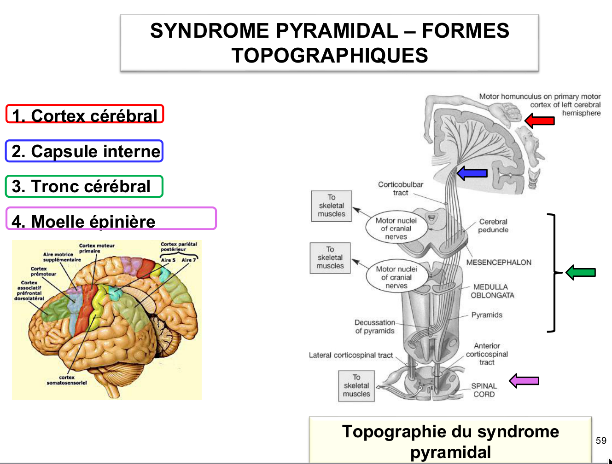

Il existe 2 types de syndrome neurologique moteur :

- Syndrome Pyramidal (neurone moteur central)
- Syndrome neurogène (neurone moteur périphérique)

#### 2.1.1. Syndrome Pyramidal

Anamnèse (signes) :

- Plainte de **faiblesse motrice de muscles squelettiques**, lourdeur, lors des
  activités courantes (parfois paralysie)
  - Claudication motrice intermittente : faiblesse indolor de membres
    inférieurs, survenant après un temps de marche, disparaissant ua repos
- Faiblesse **motrice des muscles extrémité céphalique** : trouble de
  mastication, phonation, parole, etc., par altération de fibres
  cortico-nucléaires
- Sensations de contracture ou raideur parfois douloureuses (spasticité ou hyper
  réflexie)

On explore 4 domaines au cours de l'examen neurologique :

- Force musculaire
- Tonus musculaire
- Activité réflexe- reflexes ostéotendineux (**ROT**)
- Trophicité muculaire

##### Force musculaire

On peut constater **parésie / paralysie** qui est une difficulté à contracter
ses muscles et mobiliser ses membres par baisse ou absence de génération de ou
transmission de la commande motrice volontaire. De manière globale, on peut
observer un déficit moteur en marche ou station debout (fauchée). Si la lésion
responsable est aiguë et étendue (SNC), **hémiplégie/parésie** ou
paraplégie/paraparésie.

Épreuves et manœuvres d'examen motricité :

Membres supérieurs (MS) :

1. Bras tendus à l'horizontale : chute progressive et pronation du MS
2. Épreuve Garcin : bras fléchis/extensions des doigts fortement écartés,
   déficit musculaire sur les extenseus (main creuse)
3. Mouvements alternatifs rapides : marionnettes

::: {.columns}
::::: {.column width="50%"}
Membres inférieurs (MI)

1. Épreuve Mingazzini : décubitus dorsal, "chute" progressive du membre
   inférieur affecté
2. Épreuve Barré : décubitus ventral jambes fléchies à 90º, "chute" progressive
   du membre affecté
:::::

::::: {.column width="50%"}
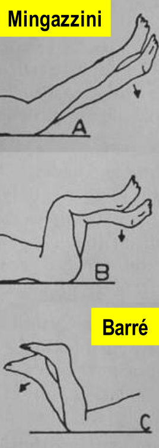{width=100}
:::::
:::

Muscles visage-cou :

1. Facial (VII) :
   - Au repos : effacement du pli naso-géninen, affaissement de l'hémi-face
   - En action : asymétrie quand on demande au patient de découvrir les dents
2. Trijumeau (V), glossopharyngien (IX), et vague (X) : muscles masséters et
   mandibulaires, dégultation et phonation
3. Hypoglosse (XII) paralysie de la langue

On utilise une **échelle globale de cotation de 0 à 5** :

- 0 - Aucune contraction musculaire
- 1 - Frémissement/ébauche/tentative de contraction sans mouvement actif
- 2 - Mouvement actif d'une partie du membre
- 3 - Mouvement actif contre la pesanteur
- 4 - Mouvement actif contre la pesanteur et contre résistance
- 5 - Mouvement contre une résistance complète sans fatigue = force musculaire
  normale

##### Tonus Musculaire et activité réflexe

La **boucle gamma** est contrôlée par la voie pyramidale d'une manière
inhibitrice, le cortex inhibe la boucle gamme, retirer cette inhibition fait
qu'elle se contracte ce qui cause une **spasticité** (exagération du tonus). On
va le faire en examinant les réflexes myotatiques et l'adaptation du corps au
cours du temps. Ça permet vraiment de savoir où se situe une lésion.

On inspecte les muscles de chaque hémicorps de manière comparative :

- Tonus musculaire du muscle en activité, en station debout puis marche,
  observation de l'attitude corporelle du patient
- Tonus musculaire de repos : mobilisation passive des segments du corps les uns
  par rapport aux autres (où on peut rencontrer la spasticité par résistance à
  des mobilisations d'amplitude et de rapidité variées)

Mouvements sous commande :

- Pianoter le plus vite possible
- Battre la mesure avec le pied
- Rotation main/poignet

Les réflexes ostéo-tendieux (ROT) sont évalués sur une échelle de 4 à 0

- 4 -Très vifs, hyperactifs +/- clonus
- 3 - Plus vifs que la moyenne
- 2 - Moyens, normaux
- 1 - Diminués/faibles
- 0 - Pas de réponse (aréflexie OT)

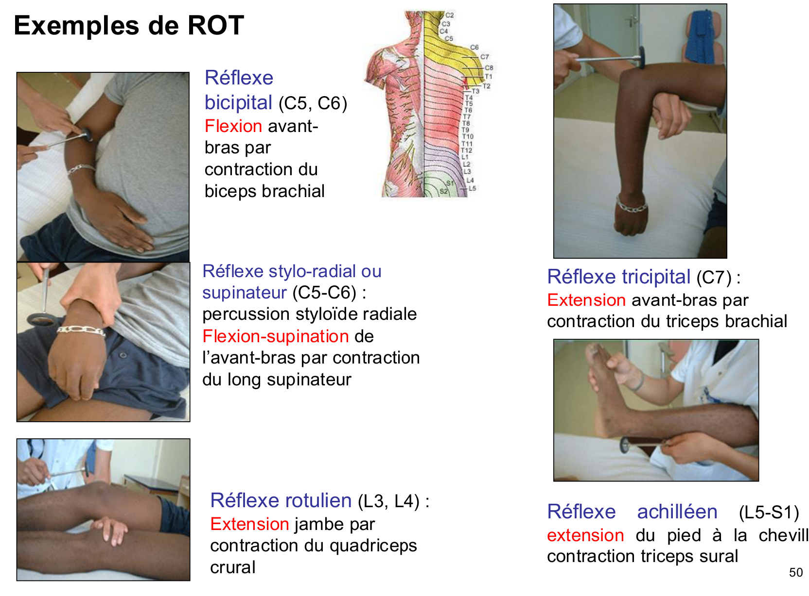

Le tonus musculaire dans le syndrome pyramidal est exagéré, mais si la lésion
est aiguë (< 2 semaines), une hypotonie se manifeste, ce qui est complémentaire.
Au bout de 3 semaines, la **spasticité** apparait, augmentation progressive du
tonus jusqu'à une contraction trop importante. Elle peut être constatée sur :

- MS : fléchisseurs en flexion du coude poignet et doigts
- MI : extenseurs : jambe en extension, démarche en fauchant
- Pendant l'action et après un certain temps de marche (claudication motrice
  intermittente)
- "Élastique" : quand on tire sur les membres ça cède et fléchit d'un coup

##### Réflexes ostéotendineux (ROT)

Les **ROT** sont des contractions réflexes d'un muscle en réponse à son propre
étirement avec relâchement du muscle antagoniste. C'est une conséquence de la
lésion pyramidale par l'exagération du réflexe myotatique par diminution de
l'inhibition de la boucle.

Comme vu pour le tonus, la temporalité de la lésion impacte les signes :

- Lésion aiguë : hypo-réflexie OT (ROT abolis)
- Lésion progressive : hyper-réflexie OT (ROT vis, poly-cinétiques), parfois
  jusqu'à clonus inépuisable d'un membre par exagération du réflexe

Le **clonus** est le signe le plus fiable de spasticité :

- Clonus du pied : exercer une dorsiflexion brusque du pied e maintenir dans
  cette position : le pied est animé de mouvements brefs et rythmés inépuisables
- Clonus de la jambe : on percute le tendon du quadriceps : la jembe est
  entrainée par des mouvements brefs et rythmés de flexion/extension

##### Trophicité musculaire

On va venir inspecter les groupes musculaires et comparer les membres
systématiquement. On n'est pas sensé découvrir d'amyotrophie dans le syndrôme
pyramidal.

##### Signes pathologiques

- Signe de Babinski : lors de l'exploration du réflxe cutané plantaire,
  extension du gros orteil ou des orteils en éventail, pathgnomonique d'une
  atteinte pyramidale
- Signe de Hoffman est l'équivalent de Babinsky au niveau de la main : on pince
  au niveau du pouce, les doigts se conractent un peu.

<!-- source: 3_avc.md -->

#### 2.1.2. Caractérisation topographique et fonctionnelle des AVC

**Diagnostic topographique** : l'objectif est de formuler un diagnostic clinique
fonctionnel et topographique, c'est-à-dire d'identifier la fonction perturbée et
le niveau anatomo-fonctionnel atteint (cortex, moelle épinière, nerf
périphérique...).

On peut plus ou moins placer sur la partie anatomique les lésions maintenant. Le
modèle le plus classique et simple de l'atteinte nerveuse est l'AVC, et quand on
parle d'ischémique, on parle de territoires extrêmement précis. Bien garder en
tête que les parties antérieures et postérieures sont irriguées par différentes
artères, ce qui va affecter les conséquences d'un AVC.

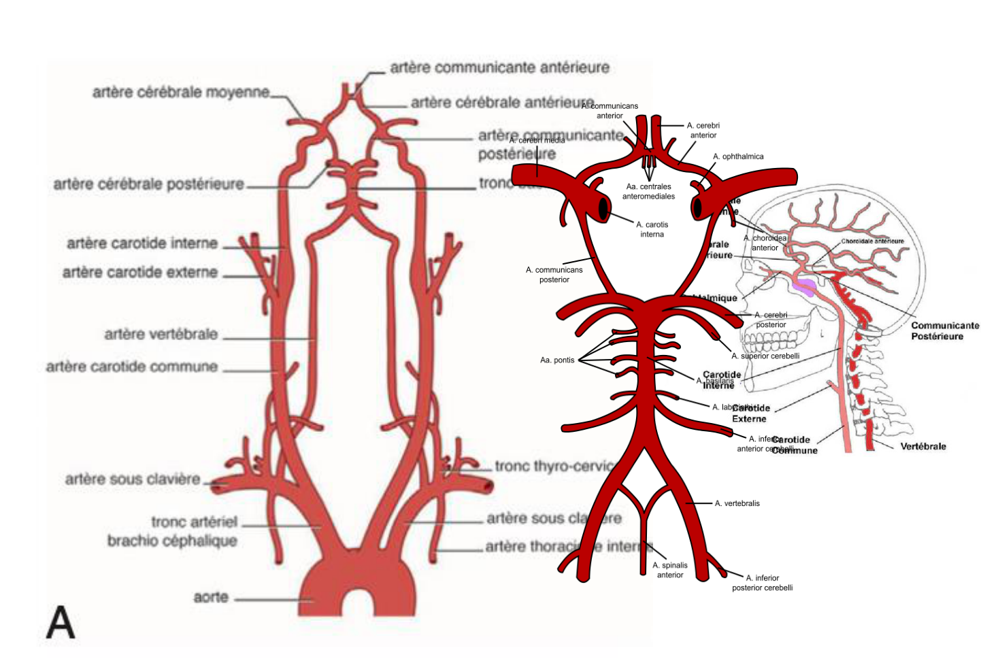

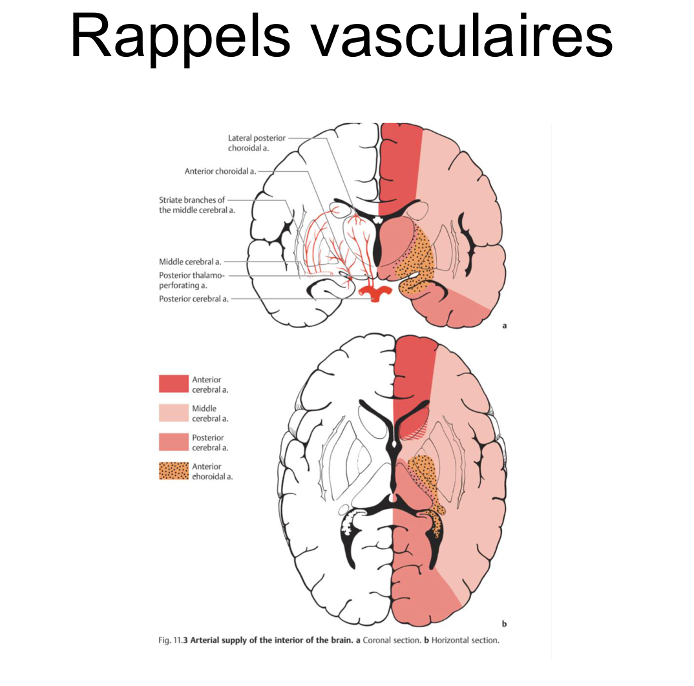

**Artères à retenir** : les carotides, l'artère cérébrale antérieure (ACA),
l'artère cérébrale moyenne (ACM) et l'artère cérébrale postérieure (ACP). Il y a
des artères communicantes entre l'antérieur et le postérieur. L'ACM vient de
l'ACI (artère carotide interne) ; son territoire est étendu, souvent le tronc
principal. Atteinte : motrice (NMC), sensitive, trouble visuel.

##### ACM superficiel antérieur

- Syndrome pyramidal : neurone moteur central. Déficit moteur controlatéral à
  prédominance brachio-faciale, anomalies du tonus et des ROT, signes
  pathologiques.
- Syndrome sensitif central, même topographie.
- Atteinte corticale : HG troubles du langage de type aphasie expressive (Broca)
  ; HD pas d'aphasie, mais trouble de l'attention et de la perception.

##### ACM superficiel postérieur

- Sensitif et moteur : même chose que l'antérieur.
- HG : troubles du langage, aphasie réceptive (Wernicke).
- HD : similaire à gauche, trouble de la perception et de
  l'attention-négligence.

Exemple : infarctus sylvien total droit → hémiplégie gauche proportionnelle,
hypo/anesthésie gauche, HLH gauche, syndrome d'Anton-Babinski (héminegligence,
anosognosie, hémissomatognosie).

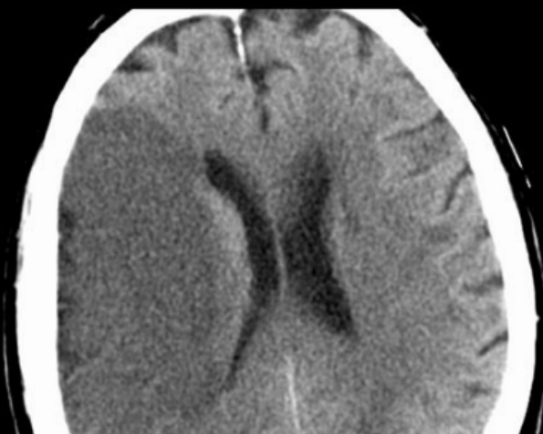

##### Artère Carrotide Antérieure

Surtout la jambe :

- Syndrome pyramidal (NMC) : déficit moteur controlatéral à prédominance
  crurale, anomalies du tonus et des ROT, signes pathologiques.
- Syndrome sensitif central, même topographie.
- Signes frontaux : grasping, troubles de la planification et de la
  programmation des actes moteurs, troubles du comportement.

### 2.2. Sémiologie et syndrome neurologique périphérique (neurogène)

#### 2.2.1. Caractérisation clinique

On appelle "**syndromes alternes**" les syndromes avec un trouble moteur d'un
côté au visage et de l'autre à la jambe. Les troubles de la moelle épinière
n'ont aucun effet sur le visage.

Le syndrome neurologique moteur comprend le syndrome pyramidal, mais pour le
périphérique, il y a aussi une topographie précise, bien plus détaillée. Dans la
moelle épinière, les neurones moteurs passent par des plexus et arrivent jusqu'à
notre peau. On va faire un examen comme pour le syndrome pyramidal.

**Diagnostic différentiel de syndrome central** :

- Maladresse, sensation de gêne, de lourdeur...
- L'atteinte des nerfs périphériques fait que la topographie est plus complexe
  et la plainte peut être plus dispersée. À l'examen, le déficit moteur est plus
  localisé et s'accompagne d'une hypotonie. Le tonus est diminué.
- ROTs abolis (aréflexie ostéo-tendineuse).
- Diminution du volume musculaire, atrophie (amyotrophie).
- On peut aussi avoir des crampes et des fasciculations : le contact muscle/nerf
  n'est plus direct, le muscle échappe au nerf et va avoir une activité réflexe
  indépendante. Ce sont donc des petites contractions causées par la
  dénervation, réagissant par exemple à la chaleur. Elles commencent souvent par
  les petits muscles.

**Électromyographie (ENMG)** : on met des électrodes, on stimule les nerfs et on
capte la vitesse de transmission pour voir si des nerfs dans certains
territoires sont endommagés ou non.

Autres symptômes associés :

- **Sensitif** : douleurs (décharges électriques, brûlures, douleurs dues aux
  crampes au repos), fourmillements, picotements.
- **SN autonome/végétatif** : téguments froids, tuméfiés, coloration violacée ;
  troubles urinaires ou de la sphère génitale ; hypotension orthostatique.
- **Troubles trophiques et signes végétatifs** : peau sèche, amincie, troubles
  vasomoteurs, œdèmes, ulcères perforants plantaires.

L'anesthésie/hypoesthésie n'apparaît pas dans l'atteinte de la corne antérieure
et de la racine antérieure, car elles s'occupent de la proprioception, pas de la
sensibilité.

**Donc le syndrome moteur périphérique** :

- déficit moteur plus localisé + hypotonie ;
- amyotrophie ;
- aréflexie ostéo-tendineuse / ROT abolis ;
- contractures / fasciculations ;
- +/- troubles sensitifs « subjectifs » (douleurs, paresthésies) et « objectifs
  » (hypo- ou anesthésie) ;
- +/- troubles végétatifs.

#### 2.2.2. L'exexemple de la SLA

La **sclérose latérale amyotrophique** (SLA ; maladie de Charcot, maladie de Lou
Gehrig) est une maladie neurodégénérative motrice incurable, de cause inconnue.

Oui amyotrophie typique. La main prend un aspect creux, puis une main simienne,
et l'atteinte motrice se généralise. Plein de choses sur les doigts et même la
langue qui cause du problème pour parler et avaler. Il y a des muscles qui
entourent les vaisseaux sanguins qui vont donc, eux aussi, souffrir.

- 5 % de formes héréditaires à transmission autosomique dominante (SLA
  familiale, « gènes de susceptibilité »), mais la majorité est sporadique.
- Hypothèses : excès de glutamate, stress oxydatif, modification des canaux
  potassiques.
- Âge moyen de début : 55 à 60 ans (des cas < 40 ans).
- Pas de traitement.
- Peut être associée à une dégénérescence frontotemporale (DLFT).
- Lésions : dégénérescence progressive des structures motrices du SNC (M1, plus
  ou moins faisceau pyramidal) et du SNP (motoneurones spinaux et noyaux moteurs
  des nerfs crâniens).

**Symptomatologie (SNMC + SNMP)** : SNMC = syndrome du neurone moteur central
(pyramidal), SNMP = syndrome du neurone moteur périphérique.

Forme spinale (la plus fréquente) :

- début : déficit musculaire des petits muscles d'une main ;
- ensuite : fasciculations, crampes ;
- amyotrophie typique (SNP) : main creuse, main simienne → l'atteinte motrice se
  généralise ;
- membres inférieurs également touchés, mais c'est surtout le syndrome pyramidal
  qui prédomine.

Formes les plus graves à début et évolution bulbaire : généralement ça traîne
avant le diagnostic. L'atteinte du bulbe rachidien induit la gravité de la
maladie et reflète la diffusion du processus pathologique : paralysie des
muscles de la langue, des lèvres et du pharynx avec troubles de la phonation et
de la déglutition. Pas de troubles sensitifs. « Amaigrissement » par atrophie
musculaire massive. Fonctions cognitives intactes dans la plupart des formes,
soit des troubles cognitifs dans les formes associées DLFT + SLA. Évolution de
la maladie très rapide.

**SLA = atteinte motrice pure** : association d'un syndrome pyramidal et
neurogène. Clinique : ROT vifs, hypertonie et Babinski contrastent avec une
amyotrophie très importante.

<!-- source: 2_epilepsie.md -->

## 3. Épilepsie

### 3.1. Historique et définitions

Avant très stigmatisé, encore aujourd'hui beaucoup de patients attendent pendant
longtemps avant de faire un diagnostic en cachant les symptômes, ce qui est
grâce car les crises font un apprentissage pour le cerveau et chaque crise
augmente les risques d'en avoir.

C'est une maladie chronique avec différentes formes, pouvant soit durer toute la
vie du patient, ou que durant l'adolescence. Dans le développement normal le
cerveau se construit pour les arrêter, c'est la forme auto-limitée. C'est la
deuxième maladie chronique après la migraine, avec un pic à la naissance et
après 60 ans dû à des accidents et chutes. Coût très important, car c'est une
contre-indication pour énormément d'activités.

Lors d'une crise d'épilepsie généralisée, **il y a toujours une même suite
d'événements** : décharge neuronale d'abord localisée puis va accaparer tout le
cerveau par réseaux, avec perte de conscience, convulsions, etc, et récupération
lente. La région démarrant les crises donne les symptômes cliniques du début, et
peut servir d'indicateur.

Une **crise généralisée commence donc en crise focale**. Certains patients ne
font que des focales durant plusieurs années, mais se développe ensuite vers une
généralisation, mais ce n'est pas l'épilepsie qui change en soi.

Dans le cerveau, il y a toujours un équilibre entre excitation et inhibition. La
première hypothèse explicative et qu'on perd une partie d'inhibition, ou que
notre partie d'excitation est trop forte et dépasse la capacité des mécanismes
d'inhibition. Dans cette perspective, on a développé des traitements pour
contrôler les crises, mais il faut garder en tête qu'**on ne sait pas traiter
l'épilepsie**, mais seulement les crises. Cette condition est un spectre sur
lequel tout le monde se place et varie en gravité selon les seuils de la lutte
excitation/inhibition. Ces crises sont stéréotypées, elles font toujours la même
chose, ce qui explique d'ailleurs que c'est le même réseau qui en est
responsable.

En d'autres termes :

- Dynamiques spatio-temporelles
- Suite à des décharges excessives localisées qui se propagent
- Symptômes différents selon :
  - Topographie de la décharge
  - Réseau auquel elle s'étend
  - Type de décharge

![[2_epilepsie 2026-10-07 09.43.09.excalidraw]]

Bonus (question) : la crise s'arrête dans les généralisées, car les excitatrices
sont consommées. Pour localiser, autres parties du cerveau peut inhiber,
manifestant chez les patients par penser à autre chose etc. Les autres réseaux
interviennent.

### 3.2. Crises focales et généralisées

On peut même nous-même provoquer des crises, ces **crises provoquées** sont
causées par l'épilepsie, et si on a 2 crises non provoquées en 2 jours alors le
patient est épileptique. Pour les provoquées, on peut les rencontrer par
hypoglycémie ou hyper-trucs, sevrage alcoolique, donc métaboliques, toxiques ou
cérébrales locales. On peut développer une épilepsie après un apprentissage par
exemple après longue période de consommation de stimulants.

Une épilepsie-maladie nécessite un traitement. La meilleure à avoir est
l'idiopathique (sans cause externe visible) généralisée qui existe dès la
naissance et peut faire des crises à partir de l'adolescence et progresser après
40 ans. Dans ce cas le cerveau fait un apprentissage bénéfique.

Les crises généralisées sont des dysfonctionnement spontanées des deux
hémisphères, sans prévenir peut donc provoquer des chutes, et causes convulsions
etc. Les régions profondes ne sont pas impliquées, si c'était le cas on mourrait
d'un coup, et ça n'existe pas. La **morte subite en épilepsie** est un risque
qui dure toute la vie des patients, qu'un court-circuit cortical trouve un
réseau pour glisser dans le TC et arrêter le cœur, ce qui est absolument
iréversible (arrive à 1 patient sur 1000, arrive plus dans pays en difficulté).

Les crises focales touchent 80% des adultes (plutôt au-delà de 60 ans à cause de
lésions). La symptomatologie dépend de la localisation de la zone épileptogène.
Crises focales simples se font sans perte de connaissance (comme clonus d'une
bras), complexes ont une altération de la conscience.

### 3.3. Différentes formes

#### 3.3.1. Formes généralisées

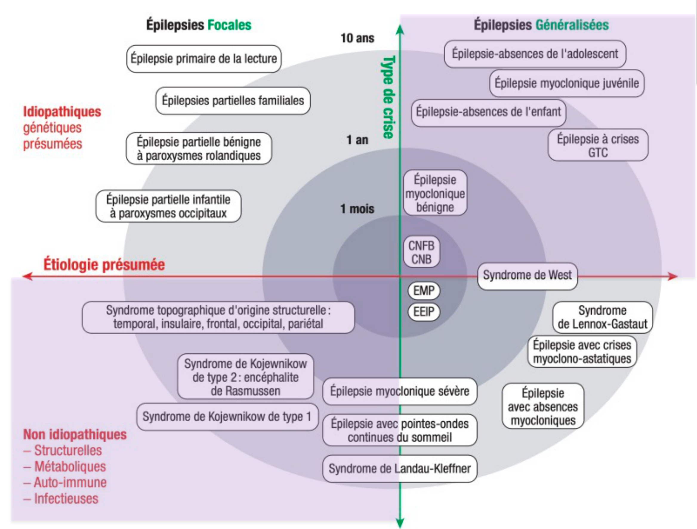

**Épilepsie d'absence de l'enfant**

- Idiopathique et généralisée
- Débute entre 3-4 ans et 8 ans
- Jusqu'à une centaine d'absence de durée variable (**pyknolepsie**), génant
  pour l'éducation, souvent cause de consultation
- Très sensible à l'hyperventilation : en EEG, on demande une hyperventilation
  de 3 minutes et on provoque des absences, ou stimluation lumineuse
  intermittente
- Pronostique favorable sous traitement, qui peut être cessé pendant
  l'adolescence
- Traitement : sirop qui arrête immédiatement l'absence

**Épilepsie myoclonique juvénile**

- Idiopathique et généralisée
- Débute de l'adolescence entre 13 et 20 ans
- Crises myocloniques au matin en général dans l'heure du réveil, en secousses
  musculaires brèves
- Pas de perte de connaissance
- Très sensible à dette de sommeil et alcool
- N'impacte pas le développement et dure toute la vie

> WARN: pas faire d'EEG si y'a pas de raisons de faire un EEG car erreur de type
> 1 très haute, détecter quelque chose alors qu'en vrai y'a rien

**Épilepsie "Grand Mal"**

- Idiopathique et généralisée
- Adolescence et jeune adulte
- Antécédents familiaux fréquents
- Crises tonico-cloniques le matin, perte de connaissance puis 3 phases en 5-10
  minute :
  - Tonique : contraction intense et généralisée des muscles
  - Clonique : secousses musculaires brusques et généralisées
  - Phase résolutive : hypotonie généralisée
- Sensible aux stimulations lumineuses intermittents, dette de sommeil et prise
  d'alcool
- Répond bien dans 90% des cas, mais pharmaco-dépendance et pharmaco-résistance
  en 30-40% de cas

Que faire ? Pas bouger la personne et la protéger, rien mettre dans la bouche.
Après la crise, LPS, rassurer, pas de médicament et à boire, appeler les secours
si crise dure plus de 5 minutes et s'il y a 2 crises.

#### 3.3.2. Formes focales

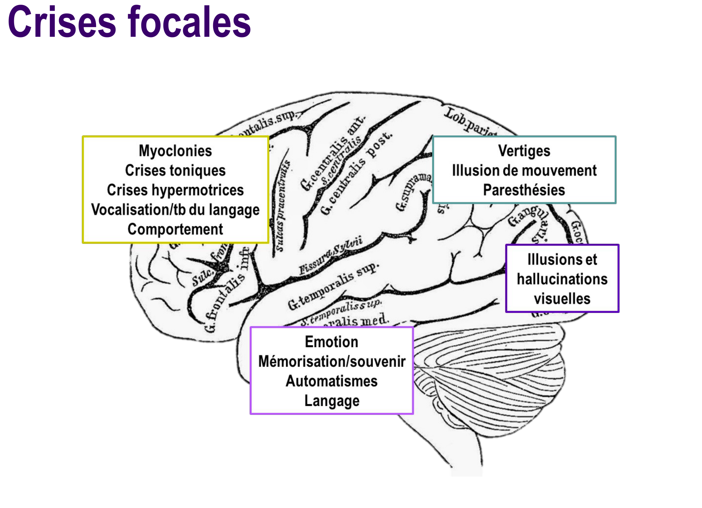

**Épilepsie focale frontale**

- Symptomatique le + souvent
- Crises noctures, courtes et sans prodrome (crise en train d'arriver)
- Pendant la crise :
  - Phénomènes dystoniques/dyskinétiques
  - Parfois comportements moteurs complexes et bizarres
  - Automatismes moteurs, salivation, arrêt/libération parole, crise de salves
- Pas de confusion post-critique
- Fréquent
- Tendance à généraliser facilement

**Épilepsie focale temporale**

- Symptomatique le + souvent
- Crises diurnes assez longues avec prodrome
- Pendant la crise :
  - Altératin du contact
  - Automatismes
  - Parfois automatismes verbaux
- Confusion post-critique ++
- Fréquent
- Généralisation peu fréquente

Autres types :

- Crises occipiptales ou pariétales
- Épilepsies réflèxes, stimulo-dépendantes

#### 3.3.3. Autres formes

**Etat de mal épileptique**

- Crises généralisées ou focales qui durent et ne semblent pas s'interrompre,
  pas à la consceince entre les crises pendant + de 30 minutes
- Dangereux et risque vital, mortalité de 5 à 10% des cas, 40% en cas de crises
  tonico-cloniques, moins grave pour l'épilepsie de type absence
- Souvent à cause d'arrêt brutal des antiépileptiques
- Traitement par anticonvulsivant puissant IV

**Épilepsie Psychogène**

- Crise non-épileptique d'origine psychologique : diagnostique différentiel avec
  d'autres troubles
- Devient très grave s'il y a des vraies crises épileptiques en même temps, et
  les traitements augmentent les chances de crises, prise en charge difficile
- Signes évocateurs :
  - Crises non stéréotypées
  - Pas de respiration stertoreuse après crise
  - Paupière fermées impossible à lever
  - Activité EEG normale
- Fréquent, plus chez les femmes que les hommes
- Se dépalce souvent vers d'autres registres (fibromyalgie)

### 3.4. Diagnostics et traitements

#### 3.4.1. Diagnostidcs et investigations

- Examens de routine
  - Examen neurologique clinique : dg. syndrome
  - EEG
  - IRM anat, CT, PET
  - Prise de sang

- Examens complémentaires
  - Viéo-EEG longue gurée
  - EEG privaiton de osmmeil
  - Neuropsychologie

- Examens avancés (si chirurgie envisagée)

- Données cliniques
  - Antécédents personnels et familiaux
  - État neurologique et psychologie
  - Type / sévérité / récurrence
  - Facteurs déclenchants

- Signes évocateurs
  - Caractère stéréotypé
  - Brièveté (< 3 mins)
  - Confusion post-critique
  - Ouverture oculaire pendant l'épisode
  - Rythmes et salves

Signes cliniques (souvent recherche d'activité unilatérale) :

- Monitoring EEG
- Imagerie en IRM
- PET scan pour métabolisme cérébral

#### 3.4.2. Traitements et pharmaco-résisatnce

Lévétiracétam est toujours le premier choix, puis lamotrigine. Noter que chaque
médicament cible un récépteur pour limiter la propagation.

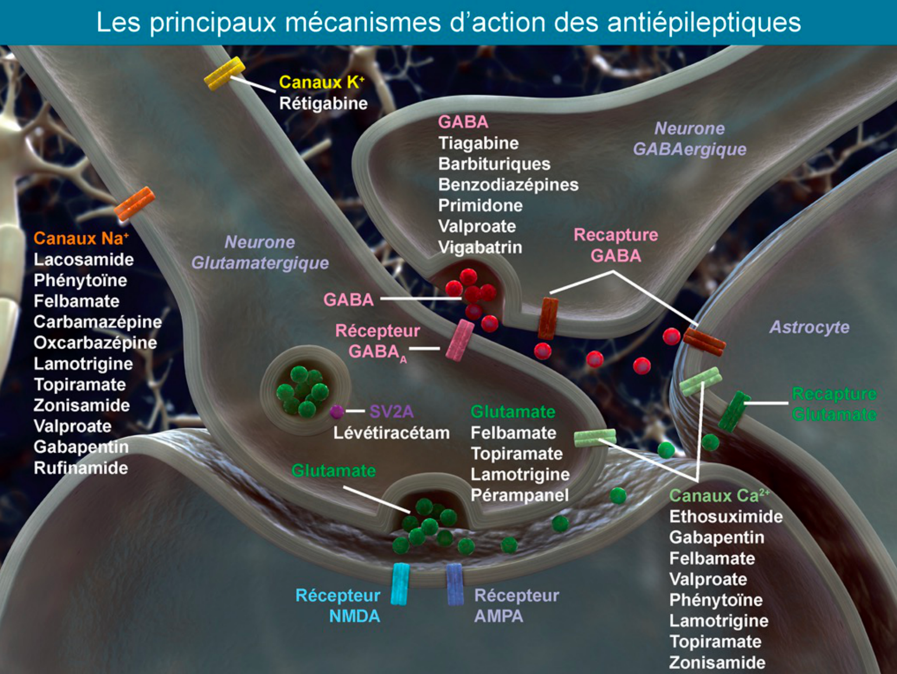

3/10 patients sont résistants aux traitements

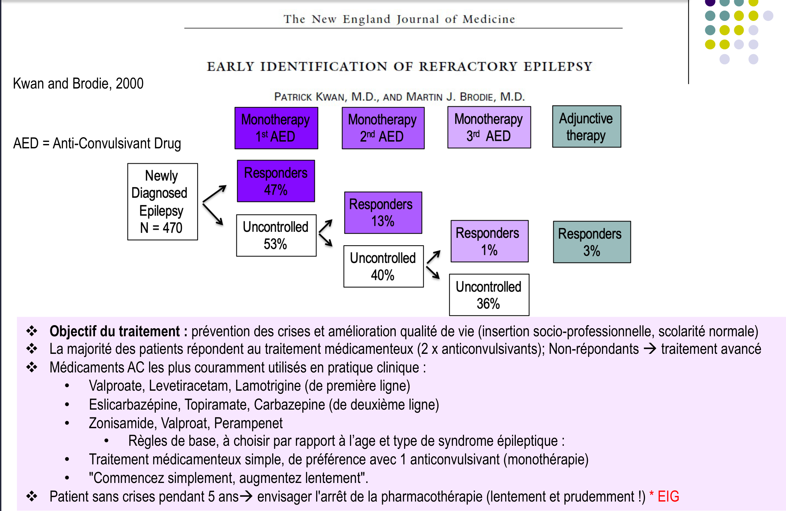

Que faire si notre patient ne répond pas au traitement ? On va enlever la région
de manière chirurgicale, puis diminuer voire arréter le traitement. Mais risque
que la cicatrice de l'opération soit épileptogène au long terme. Opération
s'appele exérèse je crois.

Le psychologue fait un bilan neuropsychologique (pour vérifier qu'il y a pas un
déclin, car il va arriver après la chirurgie et il faut limiter le dégat car il
pourrait ne pas tout récupérer, donc la qualité de vie serai trop diminuée)
avant la procédure, puis bilan EEG, puis tests fonctionnels pour savoir si la
lésion est proche d'une région fonctionnelle cruciale à ne pas opérer, et si
tout est OK alors on opère. On peut enlever un lobe ou des petites parties. En
manque d'informations, sEEG. On peut aussi faire une chirurgie palliative.

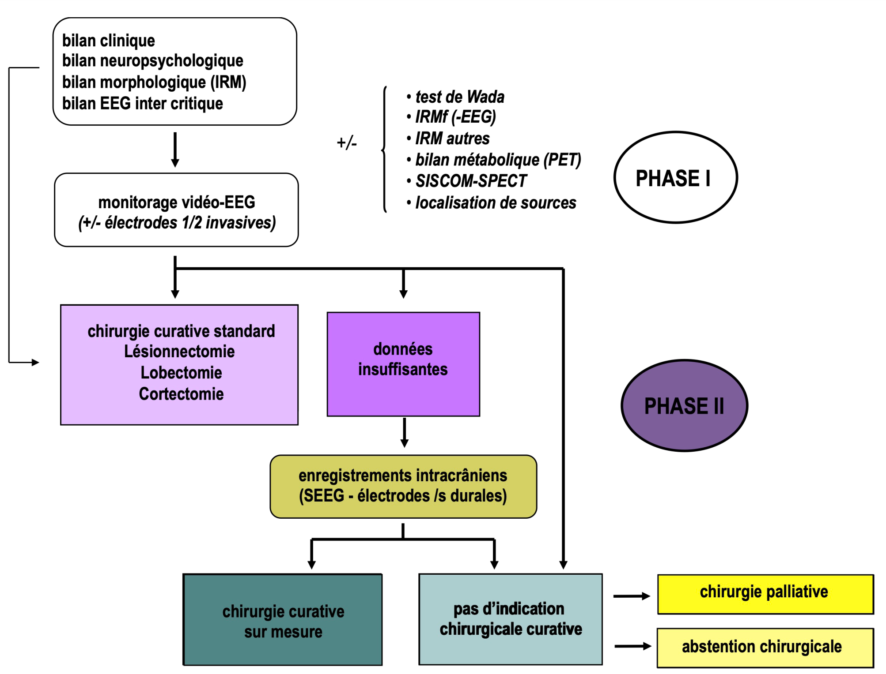

Chirurgies palliatives :

- Callosotomies pour arrêter la communication et éviter les crises généralisées
- Neurostimulation avec des électrodes
  - Ajustable et réversible
  - Réduit la survenue de crises
  - Limiter propagation
  - Différent moyens d'action

#### 3.4.3. Neuropsychologie de l'épilepsie

Complications de l'épilepsie :

- Amnésie post-critique
- Confusion post-critique
- Psychose post-critique (psychose de normalisation, choc au moment où on passe
  à un traitement qui fonctionne après plusieurs années)

Conséquences des crises : troubles d'apprentissages etc

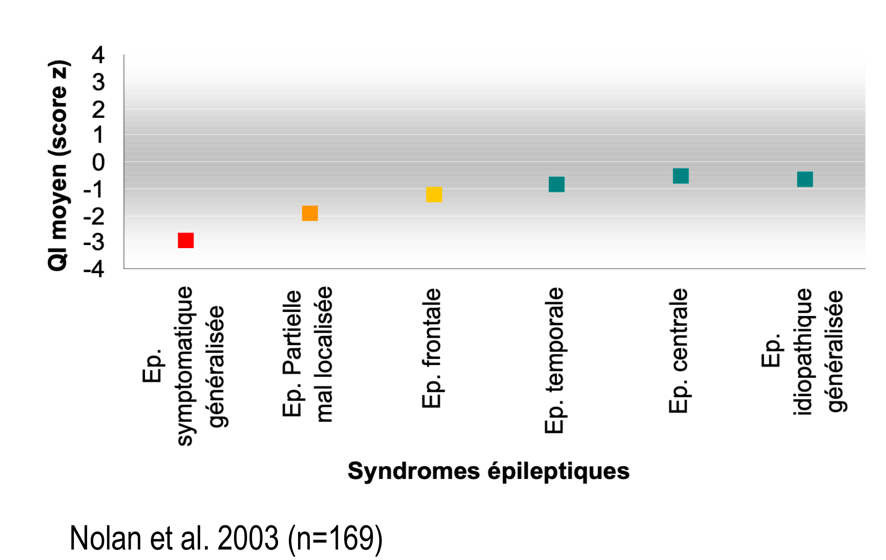

Pour les anti-épileptiques :

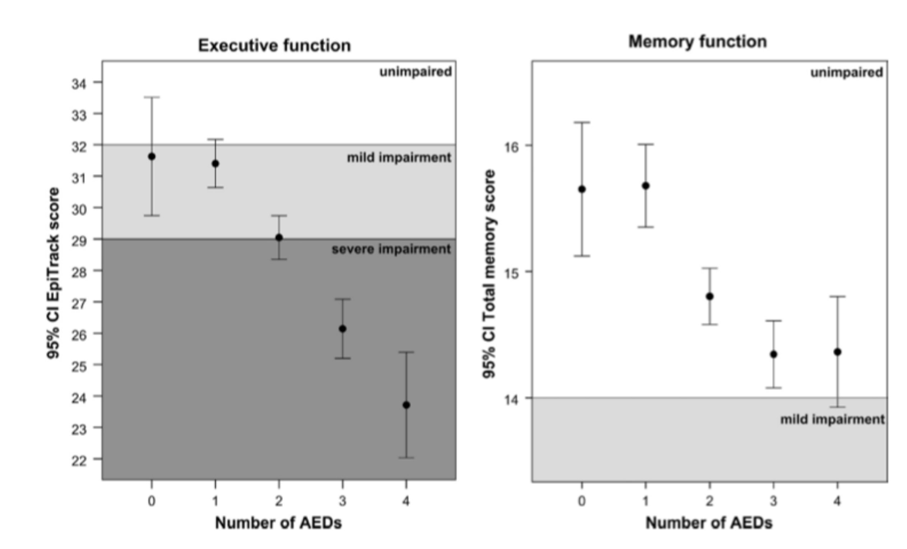

Effets des pointes :

- DMN affecté, disconnexion fronto-temporale, perte de créativité
- Beaucoup de comorbidités, dépression
- Apnée du sommeil
- TDAH surtout chez les enfants

Chirurgie est un succès quand on améliore la qualité de vie du patient. Et
adaptation spatiale plus dure. Très grave pour sans-abri car on dort pas pour se
protéger.

Expérience de Marcela sur la symptomatologie après stimulation, et à trouvé
plein d'effets :

- NPP: naming phonological paraphasia
- NSA: naming speech arrest
- NSMP: naming semantic and morphological paraphasia
- RCD: reading comprehension disorder
- RPA: reading paralexia
- RSA: reading speech arrest

Test de Wada aussi

### Troubles cognitifs et ???

Il faut pas savoir examen complémentaire, les crtières diangostiques aussi, les
tests c'est important, qu'est ce qu'ils mesurent, qu'est ce qu'on s'attend à
retrouver comme profil.

On commence par état de vigilance des patients et on va évaluer sa xognitino
avec des tests cognitifs. On va utiliser des des tests de **dépistage** qui
donnent un aperçu bref pour savoir s'il y a une pathologie.

## 1. Notions généalres des maladies neurodégénératives cognitives (MNDC)

Plusieurs facteurs :

- Causaux : génétiques
- Réserve cognitif et le capital vasculaire qui renforcent cette dernière
- Protecteurs : bonne reserve etc

Tous les facteurs qui causent des inflammations du cerveau vont diminuer la
réserve cognitive et vont exlpiquer la hausse de troubles avec l'âge et explique
la différence entre des patients qui vont avoir des conséquences plus ou moins
graves pour une même lésion.

Le **veillissement** normal est le fait qu'il est naturel d'observer une baisse
de plein de fonctions et atrophie du cortex cérébral avec l'âge. Démence est un
terme plus trop utilisé car stigmatisant est pas très clair. Maintenant on parle
de "trouble neurocognitif mineur ou majeur". La prévalence est de 5% et de plus
en plus grande.

On distingue les formes sporadiques (Alzheimer) et neurodégénératives, donc
origine génétique. Ces dernières sont des anomalies protéiques qui causent des
morts neuronales et progressent souvent trop avant qu'on les remarque. Résultent
souvent en une baisse d'autonomie du patient. Fort rôle des proches aidants

Dans Alzheimer, accumulation de $\beta$-amyltoïde (plaques extracellulaires) et
va empêcher communication entre jsp quoi et qui va inflammer les neurones et
conduire à des morts neuronales. Deuxième type d'anomalie proétique concerne
protéine Tau qui sert à la communication entre neurones, trop de phosphore s'y
connectent et on ne peut plus assurer le transport stable entre les cellules qui
entraîne des dégenérescences.

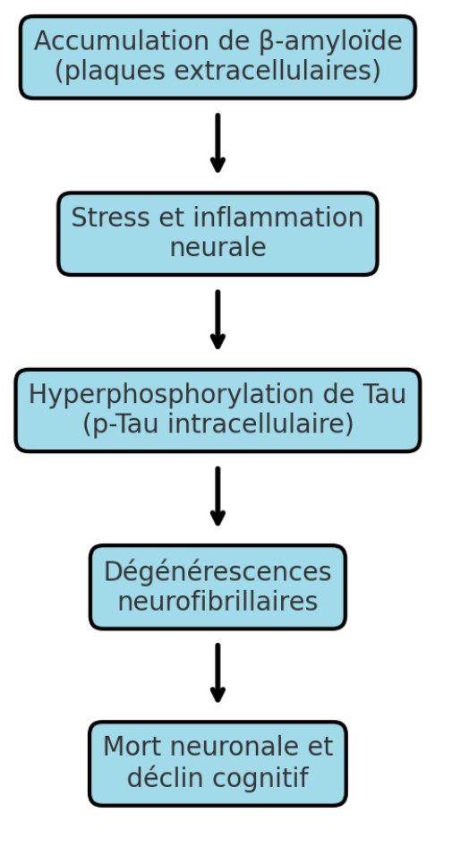

## 2. Triade diagnostique : stade (clinique)

Il est imporant d'avancer dans le diagnostique de ces maladies car il est
important de pouvoir identifier l'efficacité de traitements, ainsi qu'identifier
les sypmtômes pour mieux expliquer aux patients.

4 stades :

- Pré-symptomatique : sans plainte, biochimie modifiée
- Plainte cognitive isolée : remarque un changement dans le domaine cognitif,
  subjective car on ne retrouve rien sur un bilan
- Trouble cognitif mineur ou TCm : congitif léger, phase prodromale, altération
  objectivée chez un patient autonome dans la vie quotidienne
- Trouble cognitif majeur : altération avec autonomie altérée

On utilise stade et le score MMSE qui est une évaluation générale.

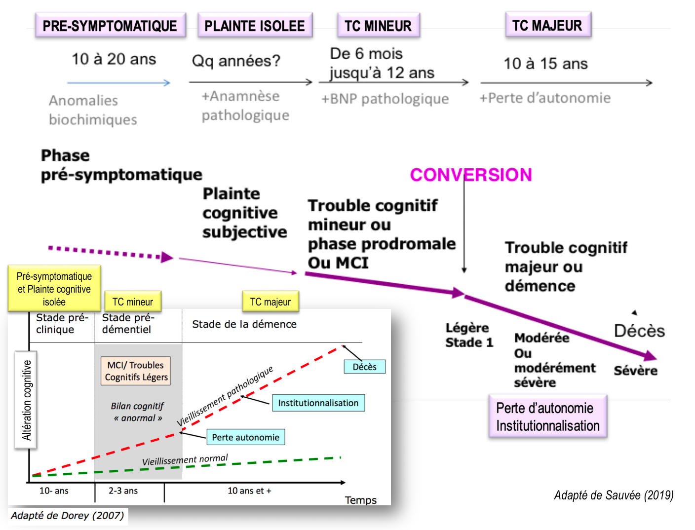

## 3. Triade diagnostique: syndrome (clinique)

Basée sur anamnèse, examen neurologie cognitif (tests) +/- BNPO selon sévérité
MMSE

- La présentation clinique est-elle à dominante cognitive ou comportementale ?
- Si présentation cognitive : quel domaine ? isolé, mixte, diffus? Idem pour
  comportementale

Entre clinique peut être plus ou moins dur selon le stade de la maladie et peut
nécessiter d'avoir un proche pour avoir des informations extérieures.

Entretien clinique : mode de vie/antécédents, anamnèse, autonomie et tests
cognitifs de dépistage

- Interroger patient et entourage (anosognosie, perte d'information du fait des
  troubles)
- Habitus :
- Entourage familial
- Logement
- Profession précédente si retraité, NSPINSC
- Antécédents personnels
- Facteurs de risque toxiques
- Antécédents familiaux neurologiques, psychiatriques et arbre généalogique
- Traitements actuels

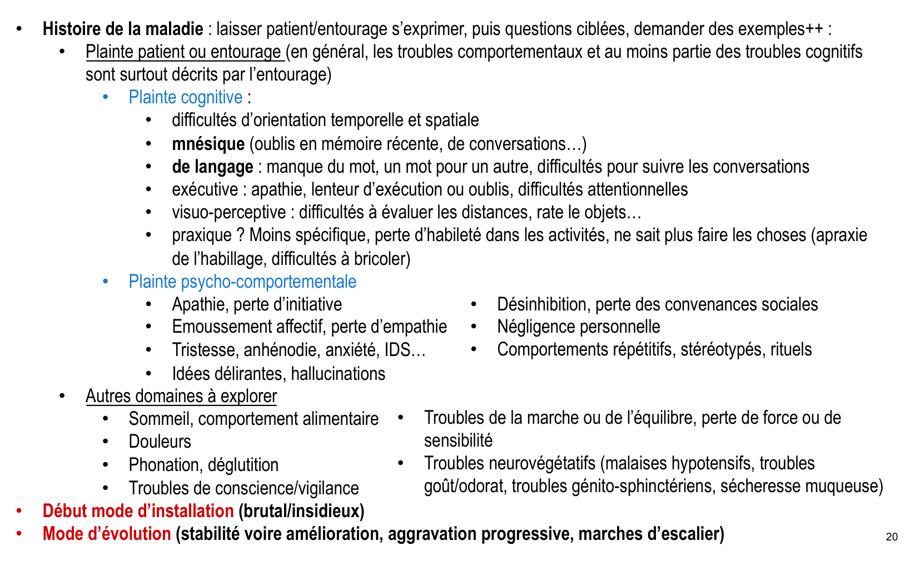

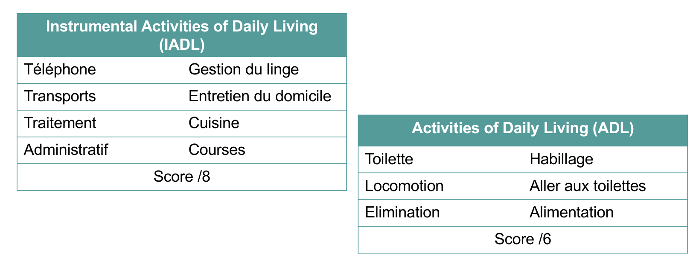

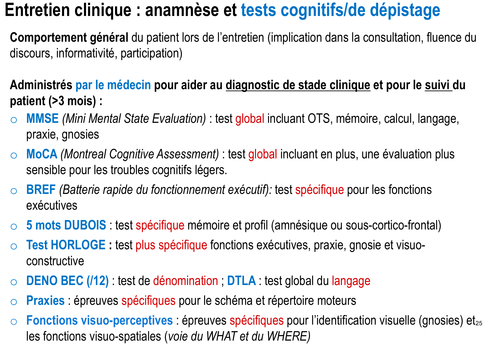

> WARN: Juste aller voire le diapo

## 4. Triade diagnostique : maladie (étiologie)

## 5. Classification MNDC, quelques exemples de MNDC
