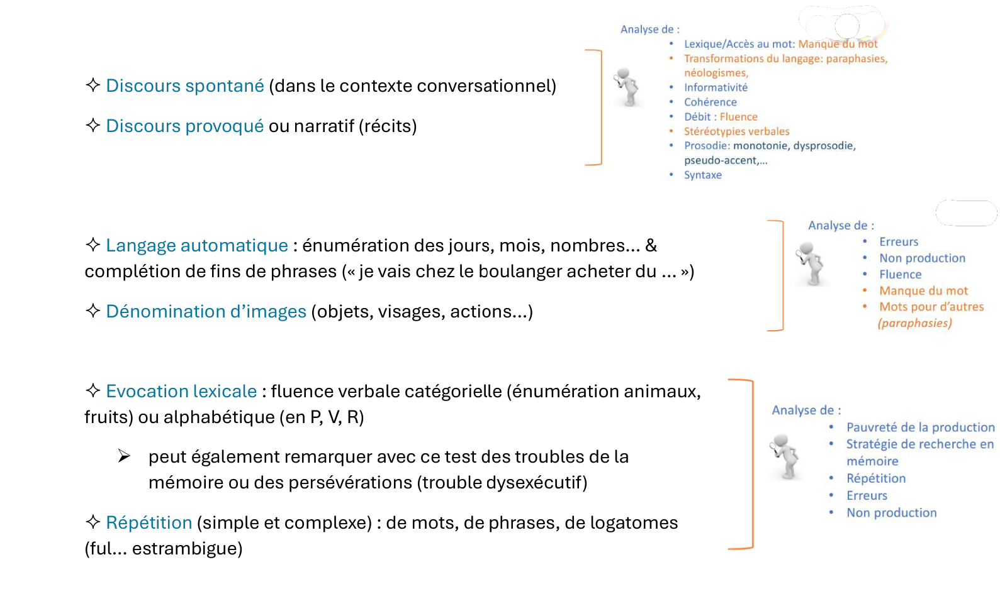
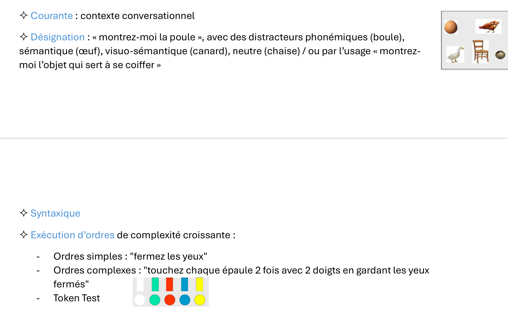
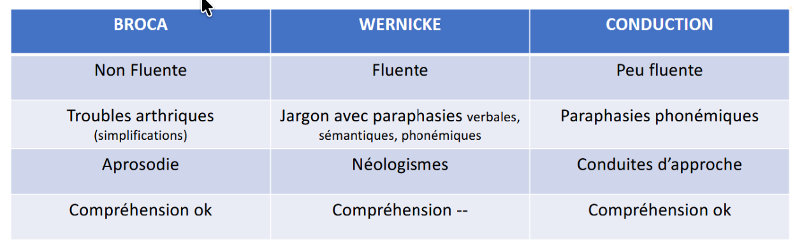
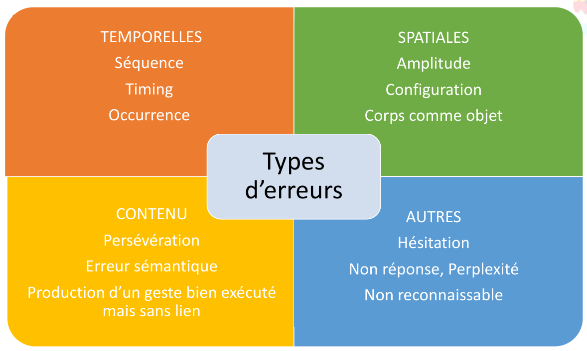
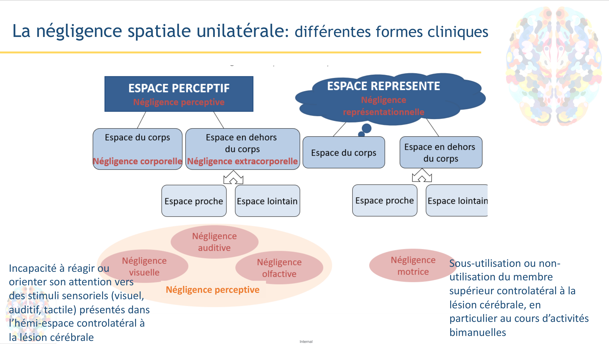
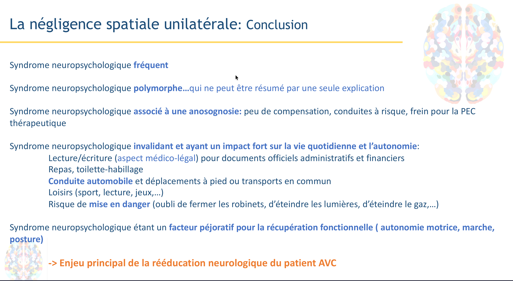
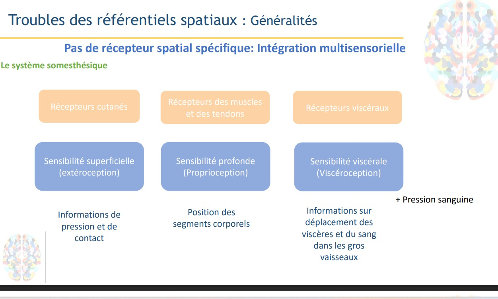
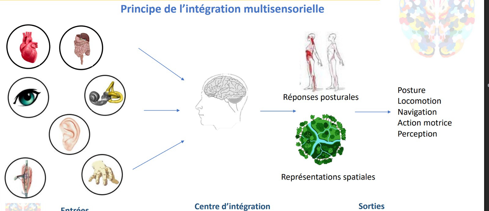

# Partie II - Neuropsychologie

<!-- source: 5_neuro_dulte.md -->

## Partie II - Neurospychologie

But des cours : présenter les syndromes neurologiques, on ne va pas beaucoup
voir les modèles et on ne sera pas interrogés dessus. Examen en situations
cliniques. On attend une maîtrise des termes de neuorpsycho et notre capacité à
pousser et réfléchir. Peu d'attentes sur les tests.

## 1. Généralités

La neuropsychologie s'inspire beaucoup de psychologie cognitive et la
neurologie. On ne va pas étudier le fonctionnement normal ou la pathologie, mais
particulièrement les dysfonctionnements des fonctions cognitives. Ingérence
aussi de psychologie clinique, par le biais de l'importance des émotions qui
peuvent perturber le fonctionnement cognitif.

On va étudier troubles cognitifs conséquents à un dysfonctionnement cérébral
chez l'adulte. Toutes celles là donnent des dysfonctions cérébrales :

- Maladies dégénératives et démences
- AVC (par ischémie, hémorragie), transitoire ou constitué
- Traumatismes crâniens
- Tumeurs cérébrales
- Maladies infectieuses
- Intoxications
- Ablations chirurgicales
- Maladies inflammatoires auto-immunes du SNC
- Anoxie cérébrale
- Pathologies psychiatriques

On évalue tout ça avec des tests, l'observation, l'entretien clinique. Le rôle
du neuropsychologue est de quantifier les capacités du patient, ce à quoi
servent les tests, qui permettent de placer la performance du patient par
rapport à une norme. On va aussi faire de la rééducation, ainsi que de la
recherche.

L'approche **anatomo-clinique** est intéressante, mais a pendant longtemps donné
une vision grossière, et qu'il n'y a jamais deux lésions identiques. Surtout,
tendance très localisationniste fonctionne mal, c'est-à-dire qu'on pensait que
les régions étaient indépendantes et régissaient qu'une fonction. Une approche
alternative s'est développée en pensant l'inverse, holistique. Maintenant, on
est associationniste, plusieurs réseaux reliés, avec spécialisations
hémisphériques et régionales.

Approche **cognitive** cherche à comprendre le fonctionnement normal par les
dysfonctionnements, que les pathologies peuvent dissocier les processus qui se
déroulent normalement de manière intégrée. Très basé sur les études de cas. Mais
on peut les critiquer, car ils avaient peu d'intérêt pour le cerveau, et que les
cas cliniques limitent les méthodes.

- Un **symptôme** est un signe représentant la manifestation par le médecin, il
  peut être objectif ou subjectif.
- **Étiologie** : causes d'une maladie
- **Physiopathologie** : mécanismes perturbant les fonctions organiques
- **Maladie** : altération par l'état de santé manifesté par ensemble de signe
  et symptômes observables par nous correspondant à des troubles généraux ou
  localisés, fonctionnels ou lésionnels, causes internes ou externe, avec
  évolution
- **Nosographie** : classification et description des maladies

Un trouble cognitif peut avoir plein de causes, et il faut le distinguer de la
plainte qui elle est rapportée. On distingue aussi le trouble de la fonction :
on parle de syndrome dysexécutif qui est différent des fonctions exécutives.

Distinguer troubles :

- Développemental : lié à la maturation cérébrale atypique
- Acquis : détérioration du fonctionnement cérébral malgré un développement et
  une maturation cérébrale normaux. Ils induisent une réduction ou perte d'une
  compétence ou capacité antérieurement acquise et développée

Différences entre trouble acquis évolutif ou non évolutifs.

## 2. Déficits consécutifs aux lésions des aires primaires

Hémianopsie est une cécité du champs visuel de chaque œil

FIX: diapo cécité corticale

--------------------------------------------------------------------------------

<!-- source: 6_aphasies.md -->

## Chapitre 5 : spécialisation hémisphérique - déficits consécutifs à des lésions de l'HG

- [[i_neuro_dulte]]
- [[ii_neuro_dulte]]
- [[iii_neuro_dulte]]
- [[iv_aphasies]]

La spécialisation hémisphérique veut dire que certaines fonctions sont traitées
préférentiellement par un hémisphère.

### 1. Les aphasies

Les aphasies sont des troubles du langage oral et écrit résultant d'une lésion
cérébrale acquise. Chez les droitiers, elle est consécutive à une lésion de
l'HG, et se distingue des :

- Défauts d'acquisition du langage
- Perturbations du discours (psychotiques, frontaux)
- Troubles de la parole (dysarthries)

L'efficience intellectuelle est préservée. Grosse variabilité. On observeu ne
dissociation **automatico-volontaire**..

### 1.1. Les signes

#### 1.1.1. En production orale

Général :

- Anomalie du débit de l'expression orale (fluence, fluidité) réduction ou
  accélérations
- Mutisme
- Stéréotypies variables
- Dysprosodie : monotonie, syllabation, parfois pseudo-accents
- Manque du mot

Transformations du langage oral :

- Transformations phonétiques : émission inadéquate de phonèmes, dans le sens
  d'une simplification articulatoire
- Paraphasies : mots pour d'autres
  - Phonémiques : addition, omission, déplacements de phonèmes
  - Sémantiques : un mot par un autre avec un rapport conceptuel
  - Verbales formelles : mot par un autre sur la forme
- Néologisme
- Jargonaphasie
- Agrammatisme & dyssyntaxie

Troubles de la répétitions :

- Répétition impossible
- Écholalie ou palialie
- Dysphasie phonologique : peut répéter les mots mais pas les logatomes
  (non-mots)
- Dysphasies profonde : répétition provoque la production de paraphasies
  sémantiques
- Dysphasie sémantique : répétition sans comprendre

#### 1.1.2. En compréhension orale

- Mauvais traitement phonétique du message
- Trouble de l'extraction de la valeur sémantique de l'information

### 1.2. Évaluation

#### 1.2.1. Production orale

En compréhension orale

### 1.3. Différents types d'aphasies de base

Elles ont des points communs :

- Présence d'un manque dem ot
- Variabilité forte
- Dissociation automatico-volontaire (langage sur-appris, automatique, est mieux
  préservé)
- Persévérations ![[6_neuro_dulte 2026-10-30 13.52.23.excalidraw]]

#### 1.3.1. Aphasie de Broca

Trouble de la production orale du langage. C'est une aphasie d'expression :
déficit de la programmation des mouvements nécessaires à la production des sons
du langage.

Caractéristiques :

- Production très peu fluente
- Parole lente et syllabée
- Manque de mot très marqué
- Troubles arthritiques : de la réalisation des osns du langage, simplification
  de sons complexes
- Agrammatisme
- Répétition perturbée
- Compréhension plutôt préservée
- Conscience forte du trouble
- Aprosodie

Signes associé :

- Hémiplégie droite
- Apraxie bucco-faciale
- Dépression

#### 1.3.2. Aphasie de Wernicke

C'est un trouble de la compréhension orale et de l'expression du langage.
Trouble de compréhension et d'expression : réalisation des mots préservée, mais
problème dans le choix des mots

Caractéristiques :

- Production très fluente, pouvant aller jusqu'à la logorrhée, avec :
  - Paraphasies verbales : mot substitut existe mais n'aucun lien
  - Paraphasies sémantiques : même catégorie sémantique
  - Paraphasies phonémiques : même sonorité
  - Néologisme
  - Jargon : sémantique (mot pour d'autres), phonémiques (mots existants
    déformés) ou indifférenciés (stéréotypies)
- Articulation normale
- Répétition perturbée par les mêmes troubles
- Trouble fort de la compréhension
- Préservation de la prosodie et intonations

Signes associés :

- Anosognosie
- Hémianopsie homonyme D (lésion des radiations optiques)

Madame AM après ischémie sylvien gauche avec transformatoin hémorragique.
Symptômes de paraphasie, néologismes, compréhension orale lexical et
contextuelle commence à s'améliorer, altération majeure du graphisme. On dirait
qu'elle comprend certaines choses

#### 1.3.3. L'aphasie de conduction

Conduction : hésitant, mais surtout paraphasies phonémiques avec conduites
d'approche

La récupération se fait souvent sur la même temporalité que les AVC. Conduction
, > Broca > Wernicke, et on retrouve les mêmes troubles à l'écrit.

## 2. Les apraxies

### 2.1. Syndrome de Gerstmann

Syndrome de Gerstmann, historiquement, correspond à 4 symptomse :

1. Agraphie
2. Acalculie
3. Confusion droite/gauche
4. Anomie digitale

Il y aurait une anomie du schéma corporel, surtout doigts et main, à cause de
leur lien avec l'écriture. Mais les cas purs sont assez rares, et des
controverses apparaissent sur la localisation lésionnelle et la pertinence
clinique.

On propose plusieurs hypothèse :

- Déficit de mécanisme commun qui explique les symptômes
- Association des symptômes est un hasard du à la proximité d'aires cérébrales
  lésées, ce qui remet en question l'existene d'une entité syndromique

Pour la première, Gerstmann proposer que le syndrome est centré sur l'agnosie
digitale, qui explique le retentissement sur écriture, ???, et droite/gauche.
Pour Kinsbourne, c'est un déficit de la différentiation et de l'arrangement des
parties qui constituent un tout. Ardila, 2014, propose une perturbation des
opérations spatiales avec médiation verbale. L'agraphie est souvent le symptôme
qui manque, car il manque souvent, et donc voit plus ça comme une aphasie
sémantique.

Pour ceux qui sont en désaccord, on avance que le syndrome est rare est souvent
partiellement présente, et associé à d'autres déficits. Pour eux aucun modèle
cognitif expliquerai ces signes par sa dysfonction. Les études en stimulation
électrique cérébrale n'ont jamais reproduit les symptômes. Enfin, on localise
plutôt substance blanche pariétale, ça serait donc plus l'architecture
fonctionnelle du cerveau qui serait touchée.

La tétrade clinique plus en détail :

- L'agraphie peut es présenter de manière aphasie et apraxique
  - Substitutions de lettres pour d'autres
  - Mauvais arrangements spatial des lettres dans le mot
  - Difficulté à former les lettres
- Acalculie, mental & posé
- Indistinction droite/gauche
- Agnosie digitale

Évaluation :

- Agnosie digitale (NE DOIT PAS CONCERNER LES ORTEILS) :
  - Dénomination des doigts
  - Désignation
  - Identification
- Indistinction gauche/droite concerne uniquement le coprs (soi/autrui)
  - Lever la main droite
  - Mettre la main gauche sur l'oreille droite
  - test normé : personnage debout, couché, de face, de dos

### 2.2. Autres apraxies

Trouble d'origine cognitive qui affecte l'exécution des gestes volontaires,
appris ou élaborés dans un objectif donné. Plusieurs manifestations avec des
mécanismes divers :

- Apraxie bucco-faciale
- Apraxie de la marche
- Apraxie occulomotrice
- Apraxie de l'habillage
- Apraxie visuo-constructive

Certains la définissent par exclusion d'autres troubles uniquement, donc "on
sait pas trop ce que c'est". On peut quand même donner "**Déficit de la
gestualité intentionnelle et/ou du contrôle moteur en l'absence de déficits
sensori-moteurs, de troubles de la compréhension et de la détrioration mentale
importante**", parmis d'autres définitions. Très peu étudié.

Jackson, 1866, observe des difficultés majeures pour mouvoir les lèvres chez des
aphasiques alors que ça va parfaitement bien pour manger. Il y a donc une
dissociation. Liepmann, 1866, première définition, à partir d'un patient qui
pouvait pas faire certaines actions avec sa main droite, qu'il pouvait faire
avec la main gauche (important car ça enlève beaucoup de troubles). Première
étude de groupe aussi, selon les côté de l'AVC, et aucune apraxie pour AVC
droit, mais 20/47 ont apraxie du membre supérieur. En 1920 il propose qu'il y
aurait plusieurs étapes pour réaliser un gest : conceptuelle, puis productions,
et distingue 3 grandes formes d'apraxie :

- Idéatoire : touche la conception du geste, par lésion postérieure
- Idéomotrice : défaut de production, pas de conception
- Mélokinétique : perte de mémoire gestuelle liée à un membre

Geschwind rejet d'un centre idéatoire lcoalisé en aires postérieures, mais
existence de connexions entre centres sensoriels et moteurs. Apraxie est une
interruption dans la traduction des stimulations sensorielles e ninflux oteur.

Puis aux annés 80, on passe à une époque de modélisation cognitive et on laisse
de coté l'anatomie. On va s'intéresser aux étapes nécessaires pour produire un
gesste. Notamment, on garde 2 grands types de processus : conceptuels, et de
production. La praxie est donc un système complexe qui contient des étapes de
traitement, et implique des fonctions cognitives coordonnées.

Roy & Square modélisent 2 grands systèmes hiéarchisés en 3 inveaux

Vocabulaire clinique :

- Geste intransitif : sans rapport avec un objet ; et geste transitif : en
  rapport avec un objet même s'il n'est pas réllement présent
- Parmis les intransitifs : gests sans signification / gestes symboliques
- Gestes réflexifs
- Gestes non réflexifs
- Production de pantomimes (mimes d'utilisation d'objets)
- Utilisation réelle d'outils

Erreur du corps pris pour objet est un signe du rouble praxique, qu'en cas
d'exlpications claires des consignes.

Plein de méthodes d'évaluations, procédures empiriques, avec peu de bases
théoriques très définies, avec grande variabilité inter-individuelle de
performances chez les sujest normaux.

<!-- FIX: diapo Plusieurs types d'erreurs  -->

<!-- FIX: diapo sémiologie -->

--------------------------------------------------------------------------------

Étiologie, quelles sont les manifestations, localisations neuro-anatomiques,
approche basée sur le processus, question du diagnostique différentiel (y'a une
diapo)

Est-ce que le patient a un trouble pour réaliser des gestes volontaires ?

- Non -> pas d'apraxie
- Oui -> possible mais exclure aphasie et agnosie (comment ?)
  - Agnosie visuel apr déficit d'identification d'objets
  - Co-occurence fréquente avec aphasie, assurer son indépendance

Quel processus semble perturbé ? (Engrammes gsetuels, connaissance sur la
manipulation)

--------------------------------------------------------------------------------

<!-- source: 07_heminegligence.md -->

- [[i_hemianopsie]]

# CM7 Neuropsy

## Troubles conséctutifs à la lésion de l'HD

### 1. Héminégligence

[[07_hemianopsie_transcription]]

Pendant longtemps on le considérait mineur et émotionnel, en vérité plutôt la
cognition spatiale, naviguer un environnement 3D. Perception et action sont ind
ssociables. Ensemble de capacités ayant un rôle essentiel dans le
développement/fonctoinnement moteur, cognitif, émotionnel et social. L'HD n'est
donc pas du tout inutile.

Héminégligence est la négligence de l'esapce gauche après lésion droite. C'est
un trouble de l'utilisation et conscience de l'espace du côté opposé à la
lésion, mais aussi modification des actions dirigées envers celui-ci. Ensemble
de manifestations comportementaels reésultat de l'altération de la conscience
qu'à le pateint de ces perturbations. "*Difficulté à détecter, répondre,
s'orienter vers des stimuli signifiants ? ? ? ? ?*"

On décrit différents sous-types selon différents facteurs :

- Modalité sensorielle ou motrice
- Localisation dans l'espace
  - Personnel
  - Extrapersonnel proche
  - Extrapersonnel lointain
  - Espace imaginaire
- Cadre de référence spatiaux
  - Egocentrique
  - Allocentrique
- La nature des symptômes
  - Déficitaire (négative) : omission ou négligence
  - Produtive (positive) : dans l'espace ipsi-lésionnel

Donc on parle des négilgenc**es** au pluriel car il y a différentes
manifestations.

Dans les manifestations productives :

- Persévérations
- Allochirie : déplacement du côté de la lésion de la partie de l'objet qui
  aurait du être dessinée du côté contralésionel

Types de négligences perceptives et motrices :

- Négligence visuelle est l'absence de prise e ncompte des stimuli visuels de
  l'espace gauche
- Négligence auditive : patient ne réagir pas à une stimulation sonore ou
  verbale provenant de l'hémi-espace gauche
- Négligence motrice : sous utilisation de l'hémicorps gauche qui peut mimer une
  hémiparésie ou une hémiplégie
- Négligence personnelle ou corporelle : manque d'exploration ou de conscience
  de la partie contralésionnelle du corps ou de la face

![[0007_neuro_adulte 2026-11-12 16.30.16.excalidraw]]

![[0007_neuro_adulte 2026-11-12 16.39.56.excalidraw]]

  | Header               | Hémianopsie           | Négligence          |
  | -------------------- | --------------------- | ------------------- |
  | Déficit              | Sensoriel             | Cognitif            |
  | Atteinte             | Rétinotopique         | Égocentrique        |
  | Perception           | Atteinte              | Intacte             |
  | Poursuite oculaire   | Possible              | Limitée             |
  | Représentation       | Préservée             | Atteinte            |
  | Écriture             | Préservéee            | Incomplète          |
  | Compensation         | Possible              | Impossible          |
  | Bissection de lignes | biais controlésionnel | biais ipsilésionnel |

70% des cas, il y a une comorbidité hémianopsie + négilgence. **Important
d'apprendre comment les séparer.**

![[0007_neuro_adulte 2026-11-12 16.44.34.excalidraw]]

Tout ça c'était pour la négligence personne ou coporelle je crois

![[0007_neuro_adulte 2026-11-12 17.13.38.excalidraw]]

![[0007_neuro_adulte 2026-11-12 17.44.20.excalidraw]]

![[0007_neuro_adulte 2026-11-12 17.55.24.excalidraw]]

Mais beaucoup de dissociations, on pense donc qu'il pourrait y avoir différents
types de négligences.

![[0007_neuro_adulte 2026-11-12 18.03.13.excalidraw]]

J'ai pas écouté mais c'est pas grave je pense. En tout cas approche combinée de
rééducation marche toujours mieux qu'un moyen d'action seul.

--------------------------------------------------------------------------------

Attentes pour l'examen :

- Pas connaître par cœur les épreuves
- Mais "Comment faire un diag différentiel entre négligence et hémianopsie ?" et
  on peut répondre par tâche expérimentale ou test clinique, même si on le sort
  de la tête tant qu'il marche
- Pas connaître localisations lésionnelles
- Manifestaitons
- Différents espaces
- Pas sur les prises en charges

--------------------------------------------------------------------------------

<!-- source: 08_deficits_hd.md -->

# CM8 Neurpsy de l'adulte

- [[i_deficits_hd]]
- [[ii_deficits_hd]]

### 2. Les troubles visuo-spatiaux

FIX: rattraper 15 minutes

Pariétal postérieur droit très impliqué pour les jugements de blablabla

Dans les épreuves visuo-spatiales, on s'attend à un déficit d'identification à
cause de ??? et on ne s'attend pas à la latéralisation des performances.

Effets de précédence locale/globale sont les capacités à identifier petites
lettres dans grandes lettres et inversement. On va manipuler la congruence. On
n'est pas sur du tout ou rien, on est sur de l'épuisement.

### 3. L'acalculie spatiale

Trouble du calcul consécutif à un défaut de la composante spatiale des calculs.
Donc surtout les calculs posés.

**Syndrome de Balindt** vient de l'association de 3 symptômes :

- **Simultagnosie** : difficulté à percevoir plusieurs objets en même temps
- **Apraxie du regard** : incapacité à orienter volontairement le regard vers un
  stimulus dans le champ périphérique. Errance et ralentissement du regard assez
  caractéristique. **Dissociation automatico-volontaire**. Épuisement.
- **Ataxie optique** : difficulté ou imprécision de réalisation des gestes
  perceptuellement guidés

Lésion pariétale postérieure et jonction pariéto-occipitale. Souvent bilatéral,
peut-être conséquence d'AVC, de dégénérescence.

Évaluation de la simultagnosie : épreuve de la scène là

### 4. Apraxies par lésion droite

#### 4.1. Apraxie constructive

**Habilités praxiques constructives** : capacité à construire des structures
complexes en positionnant les éléments les constituant dans des rapports
spatiaux correctes et réciproques. L'**apraxie constructive** serait une
altération de ces capacités en l'absence de déficit perceptif ou moteur
primaire. Mais il faut évaluer avant les déficits d'exploration visuelle tels
que la **NSU ou simultagnosie**, qui n'exclue pas le trouble pour autant, mais
pouvant se confondre.

On évalue par des tâches de dessin copié ou spontané. La manière dont le patient
fait la construction de son dessin donne des indications sur certains processus.
Je sais pas si j'ai bien pris la note la. Incapacité à construire une forme
(dans le plan et dans l'espace).

Persévération c'est une perturbation exécutive par excellence, même dans les
aphasies. La patiente semble pouvoir identifier le visage

#### 4.1. Apraxie d'habillage

Apraxie d'habillage est une incapacité ou difficulté à s'habiller par perte de
la composante spsatiale qui intervient dans l'habillage. Difficulté à
**orienter** les vêtements / corps. Concerne que ça.

### 5. Troubles des référentiels spatiaux

#### 5.1. Généralités

Y'a pas de stimulus direct ou récepteur spatial spécifique pour déterminer la
position dans l'espace. On utilise donc une intégration multisensorielle.

On a longtemps considéré à tort de système vestibulaire comme l'organe de
l'orientation ce n'est pas du tout le seul :

Toutes les informations sont traitées dans le SNC dans la notion de **cadre de
référence spatiale** : e sont des systèmes de coordonnées spatiales pour repérer
notre position et situation. Pour simplifier, on a le référentiel **égocentré**
et **allocentré**.

**LIEN TRÈS FORT ENTRE PERCEPTION ET ACTION c'est l'intérêt du cours**. Donc, on
a de l'intégration sensorielle, le centre d'intégration est dans le cerveau, et
permet des réponses posturales et représentations spatiales de l'espace, qui
permet la posture, qui permet locomotion, navigation, action motrice,
perception.

FIX: sens de verticalité

On mesure ce sens de verticalité dans l'obscurité absolue pour ne pas avoir
d'indices pour ce qu'est la verticale. On peut donc évaluer la représentation.
La **verticale posturale** est évaluée par un dispositif qui tourne le corps et
le sujet doit évaluer dans quelle position il est mis pour qu'il soit bien
vertical. On doit estimer deux indices : un indice d'orientation (est-ce qu'il y
a un biais d'inclinaison ?) ou d'incertitude (quelle est la robustesse de la
représentation) ?

Les normes pour la verticale visuelle ou posturale sont entre [-2.5º; 2.5º].

C'est une tâche dite purement perceptive, car il n'y a aucune dynamique, rien ne
bouge., on évalue que le somesthésique. La rotation doit être vraiment passive.

On fait souvent les 2 évaluations de verticale visuelle et posturale, car elles
évaluent différentes composantes de la construction vé verticalité. La première
vestibulaire, et l'autre dimension somesthésique. Il y a aussi la dimension
visuelle

//

On intègre maintenant troubles de verticale spatiale aux troubles de la posture,
comme la rétropulsion qu'on observe chez les personnes âgées.

Dans Parkinson, on peut avoir le syndrome de Pise qui ont une inclinaison.

Certains patients AVC ont un biais d'écriture où ils écrivent trop vers le haut,
qui pourrait s'expliquer par un biais de verticalité.
