<!-- source: 1_neuro_pyramidal.md -->

# EC07 Neurologie de l'Adulte

> 4 cours neurologie, 8 cours de neuropsychologie. Chacun presenté par des
> spécialistes en leur domaine du CHU de Grenoble, pour nous familiariser aux
> notions importantes de neurologie, et faire la différence entre partie
> médicale et psychologique. Prof d'aujourd'hui clinicienne, recherche clinique,
> surtout sur maladies du SNC et inflamatoires auto-immunes. Examen 1h,
> questions ouvertes, neuro couvrant tous les cours.

<!-- CM1 -->

## Partie I - Neurologie

### 1. Sémiologie et syndrome neurologique primaire

#### Notions Générales

Neurologues et neuropsychologues regardent même chose avec approche différent :
les premiers ont une vision très "maladie" mais n'ont pas de prise en compte ou
mesures de choses pas "évidentes". La neurologie est la discipline médicale qui
étudie l'ensemble des maladies du SNC et SNP.

Sa base est la **sémiologie** *(signe + parole, car on voit des signes et
utiliser notre parole pour avancer)*, qu'on étudie beaucoup avant de voir les
maladies. On cherche à recueillir les **sypmtômes** (subjectifs) par anamnèse et
les **signes cliniques** (objectifs) recuillis par l'examen neurologique.
L'objectif est de **formuler un diagnostique analytique/fonctionnel et
topographique**.


#### L'anamnèse

SN nous permet de nous retrouver dans l'environnement et d'avoir des fonctions
cognitives de haut niveau. Des gens viennent en neurologie avec des plaintes et
on doit faire des **diagnostiques de syndrômes** : ensemble de signes et
symptômes pouvant être expliqués par plusieurs maladies, il a une dimension
fonctoinelle et topographique. L'**anamnèse** est "pourquoi le patient vient" :
car il a des symptômes qui le.a gêne. Une fois la plainte identifiée, il faut
savoir depuis quand (pour différencier les causes probables), puis l'**examen
clinique** donne les signes. Ici,

$$
  \text{Symptômes} + \text{Signes} = \text{Syndrome}
$$

L'**anamnèse** peut être vue comme plus important (c'est controversé de dire
ça), car si on part sur une mauvaise piste, on peut être très biaisé. Les signes
suffisent rarement à cerner une cause, donc poser des questions est vraiment
important. Il est aussi de fouiller l'entourage, le statut social du patient...
Il faut sortir de la prétention, et il faut savoir que tous les patients ne
parlent pas autant. Il faut **systématiser la plainte** fonctionnellement et
topographiquement.

C'est donc pas facile, une maladie à différents symptômes, un symptôme
s'applique à plusieurs maladie. Peu de relations directes entre ces notions. Il
faut donc poser les bonnes questions en comprenant correctement quelle est la
plainte. Cette étape peut être utile pour clarifier l'attribution des symptômes
à des causes particulières.

#### L'examen clinique

Le but de l'**examen clinique** est de recenser les signes neurologiques. Il
faut débrouiller l'histoire pour en avoir un ensemble logique. On voit plein de
choses :

- État de vigilance
- Marche, équilibre
- motricité
- Sensibilité
- Sensorialité
- Nerfs crâniens
- Cognition

La sémiologie peut être centrale, périphérique, fonctoinnelle ou musculaire.


### 3. Exemple de syndrome neurologique "primaire"

Le diagnostique du syndrome clinique a 2 composantes :

- Fonctionnel : quelle fonction est perturbé ?
- Topographique : quel niveau anatomo-fonctionnel du système est atteint ?

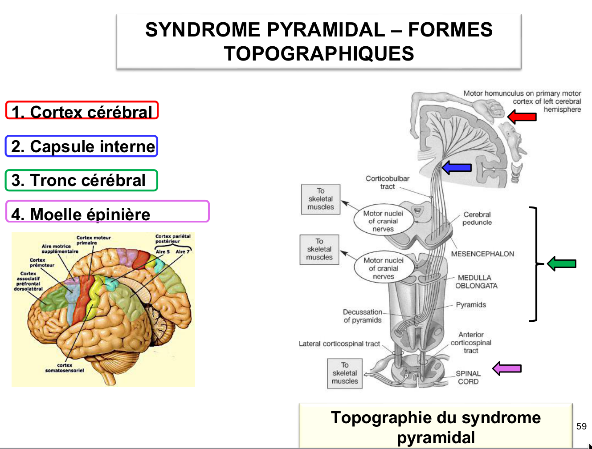

Il existe 2 types de syndrôme neurologique moteur :

- Syndrome Pyramidal (neurone moteur central)
- Syndrome neurogène (neurone moteur périphérique)

#### Syndrôme Pyramidal

Anamnèse (signes) :

- Plainte de faiblese motrice de muscles squelettiques, lourdeur, lors des
  activités courantes (parfois paralysie)
- Sensations de contracture ou raideur parfosi douleureuses (spasticité ou hyper
  réflexi)

On explore 4 domaines au cours de l'examen clinique :

- Force musculaire
- Tonus musculaire
- Activité réflexe- reflexes ostéotendineux (**ROT**)
- Trophicité muculaire

##### Force musculaire


On peut constater **parésie / paralysie** qui est une difficulté à contracer ses
muscles et mobidiliser ses membres par baisse ou absence de génération de ou
transmission de la commande motrice volontaire. De manière globale, on peut
observer un déficit moteur en marche ou station debout (fauchée). Si la lésion
responsable est aiguë et étendue (SnC), **hémplégie/parésie** ou
paraplégie/paraparésie.

Épreuves et manœuvres d'examen motricité :

Membres supérieurs (MS) :

1. Bras tendus à l'horizontale : chute progressive et pronation du MS
2. Épreuve Garcin : bras fléchis/extensions des doigts fortement écartés,
   déficit musculaire sur les extenseus (main creuse)
3. Mouvements alternatifs rapides : marionnettes

Membres inférieurs (MI)

1. Épreuve Mingazzini : décubitus dorsal, "chute" progressive du membre
   inférieur affecté
2. Épreuve Barré : décubitus ventral jambes fléchies à 90º, "chute" progressive
   du membre affecté

Muscles visage-cou :

1. Facial (VII) :
   - Au repos : effacement du pli naso-géninen, affaissement de l'hémi-face
   - En action : asymétrie quand on demande au patient de découvrir les dents
2. Trijumeau (V), glossopharyngien (IX), et vague (X) : muscles masséters et
   mandibulaires, dégultation et phonation
3. Hypoglosse (XII) paralysie de la langue

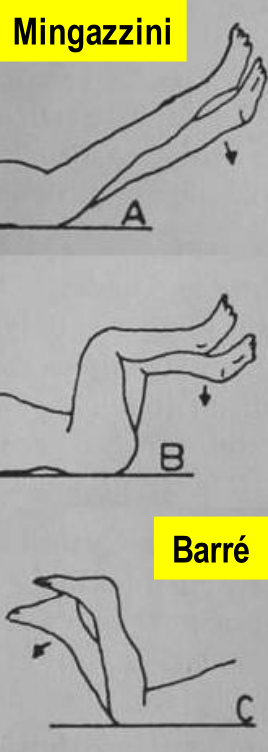{width=100}

On utilise une **échelle globale de cotation de 0 à 5** :

- 0 - Aucune contraction musculaire
- 1 - Frémissement/ébauche/tentative de contraction sans mouvement actif
- 2 - Mouvement actif d'une partie du membre
- 3 - Mouvement actif contre la pesanteur
- 4 - Mouvement actif contre la pesanteur et contre résistance
- 5 - Mouvement contre une résistance complète sans fatigue = force musculaire
  normale

##### Tonus Musculaire et activité réflexe

La **boucle gamma** est controlée par la voie pyramidale d'une manière
inhibitrice, le cortex inhibe la boucle gamme, retirer cette inhibition fait
qu'elle se contracte ce qui cause une **spasticité** (exagération du tonus). On
va le faire en examinant les réflèxes myotatiques, et l'adaptation du corps au
cours du temps. Ça permet vraiment de savoir où se situe une lésion.

On inspecte les muscles de chaque hémicorps de manière comparative :

- Tonus msuculaire du muscle en activité, en station debout puis marche,
  observation de l'attitude corporelle du patient
- Tonus musculaire de repos : mobilisation passive des segments du corps les uns
  par rapport aux autres (où on peut rencontrer la spasticité par résistance à
  des mobilisations d'amplitude et de rapidité variées)

Mouvements sous commande :

- Pianoter le plus vite possible
- Battre la mesure avec le pied
- Rotation main/poignet

Les réflexes ostéo-tendieux (ROT) sont évalués sur une échelle de 4 à 0

- 4 -Très vifs, hyperactifs +/- clonus
- 3 - Plus vifs que la moyenne
- 2 - Moyens, normaux
- 1 - Diminués/faibles
- 0 - Pas de réponse (aréflexie OT)

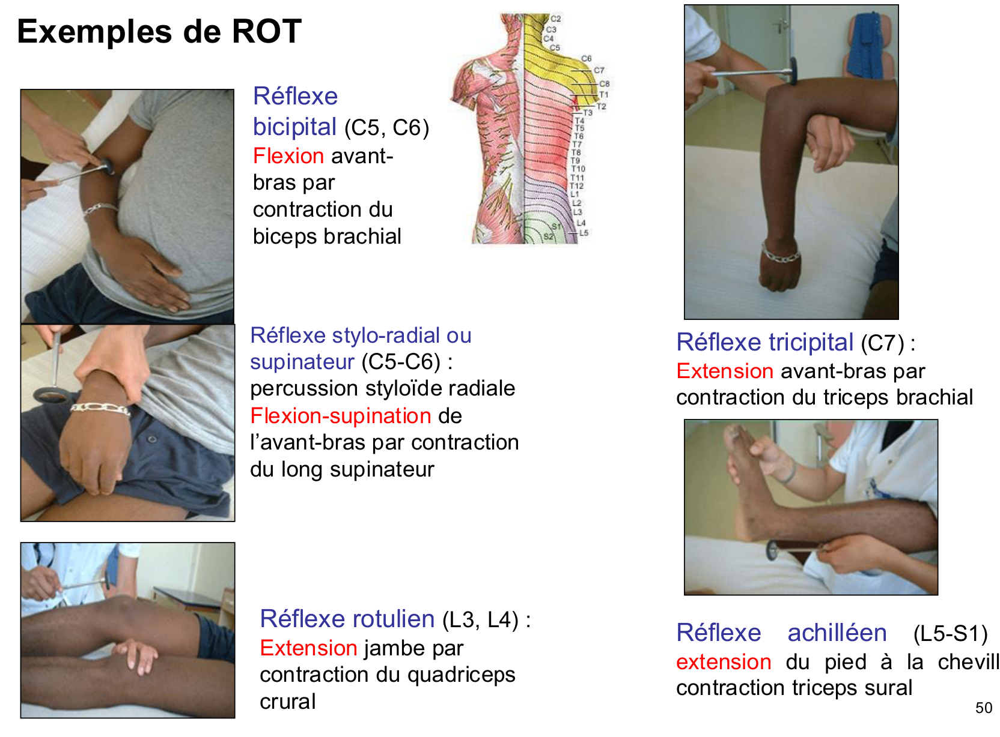

Le tonus musculaire dans le syndrome pyramidal est exaggéré, mais si la lésion
est aiguëe (< 2 semaines), une hypotonie se manifeste, ce qui est
complémentaire. Au bout de 3 semaines, la **spasticité** apprait, augmentation
progressive du tonus jusqu'à une contraction trop importante. Elle peut être
constatée sur :

- MS : fléhisseurs en flexion du coude poignet et doigts
- MI : extenseurs : jambe en extension, démarche en fauchant
- Pendant l'action et après un certain temps de marche (claudication motrice
  intermittente)
- "Élastique" : quand on tire sur les membres ça cède et fléchit d'u ncoup je
  crois

##### Réflexes ostéotendineux (ROT)

Les **ROT** sont des contractions réflexe d'une muscle en réponse à son propre
étirement avec relâchement du muscle antagoniste. C'est une conséquence de la
lésion pyramidale par l'exagération du réflexe myotatique par diminution de
l'inhibition de la boucle.

Comme vu pour le tonus, la temporalité de la lésion impacte les signes :

- Lésion aiguë : hypo-réflexie OT (ROT abolis)
- Lésion progressive : hyper-réflexie OT (ROT vis, poly-cinétiques), parfois
  jusqu'à clonus inépuisable d'un membre par exagération du réflexe

Le **clonus** est le signe le plus fiable de spasticité :

- Clonus du pied : exercer une dorsiflexion brusque du pied e maintenir dans
  cette position : le pied est animé de mouvements brefs et rythmés inépuisables
- Clonus de la jambe : on percute le tendon du quadriceps : la jembe est
  entrainée par des mouvements brefs et rythmés de flexion/extension

##### Trophicité musculaire

On va venir inspecter les groupes musculaires et comparer les membres
systématiquement. On n'est pas sensé découvrir d'amyotrophie dans le syndrôme
pyramidal.

##### Signes pathologiques

- Signe de Babinski : lors de l'exploration du réflxe cutané plantaire,
  extension du gros orteil ou des orteils en éventail, pathgnomonique d'une
  atteinte pyramidale
- Signe de Hoffman est l'équivalent de Babinsky au niveau de la main : on pince
  au niveau du pouce, les doigts se conractent un peu.

--------------------------------------------------------------------------------

<!-- source: 2_epilepsie.md -->

## CM2 - Épilepsie

- [[i_epilepsie]]
- [[ii_epilepsie]]
- [[iii_epilepsie]]
- [[iv_epilepsie]]

Christian Teodorescu neurologue spécialisé en épilepsie.

### Plan du cours

```{mermaid}
graph LR
    C["CM2 — Épilepsie"]

    C --> S1["1. Historique et définitions"]
    C --> S2["2. Formes et diagnostic"]
    C --> S3["3. Traitements"]
    C --> S4["4. Neuropsychologie"]

    S1 --> D1["Maladie chronique<br/>2e après la migraine"]
    S1 --> D2["Crise généralisée<br/>commence en focale"]
    S1 --> D3["Excès d'excitation<br/>ou perte d'inhibition"]
    S1 --> D4["Crises provoquées<br/>métaboliques ou toxiques"]
    S1 --> D5["Mort subite<br/>1 cas sur 1000"]
    S1 --> D6["Focales : 80 % des adultes"]

    S2 --> G["Généralisées idiopathiques"]
    S2 --> F["Focales symptomatiques"]
    S2 --> A["Autres tableaux"]
    S2 --> I["Investigations"]

    G --> G1["Absence de l'enfant<br/>3-8 ans, pyknolepsie"]
    G --> G2["Myoclonique juvénile<br/>13-20 ans, au réveil"]
    G --> G3["Grand Mal<br/>tonique, clonique, résolutive"]

    F --> F1["Frontale<br/>nuit, sans prodrome"]
    F --> F2["Temporale<br/>jour, prodrome, confusion"]

    A --> A1["État de mal<br/>plus de 30 min"]
    A --> A2["Psychogène<br/>non stéréotypée, EEG normal"]

    I --> I1["Routine<br/>clinique, EEG, IRM, sang"]
    I --> I2["Complémentaires<br/>vidéo-EEG, privation de sommeil"]
    I --> I3["Avancées<br/>si chirurgie envisagée"]

    S3 --> T1["Lévétiracétam puis lamotrigine<br/>3 patients sur 10 résistants"]
    S3 --> T2["Exérèse<br/>bilan neuropsy + EEG + tests"]
    S3 --> T3["Palliatif<br/>callosotomie, neurostimulation"]

    S4 --> N1["Complications post-critiques<br/>amnésie, confusion, psychose"]
    S4 --> N2["Effets des pointes<br/>DMN, dépression, TDAH"]
    S4 --> N3["Qualité de vie<br/>critère de succès"]
    S4 --> N4["Cartographie fonctionnelle<br/>Marcela, test de Wada"]

    D3 -.-> T1
    F2 -.-> N1
    G3 -.-> A1

    classDef root fill:#cba6f7,color:#11111b,stroke:#cba6f7,stroke-width:2px
    classDef sec1 fill:#a6e3a1,color:#11111b,stroke:#a6e3a1,stroke-width:2px
    classDef sec2 fill:#f9e2af,color:#11111b,stroke:#f9e2af,stroke-width:2px
    classDef sec3 fill:#fab387,color:#11111b,stroke:#fab387,stroke-width:2px
    classDef sec4 fill:#94e2d5,color:#11111b,stroke:#94e2d5,stroke-width:2px
    classDef leaf fill:#313244,color:#cdd6f4,stroke:#585b70

    class C root
    class S1 sec1
    class S2 sec2
    class S3 sec3
    class S4 sec4
    class D1,D2,D3,D4,D5,D6,G,F,A,I,G1,G2,G3,F1,F2,A1,A2,I1,I2,I3,T1,T2,T3,N1,N2,N3,N4 leaf

    linkStyle default stroke:#6c7086,stroke-width:1.5px
```

### 1. Historique et définitions

#### 1. Historique

Avant très stigmatisé, encore aujourd'hui beaucoup de patients attendent pendant
longtemps avant de faire un diagnostique en cachant les symptômes, ce qui est
gravce car les crises font un apprentissage pour le cerveau et chaque crise
augmente les risques d'en avoir.

C'est une maladie chronique avec différentes formes, pouvant soit durer toute la
vie du patient, ou que pendant l'adolescence. Dans le développement normal le
cerveau se construit pour les arrêter, c'est la forme auto-limitée. C'est la
deuxième maladie chronique après la migraine, avec un pic à la naissance et
après 60 ans du à des accidents et chutes. Coût très important car c'est une
contre-indication pour énormément d'activités.

Lors d'une crise d'épilepsie généralisée , il y a toujours une même suite
d'évènemnets : décharge neuronale d'abord localisée puis va acaparer tout le
cerveau par réseaux, avec perte de conscience, convulsions, etc, et récupération
lente. La région démarrant les crises donne les symptômes cliniques du début, et
peut servir d'indicateur.

Une crise généralisée commence donc en crise focale. Certains patients ne font
que des focales durant plusieurs années, mais se développe ensuite vers une
généralisation, mais ce n'est pas l'épilepsie qui change en soi.

Dans le cerveau, il y a touljours un équilibre entre excitation et inhibition.
La première hypothèse explicatrice et qu'on perd une partie d'inhibition, ou que
notre partie d'excitation est trop forte et dépasse la capacité de mécanises
d'inhibition. Dans cette perspective on a développé des traitements pour
contrôler les crises, mais il faut garder en tête qu'**on ne sait pas traiter
l'épilepsie**, mais seulement les crises. Cette condition est un spectre sur
lequel tout le monde se place et varie en gravité selon les seuils de la lutte
excitation/inhibition. Ces crises sont stéréotypées, elles font toujours la même
chose, ce qui exlique d'ailleurs que c'est le même réseau qui en est
responsable.

Lors de la crise, il y a une propagation spation-temporelle. Épilepsie
spatio-temporale fait vivre la patient dans un rêve mais reste mobile et peut
prendre des risques sans s'en rendre compte. Puis généralisation avec perte de
conscience. Puis activité dans symptômes non visible par autrui, avec
hallucinations auditives etc.

En d'autres termes :

- Dynamiques spatio-temporelles
- Suite à des décharges excessives localisées qui se propagent
- Symptômes différents selon :
  - Topographie de la décharge
  - Réseau auquel elel s'étend
  - Type de décharge

![[2_epilepsie 2026-10-07 09.43.09.excalidraw]]

Bonus (question) : la crise s'arrête dans les généralisées car les excitatrices
sont consomées. Pour localisées, autres parties du cerveau peut inhiber,
manifestant chez les patients par penser à autre chose etc. Les autres réseaux
interviennent.

On peut même nous-même provoquer des crises, ces **crises provoquées** sont
causées par l'épilepsie, et si on a 2 crises non provoquées en 2 jours alors le
patient est épileptique. Pour les provoqué, on peut les rencontrer par
hypoglycémie ou hyper-trucs, sevrage alcoolique, donc métaboliques, toxiques ou
cérébrales locales. On peut développer une épilepsie après un apprentissage par
exemple après longue période de consommation de stimulants.

Une épilepsie-maladie nécessite un traitement. La meilleure à avoir est
l'idiopathique (sans cause externe visible) généralisée qui existe dès la
naissance et peut faire des crises à partir de l'adolescence et progresser après
40 ans. Dans ce cas le cerveau fait un apprentissage bénéfique.

Les crises généralisées sont des dysfonctionnement spontanées des deux
hémisphères, sans prévenir peut donc provoquer des chutes, et causes convulsions
etc. Les régions profondes ne sont pas impliquées, si c'était le cas on mourrait
d'un coup, et ça n'existe pas. La **morte subite en épilepsie** est un risque
qui dure toute la vie des patients, qu'un court-circuit cortical trouve un
réseau pour glisser dans le TC et arrêter le cœur, ce qui est absolument
iréversible (arrive à 1 patient sur 1000, arrive plus dans pays en difficulté).

Les crises focales touchent 80% des adultes (plutôt au-delà de 60 ans à cause de
lésions). La symptomatologie dépend de la localisation de la zone épileptogène.
Crises focales simples se font sans perte de connaissance (comme clonus d'une
bras), complexes ont une altération de la conscience.

## 2. Différentes formes et diagnostic

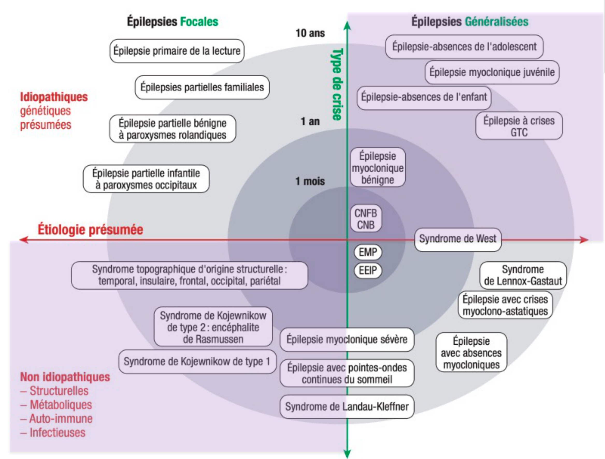

Épilepsie d'absence de l'enfant

- Idiopathique et généralisée
- Débute entre 3-4 ans et 8 ans
- Jusqu'à une centaine d'absence de durée variable (**pyknolepsie**), génant
  pour l'éducation, souvent cause de consultation
- Très sensible à l'hyperventilation : en EEG, on demande une hyperventilation
  de 3 minutes et on provoque des absences, ou stimluation lumineuse
  intermittente
- Pronostique favorable sous traitement, qui peut être cessé pendant
  l'adolescence
- Traitement : sirop qui arrête immédiatement l'absence

Épilepsie myoclonique juvénile

- Idiopathique et généralisée
- Débute de l'adolescence entre 13 et 20 ans
- Crises myocloniques au matin en général dans l'heure du réveil, en secousses
  musculaires brèves
- Pas de perte de connaissance
- Très sensible à dette de sommeil et alcool
- N'impacte pas le développement et dure toute la vie

> WARN: pas faire d'EEG si y'a pas de raisons de faire un EEG car erreur de type
> 1 très haute, détecter quelque chose alors qu'en vrai y'a rien

Épilepsie "Grand Mal"

- Idiopathique et généralisée
- Adolescence et jeune adulte
- Antécédents familiaux fréquents
- Crises tonico-cloniques le matin, perte de connaissance puis 3 phases en 5-10
  minute :
  - Tonique : contraction intense et généralisée des muscles
  - Clonique : secousses musculaires brusques et généralisées
  - Phase résolutive : hypotonie généralisée
- Sensible aux stimulations lumineuses intermittents, dette de sommeil et prise
  d'alcool
- Répond bien dans 90% des cas, mais pharmaco-dépendance et pharmaco-résistance
  en 30-40% de cas

Que faire ? Pas bouger la personne et la protéger, rien mettre dans la bouche.
Après la crise, LPS, rassurer, pas de médicament et à boire, appeler les secours
si crise dure plus de 5 minutes et s'il y a 2 crises.

Crises focales

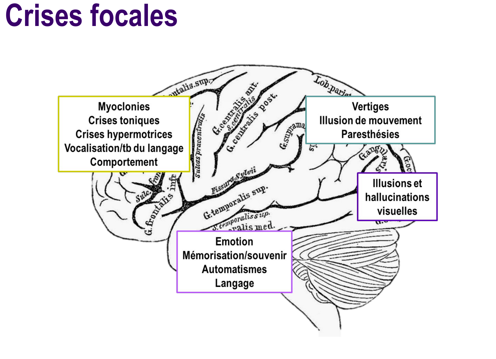

Épilepsie focale frontale

- Symptomatique le + souvent
- Crises noctures, courtes et sans prodrome (crise en train d'arriver)
- Pendant la crise :
  - Phénomènes dystoniques/dyskinétiques
  - Parfois comportements moteurs complexes et bizarres
  - Automatismes moteurs, salivation, arrêt/libération parole, crise de salves
- Pas de confusion post-critique
- Fréquent
- Tendance à généraliser facilement

Épilepsie focale temporale

- Symptomatique le + souvent
- Crises diurnes assez longues avec prodrome
- Pendant la crise :
  - Altératin du contact
  - Automatismes
  - Parfois automatismes verbaux
- Confusion post-critique ++
- Fréquent
- Généralisation peu fréquente

Autres types :

- Crises occipiptales ou pariétales
- Épilepsies réflèxes, stimulo-dépendantes

Etat de mal épileptique

- Crises généralisées ou focales qui durent et ne semblent pas s'interrompre,
  pas à la consceince entre les crises pendant + de 30 minutes
- Dangereux et risque vital, mortalité de 5 à 10% des cas, 40% en cas de crises
  tonico-cloniques, moins grave pour l'épilepsie de type absence
- Souvent à cause d'arrêt brutal des antiépileptiques
- Traitement par anticonvulsivant puissant IV

Épilepsie Psychogène

- Crise non épileptique d'origine psychologique : diagnostique différentiel avec
  d'autres troubles
- Devient très grave s'il y a des vraies crises épileptiques en même temps, et
  les traitements augmentent les chances de crises, prise en charge difficile
- Signes évocateurs :
  - Crises non stéréotypées
  - Pas de respiration stertoreuse après crise
  - Paupière fermées impossible à lever
  - Activité EEG normale
- Fréquent, plus chez les femmes que les hommes
- Se dépalce souvent vers d'autres registres (fibromyalgie)

Diagnostiques et investigations

- Examens de routine
  - Examen neurologique clinique : dg. syndrome
  - EEG
  - IRM anat, CT, PET
  - Prise de sang

- Examens complémentaires
  - Viéo-EEG longue gurée
  - EEG privaiton de osmmeil
  - Neuropsychologie

- Examens avancés (si chirurgie envisagée)

- Données cliniques
  - Antécédents personnels et familiaux
  - État neurologique et psychologie
  - Type / sévérité / récurrence
  - Facteurs déclenchants

- Signes évocateurs
  - Caractère stéréotypé
  - Brièveté (< 3 mins)
  - Confusion post-critique
  - Ouverture oculaire pendant l'épisode
  - Rythmes et salves

Signes cliniques (souvent recherche d'activité unilatérale) :

- Monitoring EEG
- Imagerie en IRM
- PET scan pour métabolisme cérébral

## 3. Traitements et pharmaco-résisatnce

Lévétiracétam est toujours le premier choix, puis lamotrigine. Noter que chaque
médicament cible un récépteur pour limiter la propagation.

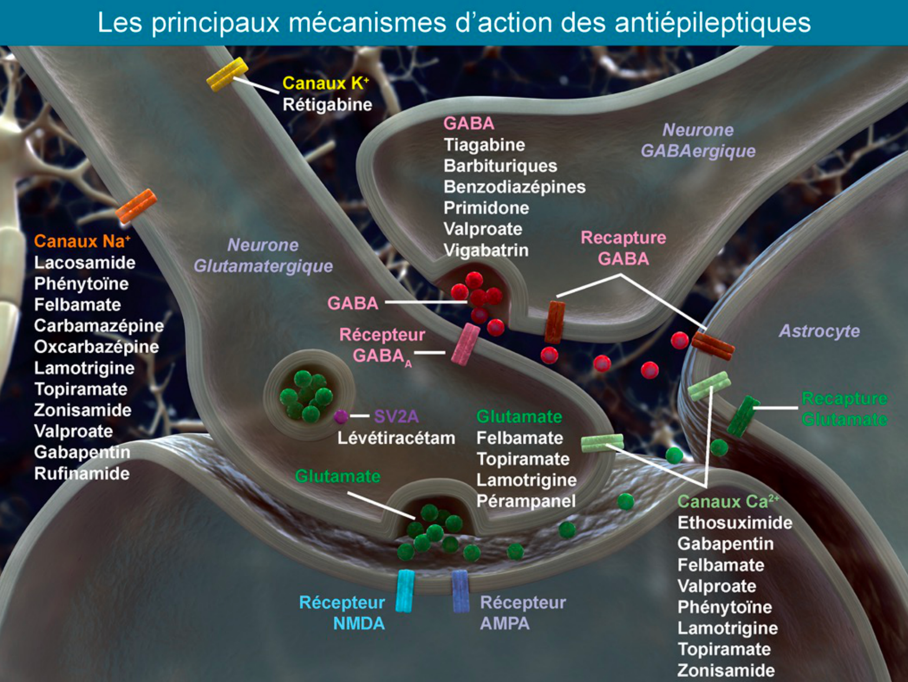

3/10 patients sont résistants aux traitements

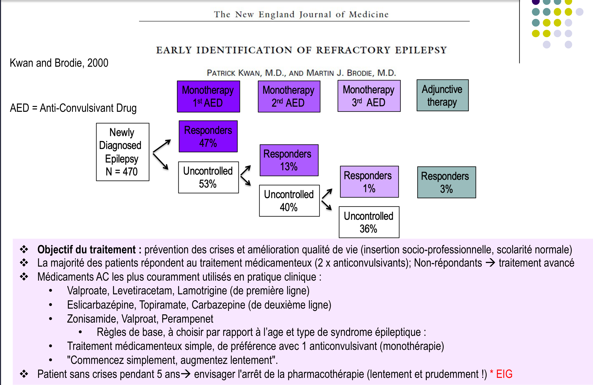

Que faire si notre patient ne répond pas au traitement ? On va enlever la région
de manière chirurgicale, puis diminuer voire arréter le traitement. Mais risque
que la cicatrice de l'opération soit épileptogène au long terme. Opération
s'appele exérèse je crois.

Le psychologue fait un bilan neuropsychologique (pour vérifier qu'il y a pas un
déclin, car il va arriver après la chirurgie et il faut limiter le dégat car il
pourrait ne pas tout récupérer, donc la qualité de vie serai trop diminuée)
avant la procédure, puis bilan EEG, puis tests fonctionnels pour savoir si la
lésion est proche d'une région fonctionnelle cruciale à ne pas opérer, et si
tout est OK alors on opère. On peut enlever un lobe ou des petites parties. En
manque d'informations, sEEG. On peut aussi faire une chirurgie palliative.

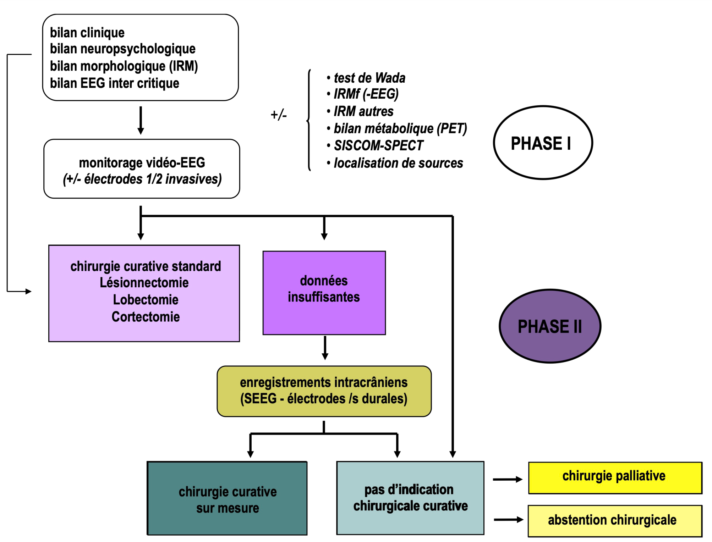

Chirurgies palliatives :

- Callosotomies pour arrêter la communication et éviter les crises généralisées
- Neurostimulation avec des électrodes
  - Ajustable et réversible
  - Réduit la survenue de crises
  - Limiter propagation
  - Différent moyens d'action

## 4. Neuropsychologie de l'épilepsie

Complications de l'épilepsie :

- Amnésie post-critique
- Confusion post-critique
- Psychose post-critique (psychose de normalisation, choc au moment où on passe
  à un traitement qui fonctionne après plusieurs années)

Conséquences des crises : troubles d'apprentissages etc

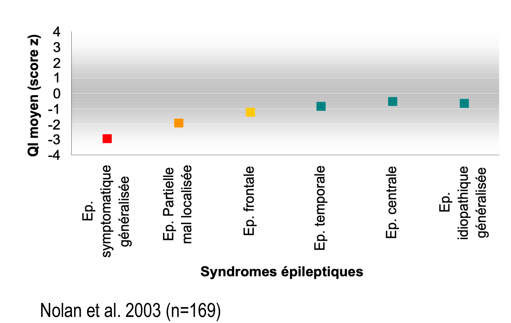

Pour les anti-épileptiques :

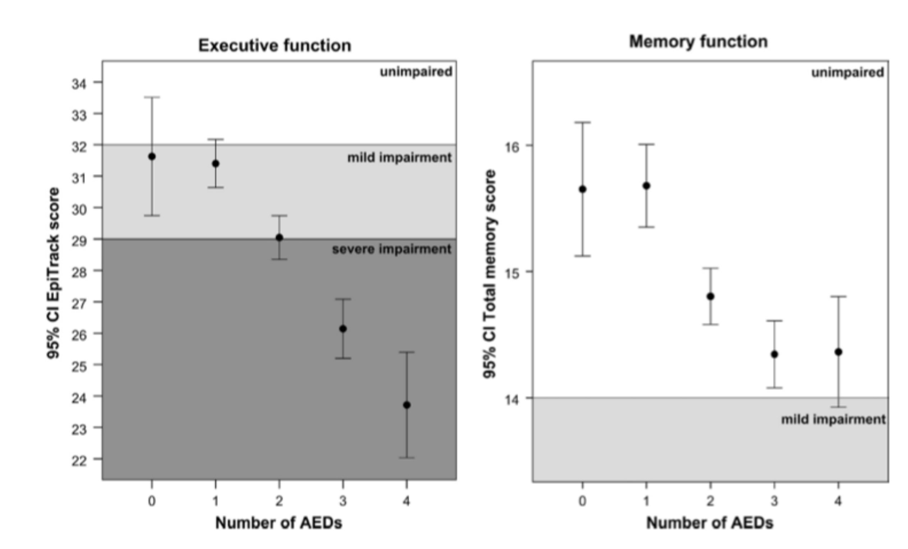

Effets des pointes :

- DMN affecté, disconnexion fronto-temporale, perte de créativité
- Beaucoup de comorbidités, dépression
- Apnée du sommeil
- TDAH surtout chez les enfants

Chirurgie est un succès quand on améliore la qualité de vie du patient. Et
adaptation spatiale plus dure. Très grave pour sans-abri car on dort pas pour se
protéger.

Expérience de Marcela sur la symptomatologie après stimulation, et à trouvé
plein d'effets :

- NPP: naming phonological paraphasia
- NSA: naming speech arrest
- NSMP: naming semantic and morphological paraphasia
- RCD: reading comprehension disorder
- RPA: reading paralexia
- RSA: reading speech arrest

Test de Wada aussi

--------------------------------------------------------------------------------

<!-- source: 3_avc.md -->

[[i_avc]] - [[ii_avc]]

On appelle "syndromes alternes" les syndromes avec un trouble moteur d'un côté
au visage et de l'autre à la jambe. Les troubles de la moelle épinière n'ont
aucun effet sur le visage.

**Diagnostic topographique** : l'objectif est de formuler un diagnostic clinique
fonctionnel et topographique, c'est-à-dire d'identifier la fonction perturbée et
le niveau anatomo-fonctionnel atteint (cortex, moelle épinière, nerf
périphérique...).

On peut plus ou moins placer sur la partie anatomique les lésions maintenant. Le
modèle le plus classique et simple de l'atteinte nerveuse est l'AVC, et quand on
parle d'ischémique, on parle de territoires extrêmement précis. Bien garder en
tête que les parties antérieures et postérieures sont irriguées par différentes
artères, ce qui va affecter les conséquences d'un AVC.

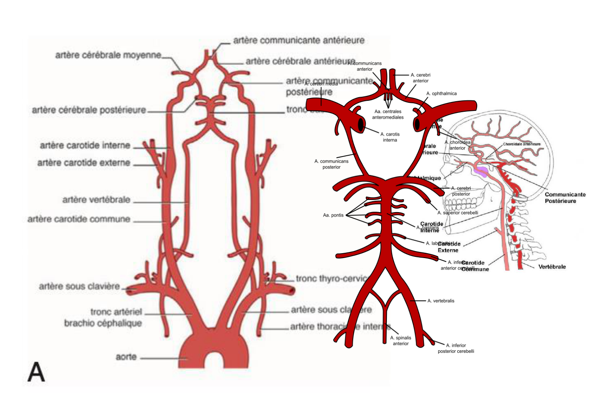

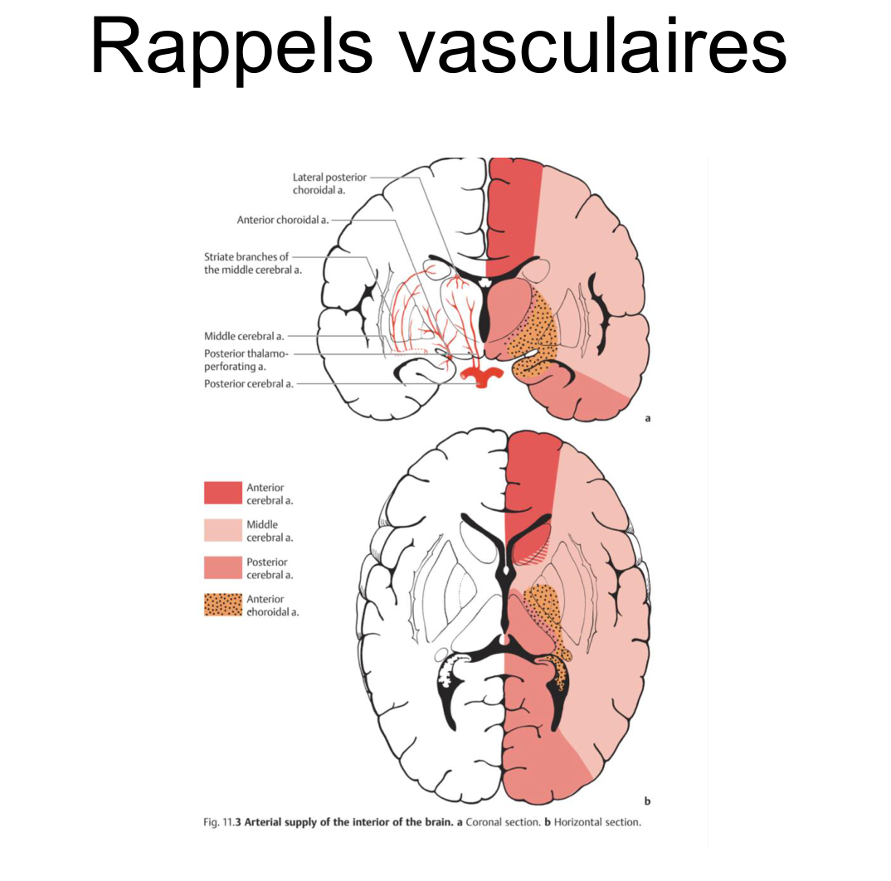

## AVC

**Artères à retenir** : les carotides, l'artère cérébrale antérieure (ACA),
l'artère cérébrale moyenne (ACM) et l'artère cérébrale postérieure (ACP). Il y a
des artères communicantes entre l'antérieur et le postérieur. L'ACM vient de
l'ACI (artère carotide interne) ; son territoire est étendu, souvent le tronc
principal. Atteinte : motrice (NMC), sensitive, trouble visuel.

### ACM superficiel antérieur

- Syndrome pyramidal : neurone moteur central. Déficit moteur controlatéral à
  prédominance brachio-faciale, anomalies du tonus et des ROT, signes
  pathologiques.
- Syndrome sensitif central, même topographie.
- Atteinte corticale : HG troubles du langage de type aphasie expressive (Broca)
  ; HD pas d'aphasie, mais trouble de l'attention et de la perception.

### ACM superficiel postérieur

- Sensitif et moteur : même chose que l'antérieur.
- HG : troubles du langage, aphasie réceptive (Wernicke).
- HD : similaire à gauche, trouble de la perception et de
  l'attention-négligence.

Exemple : infarctus sylvien total droit → hémiplégie gauche proportionnelle,
hypo/anesthésie gauche, HLH gauche, syndrome d'Anton-Babinski (héminegligence,
anosognosie, hémissomatognosie).

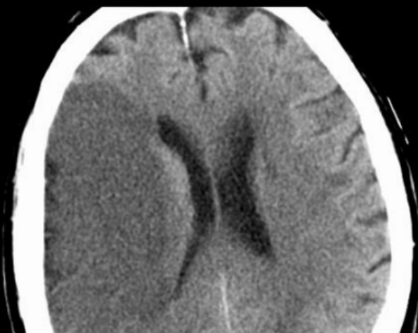

**Rappel aphasies** :

- Broca : expressive, non fluente, lobe frontal gauche ; compréhension
  relativement préservée, expression difficile. → ACM antérieur HG.
- Wernicke : réceptive, fluente, lobe temporal supérieur postérieur gauche ;
  discours fluide incompréhensible, difficulté à saisir des consignes simples. →
  ACM postérieur HG.
- Autres : aphasie de conduction, aphasie anomique.

### ACA

Surtout la jambe :

- Syndrome pyramidal (NMC) : déficit moteur controlatéral à prédominance
  crurale, anomalies du tonus et des ROT, signes pathologiques.
- Syndrome sensitif central, même topographie.
- Signes frontaux : grasping, troubles de la planification et de la
  programmation des actes moteurs, troubles du comportement.

### AVC du tronc

C'est très compliqué et ça ne suit pas trop ce qu'on connaît ; ce n'est pas
notre problème.

## Syndrome neurologique périphérique (neurogène)

Le syndrome neurologique moteur comprend le syndrome pyramidal, mais pour le
périphérique, il y a aussi une topographie précise, bien plus détaillée. Dans la
moelle épinière, les neurones moteurs passent par des plexus et arrivent jusqu'à
notre peau. On va faire un examen comme pour le syndrome pyramidal.

Diag différentiel de syndrôme central :

- Maladresse, sensation de gêne, de lourdeur...
- L'atteinte des nerfs périphériques fait que la topographie est plus complexe
  et la plainte peut être plus dispersée. À l'examen, le déficit moteur est plus
  localisé et s'accompagne d'une hypotonie. Le tonus est diminué.
- ROT abolis (aréflexie ostéo-tendineuse).
- Diminution du volume musculaire, atrophie (amyotrophie).
- On peut aussi avoir des crampes et des fasciculations : le contact muscle/nerf
  n'est plus direct, le muscle échappe au nerf et va avoir une activité réflexe
  indépendante. Ce sont donc des petites contractions causées par la
  dénervation, réagissant par exemple à la chaleur. Elles commencent souvent par
  les petits muscles.

**Électromyographie (ENMG)** : on met des électrodes, on stimule les nerfs et on
capte la vitesse de transmission pour voir si des nerfs dans certains
territoires sont endommagés ou non.

### Autres symptômes associés

- **Sensitif** : douleurs (décharges électriques, brûlures, douleurs dues aux
  crampes au repos), fourmillements, picotements.
- **SN autonome/végétatif** : téguments froids, tuméfiés, coloration violacée ;
  troubles urinaires ou de la sphère génitale ; hypotension orthostatique.
- **Troubles trophiques et signes végétatifs** : peau sèche, amincie, troubles
  vasomoteurs, œdèmes, ulcères perforants plantaires.

L'anesthésie/hypoesthésie n'apparaît pas dans l'atteinte de la corne antérieure
et de la racine antérieure, car elles s'occupent de la proprioception, pas de la
sensibilité.

**Donc le syndrome moteur périphérique** :

- déficit moteur plus localisé + hypotonie ;
- amyotrophie ;
- aréflexie ostéo-tendineuse / ROT abolis ;
- contractures / fasciculations ;
- +/- troubles sensitifs « subjectifs » (douleurs, paresthésies) et « objectifs
  » (hypo- ou anesthésie) ;
- +/- troubles végétatifs.

## SLA

**SNMP** (syndrome du neurone moteur périphérique) : est-ce que ça finit en
atrophie ? Oui : l'amyotrophie est typique. La main prend un aspect creux, puis
une main simienne, et l'atteinte motrice se généralise. Plein de choses sur les
doigts et même la langue qui cause du problème pour parler et avaler. Il y a des
muscles qui entourent les vaisseaux sanguins qui vont donc, eux aussi, souffrir.

La **sclérose latérale amyotrophique** (SLA ; maladie de Charcot, maladie de Lou
Gehrig) est une maladie neurodégénérative motrice incurable, de cause inconnue.

- 5 % de formes héréditaires à transmission autosomique dominante (SLA
  familiale, « gènes de susceptibilité »), mais la majorité est sporadique.
- Hypothèses : excès de glutamate, stress oxydatif, modification des canaux
  potassiques.
- Âge moyen de début : 55 à 60 ans (des cas < 40 ans).
- Pas de traitement.
- Peut être associée à une dégénérescence frontotemporale (DLFT).
- Lésions : dégénérescence progressive des structures motrices du SNC (M1, plus
  ou moins faisceau pyramidal) et du SNP (motoneurones spinaux et noyaux moteurs
  des nerfs crâniens).

**Symptomatologie (SNMC + SNMP)** : SNMC = syndrome du neurone moteur central
(pyramidal), SNMP = syndrome du neurone moteur périphérique.

Forme spinale (la plus fréquente) :

- début : déficit musculaire des petits muscles d'une main ;
- ensuite : fasciculations, crampes ;
- amyotrophie typique (SNP) : main creuse, main simienne → l'atteinte motrice se
  généralise ;
- membres inférieurs également touchés, mais c'est surtout le syndrome pyramidal
  qui prédomine.

Formes les plus graves à début et évolution bulbaire : généralement ça traîne
avant le diagnostic. L'atteinte du bulbe rachidien induit la gravité de la
maladie et reflète la diffusion du processus pathologique : paralysie des
muscles de la langue, des lèvres et du pharynx avec troubles de la phonation et
de la déglutition. Pas de troubles sensitifs. « Amaigrissement » par atrophie
musculaire massive. Fonctions cognitives intactes dans la plupart des formes,
soit des troubles cognitifs dans les formes associées DLFT + SLA. Évolution de
la maladie très rapide.

**SLA = atteinte motrice pure** : association d'un syndrome pyramidal et
neurogène. Clinique : ROT vifs, hypertonie et Babinski contrastent avec une
amyotrophie très importante.

--------------------------------------------------------------------------------

<!-- source: 4_syndromes_cognitifs.md -->

# CM4 Neuro Adulte

[Cours de
tessa](https://docs.google.com/document/d/1bi3k9Aq_9J-6W8w7cW8eoJUSS0V6BHT3YJgyNhe2oDQ/edit?tab=t.0)

Il faut pas savoir examen complémentaire, les crtières diangostiques aussi, les
tests c'est important, qu'est ce qu'ils mesurent, qu'est ce qu'on s'attend à
retrouver comme profil.

On commence par état de vigilance des patients et on va évaluer sa xognitino
avec des tests cognitifs. On va utiliser des des tests de **dépistage** qui
donnent un aperçu bref pour savoir s'il y a une pathologie.

## 1. Notions généalres des maladies neurodégénératives cognitives (MNDC)

Plusieurs facteurs :

- Causaux : génétiques
- Réserve cognitif et le capital vasculaire qui renforcent cette dernière
- Protecteurs : bonne reserve etc

Tous les facteurs qui causent des inflammations du cerveau vont diminuer la
réserve cognitive et vont exlpiquer la hausse de troubles avec l'âge et explique
la différence entre des patients qui vont avoir des conséquences plus ou moins
graves pour une même lésion.

Le **veillissement** normal est le fait qu'il est naturel d'observer une baisse
de plein de fonctions et atrophie du cortex cérébral avec l'âge. Démence est un
terme plus trop utilisé car stigmatisant est pas très clair. Maintenant on parle
de "trouble neurocognitif mineur ou majeur". La prévalence est de 5% et de plus
en plus grande.

On distingue les formes sporadiques (Alzheimer) et neurodégénératives, donc
origine génétique. Ces dernières sont des anomalies protéiques qui causent des
morts neuronales et progressent souvent trop avant qu'on les remarque. Résultent
souvent en une baisse d'autonomie du patient. Fort rôle des proches aidants

Dans Alzheimer, accumulation de $\beta$-amyltoïde (plaques extracellulaires) et
va empêcher communication entre jsp quoi et qui va inflammer les neurones et
conduire à des morts neuronales. Deuxième type d'anomalie proétique concerne
protéine Tau qui sert à la communication entre neurones, trop de phosphore s'y
connectent et on ne peut plus assurer le transport stable entre les cellules qui
entraîne des dégenérescences.

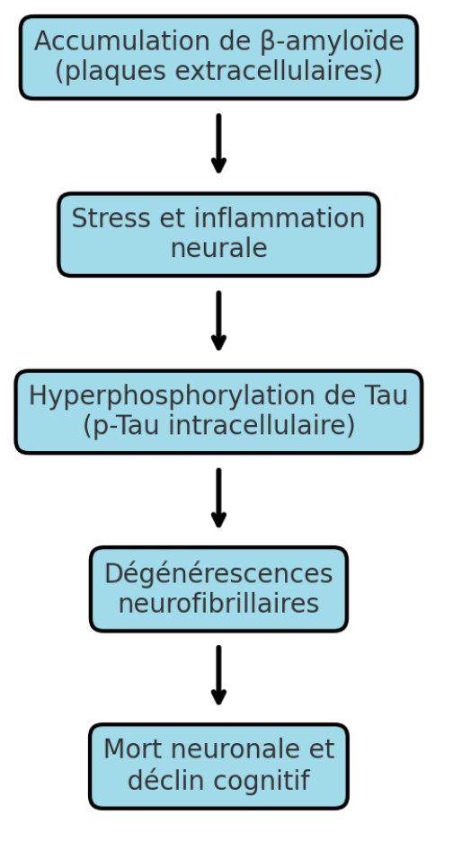

## 2. Triade diagnostique : stade (clinique)

Il est imporant d'avancer dans le diagnostique de ces maladies car il est
important de pouvoir identifier l'efficacité de traitements, ainsi qu'identifier
les sypmtômes pour mieux expliquer aux patients.

4 stades :

- Pré-symptomatique : sans plainte, biochimie modifiée
- Plainte cognitive isolée : remarque un changement dans le domaine cognitif,
  subjective car on ne retrouve rien sur un bilan
- Trouble cognitif mineur ou TCm : congitif léger, phase prodromale, altération
  objectivée chez un patient autonome dans la vie quotidienne
- Trouble cognitif majeur : altération avec autonomie altérée

On utilise stade et le score MMSE qui est une évaluation générale.

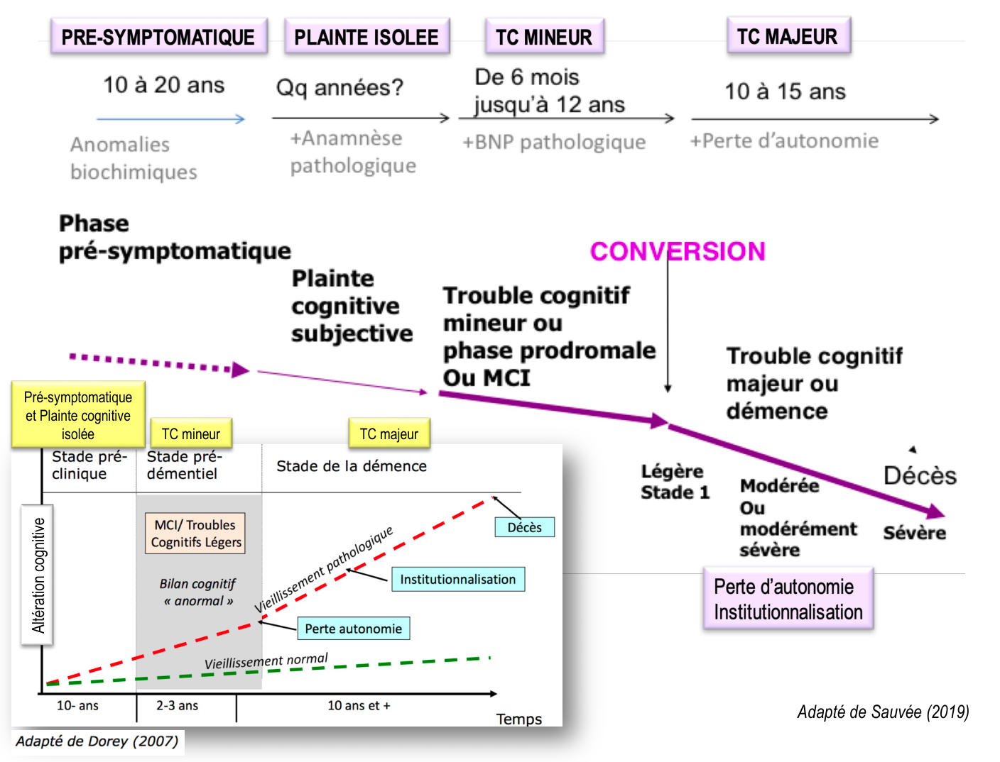

## 3. Triade diagnostique: syndrome (clinique)

Basée sur anamnèse, examen neurologie cognitif (tests) +/- BNPO selon sévérité
MMSE

- La présentation clinique est-elle à dominante cognitive ou comportementale ?
- Si présentation cognitive : quel domaine ? isolé, mixte, diffus? Idem pour
  comportementale

Entre clinique peut être plus ou moins dur selon le stade de la maladie et peut
nécessiter d'avoir un proche pour avoir des informations extérieures.

Entretien clinique : mode de vie/antécédents, anamnèse, autonomie et tests
cognitifs de dépistage

- Interroger patient et entourage (anosognosie, perte d'information du fait des
  troubles)
- Habitus :
- Entourage familial
- Logement
- Profession précédente si retraité, NSPINSC
- Antécédents personnels
- Facteurs de risque toxiques
- Antécédents familiaux neurologiques, psychiatriques et arbre généalogique
- Traitements actuels

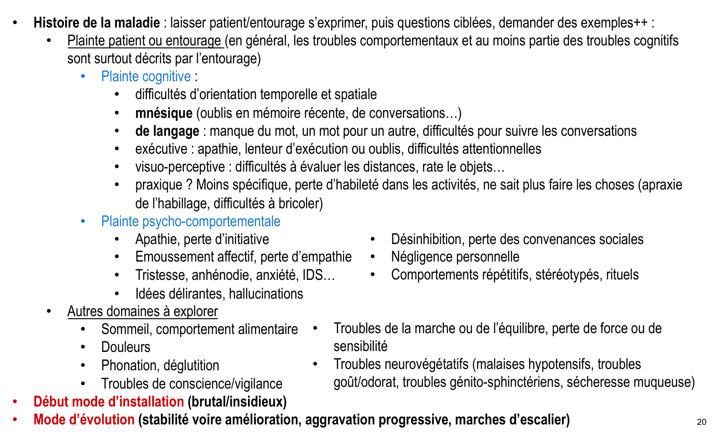

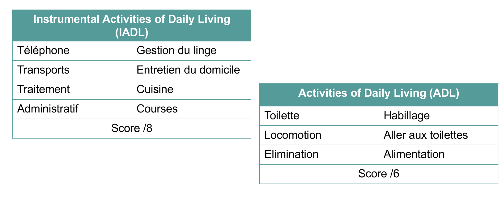

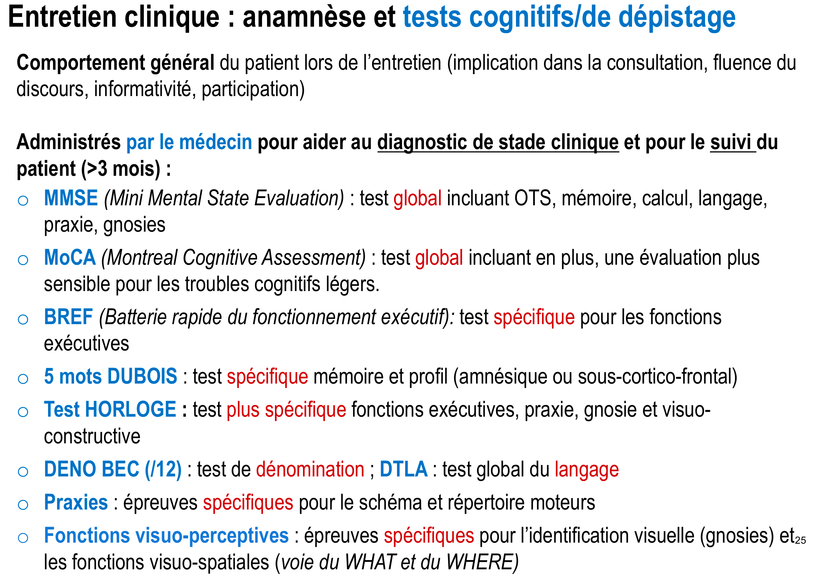

> WARN: Juste aller voire le diapo

## 4. Triade diagnostique : maladie (étiologie)

## 5. Classification MNDC, quelques exemples de MNDC

--------------------------------------------------------------------------------

<!-- source: 5_neuro_dulte.md -->

# CM5 Neuro Adulte

[[i_5_neuro_adulte]]

But des cours : présenter les syndromes neurologiques, on ne va pas beaucoup
voir les modèles et on ne sera pas interrogés dessus. Examen en situations
cliniques. On attend une maîtrise des termes de neuorpsycho et notre capacité à
pousser et réfléchir. Peu d'attentes sur les tests.

## 1. Généralités

La neuropsychologie s'inspire beaucoup de psychologie cognitive et la
neurologie. On ne va pas étudier le fonctionnement normal ou la pathologie, mais
particulièrement les dysfonctionnements des fonctions cognitives. Ingérence
aussi de psychologie clinique, par le biais de l'importance des émotions qui
peuvent perturber le fonctionnement cognitif.

On va étudier troubles cognitifs conséquents à un dysfonctionnement cérébral
chez l'adulte. Toutes celles là donnent des dysfonctions cérébrales :

- Maladies dégénératives et démences
- AVC (par ischémie, hémorragie), transitoire ou constitué
- Traumatismes crâniens
- Tumeurs cérébrales
- Maladies infectieuses
- Intoxications
- Ablations chirurgicales
- Maladies inflammatoires auto-immunes du SNC
- Anoxie cérébrale
- Pathologies psychiatriques

On évalue tout ça avec des tests, l'observation, l'entretien clinique. Le rôle
du neuropsychologue est de quantifier les capacités du patient, ce à quoi
servent les tests, qui permettent de placer la performance du patient par
rapport à une norme. On va aussi faire de la rééducation, ainsi que de la
recherche.

L'approche **anatomo-clinique** est intéressante, mais a pendant longtemps donné
une vision grossière, et qu'il n'y a jamais deux lésions identiques. Surtout,
tendance très localisationniste fonctionne mal, c'est-à-dire qu'on pensait que
les régions étaient indépendantes et régissaient qu'une fonction. Une approche
alternative s'est développée en pensant l'inverse, holistique. Maintenant, on
est associationniste, plusieurs réseaux reliés, avec spécialisations
hémisphériques et régionales.

Approche **cognitive** cherche à comprendre le fonctionnement normal par les
dysfonctionnements, que les pathologies peuvent dissocier les processus qui se
déroulent normalement de manière intégrée. Très basé sur les études de cas. Mais
on peut les critiquer, car ils avaient peu d'intérêt pour le cerveau, et que les
cas cliniques limitent les méthodes.

- Un **symptôme** est un signe représentant la manifestation par le médecin, il
  peut être objectif ou subjectif.
- **Étiologie** : causes d'une maladie
- **Physiopathologie** : mécanismes perturbant les fonctions organiques
- **Maladie** : altération par l'état de santé manifesté par ensemble de signe
  et symptômes observables par nous correspondant à des troubles généraux ou
  localisés, fonctionnels ou lésionnels, causes internes ou externe, avec
  évolution
- **Nosographie** : classification et description des maladies

Un trouble cognitif peut avoir plein de causes, et il faut le distinguer de la
plainte qui elle est rapportée. On distingue aussi le trouble de la fonction :
on parle de syndrome dysexécutif qui est différent des fonctions exécutives.

Distinguer troubles :

- Développemental : lié à la maturation cérébrale atypique
- Acquis : détérioration du fonctionnement cérébral malgré un développement et
  une maturation cérébrale normaux. Ils induisent une réduction ou perte d'une
  compétence ou capacité antérieurement acquise et développée

Différences entre trouble acquis évolutif ou non évolutifs.

## 2. Déficits consécutifs aux lésions des aires primaires

Hémianopsie est une cécité du champs visuel de chaque œil

FIX: diapo cécité corticale

--------------------------------------------------------------------------------

<!-- source: 6_aphasies.md -->

## Chapitre 5 : spécialisation hémisphérique - déficits consécutifs à des lésions de l'HG

- [[i_neuro_dulte]]
- [[ii_neuro_dulte]]
- [[iii_neuro_dulte]]
- [[iv_aphasies]]

La spécialisation hémisphérique veut dire que certaines fonctions sont traitées
préférentiellement par un hémisphère.

### 1. Les aphasies

Les aphasies sont des troubles du langage oral et écrit résultant d'une lésion
cérébrale acquise. Chez les droitiers, elle est consécutive à une lésion de
l'HG, et se distingue des :

- Défauts d'acquisition du langage
- Perturbations du discours (psychotiques, frontaux)
- Troubles de la parole (dysarthries)

L'efficience intellectuelle est préservée. Grosse variabilité. On observeu ne
dissociation **automatico-volontaire**..

### 1.1. Les signes

#### 1.1.1. En production orale

Général :

- Anomalie du débit de l'expression orale (fluence, fluidité) réduction ou
  accélérations
- Mutisme
- Stéréotypies variables
- Dysprosodie : monotonie, syllabation, parfois pseudo-accents
- Manque du mot

Transformations du langage oral :

- Transformations phonétiques : émission inadéquate de phonèmes, dans le sens
  d'une simplification articulatoire
- Paraphasies : mots pour d'autres
  - Phonémiques : addition, omission, déplacements de phonèmes
  - Sémantiques : un mot par un autre avec un rapport conceptuel
  - Verbales formelles : mot par un autre sur la forme
- Néologisme
- Jargonaphasie
- Agrammatisme & dyssyntaxie

Troubles de la répétitions :

- Répétition impossible
- Écholalie ou palialie
- Dysphasie phonologique : peut répéter les mots mais pas les logatomes
  (non-mots)
- Dysphasies profonde : répétition provoque la production de paraphasies
  sémantiques
- Dysphasie sémantique : répétition sans comprendre

#### 1.1.2. En compréhension orale

- Mauvais traitement phonétique du message
- Trouble de l'extraction de la valeur sémantique de l'information

### 1.2. Évaluation

#### 1.2.1. Production orale

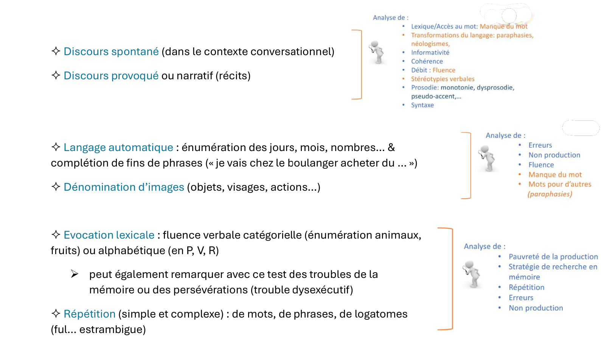

En compréhension orale


### 1.3. Différents types d'aphasies de base

Elles ont des points communs :

- Présence d'un manque dem ot
- Variabilité forte
- Dissociation automatico-volontaire (langage sur-appris, automatique, est mieux
  préservé)
- Persévérations ![[6_neuro_dulte 2026-10-30 13.52.23.excalidraw]]

#### 1.3.1. Aphasie de Broca

Trouble de la production orale du langage. C'est une aphasie d'expression :
déficit de la programmation des mouvements nécessaires à la production des sons
du langage.

Caractéristiques :

- Production très peu fluente
- Parole lente et syllabée
- Manque de mot très marqué
- Troubles arthritiques : de la réalisation des osns du langage, simplification
  de sons complexes
- Agrammatisme
- Répétition perturbée
- Compréhension plutôt préservée
- Conscience forte du trouble
- Aprosodie

Signes associé :

- Hémiplégie droite
- Apraxie bucco-faciale
- Dépression

#### 1.3.2. Aphasie de Wernicke

C'est un trouble de la compréhension orale et de l'expression du langage.
Trouble de compréhension et d'expression : réalisation des mots préservée, mais
problème dans le choix des mots

Caractéristiques :

- Production très fluente, pouvant aller jusqu'à la logorrhée, avec :
  - Paraphasies verbales : mot substitut existe mais n'aucun lien
  - Paraphasies sémantiques : même catégorie sémantique
  - Paraphasies phonémiques : même sonorité
  - Néologisme
  - Jargon : sémantique (mot pour d'autres), phonémiques (mots existants
    déformés) ou indifférenciés (stéréotypies)
- Articulation normale
- Répétition perturbée par les mêmes troubles
- Trouble fort de la compréhension
- Préservation de la prosodie et intonations

Signes associés :

- Anosognosie
- Hémianopsie homonyme D (lésion des radiations optiques)

Madame AM après ischémie sylvien gauche avec transformatoin hémorragique.
Symptômes de paraphasie, néologismes, compréhension orale lexical et
contextuelle commence à s'améliorer, altération majeure du graphisme. On dirait
qu'elle comprend certaines choses

#### 1.3.3. L'aphasie de conduction

Conduction : hésitant, mais surtout paraphasies phonémiques avec conduites
d'approche

La récupération se fait souvent sur la même temporalité que les AVC. Conduction
, > Broca > Wernicke, et on retrouve les mêmes troubles à l'écrit.

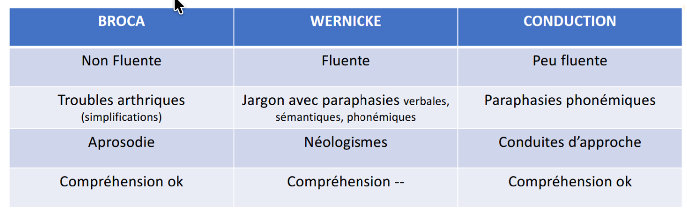

## 2. Les apraxies

### 2.1. Syndrome de Gerstmann

Syndrome de Gerstmann, historiquement, correspond à 4 symptomse :

1. Agraphie
2. Acalculie
3. Confusion droite/gauche
4. Anomie digitale

Il y aurait une anomie du schéma corporel, surtout doigts et main, à cause de
leur lien avec l'écriture. Mais les cas purs sont assez rares, et des
controverses apparaissent sur la localisation lésionnelle et la pertinence
clinique.

On propose plusieurs hypothèse :

- Déficit de mécanisme commun qui explique les symptômes
- Association des symptômes est un hasard du à la proximité d'aires cérébrales
  lésées, ce qui remet en question l'existene d'une entité syndromique

Pour la première, Gerstmann proposer que le syndrome est centré sur l'agnosie
digitale, qui explique le retentissement sur écriture, ???, et droite/gauche.
Pour Kinsbourne, c'est un déficit de la différentiation et de l'arrangement des
parties qui constituent un tout. Ardila, 2014, propose une perturbation des
opérations spatiales avec médiation verbale. L'agraphie est souvent le symptôme
qui manque, car il manque souvent, et donc voit plus ça comme une aphasie
sémantique.

Pour ceux qui sont en désaccord, on avance que le syndrome est rare est souvent
partiellement présente, et associé à d'autres déficits. Pour eux aucun modèle
cognitif expliquerai ces signes par sa dysfonction. Les études en stimulation
électrique cérébrale n'ont jamais reproduit les symptômes. Enfin, on localise
plutôt substance blanche pariétale, ça serait donc plus l'architecture
fonctionnelle du cerveau qui serait touchée.

La tétrade clinique plus en détail :

- L'agraphie peut es présenter de manière aphasie et apraxique
  - Substitutions de lettres pour d'autres
  - Mauvais arrangements spatial des lettres dans le mot
  - Difficulté à former les lettres
- Acalculie, mental & posé
- Indistinction droite/gauche
- Agnosie digitale

Évaluation :

- Agnosie digitale (NE DOIT PAS CONCERNER LES ORTEILS) :
  - Dénomination des doigts
  - Désignation
  - Identification
- Indistinction gauche/droite concerne uniquement le coprs (soi/autrui)
  - Lever la main droite
  - Mettre la main gauche sur l'oreille droite
  - test normé : personnage debout, couché, de face, de dos

### 2.2. Autres apraxies

Trouble d'origine cognitive qui affecte l'exécution des gestes volontaires,
appris ou élaborés dans un objectif donné. Plusieurs manifestations avec des
mécanismes divers :

- Apraxie bucco-faciale
- Apraxie de la marche
- Apraxie occulomotrice
- Apraxie de l'habillage
- Apraxie visuo-constructive

Certains la définissent par exclusion d'autres troubles uniquement, donc "on
sait pas trop ce que c'est". On peut quand même donner "**Déficit de la
gestualité intentionnelle et/ou du contrôle moteur en l'absence de déficits
sensori-moteurs, de troubles de la compréhension et de la détrioration mentale
importante**", parmis d'autres définitions. Très peu étudié.

Jackson, 1866, observe des difficultés majeures pour mouvoir les lèvres chez des
aphasiques alors que ça va parfaitement bien pour manger. Il y a donc une
dissociation. Liepmann, 1866, première définition, à partir d'un patient qui
pouvait pas faire certaines actions avec sa main droite, qu'il pouvait faire
avec la main gauche (important car ça enlève beaucoup de troubles). Première
étude de groupe aussi, selon les côté de l'AVC, et aucune apraxie pour AVC
droit, mais 20/47 ont apraxie du membre supérieur. En 1920 il propose qu'il y
aurait plusieurs étapes pour réaliser un gest : conceptuelle, puis productions,
et distingue 3 grandes formes d'apraxie :

- Idéatoire : touche la conception du geste, par lésion postérieure
- Idéomotrice : défaut de production, pas de conception
- Mélokinétique : perte de mémoire gestuelle liée à un membre

Geschwind rejet d'un centre idéatoire lcoalisé en aires postérieures, mais
existence de connexions entre centres sensoriels et moteurs. Apraxie est une
interruption dans la traduction des stimulations sensorielles e ninflux oteur.

Puis aux annés 80, on passe à une époque de modélisation cognitive et on laisse
de coté l'anatomie. On va s'intéresser aux étapes nécessaires pour produire un
gesste. Notamment, on garde 2 grands types de processus : conceptuels, et de
production. La praxie est donc un système complexe qui contient des étapes de
traitement, et implique des fonctions cognitives coordonnées.

Roy & Square modélisent 2 grands systèmes hiéarchisés en 3 inveaux

Vocabulaire clinique :

- Geste intransitif : sans rapport avec un objet ; et geste transitif : en
  rapport avec un objet même s'il n'est pas réllement présent
- Parmis les intransitifs : gests sans signification / gestes symboliques
- Gestes réflexifs
- Gestes non réflexifs
- Production de pantomimes (mimes d'utilisation d'objets)
- Utilisation réelle d'outils

Erreur du corps pris pour objet est un signe du rouble praxique, qu'en cas
d'exlpications claires des consignes.

Plein de méthodes d'évaluations, procédures empiriques, avec peu de bases
théoriques très définies, avec grande variabilité inter-individuelle de
performances chez les sujest normaux.

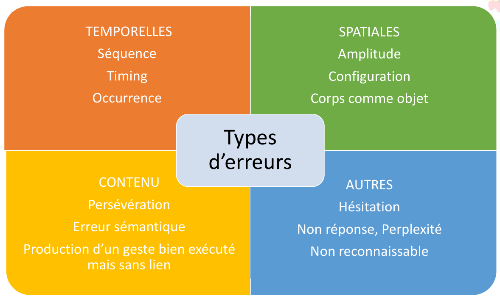

<!-- FIX: diapo Plusieurs types d'erreurs  -->

<!-- FIX: diapo sémiologie -->

--------------------------------------------------------------------------------

Étiologie, quelles sont les manifestations, localisations neuro-anatomiques,
approche basée sur le processus, question du diagnostique différentiel (y'a une
diapo)

Est-ce que le patient a un trouble pour réaliser des gestes volontaires ?

- Non -> pas d'apraxie
- Oui -> possible mais exclure aphasie et agnosie (comment ?)
  - Agnosie visuel apr déficit d'identification d'objets
  - Co-occurence fréquente avec aphasie, assurer son indépendance

Quel processus semble perturbé ? (Engrammes gsetuels, connaissance sur la
manipulation)

--------------------------------------------------------------------------------

<!-- source: 07_heminegligence.md -->

- [[i_hemianopsie]]

# CM7 Neuropsy

## Troubles conséctutifs à la lésion de l'HD

### 1. Héminégligence

[[07_hemianopsie_transcription]]

Pendant longtemps on le considérait mineur et émotionnel, en vérité plutôt la
cognition spatiale, naviguer un environnement 3D. Perception et action sont ind
ssociables. Ensemble de capacités ayant un rôle essentiel dans le
développement/fonctoinnement moteur, cognitif, émotionnel et social. L'HD n'est
donc pas du tout inutile.

Héminégligence est la négligence de l'esapce gauche après lésion droite. C'est
un trouble de l'utilisation et conscience de l'espace du côté opposé à la
lésion, mais aussi modification des actions dirigées envers celui-ci. Ensemble
de manifestations comportementaels reésultat de l'altération de la conscience
qu'à le pateint de ces perturbations. "*Difficulté à détecter, répondre,
s'orienter vers des stimuli signifiants ? ? ? ? ?*"

On décrit différents sous-types selon différents facteurs :

- Modalité sensorielle ou motrice
- Localisation dans l'espace
  - Personnel
  - Extrapersonnel proche
  - Extrapersonnel lointain
  - Espace imaginaire
- Cadre de référence spatiaux
  - Egocentrique
  - Allocentrique
- La nature des symptômes
  - Déficitaire (négative) : omission ou négligence
  - Produtive (positive) : dans l'espace ipsi-lésionnel

Donc on parle des négilgenc**es** au pluriel car il y a différentes
manifestations.

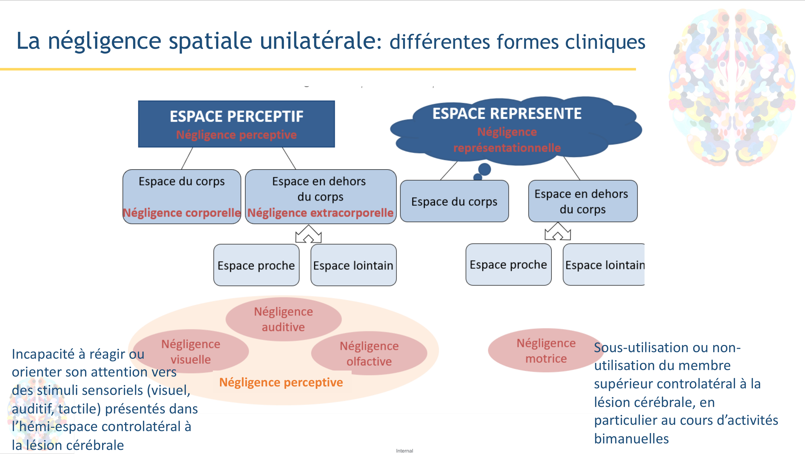

Dans les manifestations productives :

- Persévérations
- Allochirie : déplacement du côté de la lésion de la partie de l'objet qui
  aurait du être dessinée du côté contralésionel

Types de négligences perceptives et motrices :

- Négligence visuelle est l'absence de prise e ncompte des stimuli visuels de
  l'espace gauche
- Négligence auditive : patient ne réagir pas à une stimulation sonore ou
  verbale provenant de l'hémi-espace gauche
- Négligence motrice : sous utilisation de l'hémicorps gauche qui peut mimer une
  hémiparésie ou une hémiplégie
- Négligence personnelle ou corporelle : manque d'exploration ou de conscience
  de la partie contralésionnelle du corps ou de la face

![[0007_neuro_adulte 2026-11-12 16.30.16.excalidraw]]

![[0007_neuro_adulte 2026-11-12 16.39.56.excalidraw]]

  | Header               | Hémianopsie           | Négligence          |
  | -------------------- | --------------------- | ------------------- |
  | Déficit              | Sensoriel             | Cognitif            |
  | Atteinte             | Rétinotopique         | Égocentrique        |
  | Perception           | Atteinte              | Intacte             |
  | Poursuite oculaire   | Possible              | Limitée             |
  | Représentation       | Préservée             | Atteinte            |
  | Écriture             | Préservéee            | Incomplète          |
  | Compensation         | Possible              | Impossible          |
  | Bissection de lignes | biais controlésionnel | biais ipsilésionnel |

70% des cas, il y a une comorbidité hémianopsie + négilgence. **Important
d'apprendre comment les séparer.**

![[0007_neuro_adulte 2026-11-12 16.44.34.excalidraw]]

Tout ça c'était pour la négligence personne ou coporelle je crois

![[0007_neuro_adulte 2026-11-12 17.13.38.excalidraw]]

![[0007_neuro_adulte 2026-11-12 17.44.20.excalidraw]]

![[0007_neuro_adulte 2026-11-12 17.55.24.excalidraw]]

Mais beaucoup de dissociations, on pense donc qu'il pourrait y avoir différents
types de négligences.

![[0007_neuro_adulte 2026-11-12 18.03.13.excalidraw]]

J'ai pas écouté mais c'est pas grave je pense. En tout cas approche combinée de
rééducation marche toujours mieux qu'un moyen d'action seul.

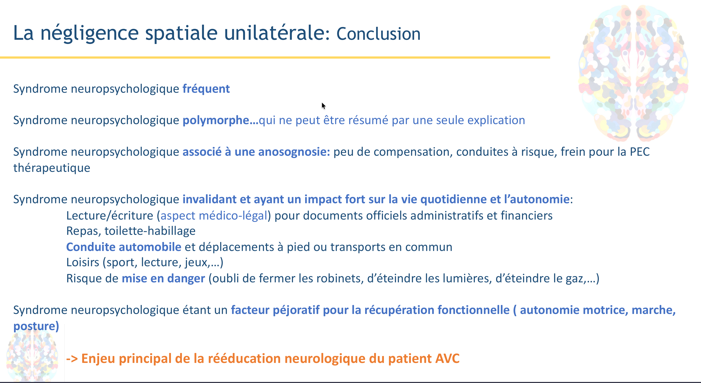

--------------------------------------------------------------------------------

Attentes pour l'examen :

- Pas connaître par cœur les épreuves
- Mais "Comment faire un diag différentiel entre négligence et hémianopsie ?" et
  on peut répondre par tâche expérimentale ou test clinique, même si on le sort
  de la tête tant qu'il marche
- Pas connaître localisations lésionnelles
- Manifestaitons
- Différents espaces
- Pas sur les prises en charges

--------------------------------------------------------------------------------

<!-- source: 08_deficits_hd.md -->

# CM8 Neurpsy de l'adulte

- [[i_deficits_hd]]
- [[ii_deficits_hd]]

### 2. Les troubles visuo-spatiaux

FIX: rattraper 15 minutes

Pariétal postérieur droit très impliqué pour les jugements de blablabla

Dans les épreuves visuo-spatiales, on s'attend à un déficit d'identification à
cause de ??? et on ne s'attend pas à la latéralisation des performances.

Effets de précédence locale/globale sont les capacités à identifier petites
lettres dans grandes lettres et inversement. On va manipuler la congruence. On
n'est pas sur du tout ou rien, on est sur de l'épuisement.

### 3. L'acalculie spatiale

Trouble du calcul consécutif à un défaut de la composante spatiale des calculs.
Donc surtout les calculs posés.

**Syndrome de Balindt** vient de l'association de 3 symptômes :

- **Simultagnosie** : difficulté à percevoir plusieurs objets en même temps
- **Apraxie du regard** : incapacité à orienter volontairement le regard vers un
  stimulus dans le champ périphérique. Errance et ralentissement du regard assez
  caractéristique. **Dissociation automatico-volontaire**. Épuisement.
- **Ataxie optique** : difficulté ou imprécision de réalisation des gestes
  perceptuellement guidés

Lésion pariétale postérieure et jonction pariéto-occipitale. Souvent bilatéral,
peut-être conséquence d'AVC, de dégénérescence.

Évaluation de la simultagnosie : épreuve de la scène là

### 4. Apraxies par lésion droite

#### 4.1. Apraxie constructive

**Habilités praxiques constructives** : capacité à construire des structures
complexes en positionnant les éléments les constituant dans des rapports
spatiaux correctes et réciproques. L'**apraxie constructive** serait une
altération de ces capacités en l'absence de déficit perceptif ou moteur
primaire. Mais il faut évaluer avant les déficits d'exploration visuelle tels
que la **NSU ou simultagnosie**, qui n'exclue pas le trouble pour autant, mais
pouvant se confondre.

On évalue par des tâches de dessin copié ou spontané. La manière dont le patient
fait la construction de son dessin donne des indications sur certains processus.
Je sais pas si j'ai bien pris la note la. Incapacité à construire une forme
(dans le plan et dans l'espace).

Persévération c'est une perturbation exécutive par excellence, même dans les
aphasies. La patiente semble pouvoir identifier le visage

#### 4.1. Apraxie d'habillage

Apraxie d'habillage est une incapacité ou difficulté à s'habiller par perte de
la composante spsatiale qui intervient dans l'habillage. Difficulté à
**orienter** les vêtements / corps. Concerne que ça.

### 5. Troubles des référentiels spatiaux

#### 5.1. Généralités

Y'a pas de stimulus direct ou récepteur spatial spécifique pour déterminer la
position dans l'espace. On utilise donc une intégration multisensorielle.

On a longtemps considéré à tort de système vestibulaire comme l'organe de
l'orientation ce n'est pas du tout le seul :

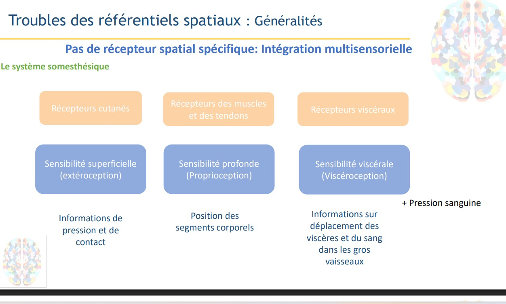

Toutes les informations sont traitées dans le SNC dans la notion de **cadre de
référence spatiale** : e sont des systèmes de coordonnées spatiales pour repérer
notre position et situation. Pour simplifier, on a le référentiel **égocentré**
et **allocentré**.

**LIEN TRÈS FORT ENTRE PERCEPTION ET ACTION c'est l'intérêt du cours**. Donc, on
a de l'intégration sensorielle, le centre d'intégration est dans le cerveau, et
permet des réponses posturales et représentations spatiales de l'espace, qui
permet la posture, qui permet locomotion, navigation, action motrice,
perception.

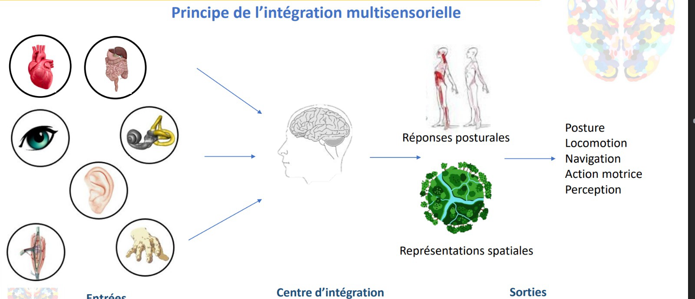

FIX: sens de verticalité

On mesure ce sens de verticalité dans l'obscurité absolue pour ne pas avoir
d'indices pour ce qu'est la verticale. On peut donc évaluer la représentation.
La **verticale posturale** est évaluée par un dispositif qui tourne le corps et
le sujet doit évaluer dans quelle position il est mis pour qu'il soit bien
vertical. On doit estimer deux indices : un indice d'orientation (est-ce qu'il y
a un biais d'inclinaison ?) ou d'incertitude (quelle est la robustesse de la
représentation) ?

Les normes pour la verticale visuelle ou posturale sont entre [-2.5º; 2.5º].

C'est une tâche dite purement perceptive, car il n'y a aucune dynamique, rien ne
bouge., on évalue que le somesthésique. La rotation doit être vraiment passive.

On fait souvent les 2 évaluations de verticale visuelle et posturale, car elles
évaluent différentes composantes de la construction vé verticalité. La première
vestibulaire, et l'autre dimension somesthésique. Il y a aussi la dimension
visuelle

//

On intègre maintenant troubles de verticale spatiale aux troubles de la posture,
comme la rétropulsion qu'on observe chez les personnes âgées.

Dans Parkinson, on peut avoir le syndrome de Pise qui ont une inclinaison.

Certains patients AVC ont un biais d'écriture où ils écrivent trop vers le haut,
qui pourrait s'expliquer par un biais de verticalité.
